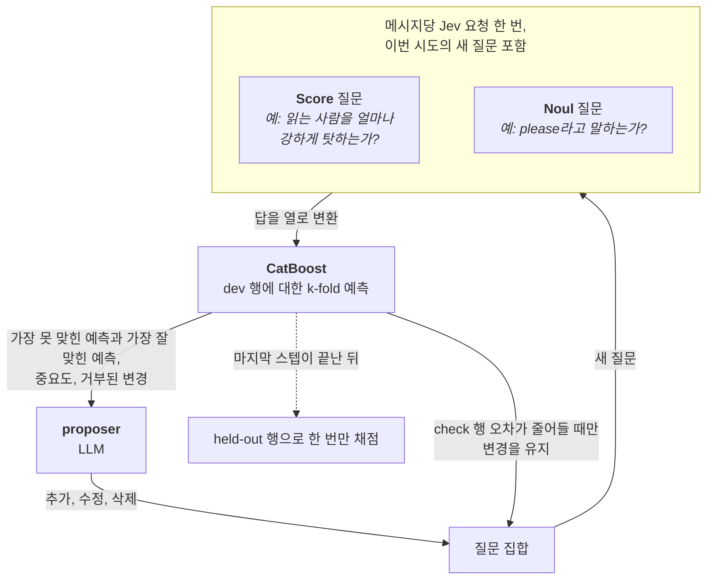

# Autoresearch feature 탐색

> 레이블이 붙은 텍스트에 대해 LLM이 질문을 제안하고, Jev가 모든 행에 대해 그 질문에 답하고, 그 답으로 CatBoost를 학습시킨 뒤, CatBoost가 틀린 부분을 다음 스텝에 되먹입니다. 예제에서는 Wikipedia 편집자들이 남긴 요청이 얼마나 공손하게 읽히는지 예측합니다.

사람들은 어떤 메시지를 얼마나 공손하다고 느낄까요? 이 cookbook(예제 모음)에서는 Wikipedia
편집자들이 서로의 토론 페이지에 남긴 요청 2,000건을 사용합니다. 요청마다 다섯 사람이 공손함을
평가한 평점이 붙어 있습니다.

대조군으로, CatBoost 회귀 모델(그레이디언트 부스팅 트리)을 원문 텍스트로 학습시킵니다. 이때
메시지를 그 안에 든 단어로 표현하는 CatBoost의 기본 텍스트 feature(특성)를 씁니다. 이 모델의
오차는 항상 평균 평점을 예측하는 경우보다 11% 낮을 뿐입니다. 메시지에 어떤 단어가 들어 있는지는
그 메시지가 얼마나 공손하게 읽히는지를 거의 알려 주지 못한다는 뜻입니다.

이 cookbook에서는 proposer(제안자) 역할을 맡은 LLM이 메시지에 대한 질문을 작성합니다. Jev가
모든 메시지에 대해 모든 질문에 답하고, CatBoost가 그 답으로 학습합니다. 그러면 CatBoost는
어떤 질문을 사용했는지, 어떤 메시지를 여전히 틀리는지 보고합니다. proposer는 이 보고를 읽고
질문을 어떻게 바꿀지 제안합니다. 변경은 CatBoost의 예측이 나아질 때만 유지되며, 유지된 변경
하나가 루프의 한 스텝입니다.



아래 표는 각 방식을 RMSE로 채점한 결과입니다. RMSE는 예측이 평점 척도에서 얼마나 빗나가는지를
나타내며, 크게 빗나갈수록 더 무겁게 반영됩니다. 낮을수록 좋습니다. 모든 수치는 루프가 한 번도
보지 못한 요청 800건에서 나온 것입니다.

| 메시지를 평점으로 바꾸는 방법 | RMSE |
| - | - |
| 학습 행의 평균 평점을 예측 | 0.788 |
| 대조군: 같은 CatBoost가 원문 텍스트를 읽음 | 0.703 |
| Jev에 평점 자체를 묻고, 학습 행에 직선을 맞춤 | 0.492 |
| proposer의 첫 호출에서 나온 질문 16개, 루프 없음 | 0.471 |
| **루프를 다섯 스텝 돌린 뒤의 질문 20개** | **0.456** |

대부분의 성과는 proposer의 첫 호출에서 나옵니다. proposer는 공손함 연구에 관해 아무것도 듣지
못한 상태에서 감사와 칭찬, 사과와 hedging(완곡 표현: 누그러뜨린 말투), 인사, 간접적으로
부탁하기("would you be willing to…"), 요청을 "we"가 함께 하는 일로 표현하기에 관한 질문을
작성했습니다. 이 말뭉치를 다룬 2013년 연구는 이 각각에 해당하는 feature를 손으로 만들었습니다.
이후 네 스텝은 오차를 0.015, 약 3% 더 낮췄습니다. 그중 한 스텝은 "please"와 그 비슷한 예의
표현에 관한 질문을 추가했는데, 이 역시 그 연구의 feature 가운데 하나로, 첫 호출이 놓친
것이었습니다. 루프는 proposer가 절대 읽지 않는 행에서 오차가 낮아질 때만 변경을 유지하므로,
스텝 1 이후 proposer가 제안한 것 대부분을 거부했고 질문 20개로 끝났습니다.

끝까지 따라 하면 레이블이 붙은 여러분의 텍스트에 돌릴 수 있는 루프, 스텝별 held-out(홀드아웃:
학습에서 떼어 둔) 오차 곡선, 최종 모델이 어떤 질문을 가장 많이 사용했는지 보여 주는 표를
얻습니다.

> [!TIP]
>
> 이 노트북을 더 발전시키거나 다른 문제에 적용하려면
> [다음 단계](#next-steps)를 참고하세요.

```python
from __future__ import annotations

import json
import os
import random
import textwrap
import urllib.request
from concurrent.futures import ThreadPoolExecutor
from pathlib import Path
from time import perf_counter
from typing import NamedTuple

import matplotlib
import matplotlib.pyplot as plt
import numpy as np
from catboost import CatBoostRegressor
from cooksafe import JsonCache, make_playground_link
from IPython.display import Markdown, display
from typesafe_sdk import Noul, NoulCriteria, Score, TypeSafeClient

matplotlib.use("Agg")  # 헤드리스 렌더링

TYPESAFE_MODEL = "jev-1.14.0"  # 이 페이지에서 쓴 모델. "jev-latest"는 최신 모델을 실시간으로 실행합니다
FOLDS, REPEATS = 5, 3  # 이 표본 크기에서는 반복해야 오차가 안정됩니다
CATBOOST = dict(
    iterations=400,
    depth=4,
    learning_rate=0.05,
    loss_function="RMSE",
    verbose=0,
    random_seed=0,
    thread_count=1,
    allow_writing_files=False,
)

client = TypeSafeClient(
    # 키가 없는 커널은 캐시를 재생합니다
    api_key=os.environ.get("TYPESAFE_API_KEY", "cache-only"),
    base_url=os.environ.get("TYPESAFE_ENDPOINT"),
    timeout=120.0,
)

EXAMPLES_URL = (
    "https://raw.githubusercontent.com/typesafe-ai/typesafe-public-examples/main/"
    "cookbooks/autoresearch_feature_discovery"
)


def download(name: str) -> Path:
    """Fetch one of this cookbook's files from typesafe-public-examples unless it is on disk."""
    path = Path(name)
    if not path.exists():
        urllib.request.urlretrieve(f"{EXAMPLES_URL}/{name}", path)
    return path


CACHE = Path("autoresearch_feature_discovery_cache.json")
# True 이면 공개된 답으로 CACHE 를 채우므로 실행 중에 요청을 보내지 않습니다. 실시간으로
# 실행하려면 False 로 바꾸고 CACHE 를 삭제하세요. 디스크에 이미 있는 CACHE 는 덮어쓰지 않습니다.
DOWNLOAD_CACHE = True
if DOWNLOAD_CACHE:
    download(CACHE.name)
json_cache = JsonCache(CACHE)

# ----------------------------------------------------------------- 명세

INTENSITY_LEVELS = [
    "Not present in this message at all",
    "Barely present - a single small trace",
    "Present at a moderate level",
    "Present strongly - it marks the whole message",
    "Dominant - the message is defined by it",
]
PRESENCE_CRITERIA = NoulCriteria(
    true="The message shows this or clearly implies it",
    false="The message gives no indication of this",
)

# 평점을 곧바로 묻는 경우: 적대적인 것부터 정중한 것까지 열 개 구간.
SCORE_LEVELS = [
    "Insults the reader or is openly hostile",
    "Curt and accusing, with no courtesy at all",
    "Blunt and demanding",
    "Abrupt, a bare question or order with no softening",
    "Neutral and businesslike",
    "Plain but carries a small courtesy",
    "Friendly, with some softening or thanks",
    "Warm and considerate of the reader",
    "Very courteous, thanking or apologising and asking gently",
    "Exceptionally gracious and deferential",
]

# 구조화된 출력은 모든 속성이 `required`에 있어야 하므로, 쓰지 않는 필드는 빈 값으로 돌아옵니다.
PROPOSAL_SCHEMA = {
    "type": "object",
    "properties": {
        "actions": {
            "type": "array",
            "items": {
                "type": "object",
                "properties": {
                    "op": {"type": "string", "enum": ["add", "revise", "drop"]},
                    "target": {"type": "string"},
                    "name": {"type": "string"},
                    "kind": {"type": "string", "enum": ["intensity", "presence"]},
                    "question": {"type": "string"},
                },
                "required": ["op", "target", "name", "kind", "question"],
                "additionalProperties": False,
            },
        }
    },
    "required": ["actions"],
    "additionalProperties": False,
}

PROPOSALS = 18  # proposer가 호출 한 번에 반환할 수 있는 action 수

# 이 작업이 공손함에 관한 것임을 아는 유일한 문자열입니다. 여러분의 레이블과 텍스트에 맞게 바꾸세요.
PROPOSER_TASK = f"""You are designing numeric features for a gradient-boosting model that
predicts how polite a request reads: the average of five people's ratings, normalised so that
0 is typical, negative is less polite and positive is more polite (most fall between -2 and 2).
Each message is a request one Wikipedia editor left on another editor's talk page. The model
sees nothing but the features you design.

Return up to {PROPOSALS} actions. Each action is one of:

- {{"op": "add", "target": "", "name": ..., "kind": ..., "question": ...}}
  A new feature.
- {{"op": "revise", "target": <name of an existing feature>, "name": ..., "kind": ...,
  "question": ...}}
  Replace that feature's question with better wording. Use this when a feature measures the
  right thing badly: too narrow, too vague, or worded so nearly every message answers the same.
- {{"op": "drop", "target": <name of an existing feature>, "name": "", "kind": "intensity",
  "question": ""}}
  Remove a feature that is not earning its place.

`kind` is "intensity" for something with a degree, or "presence" for a yes/no fact.
`question` is what gets asked about one message.

An "intensity" question is graded against this fixed five-level rubric, so word it so that the
levels make sense:
{chr(10).join(f"  {i}. {level}" for i, level in enumerate(INTENSITY_LEVELS))}

A "presence" question is answered as the probability that it is true of the message.

Good features can be judged from the message's own words, vary from message to message, and
carry information about politeness that the other features do not. Raters react to word choice,
how the writer frames the request, how they address the reader, and what they say about the
reader.

Write every question in your own words. Do not quote or closely paraphrase any one example
message in a question, not even as an "e.g.": describe the pattern it shows instead. Common words
and stock phrases that many messages use may still be named."""


class Split(NamedTuple):
    """The rows, their labels, and which rows each part of the loop may use."""

    messages: list[str]
    scores: np.ndarray
    dev: np.ndarray  # 모델이 학습하는 행
    read: np.ndarray  # proposer가 볼 수 있는 dev 행
    check: np.ndarray  # 각 변경을 판정하는 dev 행. proposer는 절대 보지 못합니다
    test: np.ndarray  # 떼어 둔 행. 마지막에 한 번만 채점합니다


# ----------------------------------------------------------------- 데이터

DATA = Path("wikipedia_politeness.json")
DATA_URL = (
    "https://raw.githubusercontent.com/typesafe-ai/typesafe-public-examples/main/"
    "cookbooks/autoresearch_feature_discovery/wikipedia_politeness.json"
)


@json_cache
def load_slice(n_dev: int, n_test: int, seed: int) -> dict:
    """Read the corpus and take a seeded sample of message + rating, one row per message."""
    if not DATA.exists():
        urllib.request.urlretrieve(DATA_URL, DATA)
    rows, seen = [], set()
    for row in json.loads(DATA.read_text(encoding="utf-8")):  # 글자 그대로 중복되는 요청이 몇 건 있습니다
        if not row["text"] or row["text"] in seen:
            continue
        seen.add(row["text"])
        rows.append((row["text"], float(row["score"])))
    random.Random(seed).shuffle(rows)
    picked = rows[: n_dev + n_test]
    return {"messages": [r[0] for r in picked], "scores": [r[1] for r in picked]}


def example_rows(split: Split, out_of_fold: np.ndarray | None, n: int) -> list[int]:
    """Select the rows a proposal call reads, from the rows the proposer may see."""
    read = split.read
    if out_of_fold is None:
        ranked = read[np.argsort(split.scores[read], kind="stable")]
        return [int(ranked[round(q * (len(ranked) - 1))]) for q in np.linspace(0, 1, n)]
    error = np.abs(split.scores[read] - out_of_fold[read])
    order = np.argsort(-error, kind="stable")
    worst = [int(read[i]) for i in order[: n // 2]]
    best = [int(read[i]) for i in order[len(order) - (n - n // 2) :]]
    return worst + best


def example_block(
    rows: list[int],
    split: Split,
    out_of_fold: np.ndarray | None,
    previous: np.ndarray | None = None,
) -> str:
    """Format selected rows for the proposer."""
    if out_of_fold is None:
        head = "Example messages, with the rating each one was given:"
        body = [f"- rated {split.scores[r]:+.2f}: {split.messages[r]}" for r in rows]
        return head + "\n" + "\n".join(body)

    head = (
        "Dev messages, worst-predicted first. The first half is where your current questions "
        "miss by the most and the second half is where they are already right, so what "
        "separates the halves is what the questions have not captured."
    )
    if previous is not None:
        head += (
            " Each line also shows what the previous step predicted, so you can see which "
            "messages your last kept change moved."
        )
    body = []
    for r in rows:
        line = f"- rated {split.scores[r]:+.2f}, predicted {out_of_fold[r]:+.2f}"
        if previous is not None:
            line += f" (last step {previous[r]:+.2f})"
        body.append(f"{line}: {split.messages[r]}")
    return head + "\n" + "\n".join(body)


def load_split(n_dev: int, n_test: int, n_check: int, seed: int = 0) -> Split:
    # 키워드 인자로 넘깁니다. 캐시 키가 함수 이름과 각 인자를 적은 방식으로 만들어지기 때문입니다
    data = load_slice(n_dev, n_test, seed=seed)
    return Split(
        messages=data["messages"],
        scores=np.array(data["scores"]),
        dev=np.arange(n_dev),
        read=np.arange(n_dev - n_check),
        check=np.arange(n_dev - n_check, n_dev),
        test=np.arange(n_dev, n_dev + n_test),
    )


# ----------------------------------------------------------------- proposer


def proposal_prompt(
    examples: str, feedback: str, accepted: list[dict], rejected: list[str]
) -> str:
    parts = [PROPOSER_TASK, "\n" + examples]
    if accepted:
        parts.append(
            "\nThe features you have now. `add` must not duplicate one of these; `revise` and "
            "`drop` refer to one by name:\n"
            + "\n".join(
                f"- {f['name']} ({f['kind']}): {f['question']}" for f in accepted
            )
        )
    if feedback:
        parts.append("\nHow the model did with those features:\n" + feedback)
    if rejected:
        parts.append(
            "\nChanges already tried and turned down, with the cross-validated RMSE before "
            f"and after. A change has to lower it by at least {MIN_GAIN}. Do not propose "
            "these again, or close variants of them:\n" + "\n".join(rejected)
        )
    return "\n".join(parts)


@json_cache
def propose(call: int, prompt: str, proposer: str) -> dict:
    """One proposal call. Every number in `prompt` is rounded so a replay hits the cache."""
    if proposer.startswith("claude"):
        import anthropic

        response = anthropic.Anthropic(
            api_key=os.environ.get("ANTHROPIC_API_KEY", "cache-only")
        ).messages.create(
            model=proposer,
            max_tokens=16000,
            output_config={
                "effort": "medium",
                "format": {"type": "json_schema", "schema": PROPOSAL_SCHEMA},
            },
            messages=[{"role": "user", "content": prompt}],
        )
        body = next(block.text for block in response.content if block.type == "text")
        usage = [response.usage.input_tokens or 0, response.usage.output_tokens or 0]
    else:
        from openai import OpenAI

        response = OpenAI(
            api_key=os.environ.get("OPENAI_API_KEY", "cache-only")
        ).chat.completions.create(
            model=proposer,
            reasoning_effort="high",
            max_completion_tokens=16000,
            response_format={"type": "json_object"},
            messages=[
                {
                    "role": "user",
                    "content": prompt
                    + "\n\nReply with JSON matching this schema:\n"
                    + json.dumps(PROPOSAL_SCHEMA),
                }
            ],
        )
        body = response.choices[0].message.content
        usage = [response.usage.prompt_tokens, response.usage.completion_tokens]
    return {"actions": json.loads(body)["actions"][:PROPOSALS], "usage": usage}


def slug(name: str, taken: set[str]) -> str:
    """Names become question ids and column labels, so keep them plain and unique."""
    base = (
        "".join(c if c.isalnum() else "_" for c in name.lower()).strip("_") or "feature"
    )
    candidate, n = base, 2
    while candidate in taken:
        candidate, n = f"{base}_{n}", n + 1
    return candidate


def to_candidates(actions: list[dict], accepted: list[dict], tag: str) -> tuple:
    """Split a proposal's actions into questions to answer and a list of names to drop."""
    live = {f["name"] for f in accepted}
    drops = [a["target"] for a in actions if a["op"] == "drop" and a["target"] in live]
    replacing = {
        a["target"] for a in actions if a["op"] == "revise" and a["target"] in live
    }
    # 수정안은 자신이 대체하는 이름을 그대로 써도 됩니다. 그 feature는 어차피 빠질 것이기 때문입니다
    taken, candidates = live - replacing, []
    for action in actions:
        if action["op"] == "drop":
            continue
        if action["op"] == "revise" and action["target"] not in live:
            continue  # 존재하지 않는 것에 대한 수정안
        name = slug(action["name"], taken)
        taken.add(name)
        candidates.append(
            {
                "id": f"{name}@{tag}",  # 고유하므로 이전 시도의 열이 그대로 남습니다
                "name": name,
                "kind": action["kind"],
                "question": action["question"],
                "replaces": action["target"] if action["op"] == "revise" else "",
            }
        )
    return candidates, drops


# ----------------------------------------------------------------- 답


def feature_questions(features: list[dict]) -> dict:
    questions = {}
    for feature in features:
        if feature["kind"] == "intensity":
            questions[feature["name"]] = Score(
                instructions=feature["question"], criteria=INTENSITY_LEVELS
            )
        else:
            questions[feature["name"]] = Noul(
                instructions=feature["question"], criteria=PRESENCE_CRITERIA
            )
    return questions


@json_cache
def answer(message: str, questions_json: str, model: str) -> dict:
    """One request per message, with every new question of the try. Keeps every probability."""
    questions = json.loads(questions_json)
    started = perf_counter()
    # 텍스트는 질문이 가리키는 표현과 일치하는 이름의 키 아래에 넣습니다
    response = client.system_one(
        state={"message": message}, questions=questions, model=model
    )
    raw = {}
    for name, question in questions.items():
        got = response.answers[name]
        if question["type"] == "score":
            raw[name] = [
                got.probabilities.get(i, 0.0) for i in range(len(question["criteria"]))
            ]
        else:
            raw[name] = [got.noul]
    return {
        "raw": raw,
        "seconds": round(perf_counter() - started, 2),
        "input_tokens": response.usage.input_tokens or 0,
        "output_tokens": response.usage.output_tokens or 0,
    }


def featurize(messages: list[str], features: list[dict]) -> dict:
    """Answer one question set for many messages: one request each, four in flight."""
    questions = feature_questions(features)
    payload = json.dumps(
        {name: q.model_dump(mode="json", exclude_none=True) for name, q in questions.items()}
    )
    with ThreadPoolExecutor(max_workers=4) as pool:
        results = list(
            pool.map(lambda message: answer(message, payload, model=TYPESAFE_MODEL), messages)
        )
    return {
        f["name"]: np.array([r["raw"][f["name"]] for r in results], dtype=float)
        for f in features
    }


def encode(feature: dict, probabilities: np.ndarray, mode: str) -> list[tuple]:
    """Turn one question's probabilities into named columns."""
    name = feature["name"]
    if feature["kind"] == "presence":
        return [(name, probabilities[:, 0])]  # 숫자 하나가 전부입니다
    levels = np.arange(probabilities.shape[1])
    mean = probabilities @ levels
    if mode == "mean":
        return [(name, mean)]
    if mode == "mean_spread":
        variance = probabilities @ (levels**2) - mean**2
        return [(name, mean), (f"{name}_sd", np.sqrt(np.clip(variance, 0, None)))]
    return [(f"{name}_p{i}", probabilities[:, i]) for i in levels]


def design(features: list[dict], answers_for: dict, mode: str) -> tuple:
    """Stack every feature's columns into one matrix, plus a label per column."""
    columns, labels = [], []
    for feature in features:
        for label, column in encode(feature, answers_for[feature["id"]], mode):
            columns.append(column)
            labels.append(label)
    return np.column_stack(columns), labels


def plain(features: list[dict]) -> list[dict]:
    """What goes on the wire and into the cache key: no id, no bookkeeping."""
    return [
        {"name": f["name"], "kind": f["kind"], "question": f["question"]}
        for f in features
    ]


# ----------------------------------------------------------------- 학습


def rmse(y: np.ndarray, p: np.ndarray) -> float:
    return float(np.sqrt(np.mean((y - p) ** 2)))


def spearman(a: np.ndarray, b: np.ndarray) -> float:
    """Rank correlation: does the model order the messages the way the raters did?"""
    ranks = (
        np.argsort(np.argsort(a)).astype(float),
        np.argsort(np.argsort(b)).astype(float),
    )
    return float(np.corrcoef(*ranks)[0, 1])


def folds(y: np.ndarray, k: int, seed: int) -> list[np.ndarray]:
    """Label-stratified k-fold: sort by the label with a seeded tiebreak, then deal off the top."""
    rng = np.random.default_rng(seed)
    order = np.lexsort((rng.random(len(y)), y))
    return [np.sort(order[i::k]) for i in range(k)]


def cross_validate(
    X: np.ndarray, y: np.ndarray, scored: np.ndarray
) -> tuple[np.ndarray, float]:
    """Out-of-fold predictions for every row, and the error on the `scored` rows."""
    out_of_fold = np.zeros((REPEATS, len(y)))
    for repeat in range(REPEATS):
        for fold in folds(y, FOLDS, seed=repeat):
            train = np.setdiff1d(np.arange(len(y)), fold)
            model = CatBoostRegressor(**CATBOOST).fit(X[train], y[train])
            out_of_fold[repeat, fold] = model.predict(X[fold])
    scores = [rmse(y[scored], out_of_fold[repeat, scored]) for repeat in range(REPEATS)]
    return out_of_fold.mean(axis=0), float(np.mean(scores))


def importances(X: np.ndarray, y: np.ndarray) -> np.ndarray:
    return CatBoostRegressor(**CATBOOST).fit(X, y).get_feature_importance()


def paired_gain(y: np.ndarray, before: np.ndarray, after: np.ndarray) -> tuple:
    """Bootstrap the paired held-out RMSE change."""
    squared = ((y - before) ** 2, (y - after) ** 2)
    rng = np.random.default_rng(0)
    drawn = []
    for _ in range(2000):
        rows = rng.integers(0, len(y), len(y))
        drawn.append(
            np.sqrt(squared[1][rows].mean()) - np.sqrt(squared[0][rows].mean())
        )
    drawn = np.array(drawn)
    return (
        rmse(y, after) - rmse(y, before),
        float(np.percentile(drawn, 2.5)),
        float(np.percentile(drawn, 97.5)),
    )


def fit_predict(X: np.ndarray, split: Split) -> np.ndarray:
    model = CatBoostRegressor(**CATBOOST).fit(X[split.dev], split.scores[split.dev])
    return model.predict(X[split.test])


def fit_predict_text(split: Split) -> np.ndarray:
    """The reference arm: the same model, handed the message instead of the columns."""
    from catboost import Pool

    raw = np.array([[message] for message in split.messages], dtype=object)
    model = CatBoostRegressor(**CATBOOST).fit(
        Pool(raw[split.dev], split.scores[split.dev], text_features=[0])
    )
    return model.predict(Pool(raw[split.test], text_features=[0]))


def evaluate(
    features: list[dict], answers_for: dict, split: Split, mode: str
) -> tuple[np.ndarray, float]:
    """k-fold predictions for every dev row, and their error on the check rows."""
    X, _ = design(features, answers_for, mode)
    return cross_validate(X[split.dev], split.scores[split.dev], split.check)


def swap_in(accepted: list[dict], feature: dict) -> list[dict] | None:
    """The accepted set with `feature` in place of the one it revises, or None if it is gone."""
    at = next(
        (i for i, f in enumerate(accepted) if f["name"] == feature["replaces"]), None
    )
    if at is None:
        return None
    trial = list(accepted)
    trial[at] = {k: feature[k] for k in ("id", "name", "kind", "question")}
    return trial


def try_change(
    trial: list[dict],
    accepted: list[dict],
    cv: float,
    answers_for: dict,
    split: Split,
    mode: str,
    tolerance: float,
) -> tuple[list[dict], float, str, bool]:
    """Refit with the change and keep it only if check-row error improves. No API calls."""
    _, cv_trial = evaluate(trial, answers_for, split, mode)
    note = f"CV {cv:.3f} -> {cv_trial:.3f}"
    if cv_trial <= cv + tolerance:
        return trial, cv_trial, note, True
    return accepted, cv, note, False


def owner_of(label: str, features: list[dict]) -> dict:
    """Which feature a column label belongs to - encodings suffix the name."""
    exact = next((f for f in features if f["name"] == label), None)
    if exact:
        return exact
    return next(f for f in features if label.startswith(f["name"] + "_"))


def importance_per_feature(
    features: list[dict], labels: list[str], column_importances: np.ndarray
) -> dict:
    """Sum each question's CatBoost column importances.

    Intensity questions can produce multiple model columns. Combining their normalized
    importances gives one percentage share per question.
    """
    total = {f["name"]: 0.0 for f in features}
    for label, column_importance in zip(labels, column_importances):
        total[owner_of(label, features)["name"]] += float(column_importance)
    return total


def feedback_for(
    history: list[float],
    accepted: list[dict],
    answers_for: dict,
    split: Split,
    mode: str,
    out_of_fold: np.ndarray,
    previous: np.ndarray | None,
) -> str:
    """The scoreboard the next proposal call reads. The messages themselves arrive separately,
    through `example_block`. Numbers are rounded before they enter the prompt."""
    X, labels = design(accepted, answers_for, mode)
    dev, scores = split.dev, split.scores
    by_name = importance_per_feature(accepted, labels, importances(X[dev], scores[dev]))

    lines = ["Cross-validated RMSE so far, lower is better:"]
    lines += [f"  step {i + 1}: {v:.3f}" for i, v in enumerate(history)]
    if previous is not None:
        read = split.read
        now = np.abs(scores[read] - out_of_fold[read])
        before = np.abs(scores[read] - previous[read])
        better, worse = int((now < before - 0.1).sum()), int((now > before + 0.1).sum())
        lines.append(
            f"\nAgainst the previous step, {better} of {len(read)} dev messages are now "
            f"predicted better by more than 0.1 and {worse} are predicted worse."
        )
    lines.append(
        "\nYour features, with importance as a percentage of the total and the spread of the "
        "column across the dev rows. Low importance or low spread means the question is not "
        "doing much; revise or drop it."
    )
    for feature in sorted(accepted, key=lambda f: -by_name.get(f["name"], 0.0)):
        column = encode(feature, answers_for[feature["id"]], mode)[0][1]
        lines.append(
            f"  {feature['name']} ({feature['kind']}): "
            f"{by_name.get(feature['name'], 0.0):.1f}% importance, "
            f"spread {column[dev].std():.2f}"
        )
    return "\n".join(lines)


# ----------------------------------------------------------------- 루프 본체


class Discovery(NamedTuple):
    """Artifacts returned by the discovery loop."""

    accepted: list[dict]  # 루프가 끝났을 때의 질문 집합
    answers_for: dict  # feature id -> (행 x 단계) 확률
    snapshots: list[list[dict]]  # 각 스텝이 끝났을 때의 질문 집합
    history: list[float]  # 각 스텝 이후의 check 행 오차
    journal: list[tuple]  # 시도한 모든 변경과 그 결과
    stop: list[str]  # 루프가 끝난 이유


def describe(what: str, feature: dict | None, name: str) -> str:
    """One line for the proposer's list of changes the check turned down."""
    if feature is None:
        return f"drop {name}"
    if feature["replaces"]:
        return f"revise {feature['replaces']} to ({feature['kind']}): {feature['question']}"
    return f"add {feature['name']} ({feature['kind']}): {feature['question']}"


def try_changes(
    step: int,
    attempt: int,
    actions: list[dict],
    run: Discovery,
    rejected: list[str],
    split: Split,
    mode: str,
    min_spread: float,
    min_gain: float,
) -> int:
    """Answer one proposal's new questions, test each change, and return how many stayed."""
    accepted, answers_for, journal = run.accepted, run.answers_for, run.journal
    keep, drops = to_candidates(actions, accepted, f"{step}.{attempt}")
    if keep:  # 행마다 요청 한 번, 이번 시도의 새 질문을 모두 담아 보냅니다
        answers = featurize(split.messages, plain(keep))
        for feature in keep:
            answers_for[feature["id"]] = answers[feature["name"]]

    def log(what: str, feature: dict | None, name: str, note: str, took: bool) -> int:
        journal.append((step, attempt, what, name, note))
        if not took:
            rejected.append(f"- {describe(what, feature, name)} ({note})")
        return int(took)

    # 스텝 1의 질문이 시작 집합입니다. 그 뒤로는 모든 변경이 check 행 오차를
    # min_gain 이상 낮춰야만 자리를 얻습니다
    cv = evaluate(accepted, answers_for, split, mode)[1] if accepted else None
    gain_args = (answers_for, split, mode, -min_gain)
    kept = 0

    for feature in [f for f in keep if not f["replaces"]]:  # 추가는 모두 시험합니다
        column = encode(feature, answers_for[feature["id"]], mode)[0][1]
        if float(column[split.dev].std()) < min_spread:
            kept += log("flat", feature, feature["name"], "answers barely vary", False)
            continue
        added = {k: feature[k] for k in ("id", "name", "kind", "question")}
        if cv is None:  # 스텝 1: 아직 비교할 대상이 없습니다
            accepted.append(added)
            kept += log("add", feature, feature["name"], "", True)
            continue
        accepted[:], cv, note, took = try_change(accepted + [added], accepted, cv, *gain_args)
        kept += log("add" if took else "skip", feature, feature["name"], note, took)
    if cv is None and accepted:  # 스텝 1이 방금 시작 집합을 만들었습니다
        _, cv = evaluate(accepted, answers_for, split, mode)

    for feature in [f for f in keep if f["replaces"]]:  # 수정도 모두 시험합니다
        trial = swap_in(accepted, feature)
        if trial is None:  # 이전 스텝에서 이미 삭제한 것을 수정하려는 경우
            continue
        accepted[:], cv, note, took = try_change(trial, accepted, cv, *gain_args)
        if feature["replaces"] != feature["name"]:
            note = f"was {feature['replaces']}, {note}"
        kept += log("revise" if took else "reject", feature, feature["name"], note, took)

    for name in drops:  # 삭제도 모두 시험합니다
        trial = [f for f in accepted if f["name"] != name]
        if not trial:
            continue
        accepted[:], cv, note, took = try_change(trial, accepted, cv, *gain_args)
        kept += log("drop" if took else "keep", None, name, note, took)

    report(step, attempt, journal, accepted, cv, kept)
    return kept


def run_loop(
    split: Split,
    max_steps: int,
    tries: int,
    max_proposals: int,
    examples: int,
    mode: str,
    min_spread: float,
    min_gain: float,
) -> Discovery:
    """Propose, answer and test until a change stays; that is one step. Repeat."""
    run = Discovery([], {}, [], [], [], [])
    shown = example_rows(split, None, examples)  # 스텝 1에는 아직 예측한 것이 없습니다
    out_of_fold = previous = None
    feedback, rejected, calls = "", [], 0

    for step in range(1, max_steps + 1):
        for attempt in range(1, tries + 1):
            if calls == max_proposals:
                run.stop.append(f"stopped at the cap of {max_proposals} proposal calls")
                return run
            calls += 1
            block = example_block(shown, split, out_of_fold, previous)
            prompt = proposal_prompt(block, feedback, run.accepted, rejected)
            actions = propose(calls, prompt, proposer=PROPOSER)["actions"]
            args = (run, rejected, split, mode, min_spread, min_gain)
            if try_changes(step, attempt, actions, *args):
                break
        else:  # 이 스텝의 모든 시도가 거부되었습니다
            run.stop.append(f"stopped: step {step} kept nothing in {tries} tries")
            return run

        previous, (out_of_fold, cv) = (
            out_of_fold,
            evaluate(run.accepted, run.answers_for, split, mode),
        )
        run.history.append(cv)
        run.snapshots.append(list(run.accepted))
        feedback = feedback_for(
            run.history, run.accepted, run.answers_for, split, mode, out_of_fold, previous
        )
        # 다음 스텝은 이 질문들이 가장 크게 틀리는 행과, 같은 수만큼의 잘 맞히는 행을 읽습니다
        shown = example_rows(split, out_of_fold, examples)

    run.stop.append(f"stopped at the cap of {max_steps} steps")
    return run


def report(
    step: int,
    attempt: int,
    journal: list[tuple],
    accepted: list[dict],
    cv: float,
    kept: int,
) -> None:
    """One block per try: what it proposed, then every change with its check-row error."""
    this_try = [j[2:] for j in journal if j[:2] == (step, attempt)]
    print(f"step {step}, try {attempt}:" if step > 1 else "step 1:")
    added = [name for what, name, note in this_try if what == "add" and not note]
    if added:
        print(
            textwrap.fill(
                ", ".join(added),
                88,
                initial_indent="  added  ",
                subsequent_indent=" " * 9,
            )
        )
    numbered = [(what, name, note) for what, name, note in this_try if note]
    width = max((len(name) for _, name, _ in numbered), default=0) + 2
    for what, name, note in numbered:  # 자체 수치가 붙은 모든 항목
        print(f"  {what:<7}{name:<{width}}{note}")
    if kept:
        print(f"  -> {len(accepted)} features, check-row RMSE {cv:.3f}\n")
    else:
        print("  -> nothing kept\n")


# ----------------------------------------------------------------- 평점을 직접 묻기


POLITENESS = Score(
    instructions="How polite is this message toward the editor it is addressed to?",
    criteria=SCORE_LEVELS,
)


@json_cache
def ask_score(message: str, politeness: Score, model: str) -> dict:
    """One `Score` over ten politeness bands, read as its expected level, 0 to 9."""
    response = client.system_one(
        state={"message": message}, questions={"politeness": politeness}, model=model
    )
    got = response.answers["politeness"]
    return {
        "expected": sum(k * v for k, v in got.probabilities.items()),
        "picked": got.score,
        "input_tokens": response.usage.input_tokens or 0,
        "output_tokens": response.usage.output_tokens or 0,
    }


# ----------------------------------------------------------------- 차트

CHART_PALETTES = {
    "light": {
        "surface": "#ffffff", "ink": "#0b0b0b", "ink2": "#52514e", "muted": "#898781",
        "grid": "#e1e0d9", "axis": "#c3c2b7", "blue": "#2a78d6", "orange": "#eb6834",
    },
    "dark": {
        "surface": "#0d0a0f", "ink": "#fafafa", "ink2": "#d4d4d8", "muted": "#a1a1aa",
        "grid": "#2e2e33", "axis": "#52525b", "blue": "#5b9be8", "orange": "#f08050",
    },
}
_LIGHT = CHART_PALETTES["light"]  # 히트맵은 밝은 팔레트로만 그립니다
SURFACE, INK, INK2, MUTED = _LIGHT["surface"], _LIGHT["ink"], _LIGHT["ink2"], _LIGHT["muted"]
GRID, AXIS, BLUE, ORANGE = _LIGHT["grid"], _LIGHT["axis"], _LIGHT["blue"], _LIGHT["orange"]


def style(ax, p: dict = _LIGHT) -> None:
    ax.set_facecolor(p["surface"])
    for side in ("top", "right"):
        ax.spines[side].set_visible(False)
    for side in ("left", "bottom"):
        ax.spines[side].set_color(p["axis"])
    ax.tick_params(colors=p["muted"], labelcolor=p["ink2"], labelsize=9)
    ax.set_axisbelow(True)


def polarity(feature: dict, answers_for: dict, split: Split) -> float:
    """Rank correlation between a question's answer and the rating, on the dev rows.

    Positive means a higher answer goes with a more polite message, negative the opposite. It is
    what orders the rows of the feature map, so the map reads as a gradient that flips.
    """
    column = encode(feature, answers_for[feature["id"]], "mean")[0][1]
    return spearman(column[split.dev], split.scores[split.dev])


def messages_heatmap(
    plt,
    questions: list[dict],
    answers_for: dict,
    split: Split,
    rows: tuple,
):
    """Compare held-out messages across the discovered questions, best-signal first.

    Rows arrive sorted from the questions that rise with the rating to the ones that fall with
    it, so a row above the divider shades left to right and a row below it shades right to
    left.
    """

    def value_of(feature: dict, row: int) -> float:
        return float(encode(feature, answers_for[feature["id"]], "mean")[0][1][row])

    signs = [polarity(question, answers_for, split) for question in questions]
    flip = next((i for i, s in enumerate(signs) if s < 0), len(questions))

    raw = np.array(
        [[value_of(question, row) for row in rows] for question in questions]
    )
    normalized = np.array(
        [
            values / (4 if question["kind"] == "intensity" else 1)
            for question, values in zip(questions, raw)
        ]
    )
    cmap = matplotlib.colors.LinearSegmentedColormap.from_list(
        "typesafe_heat", [SURFACE, "#f7c7ad", ORANGE]
    )
    height = 1.8 + 0.58 * len(questions)
    fig, ax = plt.subplots(figsize=(9.5, height), facecolor=SURFACE)
    image = ax.imshow(normalized, aspect="auto", cmap=cmap, vmin=0, vmax=1)
    row_labels = []
    for question, sign in zip(questions, signs):
        kind = "score" if question["kind"] == "intensity" else "noul"
        prefix = f"{sign:+.2f} ({kind}) "
        lines = textwrap.wrap(
            " ".join(question["question"].split()),
            width=52,
            max_lines=2,
            placeholder="...",
            break_long_words=False,
            break_on_hyphens=False,
        )
        row_labels.append(prefix + (f"\n{' ' * len(prefix)}").join(lines))
    column_labels = [
        f"#{i}\nrated {split.scores[row]:+.2f}\n{' '.join(split.messages[row].split())[:15]}..."
        for i, row in enumerate(rows, 1)
    ]
    ax.set_yticks(np.arange(len(questions)), row_labels)
    ax.set_xticks(np.arange(len(rows)), column_labels)
    ax.tick_params(
        axis="x", top=True, labeltop=True, bottom=False, labelbottom=False, pad=8
    )
    ax.tick_params(axis="y", labelsize=8.5)
    for side in ax.spines.values():
        side.set_visible(False)
    ax.set_xticks(np.arange(-0.5, len(rows), 1), minor=True)
    ax.set_yticks(np.arange(-0.5, len(questions), 1), minor=True)
    ax.grid(which="minor", color=SURFACE, linewidth=2)
    ax.tick_params(which="minor", bottom=False, left=False)
    for i, question in enumerate(questions):
        for j, value in enumerate(raw[i]):
            label = (
                f"{value:.1f}" if question["kind"] == "intensity" else f"{value:.2f}"
            )
            color = SURFACE if normalized[i, j] > 0.58 else INK2
            ax.text(j, i, label, ha="center", va="center", color=color, fontsize=8)
    # 질문의 답이 평점과 함께 오르다가 평점과 반대로 내려가기 시작하는 경계선
    if 0 < flip < len(questions):
        ax.axhline(flip - 0.5, color=INK, linewidth=1.2)
        ax.annotate(
            "below this line, a higher answer means a less polite message",
            (len(rows) - 0.5, flip - 0.5),
            xytext=(-4, -3),
            textcoords="offset points",
            va="top",
            ha="right",
            color=INK2,
            fontsize=8.5,
            bbox=dict(facecolor=SURFACE, edgecolor="none", pad=1.5),
        )
    colorbar = fig.colorbar(image, ax=ax, fraction=0.025, pad=0.025)
    colorbar.set_ticks([0, 0.5, 1])
    colorbar.set_label("normalized answer", color=INK2, fontsize=8.5)
    colorbar.ax.tick_params(labelsize=8, colors=INK2)
    # 제목과 부제는 위쪽에서 인치 단위로 배치하므로 행 수가 몇 개든 자리를 지킵니다
    fig.suptitle(
        "Every question, on five held-out messages from least to most polite",
        x=0.01,
        y=1 - 0.05 / height,
        ha="left",
        color=INK,
        fontsize=11,
    )
    fig.text(
        0.01,
        1 - 0.32 / height,
        "sorted by how the answer moves with the rating, so each row above the line shades "
        "left to right and each row below it shades the other way",
        color=MUTED,
        fontsize=9,
    )
    fig.text(
        0.01,
        0.005,
        "Row labels lead with the rank correlation between that question's answer and the "
        "rating. Cell text is each question's native scale: score 0-4, noul 0-1.",
        color=MUTED,
        fontsize=8.5,
    )
    return fig


def steps_chart(
    plt,
    curve: list[tuple],
    history: list[float],
    n_test: int,
    gain: tuple,
    p: dict = _LIGHT,
):
    """Check-row error and held-out error per step. The trend is the point, not the gap."""
    steps = list(range(1, len(curve) + 1))
    values = [v for _, v in curve]

    fig, ax = plt.subplots(figsize=(7, 3.9), facecolor=p["surface"])
    style(ax, p)
    ax.grid(axis="y", color=p["grid"], linewidth=0.8)
    # 루프가 최적화하는 값과 그 결과로 실제 얻는 값 사이의 간격을 음영으로 칠합니다
    ax.fill_between(steps, history, values, color=p["grid"], alpha=0.75, linewidth=0)
    ax.plot(
        steps,
        history,
        marker="o",
        color=p["blue"],
        linewidth=2,
        linestyle="--",
        label="check rows - what the loop optimises",
    )
    ax.plot(
        steps,
        values,
        marker="o",
        color=p["orange"],
        linewidth=2,
        label="held out - what that actually buys",
    )
    # 각 점의 레이블을 두 선의 바깥쪽에 달아, 어느 선도 자기 수치를 가리지 않게 합니다
    for x, dev_value, test_value in zip(steps, history, values):
        for value, other in ((dev_value, test_value), (test_value, dev_value)):
            ax.annotate(
                f"{value:.3f}",
                (x, value),
                textcoords="offset points",
                xytext=(0, 8 if value >= other else -16),
                ha="center",
                color=p["ink2"],
                fontsize=8.5,
            )
    ax.set_xticks(
        steps, [f"step {x}\n{n} features" for x, (n, _) in zip(steps, curve)]
    )
    ax.set_ylabel("RMSE (lower is better)", color=p["ink2"], fontsize=9)
    # 두 선에 바짝 맞춥니다. 결과 전체가 좁은 띠 안에 들어 있기 때문입니다
    low, high = min(values + history), max(values + history)
    pad = max(high - low, 0.005)
    ax.set_ylim(low - 0.6 * pad, high + 0.3 * pad)
    difference, low_ci, high_ci = gain
    ax.set_title(
        f"{len(steps)} steps of the loop, scored on {n_test} held-out messages",
        loc="left",
        color=p["ink"],
        fontsize=11,
        pad=20,
    )
    # 이 차트가 정말로 보여 주려는 수치: held-out 변화가 노이즈보다 큰가?
    ax.text(
        0,
        1.015,
        f"step 1 to step {len(steps)}, held out: {difference:+.3f} RMSE, "
        f"95% CI [{low_ci:+.3f}, {high_ci:+.3f}]",
        transform=ax.transAxes,
        color=p["muted"],
        fontsize=9,
    )
    ax.legend(frameon=False, labelcolor=p["ink2"], fontsize=9, loc="lower left")
    return fig
```

## 설정

Python 3.10 이상이 필요합니다. 패키지 관리자를 골라 의존성을 설치하세요.

> [tab] pip
>
> 가상 환경을 만들고 의존성을 추가합니다.
>
> ```bash wrap theme={null}
> python3 -m venv .venv
> .venv/bin/pip install anthropic openai catboost numpy matplotlib ipython 'cooksafe>=0.3.0,<0.4.0'
> ```

> [tab] uv
>
> 프로젝트를 초기화하고 의존성을 추가합니다.
>
> ```bash wrap theme={null}
> uv init --bare
> uv add anthropic openai catboost numpy matplotlib ipython 'cooksafe>=0.3.0,<0.4.0'
> ```

`TYPESAFE_API_KEY`와 `ANTHROPIC_API_KEY`를 설정합니다. 코드는 공개된 답을
`autoresearch_feature_discovery_cache.json`에 내려받으므로 실행 중에 요청을 보내지 않습니다.
실시간으로 실행하려면 `DOWNLOAD_CACHE = False`로 설정하고 그 파일을 삭제하세요. `propose()`
함수에는 `gpt-5.6-luna`용 분기도 있습니다. 이 분기에는 `OPENAI_API_KEY`가 필요하며, 이번
실행에서는 쓰지 않았습니다.

아래 수치는 2026-11-05에 `jev-1.14.0`과 `claude-sonnet-5`로 얻은 것입니다.

첫 번째 코드 셀에는 구현 전체가 들어 있습니다. API 호출, 답을 열로 바꾸는 코드, 지표, 차트
스타일이 모두 여기에 있습니다. 이 파일만으로 실행할 수 있게 하려고 넣어 둔 것이며, 문서
사이트에서는 접힌 상태로 보입니다. 처음 읽을 때는 건너뛰세요. 본격적인 절차는 다음 셀에서
시작합니다.

```python
N_DEV, N_TEST = 1200, 800  # 루프는 dev 레이블만 읽습니다. test는 한 번만 채점합니다
N_CHECK = 400  # 각 변경을 판정하는 dev 행. proposer는 절대 보지 못합니다
MAX_STEPS = 5  # 스텝 1은 첫 제안입니다. 이후의 각 스텝은 변경 하나가 유지되면 끝납니다
TRIES = 3  # 한 스텝이 이 횟수만큼 시도하고도 아무것도 유지하지 못하면 루프가 끝납니다
MAX_PROPOSALS = 12  # 전체 제안 호출 수. 시도마다 Jev에 2,000개 행 전부를 묻습니다
PROPOSER = "claude-sonnet-5"  # 또는 "gpt-5.6-luna"
EXAMPLES = 60  # proposer가 시도마다 읽는 메시지 수. 절반은 가장 크게 틀린 것입니다
MIN_SPREAD = 0.05  # 이만큼 평평한 열은 아무것도 구분하지 못하므로 유지하지 않습니다
MIN_GAIN = 0.003  # 스텝 1 이후에는 check 행 오차가 이만큼 줄어야 변경이 유지됩니다
ENCODING = "mean_spread"  # score 답은 열 두 개가 됩니다: 평균과 퍼짐 정도

split = load_split(N_DEV, N_TEST, N_CHECK, seed=0)
MESSAGES, SCORES, DEV, TEST = split.messages, split.scores, split.dev, split.test

print(
    f"{len(DEV)} dev rows, {len(TEST)} held out; ratings run "
    f"{SCORES.min():+.2f} to {SCORES.max():+.2f}, mean {SCORES.mean():+.2f}, sd {SCORES.std():.2f}"
)
for row in (int(np.argmin(SCORES[DEV])), int(np.argmax(SCORES[DEV]))):
    print(f"\nrated {SCORES[row]:+.2f}:\n{MESSAGES[row]}")
```

```
1200 dev rows, 800 held out; ratings run -2.78 to +2.35, mean -0.01, sd 0.76

rated -2.62:
Don't add any more trash to the article. Got it?

rated +2.24:
Although I have yet to understand what some of your maps mean, they are superb! Have you ever considered professional cartography?
```

## 평점이 매겨진 요청 불러오기

각 행은 Stanford Politeness Corpus의 Wikipedia 부분에서 가져온 요청입니다. 평가자 다섯 명이
요청마다 평점을 매겼고, 레이블은 정규화한 평점들의 평균입니다. 0은 평범한 요청, 0보다 낮으면 더
퉁명스러운 요청, 0보다 높으면 더 정중한 요청입니다. 위에 출력된 두 요청은 dev 행, 즉 루프가
학습하는 행 가운데 가장 덜 공손한 것과 가장 공손한 것입니다.

요청은 한 문장에서 몇 문장 정도로 짧으며, 평가자들은 메시지 하나를 통째로 놓고 판단했습니다.
같은 단어가 어느 쪽으로든 작용할 수 있습니다. "thanks"는 진심 어린 요청을 더 공손하게 읽히게
하고, 비꼬는 요청은 덜 공손하게 읽히게 합니다. 평가자 다섯 명끼리도 의견이 갈리므로, 어떤
모델도 오차를 0으로 만들 수는 없습니다.

`load_slice` 함수는 이 말뭉치의 서로 다른 요청 4,338건 가운데 2,000건을 무작위로 뽑습니다.
seed(시드)를 고정했으므로 실행할 때마다 같은 표본이 나옵니다. 코드는 이 요청을 세 갈래로
나눕니다.

* **read 행 800개.** proposer는 여기에서 예시 메시지를 시도마다 60개씩 읽습니다.
* **check 행 400개.** proposer는 이 행을 절대 보지 못합니다. 변경은 여기에서 오차를 낮출 때만
  유지됩니다. proposer가 읽은 메시지를 고치려고 쓴 질문은 바로 그 메시지에서 점수가 잘 나올
  것이므로, 그 메시지들에 판정을 맡길 수는 없습니다.
* **held-out 행 800개.** 루프의 어떤 부분도 이 행을 건드리지 않습니다. 마지막에 한 번만
  채점하며, 맨 위 표의 모든 수치가 여기에서 나옵니다.

read 행과 check 행을 합친 것이 dev 행 1,200개이고, CatBoost는 이 전부로 학습합니다.

## 각 답을 열로 바꾸기

제안된 질문은 두 종류 가운데 하나이며, 종류에 따라 답이 CatBoost에 넣을 숫자 열로 바뀌는
방식이 정해집니다.

* **`intensity`**는 `Score`가 되며, 정도가 있는 모든 것에 씁니다. 다섯 단계는 아래에 출력되어
  있습니다. 첫 번째 열은 Jev가 각 단계에 준 확률로 가중한 평균 단계입니다. 그래서 "moderate"와
  "strongly" 사이에 놓인 메시지는 두 단계 사이의 값으로 나옵니다. 두 번째 열은 그 확률이 평균을
  중심으로 얼마나 넓게 퍼져 있는지를 나타냅니다.
* **`presence`**는 `Noul`이 되며, 작성자가 고맙다고 말하는지 같은 예/아니요 사실에 씁니다.
  열은 하나이고 그 확률이 값입니다.

각 요청은 텍스트를 `{"message": text}` 형태로 Jev에 보냅니다. 질문이 텍스트를 "the message"라고
가리키기 때문입니다.

```python
print("every intensity question is graded on these five levels:\n")
for i, level in enumerate(INTENSITY_LEVELS):
    print(f"  {i}. {level}")
print("\nevery presence question is judged true or false against these:\n")
print(f"  true:  {PRESENCE_CRITERIA['true']}")
print(f"  false: {PRESENCE_CRITERIA['false']}")
print("\nthe brief the proposer works from:\n")
print("\n".join(PROPOSER_TASK.splitlines()[:6]) + "\n  ...")
```

```
every intensity question is graded on these five levels:

  0. Not present in this message at all
  1. Barely present - a single small trace
  2. Present at a moderate level
  3. Present strongly - it marks the whole message
  4. Dominant - the message is defined by it

every presence question is judged true or false against these:

  true:  The message shows this or clearly implies it
  false: The message gives no indication of this

the brief the proposer works from:

You are designing numeric features for a gradient-boosting model that
predicts how polite a request reads: the average of five people's ratings, normalised so that
0 is typical, negative is less polite and positive is more polite (most fall between -2 and 2).
Each message is a request one Wikipedia editor left on another editor's talk page. The model
sees nothing but the features you design.

  ...
```

## 루프 실행하기

```
step 1: questions <- LLM(brief, 60 read rows across the rating range)
        answers[q] <- Jev(message, questions) for every row
repeat for each later step, up to MAX_STEPS:
    repeat up to TRIES times:
        messages <- the 30 worst-predicted read rows + the 30 best,
                    each with its rating, this prediction and the last step's
        actions  <- LLM(brief, questions, messages, importance and error so far,
                        every change already turned down)
        answers[q] <- Jev(message, this try's new questions) for every row
        for each add, revision or drop: refit; keep it if check-row error falls by MIN_GAIN
        if anything was kept: the step is done
    if no try kept anything: stop
    out_of_fold <- k-fold CatBoost on the columns   # 다음 스텝이 읽을 메시지를 고릅니다
```

제안된 질문은 Jev가 답하기 전에 하나도 걸러 내지 않습니다. Jev는 한 메시지에 대해 그 시도의 새
질문 전부를 요청 한 번으로 답하므로, 질문이 하나 늘어도 요청은 늘지 않습니다. 열 행 가운데 한
행에만 해당하는 질문은 proposer가 읽는 메시지 60개에서는 쓸모없어 보일 수 있지만, 그래도 전체
집합에서 가장 유용한 열로 드러날 수 있습니다.

k-fold 단계는 dev 행을 k개 부분으로 나누고, 각 부분을 나머지로 학습한 CatBoost 모델로
예측합니다. 따라서 모든 dev 행은 그 행을 본 적 없는 모델이 낸 예측을 받습니다. 이 예측은 세
가지 일을 합니다. check 행에서의 오차는 모든 추가, 수정, 삭제를 판정합니다. read 행에서 빗나간
정도는 다음 스텝이 읽을 메시지를 고릅니다. 그리고 마지막으로 유지된 변경이 각 메시지의 예측을
얼마나 움직였는지를 proposer에게 보여 줍니다.

과제 설명문인 `PROPOSER_TASK`는 proposer가 시도마다 받는 지시문 텍스트입니다. 이 텍스트는
질문에 예시 메시지 어느 하나도 인용하지 말라는 말로 끝납니다. 이 줄이 없으면 proposer가
자신에게 보여 준 행의 문구를 예시 삼아 질문에 베껴 넣을 수 있고, 한 행의 표현을 중심으로 만든
질문은 그 행에 맞춰 조정된 것처럼 보이게 됩니다.

아래 `run_loop` 호출은 시도마다 블록 하나를 출력합니다. 스텝 1의 질문은 시작 집합이므로, 열이
평평하지 않은 한, 즉 모든 dev 행에서 값이 거의 같지 않은 한 곧바로 들어갑니다. 그 뒤로는 모든
변경을 먼저 시험합니다. 변경을 넣어 다시 학습시키고, check 행 오차가 `MIN_GAIN` 이상 줄어들
때만 유지합니다. 추가도 검사합니다. 범위가 좁은 질문은 모델에 신호보다 노이즈를 더 많이 보탤 수
있기 때문입니다. 이보다 작은 개선은 400개 행으로 매긴 점수의 노이즈 범위 안에 있습니다. 다시
학습시키는 데는 API 호출이 들지 않으므로, 거부된 변경에는 추가 비용이 없습니다. 로그에서
`skip`은 거부된 추가, `reject`는 거부된 수정, `keep`은 거부된 삭제입니다.

한 스텝은 어느 시도든 변경을 하나 유지하는 즉시 끝납니다. 아무것도 유지하지 못한 시도는 질문
집합과 예측을 그대로 남기므로, 다음 시도는 같은 prompt(프롬프트)를 보고 거의 같은 변경을 다시
제안하게 됩니다. 이를 막기 위해, 검사에서 거부된 모든 변경은 변경 전후의 check 행 오차와 함께
다음 prompt에 들어가고, proposer는 그것을 다시 제안하지 말라는 지시를 받습니다. `TRIES`번의
시도가 연달아 아무것도 유지하지 못하면 루프는 도움이 되는 아이디어가 바닥난 것이므로 멈춥니다.
어느 경우든 `MAX_STEPS`와 `MAX_PROPOSALS`가 실행의 상한을 정합니다.

```python
run = run_loop(
    split, MAX_STEPS, TRIES, MAX_PROPOSALS, EXAMPLES, ENCODING, MIN_SPREAD, MIN_GAIN
)
print(run.stop[0])
accepted, answers_for = run.accepted, run.answers_for
snapshots, history = run.snapshots, run.history
```

```text
step 1:
  added  rudeness_insult, hostile_accusation, gratitude_or_praise, softening_hedges,
         greeting_or_address, blunt_command, sarcasm_or_mockery, explanation_given,
         positive_framing_of_reader, curt_terseness, question_mark_politeness,
         exclamatory_emotion, personal_criticism_of_edit, collaborative_tone,
         doubt_questioning_competence, indirect_request
  -> 16 features, check-row RMSE 0.450

step 2, try 1:
  skip   rhetorical_challenge_question  CV 0.450 -> 0.447
  skip   genuine_information_seeking    CV 0.450 -> 0.456
  skip   third_party_complaint          CV 0.450 -> 0.451
  skip   self_deprecating_irony         CV 0.450 -> 0.451
  skip   nonstandard_or_foreign_text    CV 0.450 -> 0.453
  reject sarcasm_or_mockery             CV 0.450 -> 0.452
  reject doubt_questioning_competence   CV 0.450 -> 0.458
  reject curt_terseness                 CV 0.450 -> 0.449
  keep   explanation_given              CV 0.450 -> 0.456
  -> nothing kept

step 2, try 2:
  add    offer_of_assistance               CV 0.450 -> 0.441
  skip   dismissive_or_distancing_closure  CV 0.441 -> 0.448
  -> 17 features, check-row RMSE 0.441

step 3, try 1:
  add    informal_slang_register                     CV 0.441 -> 0.436
  skip   minimizing_dismissive_tone                  CV 0.436 -> 0.439
  skip   direct_name_address                         CV 0.436 -> 0.434
  skip   rhetorical_statement_disguised_as_question  CV 0.436 -> 0.436
  keep   indirect_request                            CV 0.436 -> 0.437
  -> 18 features, check-row RMSE 0.436

step 4, try 1:
  add    explicit_politeness_marker  CV 0.436 -> 0.427
  reject positive_framing_of_reader  CV 0.427 -> 0.427
  -> 19 features, check-row RMSE 0.427

step 5, try 1:
  skip   insincere_or_backhanded_courtesy  CV 0.427 -> 0.429
  skip   negative_labeling_of_reader       CV 0.427 -> 0.430
  reject gratitude_or_praise               CV 0.427 -> 0.427
  -> nothing kept

step 5, try 2:
  skip   condescension_or_lecturing_tone       CV 0.427 -> 0.427
  skip   polite_opening_undercut_by_criticism  CV 0.427 -> 0.427
  skip   enthusiastic_admiration_strength      CV 0.427 -> 0.426
  -> nothing kept

step 5, try 3:
  skip   contradiction_or_correction   CV 0.427 -> 0.429
  skip   specific_detail_engagement    CV 0.427 -> 0.431
  add    defensive_self_justification  CV 0.427 -> 0.423
  reject collaborative_tone            CV 0.423 -> 0.426
  -> 20 features, check-row RMSE 0.423

stopped at the cap of 5 steps
```

## 여러분의 데이터에 적용하기

루프 안에서 공손함을 언급하는 문자열은 `PROPOSER_TASK` 하나뿐이고, `featurize()`는 어떤 문자열
목록이든 받습니다. 과제 설명문을 여러분의 레이블과 텍스트에 맞게 다시 쓰세요. 캐시된 응답은
prompt를 키로 조회하므로, 수정한 뒤 다음 실행에서는 모든 시도에서 API를 다시 호출합니다.

요청 수는 질문 수가 아니라 행 수에 따라 늘어납니다. 시도마다 행당 요청 한 번이므로 100,000개
행이면 시도 한 번에 요청 100,000건이고, `MAX_PROPOSALS`가 시도 횟수의 상한을 정합니다. 수정은
새 질문이므로, 그 답도 모든 행에 대해 새로 가져옵니다. 코드는 요청을 한 번에 네 개씩 보냅니다.
한 번에 여덟 개씩 보냈을 때는 공유 키에서 rate limit(요청 한도)에 걸렸습니다.

## 질문이 무엇을 측정하는지 읽기

아래 차트는 held-out 요청 다섯 건을 최종 모델이 가장 많이 사용하는 질문에 비추어 보여 줍니다.
중요도 기준 상위 여덟 개 `Score` 질문과, 루프가 유지한 `Noul` 질문 세 개입니다. 요청은 가장 덜
공손한 것, 가장 공손한 것, 그리고 그 사이에 고른 간격으로 놓인 세 건입니다.

차트의 각 행은 질문이고 각 열은 요청이며, 가장 덜 공손한 요청이 왼쪽에 있습니다. 질문은 답이
평점과 어느 방향으로 함께 움직이는지에 따라 정렬했습니다. 공손할수록 답이 올라가는 질문은
구분선 위에, 공손할수록 답이 내려가는 질문은 구분선 아래에 놓입니다. 따라서 왼쪽에서 오른쪽으로
읽으면 구분선 위의 답은 올라가고 구분선 아래의 답은 내려가야 합니다.

```python
X, labels = design(accepted, answers_for, ENCODING)
column_importances = importances(X[DEV], SCORES[DEV])
# 인코딩 때문에 feature 하나가 열을 여러 개 가지므로, feature의 열들을 다시 합산합니다
feature_importances = importance_per_feature(accepted, labels, column_importances)
ranked = sorted(accepted, key=lambda f: -feature_importances[f["name"]])
score_questions = [f for f in ranked if f["kind"] == "intensity"][:8]
noul_questions = [f for f in ranked if f["kind"] == "presence"][:7]
# 답이 평점과 함께 움직이는 방향 순으로 정렬하므로, 맵은 중간쯤에서 뒤집힙니다
heatmap_questions = sorted(
    score_questions + noul_questions,
    key=lambda f: -polarity(f, answers_for, split),
)
ordered_test = TEST[np.argsort(SCORES[TEST], kind="stable")]
positions = np.linspace(0, len(ordered_test) - 1, 5).round().astype(int)
heatmap_rows = tuple(ordered_test[positions])

print("the five held-out heatmap columns:\n")
for i, row in enumerate(heatmap_rows, 1):
    excerpt = " ".join(MESSAGES[row].split())
    print(f"  {i}. rated {SCORES[row]:+.2f}: {excerpt[:100]}")

fig = messages_heatmap(plt, heatmap_questions, answers_for, split, heatmap_rows)
display(fig)
plt.close(fig)
```

```
the five held-out heatmap columns:

  1. rated -2.78: no, not funny, unless you are a mentally challenged person. Why don't you find a better hobby where 
  2. rated -0.50: On the third reading... Why not include an edit summary that tells me this? Why not revert my revert
  3. rated +0.02: Hey, when do we add games for the EHF Champion League and the Basketball EuroLeague into the portal?
  4. rated +0.56: I was trying to create a subpage. Could you please make it a subpage for me?
  5. rated +2.35: I'm an admin, I'd be happy to do it. You want me to do it now?
```


가장 덜 공손한 두 요청은 구분선 아래의 비난, 의심, 비꼼, 모욕 행에서 점수가 높고, #2는 가장
퉁명스럽기도 합니다. 요청 #3은 "Hey"로 시작해 인사 행에 불이 들어오고, #4 "Could you please
make it a subpage for me?"는 예의 표현이 들어 있는 유일한 요청입니다. 가장 공손한 요청 #5는
관리자가 그 일을 해 주겠다고 나서는 내용입니다. 이 요청은 구분선 위의 행 가운데 요청을
설명하는지에 관한 행 하나를 빼고는 모두 점수가 낮습니다. 이 요청을 공손하게 만드는 것은 그
제안 자체입니다. 스텝 2에서 추가된 도움 제안 질문은 순위가 낮아 이 차트에 들지 못했지만, #5에
4점 만점에 3.9점을 줍니다.

## held-out 행으로 모든 방식 채점하기

아래 셀은 페이지 맨 위에 있는 표를 계산합니다. 다섯 가지 방식 모두 같은 held-out 행 800개로 한
번씩 채점하며, 처음 세 가지는 루프의 질문을 전혀 쓰지 않습니다. 첫 번째는 모든 행에 대해 dev
평점의 평균을 예측하며 메시지에서는 아무것도 읽지 않습니다. 두 번째는 대조군으로, 같은
CatBoost가 기본 텍스트 feature로 원문 텍스트를 읽습니다. 세 번째는 Jev에 평점을 직접 묻습니다.

세 번째 방식은 행마다 `Score` 질문 하나를 열 개 구간에 걸쳐 묻는 것으로, 구간은 "insults the
reader or is openly hostile"부터 "exceptionally gracious and deferential"까지입니다. 답은
0부터 9까지의 단계이고, 그 단계들이 이 말뭉치의 평점 척도에서 어디에 놓이는지는 질문 어디에도
나와 있지 않습니다. 그래서 코드는 dev 행에서 단계를 평점으로 옮기는 직선을 맞춥니다. 이 방식이
평점에서 배우는 것은 직선의 두 숫자, 즉 기울기와 절편뿐입니다.

출력된 표에서 `vs mean`은 각 방식의 RMSE를 평균을 예측할 때의 RMSE로 나눈 값입니다. `spearman`
열은 순위 상관으로, 1.0이면 held-out 요청이 평가자들이 매긴 순서와 정확히 같은 순서로 나온다는
뜻입니다. 대조군은 CatBoost의 기본 텍스트 처리이지 튜닝한 텍스트 모델이 아닙니다. 이 모든 것은
데이터셋 하나와 루프 실행 한 번의 결과입니다.

```python
predicted = fit_predict(X, split)
text_predicted = fit_predict_text(split)

# Jev에 평점 자체를 묻습니다. 행마다 요청 한 번입니다
with ThreadPoolExecutor(max_workers=4) as pool:
    direct = list(
        pool.map(lambda message: ask_score(message, POLITENESS, model=TYPESAFE_MODEL), MESSAGES)
    )
asked = np.array([d["expected"] for d in direct])
# 숫자 두 개, 둘 다 dev 레이블에서 얻습니다: 단계들이 평점 척도에서 놓이는 위치
slope, intercept = np.polyfit(asked[DEV], SCORES[DEV], 1)

# 피드백 없이 제안 호출 한 번으로 얻는 것: 스텝 1이 끝났을 때의 집합
first_step, _ = design(snapshots[0], answers_for, ENCODING)

mean_error = rmse(SCORES[TEST], np.full(len(TEST), SCORES[DEV].mean()))
print(f"{'arm':<48}{'RMSE':>7}{'vs mean':>9}{'spearman':>10}")
for label, p in (
    ("predict the mean of the dev rows", np.full(len(TEST), SCORES[DEV].mean())),
    ("the control: same CatBoost, raw text", text_predicted),
    ("ask for the rating itself, line fitted on dev", slope * asked[TEST] + intercept),
    (
        f"{len(snapshots[0])} questions from step 1, no loop",
        fit_predict(first_step, split),
    ),
    (f"{len(accepted)} questions after {len(snapshots)} steps", predicted),
):
    error = rmse(SCORES[TEST], p)
    print(f"{label:<48}{error:>7.3f}{error / mean_error:>9.2f}{spearman(SCORES[TEST], p):>10.3f}")
```

```
arm                                                RMSE  vs mean  spearman
predict the mean of the dev rows                  0.788     1.00    -0.095
the control: same CatBoost, raw text              0.703     0.89     0.471
ask for the rating itself, line fitted on dev     0.492     0.62     0.765
16 questions from step 1, no loop                 0.471     0.60     0.786
20 questions after 5 steps                        0.456     0.58     0.802
```

## 이후 스텝이 무엇을 더하는지 확인하기

아래 차트는 proposer의 첫 호출부터 시작해, 각 스텝이 끝났을 때의 질문 집합에 대한 오차를
그립니다. 점선은 check 행에서의 k-fold 오차로, 각 변경을 판정하는 수치입니다. 실선은 같은 질문
집합을 루프가 절대 읽지 않는 held-out 행으로 채점한 것입니다.

제목 아래의 구간은 held-out 행을 재표본추출해서 얻습니다. 800개 행을 중복을 허용해 무작위로
뽑는 일을 여러 번 되풀이하고, 뽑을 때마다 두 질문 집합을 모두 채점합니다. 이 구간은 첫 스텝에서
마지막 스텝까지의 변화가 800개 행의 노이즈보다 큰지를 보여 줍니다.

```python
curve, per_step = [], []
for features in snapshots:
    X_step, _ = design(features, answers_for, ENCODING)
    per_step.append(fit_predict(X_step, split))
    curve.append((len(features), rmse(SCORES[TEST], per_step[-1])))

# 같은 held-out 행을 2,000번 재표본추출하고, 매번 두 방식을 모두 채점합니다
gain = paired_gain(SCORES[TEST], per_step[0], per_step[-1])
print(
    f"step 1 -> step {len(snapshots)} on the held-out rows: {gain[0]:+.3f} RMSE, "
    f"95% CI [{gain[1]:+.3f}, {gain[2]:+.3f}]"
)

# 문서 빌드는 COOKSAFE_RENDER 를 설정하고 어두운 버전도 함께 그립니다.
for theme in ("light", "dark") if os.environ.get("COOKSAFE_RENDER") else ("light",):
    fig = steps_chart(plt, curve, history, len(TEST), gain, CHART_PALETTES[theme])
    display(fig, metadata={"theme": theme})
    plt.close(fig)
```

```
step 1 -> step 5 on the held-out rows: -0.015 RMSE, 95% CI [-0.026, -0.003]
```


두 선 모두 폭 0.05의 띠 안에 머물며, 표에서 질문을 쓰지 않는 세 가지 방식은 이 차트의 맨 위보다
더 위에 놓입니다. check 행 오차는 스텝마다 줄어 0.450에서 0.423이 되었습니다. held-out 오차는
0.471에서 0.456으로 줄었고, 도중에 스텝 3에서 한 번 올랐습니다. 제목 아래의 구간은 -0.026에서
-0.003까지로 0을 포함하지 않으므로, 첫 스텝 이후의 네 스텝은 held-out 오차를 노이즈보다 크게
낮췄습니다.

이후의 각 스텝은 새 질문을 하나씩 유지했고, 위 로그에서 확인할 수 있습니다. 스텝 2의
`offer_of_assistance`, 스텝 3의 `informal_slang_register`, 스텝 4의
`explicit_politeness_marker`, 스텝 5의 `defensive_self_justification`입니다. 스텝 2와 5는
시도가 한 번으로 끝나지 않았습니다. 스텝 2에서는 첫 시도의 모든 변경이 검사를 통과하지
못했습니다. 두 번째 시도는 변경별 오차가 붙은 그 목록을 보고 다른 것을 제안했고, 이때 나온
도움 제안 질문이 check 행 오차를 0.009 줄였습니다. 스텝 5는 세 번의 시도를 모두 썼습니다.

거부된 질문 대부분은 스텝 1이 물었던 것보다 더 좁은 종류의 무례함을 겨냥합니다. 수사적인 따져
묻기, 칭찬인 척하는 비꼼, 읽는 사람에게 붙이는 부정적인 딱지, 훈계하는 말투 같은 것들입니다.
하나하나가 check 행 오차를 높였거나 `MIN_GAIN`보다 적게 낮췄습니다. proposer는 스텝 1 질문
가운데 여섯 개의 표현을 고치고 두 개를 삭제하려고도 했습니다. 이 변경은 모두 검사를 통과하지
못했으므로 스텝 1의 표현이 그대로 남았습니다.

```python
kinds = {f["name"]: f["kind"] for f in accepted}
print("feature importance share: % of total CatBoost importance across all questions")
print(f"{'feature':<40}{'asked as':<10}{'importance share':>16}")
for name, importance_share in sorted(feature_importances.items(), key=lambda p: -p[1])[
    :12
]:
    kind = "score" if kinds[name] == "intensity" else "noul"
    print(
        f"{name[:38]:<40}{kind:<10}{importance_share:>8.1f}%  "
        f"{'#' * round(importance_share)}"
    )
counts = f"{sum(1 for k in kinds.values() if k == 'intensity')} score"
counts += f", {sum(1 for k in kinds.values() if k == 'presence')} noul"
print(f"\nthe {len(accepted)} questions the loop kept: {counts}")
top = max(feature_importances, key=feature_importances.get)
print(
    f'the question behind the top row:\n  {top}: "{owner_of(top, accepted)["question"]}"'
)
```

```
feature importance share: % of total CatBoost importance across all questions
feature                                 asked as  importance share
hostile_accusation                      score         11.8%  ############
explicit_politeness_marker              noul           9.4%  #########
curt_terseness                          score          9.1%  #########
positive_framing_of_reader              score          8.4%  ########
rudeness_insult                         score          7.9%  ########
doubt_questioning_competence            score          6.9%  #######
gratitude_or_praise                     score          6.3%  ######
sarcasm_or_mockery                      score          6.3%  ######
exclamatory_emotion                     score          5.6%  ######
personal_criticism_of_edit              score          5.4%  #####
blunt_command                           score          3.5%  ####
offer_of_assistance                     score          3.3%  ###

the 20 questions the loop kept: 17 score, 3 noul
the question behind the top row:
  hostile_accusation: "Does the writer accuse the reader of wrongdoing, bad faith, or disruptive behavior in a confrontational way?"
```

`importance share` 열은 CatBoost의 feature 중요도를 최종 집합의 모든 질문을 합쳐 100%가 되도록
환산한 값입니다. 행의 비율도, 질문의 비율도, 예측 정확도의 비율도 아닙니다. `Score` 질문은
평균과 퍼짐 정도라는 두 열을 가지므로, 퍼센트를 출력하기 전에 두 열의 중요도를 더합니다.

목록의 위쪽은 적대감에 관한 질문입니다. `hostile_accusation` 하나가 11.8%를 차지하고,
`curt_terseness`, `rudeness_insult`, `doubt_questioning_competence`가 바로 뒤를 잇습니다. 이
말뭉치의 출처인 2013년 연구에서
[Danescu-Niculescu-Mizil과 동료들](https://aclanthology.org/P13-1025/)은 공손함 전략 20개를
손으로 만들었습니다. 그중 무례한 쪽의 전략은 겉으로 드러나는 형태입니다. 부정적인 감정을 담은
단어, 직접적인 질문, "in fact", 그리고 "please"나 "you"로 시작하는 요청입니다. 루프의 상위
질문은 그 대신 어조를 판단합니다. 작성자가 읽는 사람을 비난하는지, 퉁명스러운지, 모욕하는지,
읽는 사람의 역량을 의심하는지를 봅니다.

그 연구의 공손한 쪽 전략도 여러 개가 집합에 들어왔습니다. 세 개는 순위가 높습니다.
`explicit_politeness_marker`("please"와 그 비슷한 표현, 9.4%로 2위),
`positive_framing_of_reader`(그 연구에서 말하는 deference(공대)로, 읽는 사람의 작업에 대한 칭찬
등)와 `gratitude_or_praise`입니다. 인사, hedging, "we"를 써서 부탁하기, 간접적으로 부탁하기도
집합에 들어 있으며 각각 3% 미만입니다.

## 다음 단계

이번 실행은 루프를 작게 유지했습니다. 다음과 같이 확장할 수 있습니다.

* 제안된 질문을 비용을 들여 모든 행에 대해 답하기 전에 먼저 걸러 냅니다. 질문 자체를
  state(상태)로 Jev에 보내고 그 질문에 관한 `Noul` 질문을 묻습니다. 원본 텍스트만으로 답할 수
  있는가, criteria(판단 기준)에 비추어 한 가지 뜻으로만 읽히는가, 답이 행마다 달라지겠는가를
  묻습니다. 세 가지를 모두 충분히 높은 확률로 통과한 질문에만 답하게 합니다.
* 거의 중복인 질문을 제거합니다. dev 행에서 열들이 서로 얼마나 비슷하게 움직이는지 측정해 거의
  중복인 것끼리 묶고, 묶음마다 가장 명확하거나 가장 중요한 질문만 남깁니다.
* 단순한 baseline(기준선)을 추가합니다. TF-IDF(드문 단어에 가중치를 더 준 단어 빈도), 글자 수,
  그 밖에 텍스트의 형태를 재는 지표만으로 먼저 시도해 봅니다. 그런 다음 찾아낸 열에 이것들을
  더하고 각각이 무엇을 보태는지 측정합니다.
* 서로 다른 모델 개발사의 proposer를 씁니다. Anthropic, OpenAI, Google Gemini, 오픈소스 모델로
  질문 묶음을 생성한 다음, Jev에 보내기 전에 합치고 중복을 제거합니다. 여러 개발사의 모델을
  쓰면 proposer 하나를 반복 호출할 때보다 더 다양한 질문이 나올 것입니다.
* 다른 모델을 시도합니다. 같은 열에 선형 회귀나 elastic-net 회귀, 서포트 벡터 회귀, 랜덤
  포레스트를 맞춰 보고, 찾아낸 질문이 CatBoost 밖에서도 도움이 되는지 확인합니다. 예측하는 값이
  확률이라면, 예측 확률이 관측된 비율과 맞도록 recalibration(재보정)도 시도해 봅니다.
* embedding(임베딩) baseline을 추가합니다. embedding은 질문 없이 메시지를 수백 개의 숫자로
  바꿉니다. `sentence-transformers/all-MiniLM-L6-v2`는 로컬에서 실행되고, OpenAI의
  `text-embedding-3-small`은 호스팅된 API 호출입니다. 찾아낸 열에 하나를 더하고, 기존 열에
  없는 정보를 담고 있는지 측정합니다.
* 모델을 실제로 쓸 방식대로 데이터를 나눕니다. 미래를 예측한다면 날짜로 나눕니다. 서로 관련된
  행이 함께 있어야 한다면 그룹으로 나눕니다. 루프도, 모델 선택 과정도 절대 건드리지 않는 최종
  테스트 세트를 따로 둡니다.
* 중단 규칙을 바꿉니다. 더 길게 탐색하려면 `TRIES`나 `MAX_STEPS`를 올리고, 제안 호출 횟수 대신
  Jev 요청 예산을 기준으로 멈추게 할 수도 있습니다.
* 에이전트의 Goal 모드에서 더 긴 탐색을 돌립니다. 지표, 예산, 멈출 시점에 관한 규칙을 주고,
  제안하고 채점하고 수정하는 스텝을 더 많이 돌리게 합니다.
* 어떤 질문이 꾸준히 유효한지 확인합니다. 다른 seed나 데이터 표본으로 루프를 다시 돌리고, 한
  가지 분할에서만 중요한 질문이 아니라 여러 실행에 걸쳐 계속 유용한 질문을 남깁니다.

## playground에서 열기

아래 링크는 요청 하나와 루프가 유지한 모든 질문을 담아 TypeSafe playground(플레이그라운드)를
엽니다.

```python
playground_link = make_playground_link(
    {"message": MESSAGES[0]}, feature_questions(accepted)
)
display(
    Markdown(
        f"🔗 [Open the message + questions in the TypeSafe playground]({playground_link})"
    )
)
```

[TypeSafe playground에서 메시지와 질문 열기 →](https://console.typesafe.ai/playground#share/N4IgJg9gxgrgtgUwHYBcAqCAeKQC4AEIwAOiIgM7kCGA5gqQaWgBZVIDW+AnhDPgGYQATvihUUUZgEskNfAGkkEAO5IBwhUuUA6fPgASK-GClhuvfKwAOV5PhQR8AGwgRO4+8wT4qQlFKgnBAB+UgBfEAAaQishCDgrFHIMbDxCEhAhGDBkBEoAfRlyGCcUBnwMlC5bctJyKGF6KPxSIpQsqH8IJHJakAARCDzPbwpqOlFulCoZfCKSpOikKkQAWjEnJxkaaI0G1AQElBhecnwhQ992M6oAI14UEfOEKhyhAHIzhoSEFGQoBDRGR-TZSOhIAG7ESSXxUToIIShZqkKBCKR-NFUcoAbVIADkII9YnlkI9ZihpGcxrRvB4qJtSNFSAAhXwIJxcfDE8ik-CrHz4cjbIKCuD0pz2IRwppMkAABQuPNQPkeVHwcAgb3E3iCADd2YyWvLFbzyO1ujQOXy5o8xUJrk9lMwICLqXRDaRBnAZGxHvyKaM8uNvFIzjl+DIEGZbpz0aQALphWXOs1SIL5OGwahdJDlSrVJqMED1RoekBtDo53ppT1DM4B-DKNEYnxQLPeBsXV4I-AQfiNuKySDbaK3V4CGYUqHGUNZRJSfX4W4IVi6qQaWZq-b8QfTHP0xtULhI2Wo9EIqRYtK4kAEokm5XkynqoM0lU+BnIkCsi5W7m8-k1SFWQRXIMVNklaUywVEllTpdVNQRbVnAQfUnGgh9HjNQdLU5fl0XVK56y8RtnVdV93S-L0fWVf0SLdEMwwQCMkCjJdYzKEBE1lGgpX8Y4cnyYR8liGYeTzUgqhqGtiwaC4ywrGBOnXHo+kGYYGwYzw2E4TsXjeXtoXiKwtkQZUAykERlGEdhomYwQ-GnO403RKQ8hPI0zwxS8cXxQkuUwuY1ApUMX0oN86U-WUf3ZTl-1ogVgMtbwwPFSCAQw2DVVVBCtT+FC0MypUsPNEC8JtQj7WI7wnRdQNwso2VqOWBLNIoxjjGYyNow4hMkyNcg+z+JBtnyLwwDoasCHzaSixLeSv0U5Tuimo11OqgdzxEGAeUFIbkG2Zw2BoGA32KSQfBuKwXQgGg3PIaJxsm6csG5IUVt7fsYAhBFpmBTllwc0YqHYQ6LJEC4AEcYDyFAPJRZsLyvAgbzvAKsqCzxQq0yL0K-GK-0CwDBWFFLwIldooK-GDivfNUNTynVUINanAuwi0rXw20iMdMj6uDMtmt9a02oajrw269ibT6niLl+UbhNeMBFVWmbCyNJQSgUnp2iUqs1LrJ4tIgWw1GUdFmAFXiEHl2RomoJwYD3FTpx3NykDAK0lZV+xHD07sRAACnOy2qBufBlkQR72RcachW9JxfC5IIw99IQuAASnhkAvKRiSQF19WmHo9rBWdZRiNCvYU6EK0pASLZhjjL9+HpcSZJYfm3zu-UziUIKTDEHNPqx6swn60hbkd1B8m+MUPfzqSi9k0tFp1ysVNW2sNJLsX8B22kl2nskfj4hdvA0HJ57MPivBECk2C5ZgpSSp4oZhs1LoFaHYZUwyuRdOeS67Bs650xL5W8-l4pkmCs+HGqoopGgJnFImiVSaijSpTDKrMMbwQZkhfKeoWayhpqaUquFrQETtA6BstVyJi0FvEGifojal1ChLViPVpZcQnsWXwYgwJCSEPkDUUB2AIi4IvAsfR5oyiNEtfWMl1qsL3vsfUnJqBCAEXAaIojxHpycpMD2eQAQezBt0DsKhfBmH9m8UBiNwHXj8veDGT5sal1xmWZB6NabEySqBcm6U5GkFIXBHK+C+JM0Kjg2m7MyqUO5lVXmdUwoCyokwlqLDRbBjmExFibEYzcO4kaV6idlg5nyD3ZAUjZoa14HjWUCjN4Gx3jVBx+BSkzFgQgSyvZVDPDDt0EcRi-jYGnAAKx2v4CMQ8-4OTfggH+n9AaNGAYddE9ito+TSJULIy9O6pLOuXSuZxq4vFrrGBu91uGylbk4duRYDlaSqX3RwMhB7iD-n2Ue4ReHXSFP4fU+QdwrAVvwfIXY3g1OXrI7W2E9bNKUYbbJb5Xo+yoDYC4UBLw5miK8b0Z9ujTn+a5RcFwaDWPUPfEikKESfFbFWf+MIpTwkRGWMB2yUbOJ8byNxVIPEIIaUgtkhMMZ+PQalCCWDgnGlweExCkSCrEKNKEkqOFOYVWoRtOhXdGprQycLOiurxZdU4VLZuxSUQwD8PkDESogzQpkXJGVTSVp9AAJIbS0lgdohxYpl2EKqD2PhbhzhQNEROYjDpsE5OyO4whPlEuTi8agqA0R5DjvtEashGzCDAOQTZ3lkb4FRlAwKfLDkTE8fjEVKCxVoJAmTTBLKZWqrprlAhUTlUhLZuQjVVCea0L5pWmVQtWq7xyew01BTeo8NlEsip1CRKAOGg6nZklpEyVhWveFy1VIyU9QshdT8X5sTDlbZAMBIy7FNvgBdf8ZBrn8Dm2xdKzgyCsE7c44g77aTUOeoCe4-XKivmwEwObvgmUvD9QtecnGQJcbTCt8CPxCpZLWnlCUgISsCdKoqvI8EKuQkQtDsrYl9vKgOpJQ6UkMUYd6TJIsJ1vinfkrhFreFYECCscQwguD5EOISFSjqt3OrhbrPdW8BjIuYxMA+HTMDcbFMPa6wIHqofWBi9TGhCS-uoQiU5-Y4lyEE-uCUwJkAAs5BoLAYdbCEqQLBxxXKEOYZgaPEddNEHod-HW3xDbkoYKlS2-DYSBQROI8zUjbbjP9sSTQkiOqR30eYUx41uTOpsfNZxS1IB7ODWWE4WezYAihjgEJcFUZm7TQ3bUuoYmd0ScUUWZRtD2leVKwALwviINFQYBBZGwom-99wv1AVsNimZDK-6vvvq4WycwG5cHWY8ZQ56mwWn-t9ZQ7JvghHZQ4zlJbuXQMxiFfle9q3RQw6d8VjagsUxCzEgj8rGZKui729VlH4vauHXR9JDHDUqMnXkyWhSOOnhdIne4Z8gUOFYiJuaDXGnrwRW6pFrTNothBYgI9H9VTh3IKwC4Zg9hQ-jbD7w9lA3RB2odMpJ03xbHEYKGANBJrPrkO8Hb7xc32l9nQAMEMf09gfmoUDZic2DUQCFHN3QrTfNm05o7pbEO8tge4y7gqvE3dQdh+7krHtUxIYFQjb2SOhbVRzb7lUEs1T++1FLjGjWedY2D2duXIAwFuCgfI96hmyFnsZX4-x1ZqydavFHu7mv6sx1peuJkNHiPnNisC-8vc+5DQ8BZAd6XfTeGaMDwznSsTNFwackGQ8wYO1s4tqu3NnbgQK1DOvfMN7u4Fw3QTLftoi4QqLPfYs261ck+haSmoGvHelt3Zrwc5d4e8yyCBOgQsWfjxHA1kfyNR5Jj1G136wxPWHNii+sUoA5PbJSocbjkFBjmp0vxf3S8f+ss4-yhRTx66RR-ouaX6R7NZCUNGDVGmFsHbN+kLn+jOGflaCCGAXIAGHAKRB4A4MYBAMrnXiduWhrhdjkldsKm3rdgFgEs2sbiqqbq9p2u9oPhRgkrbr9rRo7gDqli7vHqDrPh7rwn2PwAiBVhmJQKGNMD9BvvVpHtvtHoii1jJm0ltAFBAHCICv6twaLo4F4E4FYNELqC6N9H8L-j0iICoGoNTo5P-H1pQI2KAdsKXvWI4GHEKJ-LNtELfL-o-JMp-GHHfggX-gHL7GgXtDLtILIBgRAmjKdshs3uKK3v6kQfrp3rhk9ibnKuFkRv3tEokeRl9nQSPjRmPjSE7kDiihMDPjOkUgvkgA5OBPkOQAzqvndGaAiCISvAtFHk1pIbHl6qXPJgIqdBKNUcdNEA0JsBANDJeBKPsFglWNOBZkIKxCgKsGXiKDIBUQeFYM-GHIdIHMzt4O8FwC8MwO8NEO8DQN0MsAcfgO8F0u8CgGcZfHEDYGxLxCsHaBnNpNzOIhtPDt4DweyJ9PwKwMGhoN9NdFsETmxM4dSo-GIBcPwCUFaJBhADyGAMEfBqEdgR5ihpETWoQXriTAbvEWQT2kkfTCkV2h9hjEPlkYOolg7gwswc7sDixuwSURDiUpgFBtir7sCeeNYSIlcA0eugXJukWJrKRq6vulIXHmwhCI7DkD4EYWyVsByZMNan8OQJyNZEIKTiIKsaet-moGKJ4TaGcAfmaJfhdOeu8CZCmggGcdzvUmYDwHwAxmADcSIO8FIP2I6cqU4C6fbGCIVodDkFsMuIqlyaupQMiTVgXHsn0E8qXETioCckyjXHXFck3JxLcm3PsrJt4C8hHG8mYrMt0CPOdr8rKOGJZufFUeyOCm4dMgEMNo0dui0RvOjhKdqu0hWT0OfFaJ0rMBoHWR6ZyODH0moLEOuCIAoX-IHOeibP8mxKgYOfwMti+n-seuiDyE4PwBnGadfp1EgCuXIBtkOBAIdNXL4EOYdE6CgV4JyAoT0VaCYGAKOMxKsh4WDF4L0v7o5jXkWiEWWq4jgZ5vgT5tETif4k2sFgSWRi9skebgPs9sqBSVzPQaPsavkVPq7kyexvPhENECABilIAAGoGYqRpAgC6gACMIAYQQAA)


이 문서는 개발자 문서 플랫폼인 [Mintlify](https://mintlify.com)로 제작하고 호스팅합니다.
