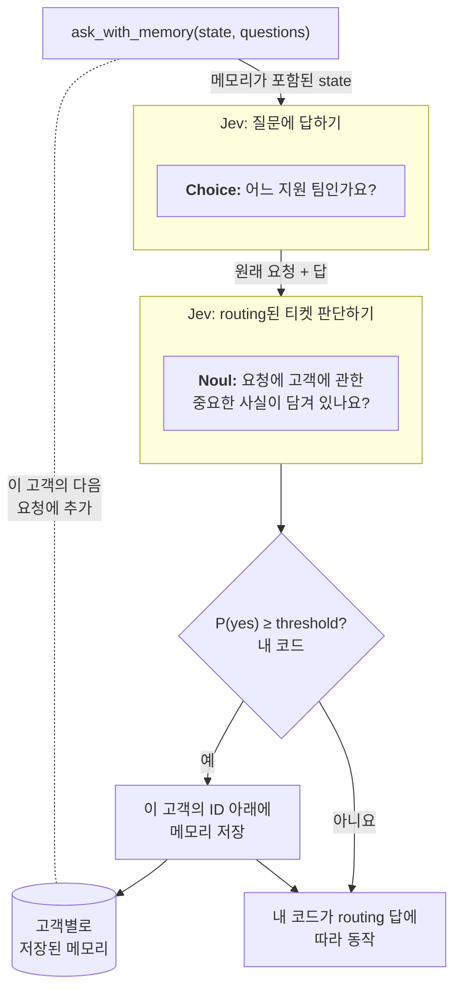

# 간단한 메모리 시스템

> 어떤 요청과 답을 기억할 가치가 있는지 Jev가 판단하게 한 다음, Jev 호출을 작은 함수로 감싸서 이후 호출에 메모리를 덧붙입니다.

Jev 요청은 매번 여러분이 보낸 state(상태)만 봅니다. 고객이 지난달에 앱에 알려 준 내용,
예컨대 사용하는 에디션이나 요금제는 코드에서 직접 넣어 주지 않는 한 그 고객의 다음 요청에
들어 있지 않습니다. 여기서 소개하는 메모리 시스템은 호출마다 Jev 요청 한 번을 추가하고
Python dict 하나를 써서 이 일을 해냅니다.

예제에서는 지원 티켓을 routing(라우팅)합니다. 8월에 한 고객이 Windows Server에서 자체
호스팅한다고 말했습니다. 9월에는 "Dashboards have been really slow since this morning"이라고
씁니다. 메모리가 없으면 Jev는 이 티켓을 자체 호스팅 팀이 아니라 클라우드 팀으로 보냅니다.
메모리가 있으면 이후 티켓 여섯 개가 모두 기대한 팀에 도착합니다. 티켓을 하나씩 따로
routing하면 여섯 개 중 세 개만 맞습니다.

이 간단한 메모리 시스템은 두 부분으로 이루어집니다.

* 호출이 끝날 때마다 Jev가 원래 요청과 그에 대한 답을 함께 봅니다. remember 질문이라고
  부르는 `Noul` 질문 하나가, 요청에 기억해 둘 만한 고객에 관한 중요한 사실이 담겨 있는지
  묻습니다. P(yes)가 0.5 이상이면 티켓과 Jev의 답을 그 고객의 메모리로 저장합니다.
* 호출하기 전에는 그 고객의 저장된 티켓을 각 티켓에 대한 Jev의 답과 함께 state에 추가합니다.
  이 작업은 wrapper(래퍼)인 `ask_with_memory()`에서 하며, 인자와 응답은 `ask()`와 같습니다.
  `ask()`는 TypeSafe Python SDK의 `client.system_one`에 모델을 고정하고 호출을 캐시한
  함수입니다.

이 wrapper가 기본적인 agent harness(에이전트 하니스)입니다. harness는 모델을 둘러싸고
[tool call(도구 호출)](function_calling.md)이나 루프 실행 같은 추가 기능을 부여하는 코드입니다.
여기서 만드는 harness는 모델에 메모리만 부여하며, 메모리는 고객 ID마다 리스트 하나를 두는
평범한 Python dict에 보관합니다.



호출마다 Jev 요청이 두 번 차례로 나갑니다. 먼저 routing 요청이 나가고, 이어서 티켓과 Jev의
답을 함께 판단하는 remember 질문이 나갑니다. 저장 여부와 상관없이 routing 응답은 그대로
돌려받습니다.

`ask_with_memory()`는 `ask()`와 같은 인자를 받고 같은 응답을 반환하므로, 다른 코드를 전혀
바꾸지 않고 둘을 서로 바꿔 쓸 수 있습니다.

## 준비

```bash
pip install ipython 'cooksafe>=0.3.0,<0.4.0'
```

`TYPESAFE_API_KEY`를 설정합니다.

아래 수치는 2026-10-29에 `jev-1.14.0`으로 얻은 것입니다.

```python
import json
import os
import urllib.request
from pathlib import Path

from cooksafe import JsonCache, make_playground_link
from IPython.display import Markdown, display
from typesafe_sdk import Choice, Noul, NoulCriteria, SystemOneResponse, TypeSafeClient

TYPESAFE_MODEL = "jev-1.14.0"  # 이 페이지에서 쓴 모델. "jev-latest"는 최신 모델을 실시간으로 실행
REMEMBER_AT = 0.5  # P(오래 유지되는 고객 사실)이 이 시작 threshold에 이르면 저장
MEMORY_KEY = "earlier_tickets_from_this_customer"  # 저장된 티켓이 state에서 들어가는 위치

client = TypeSafeClient(
    api_key=os.environ.get("TYPESAFE_API_KEY", "cache-only"),  # 키가 없는 커널은 캐시를 재생
    base_url=os.environ.get("TYPESAFE_ENDPOINT"),
    timeout=120.0,
)
```

```python
EXAMPLES_URL = (
    "https://raw.githubusercontent.com/typesafe-ai/typesafe-public-examples/main/"
    "cookbooks/basic_memory"
)


def download(name: str) -> Path:
    """Fetch one of this cookbook's files from typesafe-public-examples unless it is on disk."""
    path = Path(name)
    if not path.exists():
        urllib.request.urlretrieve(f"{EXAMPLES_URL}/{name}", path)
    return path


CACHE = Path("basic_memory_cache.json")
# True이면 공개된 답으로 CACHE를 채우므로 실행 중에 요청을 보내지 않습니다. 실시간으로 실행하려면
# False로 바꾸고 CACHE를 삭제하세요. 디스크에 이미 있는 CACHE는 절대 덮어쓰지 않습니다.
DOWNLOAD_CACHE = True
if DOWNLOAD_CACHE:
    download(CACHE.name)
json_cache = JsonCache(CACHE)
```

## 티켓 정의하기

고객 두 곳, 이전 티켓 다섯 개, 이후 메시지 세 개가 있으며 모두 이 cookbook(예제 모음)을
위해 작성한 것입니다. C-1042(Acme Corp)는 Enterprise 계약으로 Windows Server에서 자체 호스팅
에디션을 운영합니다. C-2210(Example Studio)은 클라우드 에디션의 셀프서비스 Team 요금제를
씁니다. 이전 티켓 중 세 개에는 오래 유지되는 사실, 즉 에디션, 요금제, 계약이 담겨 있습니다.
나머지 두 개에는 그런 사실이 없고, 공항에서 쓰는 휴대폰과 공휴일 이야기만 있습니다. 이후
메시지에는 고객의 환경이 전혀 언급되지 않으므로, 메모리가 없으면 Jev는 이를 짐작할 수밖에
없습니다.

각 티켓은 `ticket_state()`가 만드는 두 부분짜리 state가 됩니다. 고객이 누구인지 나타내는
`customer`와, 헬프데스크 스레드를 단순화한 `ticket`입니다. 실제 앱에서는 헬프데스크가 보내는
티켓 하나하나가 state이고, `ask_with_memory()`가 여기에 그 고객의 저장된 티켓을
추가합니다.
이전 티켓과 이후 메시지로 나눈 것은 이 예제를 위한 구분일 뿐입니다.

```python
DATA = {
    "customers": {
        "C-1042": {"id": "C-1042", "company": "Acme Corp"},
        "C-2210": {"id": "C-2210", "company": "Example Studio"},
    },
    "earlier_tickets": [
        {"id": "T-101", "customer_id": "C-1042", "received_on": "2026-08-04",
         "subject": "Adding an admin",
         "text": "Hi, we run your self-hosted edition on Windows Server 2022 in our own data "
                 "centre. How do I add a new admin user?"},
        {"id": "T-102", "customer_id": "C-2210", "received_on": "2026-08-11",
         "subject": "Exporting to PDF",
         "text": "We're a small design studio on your cloud edition, paying monthly on the "
                 "self-serve Team plan. How do I export a dashboard as a PDF?"},
        {"id": "T-103", "customer_id": "C-1042", "received_on": "2026-08-19",
         "subject": "Invoice download",
         "text": "Sorry for the typos, typing this on my phone at the airport. Where can I "
                 "download last month's invoice?"},
        {"id": "T-104", "customer_id": "C-2210", "received_on": "2026-09-02",
         "subject": "Dark mode?",
         "text": "Our whole team is out on Friday for a public holiday, so no rush on this "
                 "one. Is there a dark mode?"},
        {"id": "T-105", "customer_id": "C-1042", "received_on": "2026-09-10",
         "subject": "Sandbox environment",
         "text": "For context, we signed an Enterprise contract with you in March. Can we get "
                 "a sandbox environment for testing?"},
    ],
    "later_messages": [
        {"subject": "Slow dashboards",
         "text": "Dashboards have been really slow since this morning."},
        {"subject": "Upgrade failing",
         "text": "The upgrade to version 5.2 keeps failing halfway through."},
        {"subject": "More seats",
         "text": "We'd like to add 20 more seats before next quarter."},
    ],
    "later_received_on": "2026-09-28",
    # 각 고객이 이전 티켓에서 말한 내용을 바탕으로 사람이 직접 붙인 레이블입니다.
    "expected_team": {
        "C-1042": {"Slow dashboards": "selfhosted_windows",
                   "Upgrade failing": "selfhosted_windows", "More seats": "enterprise_desk"},
        "C-2210": {"Slow dashboards": "cloud_ops", "Upgrade failing": "cloud_ops",
                   "More seats": "billing"},
    },
}
CUSTOMERS = DATA["customers"]


def ticket_state(customer_id: str, ticket_id: str, received_on: str, subject: str,
                 text: str) -> dict:
    """The state Jev sees for one ticket: a simplified ticket, like one from a helpdesk."""
    return {
        "customer": CUSTOMERS[customer_id],
        "ticket": {
            "id": ticket_id,
            "received_on": received_on,
            "subject": subject,
            "messages": [{"from": "customer", "text": text}],
        },
    }


EARLIER = [
    ticket_state(t["customer_id"], t["id"], t["received_on"], t["subject"], t["text"])
    for t in DATA["earlier_tickets"]
]
print(f"{len(CUSTOMERS)} customers, {len(EARLIER)} earlier tickets, "
      f"{len(DATA['later_messages'])} later messages. The first ticket as Jev sees it:\n")
print(json.dumps(EARLIER[0], indent=2))
```

```
2 customers, 5 earlier tickets, 3 later messages. The first ticket as Jev sees it:

{
  "customer": {
    "id": "C-1042",
    "company": "Acme Corp"
  },
  "ticket": {
    "id": "T-101",
    "received_on": "2026-08-04",
    "subject": "Adding an admin",
    "messages": [
      {
        "from": "customer",
        "text": "Hi, we run your self-hosted edition on Windows Server 2022 in our own data centre. How do I add a new admin user?"
      }
    ]
  }
}
```

## 티켓 routing하기

`Choice` 질문 하나가 지원 팀을 고릅니다. `none_suitable` 선택지는 맞는 팀이 없을 때 Jev가
고를 수 있는 답이며, 맥락이 너무 부족한 티켓은 이쪽으로 갈 수 있습니다.

```python
ROUTE = {
    "team": Choice(
        instructions="Which support team should handle `ticket`?",
        criteria={
            "cloud_ops": "Cloud team: problems with the hosted cloud edition, run by us",
            "selfhosted_linux": "Self-hosted team, Linux: installs, upgrades and "
            "performance of the self-hosted edition on Linux servers",
            "selfhosted_windows": "Self-hosted team, Windows: installs, upgrades and "
            "performance of the self-hosted edition on Windows Server",
            "billing": "Billing: invoices, payments, seats and plan changes for "
            "self-serve plans",
            "enterprise_desk": "Enterprise desk: seats, contracts and account changes for "
            "customers on an Enterprise contract (their technical problems go to the "
            "technical teams)",
            "general": "General product questions: features, how-to, settings",
            "none_suitable": "None of these teams fits the ticket",
        },
    ),
}


@json_cache
def _system_one(state: str, questions: str, model: str) -> dict:
    response = client.system_one(
        state=json.loads(state), questions=json.loads(questions), model=model
    )
    return response.model_dump(mode="json", exclude={"model"})


def ask(state: dict, questions: dict) -> SystemOneResponse:
    """client.system_one, with the model pinned and the call cached."""
    as_json = {qid: q.model_dump(mode="json", exclude_none=True) for qid, q in questions.items()}
    raw = _system_one(json.dumps(state), json.dumps(as_json), model=TYPESAFE_MODEL)
    # 캐시된 답에는 모델이 저장되지 않습니다. 응답 타입에는 모델이 필요하므로 캐시 키에 쓰인 모델을 넣습니다.
    return SystemOneResponse.model_validate({**raw, "model": TYPESAFE_MODEL})


def later_state(customer_id: str, message_index: int) -> dict:
    """One of the later messages, sent by this customer, with a fixed ticket ID."""
    n = 201 + 3 * list(CUSTOMERS).index(customer_id) + message_index
    message = DATA["later_messages"][message_index]
    return ticket_state(customer_id, f"T-{n}", DATA["later_received_on"], message["subject"],
                        message["text"])


slow = later_state("C-1042", 0)
team = ask(slow, ROUTE).answers["team"]
print(f"C-1042: {slow['ticket']['messages'][0]['text']!r}")
print(f"  plain Jev -> {team.choice} {team.probabilities[team.choice]:.2f}")
```

```
C-1042: 'Dashboards have been really slow since this morning.'
  plain Jev -> cloud_ops 0.55
```

메모리 없이 Jev만 쓰면 C-1042의 느린 대시보드 티켓은 클라우드 팀으로 갑니다. 이 티켓만
봐서는 달리 판단할 근거가 없습니다.

## 티켓을 기억할 가치가 있는지 Jev에게 묻기

먼저 `as_memory()`에서 원래 state와 Jev의 답을 한 쌍으로 묶습니다. 이 쌍이 wrapper가 저장할
수 있는 메모리입니다. `request` 키에는 메모리를 추가하기 전의 state가 들어가므로, 오래된
메모리가 새 메모리 안에 중첩되어 들어가는 일은 없습니다. `jev_answered`는 각 질문을 그 답에
대응시킵니다.

두 번째 Jev 호출이 이 쌍을 읽습니다. remember 질문은 요청에 고객의 에디션, 운영 체제,
요금제, 계약 같은 고객에 관한 중요한 사실이 담겨 있는지 묻습니다. Jev의 답도 맥락으로
함께 주어지지만, 답에만 나오는 사실은 세지 않습니다. 이 규칙이 없으면 "General product
questions" 같은 일반적인 답이 요청에 담긴 실제 사실보다 더 크게 작용할 수 있고, 이전
메모리에 기대어 나온 답이 마치 새로운 사실인 것처럼 다시 저장될 수 있습니다.

```python
REMEMBER = {
    "remember": Noul(
        instructions=(
            "In `request.ticket`, does the thread state a lasting fact about the customer that "
            "should change how their future, unrelated tickets are handled? Count what the "
            "customer or our support staff wrote in `request.ticket`. `jev_answered` shows how "
            "the ticket was routed, which may rely on things learned earlier: do not count "
            "anything it says or implies."
        ),
        criteria=NoulCriteria(
            true=(
                "Yes: in `request.ticket` the customer or our support staff state something "
                "about the customer that stays true after this ticket, such as the product "
                "edition or operating system they run, their plan or contract, or a standing "
                "preference."
            ),
            false=(
                "No: `request.ticket` only contains things specific to this one ticket or "
                "moment, such as a one-off request, today's schedule, or the device they "
                "happen to be typing on; or the lasting fact appears only in `jev_answered`."
            ),
        ),
    ),
}


def answer_text(question, answer):
    """The readable part of an answer: the chosen option's description, or the number."""
    if answer.type == "choice":
        return question.criteria[answer.choice]
    return answer.noul if answer.type == "noul" else answer.score


def as_memory(state: dict, questions: dict, response: SystemOneResponse) -> dict:
    return {
        "request": state,
        "jev_answered": {
            q.instructions: answer_text(q, response.answers[qid])
            for qid, q in questions.items()
        },
    }


def remember_probability(memory: dict) -> float:
    """P(the request states an important fact about the customer), with the answer as context."""
    return ask(memory, REMEMBER).answers["remember"].noul
```

## 기억하도록 호출 감싸기

메모리는 `MEMORIES`에 고객 ID마다 리스트 하나씩 보관하고, state에 있는 ID로 찾습니다.

```python
MEMORIES: dict[str, list[dict]] = {}  # 고객 ID -> 그 고객의 저장된 메모리


def customer_id(state: dict) -> str:
    return state["customer"]["id"]


def ask_with_memory(state: dict, questions: dict) -> SystemOneResponse:
    """ask(), plus memory: same arguments, same return value."""
    # 1. 이 고객의 기존 메모리를 넣어 호출에 답합니다.
    saved = MEMORIES.get(customer_id(state), [])
    response = ask({**state, MEMORY_KEY: saved} if saved else state, questions)

    # 2. 원래 요청에 보관할 가치가 있는 중요한 사실이 담겨 있는지 Jev에게 묻습니다.
    memory = as_memory(state, questions, response)
    if remember_probability(memory) >= REMEMBER_AT:
        MEMORIES.setdefault(customer_id(state), []).append(memory)
    return response
```

이런 식으로 메모리를 추가하면 앱에 다섯 가지 영향이 생깁니다.

* **호출마다 요청이 두 번 순차적으로 나갑니다.** routing 요청이 먼저 나가고, 이어서
  remember 질문이 나갑니다. 이 질문은 티켓을 Jev의 답과 함께 판단하므로 routing 요청이 끝난
  뒤에 실행됩니다. remember 질문이 답을 참고하지 않는다면, 대신 routing 요청 안의 두 번째
  질문으로 넣을 수도 있습니다([fan-out(팬아웃)](../patterns/fan-out.md)과
  [병렬 질문](parallel_questions.md) 참고).
* **메모리는 늘어나기만 합니다.** 저장된 메모리는 전부 그 고객의 이후 모든 호출에
  들어갑니다. 여기에는 크기 제한도, 관련성 검사도, 만료일도 없습니다.
* **질문에서는 메모리를 전혀 언급하지 않습니다.** 메모리는 state의
  `earlier_tickets_from_this_customer` 아래에 들어가고, Jev는 state 전체를 읽습니다.
  `ROUTE`는 하나도 바뀌지 않습니다.
* **state에 `customer.id`가 있어야 합니다.** Jev 자체는 문자열도 state로 받지만, 이
  wrapper는 고객의 리스트를 찾으려면 ID가 필요합니다.
* **저장된 답이 실수를 되풀이할 수 있습니다.** remember 질문은 Jev의 답에만 나오는 내용을
  무시하므로, 답만으로 티켓이 저장되는 일은 없습니다. 하지만 저장된 티켓에는 그 답이 그대로
  남고 그 고객의 이후 모든 호출이 이를 읽으므로, 잘못된 추론이 계속 이어질 수 있습니다.

## 이전 티켓을 보내고 답이 달라지는 모습 지켜보기

이전 티켓 다섯 개를 도착한 순서대로 `ask_with_memory()`에 보냅니다. 첫 티켓을 보내기 전에,
그리고 티켓을 하나 보낼 때마다 다시, 해당 고객이 이후 메시지 중 두 개(느린 대시보드와 좌석
20개 추가)를 보냅니다. 이렇게 하면 저장된 메모리 하나하나가 Jev의 답을 어떻게 바꾸는지 볼 수
있습니다. 반복해서 보내는 메시지도 wrapper를 거치므로 remember 질문이 이 메시지들도
판단합니다.

```python
PROBES = {"Slow dashboards": 0, "More seats": 2}  # 티켓을 하나 보낼 때마다 이어서 보낼 이후 메시지


def memory_ids(cid: str) -> str:
    return ", ".join(m["request"]["ticket"]["id"] for m in MEMORIES.get(cid, [])) or "none"


def send_probes(cid: str) -> None:
    for subject, i in PROBES.items():
        team = ask_with_memory(later_state(cid, i), ROUTE).answers["team"]
        print(f"      {subject:<16} -> {team.choice:<19} {team.probabilities[team.choice]:.2f}")


for cid in CUSTOMERS:
    print(f"{cid}, memories: {memory_ids(cid)}")
    send_probes(cid)

for state in EARLIER:
    cid = customer_id(state)
    response = ask_with_memory(state, ROUTE)
    p = remember_probability(as_memory(state, ROUTE, response))  # 캐시됨: wrapper가 한 호출
    verdict = "saved" if p >= REMEMBER_AT else "not saved"
    text = state["ticket"]["messages"][0]["text"]
    print(f"\n{cid} {state['ticket']['id']}  {response.answers['team'].choice:<19} "
          f"P(remember) {p:.2f}  {verdict}")
    print(f"    {text[:84]}")
    print(f"{cid}, memories: {memory_ids(cid)}")
    send_probes(cid)
```

```text
C-1042, memories: none
      Slow dashboards  -> cloud_ops           0.55
      More seats       -> enterprise_desk     0.53
C-2210, memories: none
      Slow dashboards  -> cloud_ops           0.68
      More seats       -> billing             0.58

C-1042 T-101  selfhosted_windows  P(remember) 0.97  saved
    Hi, we run your self-hosted edition on Windows Server 2022 in our own data centre. H
C-1042, memories: T-101
      Slow dashboards  -> selfhosted_windows  0.99
      More seats       -> enterprise_desk     0.53

C-2210 T-102  general             P(remember) 0.98  saved
    We're a small design studio on your cloud edition, paying monthly on the self-serve 
C-2210, memories: T-102
      Slow dashboards  -> cloud_ops           0.98
      More seats       -> billing             0.98

C-1042 T-103  billing             P(remember) 0.02  not saved
    Sorry for the typos, typing this on my phone at the airport. Where can I download la
C-1042, memories: T-101
      Slow dashboards  -> selfhosted_windows  0.99
      More seats       -> enterprise_desk     0.53

C-2210 T-104  general             P(remember) 0.03  not saved
    Our whole team is out on Friday for a public holiday, so no rush on this one. Is the
C-2210, memories: T-102
      Slow dashboards  -> cloud_ops           0.98
      More seats       -> billing             0.98

C-1042 T-105  enterprise_desk     P(remember) 0.96  saved
    For context, we signed an Enterprise contract with you in March. Can we get a sandbo
C-1042, memories: T-101, T-105
      Slow dashboards  -> selfhosted_windows  0.98
      More seats       -> enterprise_desk     1.00
```

에디션, 요금제, 계약이 담긴 티켓 세 개는 0.96에서 0.98 사이의 값으로 저장됩니다.
T-102는 Jev가 general 팀으로 routing했는데도 저장됩니다. remember 질문이 답이 아니라
고객이 쓴 말을 세기 때문입니다. 공항 티켓과 공휴일 티켓은 0.02와 0.03을 받아 저장되지
않으므로, 그 뒤의 답은 달라지지 않습니다.

저장된 메모리는 저마다 관련 있는 답을 바꿉니다. C-1042의 경우 Windows 티켓 덕분에 느린
대시보드가 클라우드 팀(0.55)에서 Windows 팀(0.99)으로 옮겨 가고, Enterprise 계약 덕분에
좌석 추가에 대한 Enterprise desk의 확률이 0.53에서 1.00으로 올라갑니다. C-2210의 경우 Team
요금제 티켓 덕분에 느린 대시보드에 대한 클라우드 팀의 확률이 0.68에서 0.98로, 좌석 추가에 대한
billing의 확률이 0.58에서 0.98로 올라갑니다. 반복해서 보낸 메시지는 하나도 저장되지
않았습니다.

## 두 고객의 같은 메시지 routing하기

이제 각 고객이 이후 메시지 세 개를 보냅니다. 메시지마다 같은 state와 같은 질문으로 메모리
없는 `ask()`와 `ask_with_memory()`에 각각 보냅니다.

```python
EXPECTED = DATA["expected_team"]
plain_correct = memory_correct = total = 0
example_state = None


def cell(answer, expected: str) -> str:
    mark = "✓" if answer.choice == expected else "✗"
    return f"{mark} {answer.choice} {answer.probabilities[answer.choice]:.2f}"


print(f"{'customer':<9}{'message':<17}{'expected':<20}{'plain Jev':<27}{'with memory':<27}")
for cid in CUSTOMERS:
    for i, message in enumerate(DATA["later_messages"]):
        state = later_state(cid, i)
        expected = EXPECTED[cid][message["subject"]]
        plain = ask(state, ROUTE).answers["team"]
        if example_state is None:
            # playground 링크에 쓰기 위해 이 호출에 사용한 state를 그대로 보관합니다.
            saved = MEMORIES.get(cid, [])
            example_state = json.loads(json.dumps({**state, MEMORY_KEY: saved} if saved else state))
        response = ask_with_memory(state, ROUTE)
        remembered = response.answers["team"]
        plain_correct += plain.choice == expected
        memory_correct += remembered.choice == expected
        total += 1
        print(f"{cid:<9}{message['subject']:<17}{expected:<20}{cell(plain, expected):<27}"
              f"{cell(remembered, expected):<27}")

print(f"\nExpected routes: {plain_correct}/{total} without memory, "
      f"{memory_correct}/{total} with memory.")
```

```
customer message          expected            plain Jev                  with memory                
C-1042   Slow dashboards  selfhosted_windows  ✗ cloud_ops 0.55           ✓ selfhosted_windows 0.98  
C-1042   Upgrade failing  selfhosted_windows  ✗ none_suitable 0.64       ✓ selfhosted_windows 1.00  
C-1042   More seats       enterprise_desk     ✓ enterprise_desk 0.53     ✓ enterprise_desk 1.00     
C-2210   Slow dashboards  cloud_ops           ✓ cloud_ops 0.68           ✓ cloud_ops 0.98           
C-2210   Upgrade failing  cloud_ops           ✗ none_suitable 0.58       ✓ cloud_ops 0.95           
C-2210   More seats       billing             ✓ billing 0.58             ✓ billing 0.98             

Expected routes: 3/6 without memory, 6/6 with memory.
```

메모리가 있으면 메시지 여섯 개가 모두 기대한 팀에 도착하고, 없으면 세 개만 도착합니다. 같은
메시지라도 이제 고객에 따라 다른 팀으로 갑니다. 느린 대시보드는 C-1042의 경우 Windows 팀으로
가고 C-2210의 경우 클라우드 팀에 그대로 남으며, 좌석 20개 추가는 C-1042의 경우 Enterprise
desk로, C-2210의 경우 billing으로 갑니다. 메모리 없는 Jev가 이미 맞혔던 경우에는 메모리가
확률을 높여 줍니다. C-1042의 좌석 메시지는 0.53에서 1.00이 됩니다. wrapper는 이후 메시지
여섯 개에 대해서도 remember 질문을 던졌고 하나도 저장하지 않았습니다. 중요한 사실이 담겨 있지
않기 때문입니다.

각 행의 기대 팀은 이전 티켓에 나온 고객의 환경에서 정해집니다. C-1042는 자체 호스팅 에디션과
Enterprise 계약이고, C-2210은 클라우드 Team 요금제입니다.

## playground에서 열어 보기

이 링크에는 C-1042의 첫 번째 느린 대시보드 호출에 쓰인 routing state가 그 시점의 메모리까지
포함해 그대로 들어 있고, routing 질문도 함께 들어 있습니다.

```python
playground_link = make_playground_link(example_state, ROUTE)
display(Markdown(
    f"🔗 [Open C-1042's ticket with its memories in the TypeSafe playground]({playground_link})"
))
```

[TypeSafe playground에서 C-1042의 티켓을 메모리와 함께 열기 →](https://console.typesafe.ai/playground#share/N4IgJg9gxgrgtgUwHYBcAqCAeKQC4AEIwAOiLAM4oSIBOpBJIAlmPfqQMIC0AjAAwAWAEykANOzLUADgEMkATzakAglET4OEGlNIBfcaRRMoAawQo2jFkpBouQvjzESaCKAiYA3BGAD6EJBsHIQA2Lj4ATnsADmdSchgAIwArNws8CQBlABsIAHd8MBlyAAtEiBkaMHI4kERychkAcwQajIBtRgAzGmobCipaWpQsdIJSABFisoqq8nwSmW98RIRkfFcZbOz5fHJcgvImJHd8FBKmebgtJGOmgDo9AF19CQRK7KYEGl8jU3NyL4etRfhdAQNqN82J1SK4AI4wVpjfCMCFDDJWVgZTi8QQiEAGSRwWQKGyqdSabR6Ql-MzIzE2Oz8JwElxuDzePwBIJ8ULhaLhAS1BIpNJksBgO74OTSsBwY61eqNFptAgwkDAuD9GCUSF0VmGUY2AASTHEeQQGxgSHw8ggMBoewQ2S6XBKEEoPnwPiYRgC+H9AHVjpA8vNMt9vI7gkJ8McAw6A3kbUUUDJ8O5UK57vhjflChB8ABJWVgaX4JAIAoyOXxnXfAD8z10r1IqU8vjk5AtrixDFIgYuUBKexgUikWhQZ3ecD27pg2TLiyQYGyloABrTzOum9iQBGXW6PSMyyMZHBxMGV-lyARjpQttlyOIx00aDXWtKV-gpN8ulo4DkU4IC6M4SktchnVdd1PTLH0-RtIMQxvfAIxoKM9FeRh4URShLFINEoQxUhrD3bh+GEWooGkORFD3clLUpHQQFbEAt3pEi+wkJk+AAVlqVx3C8Hx-ECPdgjCSJcWFJJUigZFSEyOQwHKTBvSQTwmF6JBEFQRVWmVVpoW6XotT3Qj9RpI09wAMS0DMAhGbBzQgpgmkrMsZQAUVQb4pBoS5LWorMZHk-A8l9Ec7RgOMbQAWUqYccw4GULXwFop3TRoV1U9TNO03Sp3-R0RkoO5d10F5WPbTskG7b4fHwkBB2MEcEnHSdp3POd7UXBZlLXfBN2MOkdxsHyRm0ALIMKVoTAISCZBQZ8HJC+T5mU6UoGo60p2HOQVXwYqMx1QZvnmf1vN8qbAtWlB3zCgAKc4PBKtwSluKAth-XpEjXOB5iaQsqDAy0RmHT7vrPAGAEpMJeVkQH86RlowbAMiIQ1zyalB5F-fp3WMBBanve6YHkpgAlVCQWuHUcOpoKdoZ6hclwGjd2LGg0yACyamBkJqoFyGAuSkanOGF08ZwIZG-oQAHwsi0GFmPL0hftODJQQ8QaGtFZdh1YUoJgk9fE+JAYEwGwD2g1WpfPcQABljktu86rTbYVtfd8wE-TbfxoYrAJOS0QOVyDDxNr14MpxCbWdi21Mg9DzqNl0o78CLrzDa2oKPWCuovfAr1DW9YofT2XykN8Pw278A6DoDQ9Al6nUju3vS12OAxtEuULQjDucSJhtjuGwACER-Npo3c8CAiZW2R5EKlbFuWr8yykbIZX2pBDuOiPXWT5Yt67WpkEm-zAt8X3yBMcbrqvmbb-mp0lpW4L7tC9fNtCnbUAzMufe9kLIXRtFdS+00gqOQelOZ64EtLTghsYb6st-qA2BsDcCSCPooOyIXcgcNuYtErO+bINgADiyBvioN6GAcmU4ERIljmXLo7wUAOlaOId0eQuBUHEJBFARg95tEJEgAICBfAJF9DIOWNgAByEiAwt3AjNaG8wui+nmK3dimFdCIxkFIJgAA1c6scMaeB4CxIAA)

## 다음 단계

* **앱이 무엇을 기억할지 정하세요.** `REMEMBER`를 수정해서 여러분의 작업에서 기억할 가치가
  있는 것이 무엇인지 기술합니다. `REMEMBER_AT`을 정하려면 실제 트래픽에서 요청과 답의 쌍을
  골라 기억할 가치가 있는지 없는지 레이블을 붙이고, 두 그룹을 가장 잘 가르는 확률을 고른 다음,
  그 값을 고르는 데 쓰지 않은 쌍으로 확인합니다. 메모리가 빠지는 것보다 잘못된 방향으로 이끄는
  메모리의 비용이 더 크다면 값을 올리세요. [Confidence](../confidence.md)와
  [확률 기반 routing](../patterns/probability-routing.md)을 참고하세요.
* **어떤 메모리를 추가할지 정하세요.** 이 wrapper는 저장된 메모리를 전부 추가합니다. 리스트가
  길어지면 관련성 질문으로 더 작은 집합을 골라낼 수 있습니다.
* **오래된 메모리를 교체하세요.** 새 메모리가 이전 메모리를 대체하는지 묻고, 필요하면
  코드에서 이전 항목을 제거합니다.
* **실행이 끝나도 메모리를 유지하세요.** `MEMORIES`를 고객 ID를 키로 하는 데이터베이스로
  바꿉니다. 메모리 안의 dict는 프로세스가 종료되면 사라집니다.
* **앱이 한 일을 기억하세요.** 여러분의 답장을 지원 메시지로 티켓 스레드에 추가하면, remember
  질문이 고객이 쓴 말과 함께 이 답장도 판단합니다.


이 문서는 개발자 문서 플랫폼인 [Mintlify](https://mintlify.com)로 제작하고 호스팅합니다.
