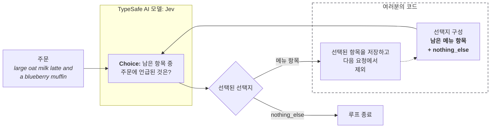
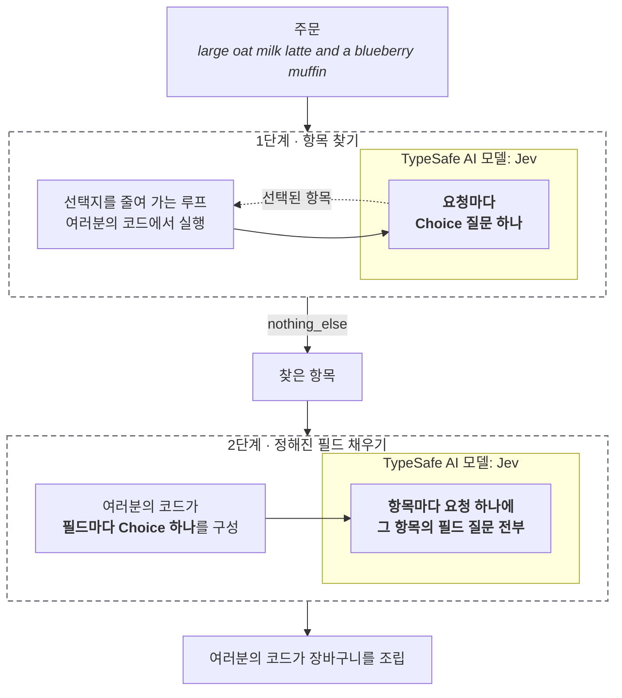

# 장바구니

> 자연어로 된 카페 주문을 구조화된 장바구니로 바꿉니다. 선택지를 줄여 가며 Choice 질문을 반복하는 루프로 모든 항목을 찾은 다음, 항목마다 요청 하나에 질문을 묶어 보내 정해진 필드를 채웁니다.

고객은 주문을 한 문장으로 말할 수 있지만, 애플리케이션에는 항목과 필드가 따로 나뉜 구조화된
장바구니가 필요합니다.

[TypeSafe 장바구니 데모](https://player.vimeo.com/video/1230923854)

이 데모에서 TypeSafe가 맡은 부분은 값을 하나씩 반환하는
[`Choice` 질문](../primitives/choice.md) 여러 개로 장바구니를 만듭니다. 여기서는
작은 카페 메뉴와 코드에 고정해 둔 주문 하나로 실행합니다.

## 장바구니 빌더의 동작 방식

입력은 한 문장입니다.

```text
Can I get a large oat milk latte and a blueberry muffin please
```

애플리케이션은 다음 장바구니를 만듭니다.

```text
latte
  size: large
  milk: oat
blueberry_muffin
```

`Choice` 질문은 장바구니 전체가 아니라 선택지 하나를 반환합니다. 그래서 애플리케이션은
두 단계를 거칩니다.

1. **항목 찾기.** 남은 메뉴 항목 중 주문에 언급된 것이 무엇인지 반복해서 묻습니다.
   선택된 항목은 다음 요청에서 뺍니다. Jev가 `nothing_else`를 선택하면
   멈춥니다.
2. **필드 채우기.** 찾은 항목마다 정해진 필드당 `Choice` 질문 하나씩을 담은 요청을
   하나 보냅니다. 반환된 값을 장바구니로 조립하는 일은 코드가 합니다.

### 개수를 모르는 항목을 루프로 찾기

주문된 항목이 몇 개인지는 미리 알 수 없습니다. 요청마다 남은 메뉴 항목 중
주문에 가장 먼저 나오는 것이 무엇인지 묻습니다. 그러면 코드의 루프가 다음을 수행합니다.

1. 선택된 항목을 저장합니다.
2. 다음 요청의 선택지에서 그 항목을 뺍니다.
3. 짧아진 선택지 목록과 함께 주문 전체를 다시 보냅니다.

`Choice` 질문은 반드시 선택지 하나를 골라야 하므로, 모든 요청에는
`nothing_else`도 들어 있습니다. 주문에 남은 메뉴 항목이 없을 때 이 선택지가 루프에 멈추라고
알려 줍니다.



### 정해진 필드 채우기

항목 루프가 끝나면 애플리케이션은 각 항목에 어떤 스키마가 적용되는지 압니다. latte
스키마에는 `size`와 `milk` 필드가 있습니다. 애플리케이션은 두 필드 질문을 요청 하나에 담아
Jev에 보냅니다. muffin에는 필드가 없으므로 필드 요청이 필요 없습니다.



## 준비

```bash
pip install ipython 'cooksafe>=0.3.0,<0.4.0'
```

그런 다음 `TYPESAFE_API_KEY`를 설정합니다.

아래 수치는 2026-10-29에 `jev-1.14.0`으로 얻은 것입니다.

```python
import os
import urllib.request
from pathlib import Path

from cooksafe import JsonCache, make_playground_link
from IPython.display import Markdown, display
from typesafe_sdk import Choice, TypeSafeClient

TYPESAFE_MODEL = "jev-1.14.0"  # 이 페이지에서 쓴 모델입니다. "jev-latest"로 바꾸면 최신 모델로 실제 요청을 보냅니다
NOTHING_ELSE = "nothing_else"  # 항목 루프를 끝내는 sentinel 선택지
MAX_ITEM_REQUESTS = 6  # 강제 상한입니다. 답이 잘못되어도 루프가 끝없이 돌지 않습니다

client = TypeSafeClient(
    api_key=os.environ.get("TYPESAFE_API_KEY", "cache-only"),  # 캐시로 다시 렌더링할 때는 키가 필요 없습니다
    model=TYPESAFE_MODEL,
    timeout=30.0,
)
```

```python
EXAMPLES_URL = (
    "https://raw.githubusercontent.com/typesafe-ai/typesafe-public-examples/main/"
    "cookbooks/cart_from_primitives"
)


def download(name: str) -> Path:
    """Fetch one of this cookbook's files from typesafe-public-examples unless it is on disk."""
    path = Path(name)
    if not path.exists():
        urllib.request.urlretrieve(f"{EXAMPLES_URL}/{name}", path)
    return path


CACHE = Path("cart_from_primitives_cache.json")
# True이면 공개된 답으로 CACHE를 채우므로 실행 중에 요청을 보내지 않습니다. 실제 요청을 보내려면
# False로 바꾸고 CACHE를 삭제하세요. 디스크에 이미 있는 CACHE는 덮어쓰지 않습니다.
DOWNLOAD_CACHE = True
if DOWNLOAD_CACHE:
    download(CACHE.name)
json_cache = JsonCache(CACHE)


def fmt_confidence(confidence: float | None) -> str:
    """A confidence for printing. The API can return None, so never format it blind."""
    return f"{confidence:.2f}" if confidence is not None else "n/a"
```

### 메뉴 만들기

메뉴에는 항목이 네 개 있고, 필드가 있는 것은 latte뿐입니다.

각 항목의 설명에는 고객이 그 항목을 주문할 때 쓸 만한 단어를 담습니다. Jev는
주문을 이 설명들과 대조합니다. `fields`는 항목 자체의 스키마입니다. 각 필드는
허용되는 값의 목록이며, 이 값들이 그 필드에 대한 `Choice` 질문의 선택지가 됩니다.

```python
MENU = {
    "latte": {
        "description": "Espresso with steamed milk. Also ordered as a flat white or a milky coffee.",
        "fields": {
            "size": ["small", "medium", "large"],
            "milk": ["whole", "oat", "almond"],
        },
    },
    "filter_coffee": {
        "description": "Plain brewed drip coffee, sometimes ordered as a black coffee.",
        "fields": {},
    },
    "blueberry_muffin": {
        "description": "A blueberry muffin.",
        "fields": {},
    },
    "almond_croissant": {
        "description": "An almond croissant, sometimes ordered as a pastry.",
        "fields": {},
    },
}

ORDER = "Can I get a large oat milk latte and a blueberry muffin please"
```

### 주문에서 항목 찾기

루프는 요청을 보내기 전마다 아직 찾지 못한 항목으로 선택지 집합을 새로 만들고
`nothing_else` sentinel(센티널: 종료를 알리는 값)을 추가합니다. 주문은
요청의 [state](../concepts/state.md)(상태)이고, 질문은 요청마다
바뀝니다. `nothing_else`가 선택되면 루프가 멈춥니다.

루프는 요청 수에도 상한을 두므로, 답이 잘못되어도 끝없이 돌지 않습니다. sentinel이
선택되거나, 메뉴가 바닥나거나, 상한에 도달하면 끝납니다.

```python
def item_question(remaining: dict[str, dict], found: list[str]) -> Choice:
    """Build one request's question from the items not found yet."""
    already = ", ".join(found) if found else "nothing yet"
    criteria = {name: item["description"] for name, item in remaining.items()}
    criteria[NOTHING_ELSE] = (
        "The order mentions no menu item other than the ones already accounted for."
    )
    return Choice(
        instructions=(
            f"This is a cafe order. Items already accounted for: {already}. "
            "Which remaining menu item does the order mention? If the order mentions more "
            "than one remaining item, choose the one mentioned first."
        ),
        criteria=criteria,
    )


@json_cache
def ask_item(order: str, question: dict, model: str) -> dict:
    """One item request. The question arrives as its API JSON, which also keys the cache."""
    answer = client.system_one(
        state=order, questions={"item": question}, model=model
    ).choices["item"]
    return {"choice": answer.choice, "confidence": answer.confidence}


def find_items(order: str) -> list[dict]:
    remaining = list(MENU)
    found: list[dict] = []
    item_requests = 0
    for _ in range(MAX_ITEM_REQUESTS):
        if not remaining:
            break
        question = item_question(
            {name: MENU[name] for name in remaining},
            [item["name"] for item in found],
        )
        result = ask_item(
            order, question.model_dump(mode="json", exclude_none=True), model=TYPESAFE_MODEL
        )
        item_requests += 1
        print(
            f"item request {item_requests}: {len(remaining)} items + sentinel "
            f"-> {result['choice']} (confidence {fmt_confidence(result['confidence'])})"
        )
        if result["choice"] == NOTHING_ELSE:
            break
        remaining.remove(result["choice"])
        found.append({"name": result["choice"], "confidence": result["confidence"]})
    return found


items = find_items(ORDER)
print(f"\nfound {len(items)} items: {[item['name'] for item in items]}")
```

```
item request 1: 4 items + sentinel -> latte (confidence 0.99)
item request 2: 3 items + sentinel -> blueberry_muffin (confidence 1.00)
item request 3: 2 items + sentinel -> nothing_else (confidence 1.00)

found 2 items: ['latte', 'blueberry_muffin']
```

이 주문에서는 처음 두 항목 요청이 각각 항목 하나씩을 찾았습니다. 세 번째 요청은
sentinel을 선택해 루프를 끝냈습니다.

찾은 항목은 선택지 목록에서 빠지므로, 루프는 메뉴 항목 하나를 많아야 한 번만
찾습니다. 장바구니에는 수량 필드도 없어서 "two flat whites"라는 주문도
`latte` 하나가 됩니다. 수량을 처리하려면 각 항목의 스키마에 `one`, `two`, `three` 같은
값을 갖는 `quantity` 필드를 추가하세요.

### 찾은 항목의 필드 채우기

찾은 항목마다 정해진 필드당 `Choice` 질문을 하나씩 만들고, 같은 주문을 대상으로
`system_one` 호출 하나에 함께 담아 보냅니다. 이것이
[fan-out(팬아웃) 패턴](../patterns/fan-out.md)입니다.

각 필드 질문에는 `unspecified`도 들어 있습니다. 그래서 고객이 언급하지 않은 필드는
구체적인 값을 억지로 받지 않고 이 선택지를 받습니다.

필드가 없는 항목은 호출 자체를 건너뜁니다.

```python
UNSPECIFIED = "unspecified"


def field_questions(item_name: str) -> dict[str, Choice]:
    questions = {}
    for field, values in MENU[item_name]["fields"].items():
        criteria = {value: None for value in values}
        criteria[UNSPECIFIED] = (
            f"The order does not say which {field} for the {item_name}."
        )
        questions[field] = Choice(
            instructions=f"Which {field} did the order ask for, for the {item_name}?",
            criteria=criteria,
        )
    return questions


@json_cache
def ask_fields(order: str, questions: dict[str, dict], model: str) -> dict:
    """One field request. The questions arrive as their API JSON, which also keys the cache."""
    response = client.system_one(state=order, questions=questions, model=model)
    return {
        field: {"choice": answer.choice, "confidence": answer.confidence}
        for field, answer in response.choices.items()
    }


def fill_fields(order: str, item_name: str) -> dict:
    if not MENU[item_name]["fields"]:
        return {}
    questions = {
        field: question.model_dump(mode="json", exclude_none=True)
        for field, question in field_questions(item_name).items()
    }
    return ask_fields(order, questions, model=TYPESAFE_MODEL)


cart = []
for item in items:
    fields = fill_fields(ORDER, item["name"])
    cart.append(
        {"name": item["name"], "confidence": item["confidence"], "fields": fields}
    )
```

### 조립된 장바구니

이 단계에서는 TypeSafe를 호출하지 않습니다. 위에서 모은 단일 값 답들로 조립한
장바구니를 출력합니다.

```python
print(f'order: "{ORDER}"\n')
for line in cart:
    print(f"{line['name']}  (item confidence {fmt_confidence(line['confidence'])})")
    for field, answer in line["fields"].items():
        conf = fmt_confidence(answer["confidence"])
        print(f"    {field:<6} {answer['choice']:<12} confidence {conf}")
```

```
order: "Can I get a large oat milk latte and a blueberry muffin please"

latte  (item confidence 0.99)
    size   large        confidence 1.00
    milk   oat          confidence 1.00
blueberry_muffin  (item confidence 1.00)
```

## 플레이그라운드에서 해 보기

아래 링크에는 항목을 찾는 첫 번째 요청이 들어 있습니다. 주문 전체가 state이고,
메뉴 항목 네 개에 `nothing_else`를 더한 선택지를 두고 묻는 `Choice` 질문이 하나 있습니다. 위의 루프는
이 요청을 되풀이하되, 매번 방금 찾은 항목을 빼고 보냅니다. 플레이그라운드에서 주문을 고치면
답도 그에 따라 바뀝니다.

```python
playground_link = make_playground_link(ORDER, {"item": item_question(MENU, [])})
display(
    Markdown(
        f"🔗 [Open the first item-finding request in the TypeSafe playground]({playground_link})"
    )
)
```

[TypeSafe 플레이그라운드에서 항목을 찾는 첫 번째 요청 열기 →](https://console.typesafe.ai/playground#share/N4IgJg9gxgrgtgUwHYBcAqCAeKQC4AEIAwgIZL4CS+A5givifgDYkBOt+EJ9cAlkwGtm3FAgZIwDfACMmMBNIStWAT3xwYAM029yAByYISAZwQgANIT2sIcPSmMZseQsAA6IXqLgeC7kCgqegi++B5QABYQvFAhFmGeSMYorDBQKLwQSaEeaBG8xvgFUlAkmmIQrGBKAHSU3oUkTKxGYGokUFAQMKgIkpqVBEgQKPlI1PgqdHUA6vmR+C1wJLq6E4hIMEXe+JAIhaMVVUrqyBlZAPyUmviHnMesp6iZSeqVYqNknEhiSytIa22CDglkiEAgpluEQqPye5x+-V4rGSNQ8lnCrC8Sl4JFC-hYKFEORAAFFjNZ9sYIPgAO5eCL4ZJGRCSPiCOoAQSYVPu1RakhMUk0BNp+VE9ykbIEai62gQCFR8Q8OiYolYAH1ZeU4gQPAAFFi6GQtGl9XaYvT4LXyyxUxAZRCFSp8s2CxiyDpCa0KtEJWTyRTKFTqjTaXTEjkyOQKJSqdRaHRIRXokBNOBZMCamwFYxkFAR8hpjNW7PGXOoW22Oi8R28pSuxr4PQmFIqZMJYajNbqhDcnUJPJHPlwl6FYZPLZYuCcQ6PT7kO5ZfYMZqtdqdbq9fqVRUAX338VTel4ADUlMYXi4QAA3ACMIF3QA)

## 다음 단계

* [Primitives](../primitives.md)는 질문 유형과 각 답에 담기는 필드를 정리한
  레퍼런스입니다.
* [병렬 질문 cookbook(예제 모음)](parallel_questions.md)은 필드 질문을
  하나씩 따로 묻는 것과 비교해 요청 하나에 담아 보내면 얼마나 절약되는지 측정합니다.
* [function calling cookbook](function_calling.md)은 같은 방식으로 문장 하나를
  여러분이 만든 함수 중 하나에 대한 호출로 바꿉니다. `Choice` 질문 하나가 함수를 고르고,
  인자마다 질문 하나가 값을 채웁니다. 사용자가 언급하지 않은 인자는
  `unspecified` 선택지 대신 별도의 예/아니요 질문으로 처리합니다.
* [Confidence](../confidence.md)는 confidence(신뢰도) 값을 신호로 읽는 방법을 다룹니다.


이 문서는 개발자 문서 플랫폼인 [Mintlify](https://mintlify.com)로 제작하고 호스팅합니다.
