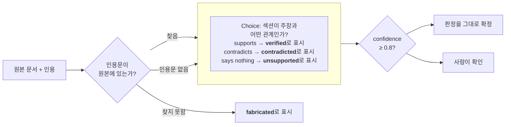

# 인용 재확인

> 원본 문서와 대조해 잘못되었거나 hallucination으로 만들어진 인용을 잡아냅니다. Choice 질문 하나가 인용문의 문맥이 주장을 뒷받침하는지 판단합니다.

LLM이 질문에 답하면서 인용을 붙입니다. 주장마다 원본 문서의 섹션 하나와, 그 주장의 근거가
되는 인용문을 다는 식입니다. 이런 인용 가운데 일부는 틀렸거나 hallucination(환각)으로 만들어진
것입니다. 인용문이 문서에 아예 없을 수도 있고, 문서에 글자 그대로 있지만 그 문맥은 주장과
정반대를 말할 수도 있습니다.

인용 하나를 사람이 직접 확인하려면 시간이 걸립니다. 문서를 찾고, 그 안에서 인용문을 찾고,
인용문이 주장을 뒷받침하는지 알 수 있을 만큼 앞뒤 문맥을 읽어야 합니다.

이 확인을 자동화하기 위해, 먼저 평범한 문자열 매칭으로 원본에 없는 인용문을 찾습니다. 그런
다음 `Choice` 질문으로 남은 인용문 각각의 문맥을 읽고 그 문맥이 주장을 뒷받침하는지
판단합니다.



아래에서는 RFC 7519(JSON Web Token)에 관한 LLM의 답변에서 가져온 인용 여덟 개를 이 방식으로
확인합니다. 정확한 인용 네 개는 confidence(신뢰도) 0.98 이상으로 `verified` 판정을
받았습니다. 일부러 심어 둔 실패 사례 네 개도 모두 잡아냈습니다. 지어낸 인용문 하나, 원본과
모순되는 주장 하나, 근거가 없는 인용 두 개이며, 근거 없는 인용 중 하나는 사람에게
넘어갔습니다.

여기서 만드는 함수 `check_citation()`은 원본 문서와 인용 하나를 받아 네 가지 판정 중 하나를
돌려줍니다. `verified`, `unsupported`, `contradicted`, `fabricated`입니다. 사람이 살펴봐야 할
인용을 표시해 주는 confidence도 함께 돌려줍니다.

## 준비

```bash
pip install ipython 'cooksafe>=0.3.0,<0.4.0'
```

그런 다음 `TYPESAFE_API_KEY`를 설정합니다.

아래 수치는 2026-11-03에 `jev-1.14.0`으로 얻은 값입니다.

```python
import json
import os
import re
import urllib.request
from pathlib import Path
from time import perf_counter

from cooksafe import JsonCache, make_playground_link
from IPython.display import Markdown, display
from typesafe_sdk import Choice, TypeSafeClient

TYPESAFE_MODEL = "jev-1.14.0"  # 이 페이지에서 쓴 모델입니다. "jev-latest"로 바꾸면 최신 모델을 실시간으로 호출합니다
AUTO_ACCEPT = 0.8  # 처음에는 높게 잡아 사람 검토를 늘리고, 모델에 대한 신뢰가 쌓이면 조정합니다

client = TypeSafeClient(
    api_key=os.environ.get("TYPESAFE_API_KEY", "cache-only"),
    base_url=os.environ.get("TYPESAFE_ENDPOINT"),
    timeout=120.0,
)


EXAMPLES = (
    "https://raw.githubusercontent.com/typesafe-ai/typesafe-public-examples/main/"
    "cookbooks/citation_check"
)


def download(name: str) -> Path:
    """Fetch one of this cookbook's files from typesafe-public-examples unless it is on disk."""
    path = Path(name)
    if not path.exists():
        path.parent.mkdir(parents=True, exist_ok=True)
        urllib.request.urlretrieve(f"{EXAMPLES}/{name}", path)
    return path


CACHE = Path("citation_check_cache.json")
# True이면 공개된 답변으로 CACHE를 채우므로 실행 중에 요청을 보내지 않습니다. 실시간으로
# 실행하려면 False로 바꾸고 CACHE를 삭제하세요. 디스크에 이미 있는 CACHE는 덮어쓰지 않습니다.
DOWNLOAD_CACHE = True
if DOWNLOAD_CACHE:
    download(CACHE.name)
json_cache = JsonCache(CACHE)
```

## 원본과 인용 불러오기

원본은 [RFC 7519](https://www.rfc-editor.org/rfc/rfc7519.html)(JSON Web Token)입니다.
rfc-editor.org에서 받아 이 cookbook(예제 모음) 옆에 `rfc7519.txt`로 커밋해 두었습니다. 아래
코드는 페이지 머리글과 바닥글을 걷어 낸 다음 텍스트를 번호가 붙은 섹션으로 나눕니다.

`citations.json`의 인용 여덟 개는 LLM이 이 RFC를 대상으로 작성한 것입니다. 네 개는 정확하고,
나머지 네 개는 확인에서 걸리도록 저희가 고쳤습니다.

```python
def load_source() -> str:
    """RFC 7519 verbatim, minus the page headers and footers that interrupt its paragraphs."""
    lines = []
    for line in download("rfc7519.txt").read_text().splitlines():
        bare = line.lstrip("\f")
        if re.match(r"Jones, et al\.\s.*\[Page \d+\]$", bare):
            continue
        if re.match(r"RFC 7519\s+JSON Web Token \(JWT\)\s+May 2015$", bare):
            continue
        lines.append(bare)
    return re.sub(r"\n{3,}", "\n\n", "\n".join(lines))


def split_sections(source: str) -> dict[str, str]:
    """Map each numbered section ("4.1.3") to its text, split on the RFC's header lines."""
    boundary = re.compile(r"(?m)^(?:(\d+(?:\.\d+)*)\.  .+|Appendix [A-Z]\..*)$")
    marks = list(boundary.finditer(source))
    sections = {}
    for mark, nxt in zip(marks, marks[1:] + [None]):
        if mark.group(1) is None:  # 부록 제목은 바로 앞 섹션을 끝내는 역할만 합니다
            continue
        sections[mark.group(1)] = source[mark.start() : nxt.start() if nxt else len(source)].strip()
    return sections


SOURCE = load_source()
SECTIONS = split_sections(SOURCE)
CITATIONS = json.loads(download("citations.json").read_text())

print(f"{len(SOURCE):,} characters, {len(SECTIONS)} numbered sections, {len(CITATIONS)} citations")
print("\nA citation with a quote:")
print(json.dumps(CITATIONS[1], indent=2))
print("\nA claim-only citation:")
print(json.dumps(next(c for c in CITATIONS if c["quote"] is None), indent=2))
```

```
58,365 characters, 45 numbered sections, 8 citations

A citation with a quote:
{
  "id": "aud_reject",
  "claim": "If a validator does not find itself in a token's audience list, it has to reject the token.",
  "quote": "If the principal processing the claim does not identify itself with a value in the \"aud\" claim when this claim is present, then the JWT MUST be rejected.",
  "section": "4.1.3"
}

A claim-only citation:
{
  "id": "iat_future",
  "claim": "The \"iat\" claim requires validators to reject tokens whose issue time is in the future.",
  "quote": null,
  "section": "4.1.6"
}
```

## 원본에서 인용문 찾기

원본에 없는 인용문은 지어낸 것이며, 이를 알아내는 데는 모델이 필요 없습니다. 인용문이 RFC의
줄바꿈에 걸쳐 있어도 일치하도록 공백과 둥근 따옴표를 정규화한 다음, 부분 문자열로 찾습니다.
일치하는 곳을 찾으면 인용문이 어느 섹션에서 왔는지도 알 수 있고, 그 섹션이 다음 단계에서
모델이 읽을 텍스트가 됩니다.

인용이 섹션만 지목하고 그 안의 내용은 전혀 인용하지 않을 수도 있습니다. 이 경우에는 대조할
것이 없으므로, 인용이 지목한 섹션을 가져와 곧바로 모델로 넘어갑니다.

```python
def normalize(text: str) -> str:
    """Collapse whitespace and fold curly quotes, so a quote matches across line wraps."""
    table = str.maketrans({"“": '"', "”": '"', "‘": "'", "’": "'"})
    return re.sub(r"\s+", " ", text.translate(table)).strip()


def find_quote(sections: dict[str, str], quote: str) -> str | None:
    """The number of the section that contains the quote verbatim, or None."""
    needle = normalize(quote)
    for number in sorted(sections, key=lambda n: [int(p) for p in n.split(".")]):
        if needle in normalize(sections[number]):
            return number
    return None


def locate(sections: dict[str, str], citation: dict) -> tuple[str, str | None]:
    """Step 1 for one citation: a status, plus the section step 2 will read."""
    if citation["quote"] is None:
        return "section-only", sections[citation["section"]]
    number = find_quote(sections, citation["quote"])
    if number is None:
        return "missing", None
    return "found", sections[number]


for citation in CITATIONS:
    status, section = locate(SECTIONS, citation)
    where = f"section of {len(section):,} chars" if section else "not in the source"
    print(f"{citation['id']:<18}{status:<14}{where}")
```

```
epoch_seconds     found         section of 3,122 chars
aud_reject        found         section of 761 chars
sig_reporting     missing       not in the source
clock_skew        found         section of 529 chars
exp_required      found         section of 529 chars
pii_encryption    found         section of 1,653 chars
iat_future        section-only  section of 270 chars
duplicate_names   found         section of 918 chars
```

## 원본이 주장을 뒷받침하는지 검증하기

이 시점까지 인용문이 남아 있는 인용은 원본과 글자 그대로 일치합니다. 하지만 그것만으로는
부족합니다. 인용문은 정확한데 그 위에 세운 주장은 틀릴 수 있습니다. 이를 가리려면 인용문의
문맥, 곧 1단계에서 찾은 섹션이 필요합니다.

남은 인용마다 `Choice` 질문 하나로 섹션과 주장 사이에 있을 수 있는 세 가지 관계를 모두
다룹니다.
확률이 가장 높은 선택지가 판정이 되고, 그 판정을 어떻게 처리할지는 `AUTO_ACCEPT`(위 코드에서
0.8)가 정합니다.

* confidence가 0.8 이상이면 판정이 그대로 확정됩니다.
* 0.8 미만이면 그 판정에 따라 어떤 조치가 이루어지기 전에 사람이 확인합니다.

처음에는 높게 시작하고, 여러분의 문서에서 모델이 어떻게 판단하는지 지켜보면서
threshold(임계값)를 낮추세요.

```python
QUESTIONS = {
    "relation": Choice(
        instructions="How does the section relate to the claim?",
        criteria={
            "supports": "The section states the claim or directly implies that it is true",
            "contradicts": "The section states the opposite of the claim or implies it is false",
            "says_nothing": "The section does not address what the claim asserts, either way",
        },
    ),
}

RELATION_TO_VERDICT = {
    "supports": "verified",
    "contradicts": "contradicted",
    "says_nothing": "unsupported",
}


@json_cache
def ask(claim: str, section: str, relation: Choice, model: str) -> dict:
    started = perf_counter()
    response = client.system_one(
        state={"claim": claim, "section": section},
        questions={"relation": relation},
        model=model,
    )
    answer = response.answers["relation"]
    return {
        "choice": answer.choice,
        "probabilities": answer.probabilities,
        "confidence": answer.confidence,
        "seconds": round(perf_counter() - started, 2),
        "input_tokens": response.usage.input_tokens or 0,
        "output_tokens": response.usage.output_tokens or 0,
    }


def verdict(status: str, answer: dict | None) -> dict:
    """Fold step 1 and step 2 into one of the four labels, plus an auto-or-review flag."""
    if status == "missing":
        # confidence가 None인 경우: 모델을 호출하지 않았으므로 보고할 모델 confidence가 없습니다
        return {"verdict": "fabricated", "confidence": None, "auto": True}
    return {
        "verdict": RELATION_TO_VERDICT[answer["choice"]],
        "confidence": answer["confidence"],
        "auto": answer["confidence"] >= AUTO_ACCEPT,
    }


def check_citation(sections: dict[str, str], citation: dict) -> dict:
    status, section = locate(sections, citation)
    answer = (
        ask(citation["claim"], section, QUESTIONS["relation"], model=TYPESAFE_MODEL)
        if section is not None
        else None
    )
    return {"id": citation["id"], "status": status, "answer": answer, **verdict(status, answer)}
```

## 모든 인용 확인하기

인용 여덟 개를 모두 같은 방식으로 확인합니다.

```python
print(f"{'citation':<18}{'quote':<14}{'relation':<14}{'conf':>6}  {'verdict':<13}{'action':>7}")
for citation in CITATIONS:
    result = check_citation(SECTIONS, citation)
    answer = result["answer"]
    relation = answer["choice"] if answer else "-"
    conf = f"{answer['confidence']:.2f}" if answer else "-"
    action = "auto" if result["auto"] else "review"
    print(
        f"{result['id']:<18}{result['status']:<14}{relation:<14}{conf:>6}"
        f"  {result['verdict']:<13}{action:>7}"
    )
```

```
citation          quote         relation        conf  verdict       action
epoch_seconds     found         supports        0.98  verified        auto
aud_reject        found         supports        0.98  verified        auto
sig_reporting     missing       -                  -  fabricated      auto
clock_skew        found         supports        1.00  verified        auto
exp_required      found         contradicts     1.00  contradicted    auto
pii_encryption    found         says_nothing    0.56  unsupported   review
iat_future        section-only  says_nothing    0.97  unsupported     auto
duplicate_names   found         supports        1.00  verified        auto
```

인용 네 개는 `verified`, 한 개는 `fabricated`, 한 개는 `contradicted`, 두 개는
`unsupported`로 나왔습니다.

* `epoch_seconds`, `aud_reject`, `clock_skew`, `duplicate_names`가 정확한 네 개입니다.
  모두 confidence 0.98 이상으로 `verified`가 나왔고, 이는 `AUTO_ACCEPT`를 크게 웃돕니다.
* `sig_reporting`은 모델까지 가지도 않았습니다. 인용문이 RFC에 없으므로 문자열 매칭만으로
  `fabricated`로 표시됩니다.
* `exp_required`는 4.1.4절을 글자 그대로 인용하지만, 같은 절에 "Use of this claim is
  OPTIONAL"이라고 적혀 있으므로 confidence 1.00으로 `contradicted`입니다.
* `pii_encryption`과 `iat_future`는 `unsupported`로 나왔습니다. `iat_future`는 threshold를
  넘는 0.97을 받아 사람 없이 확정되었습니다. `pii_encryption`은 threshold에 못 미치는 0.56을
  받아 사람에게 넘어갔습니다. 이 사례는 문자열 매칭만으로는 부족한 이유를 보여 줍니다.
  인용문은 원본에 글자 그대로 있지만, 그 인용문이 나온 섹션은 주장에 대해 아무 말도 하지
  않습니다.

이 코드를 여러분의 데이터에 적용하려면 `rfc7519.txt`와 `citations.json`을 바꾸면 됩니다.
`load_source()`와 `split_sections()`는 RFC의 구조에 맞춰 작성되었으므로, 형태가 다른 문서에는
그에 맞는 파싱이 따로 필요합니다.

문자열 매칭은 정규화를 거친 뒤 정확히 일치하는지를 봅니다. 잘렸거나 표현이 조금 바뀐
인용문은 `fabricated`로 나옵니다. 엄밀하지 않은 인용을 허용하는 프로덕션 시스템이라면 그
대신 퍼지 매칭이 필요합니다.

## Playground에서 열어 보기

이 링크에는 인용 하나의 주장과 섹션, 그리고 질문이 들어 있습니다. 링크를 열면 같은 호출을
브라우저에서 실시간으로 실행해 볼 수 있습니다.

```python
example = next(c for c in CITATIONS if c["id"] == "exp_required")
_, example_section = locate(SECTIONS, example)
playground_link = make_playground_link(
    {"claim": example["claim"], "section": example_section}, QUESTIONS
)
display(Markdown(f"🔗 [Open one citation's claim + section in the TypeSafe playground]({playground_link})"))
```

[TypeSafe playground에서 인용 하나의 주장과 섹션 열기 →](https://console.typesafe.ai/playground#share/N4IgJg9gxgrgtgUwHYBcAqCAeKQC4AEIwAOiFADYCGAlnKQaQKIBuCATgJ74BSA6mvjgwAzinzUkFGGAT5KSfFgAO1NpRTUICjYgDcc-CggBrZPgDu1FAAsIMMcUchlj0uOH4kEMc0rlqYAB0pAA0+KTCCFAaWvThIAAsgQCMgUn44U4uTvgAFIyYKmoxCmi0CACU+ADCVLSOSA0Z+GjWsq7OhR15yqrqmtrlVRQ0cOIyqNQAZtQIHjayvcUDhuX4scQKGRBsclMo7BbW1FDWhm08-PgAsgCqAMoCAHIA8gIARrKUUFAISgdgfBTHb4JRsaBzYQSADmgQyrQQTQyYIhwihSGh6ym53aWS6ORGtHwbAQAEcYKo5ud1Dj8LA2CTUPgwOoEAB6HSIzbNO6PfCffkIYEk2lLfpaZmsjlrfyiBCAiS0jrZNyEuDBTZI-AASTgSnICEQqHYHmuAEEAJqg8HMAKyYX4YQQRCOuB+cj4A0IcyUDhhEQwd1cLyCHayGzyLWUIHewQSexzMJGOQ-OxMh0UaDGR2mcxwnUoDy+cgwWS8j5fTzwT5sLVQLQoGhIGEGJ7wdgnAAirPwxdL+dukSx52oHjV7nwLwACmhtS8nmaADLBEAAXxAYRAKL1hYw2DwhBIIBJVBKcSPKA4SkRB9IpwgJxvYVIElEbBg0QGwjipAAEhBzGZCAqQWR0ohKYkEFPcMIFpNUAH5QniKA2CsDtKHPCIYCUJQdkLH8QARMDPwlURWXmC5xxBMBKWicguFofVZgomkrAnFB3yfZCGzUGjom-W9CIuSISIUMiDgo2QIBwiAoQOYdQKo3ZGP8Kk2NHIE-EiJCIl9YQAH0vBsGECKIkSIMgKkjLkMAwBJNEjhpRS6jGSg0XYQswgQKw2l2H0OFIVcgo3QhKBUAA1E0BgPEBmGSNcgA)


이 문서는 개발자 문서 플랫폼인 [Mintlify](https://mintlify.com)로 제작하고 호스팅합니다.
