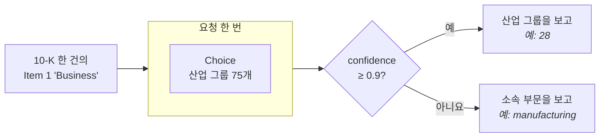

# confidence를 활용한 분류

> SEC 연차 보고서를 문서당 Choice 하나로 75개 산업 그룹에 분류한 다음, 답변에 딸려 오는 confidence(신뢰도)를 읽어 그 그룹을 보고할지 한 단계 위의 더 넓은 부문을 보고할지 결정합니다.

SEC에 연차 보고서를 제출하는 회사는 모두 그 보고서 안에 자기 사업을 직접 설명합니다. 여기서는
그 설명을 Standard Industrial Classification(표준 산업 분류, SIC)에 따라 분류합니다. 산업 그룹은
75개이고, 문서 하나에 `Choice` 질문 하나를 씁니다.

쉬운 문서가 많습니다. 지방 은행은 지방 은행입니다. 그렇지 않은 문서도 있습니다. 두 사업 부문 중
하나를 막 매각한 회사, 지금 운영하는 사업이 아니라 앞으로 진입할 사업을 설명하는 스타트업이
그렇습니다. 그래도 모델은 그룹 하나를 골라야 하고, 어려운 사례의 답은 쉬운 사례의 답과 겉보기에
다르지 않습니다. 어려운 사례와 쉬운 사례를 가려내는 일에 보통 비용이 들어갑니다. 두 번째 모델,
추가 호출, 사람 검토 같은 것입니다.

Choice는 이미 그 정보를 알려 줍니다. 선택된 선택지와 함께 `confidence`를 반환하는데, 확률이 거의
전부 한 선택지에 몰리면 높고 여러 선택지에 퍼지면 낮습니다. 이 숫자 하나로 믿어도 되는 답과
그렇지 않은 답이 나뉩니다.

믿기 어려운 답을 어떻게 처리할지는 라벨 구조에 달려 있습니다. SIC 라벨은 계층을 이룹니다. 산업
그룹이 모여 더 넓은 부문이 됩니다. 모델이 그룹을 확신하지 못하면 그 그룹이 속한 부문을
보고합니다. 부문은 그룹에서 바로 정해지므로 호출을 한 번 더 할 필요가 없습니다.

공시 문서 60건에 confidence 기준값 0.9를 적용하면 28건은 확신하는 답, 32건은 그렇지 않은 답으로
나뉩니다. 확신하는 28건은 93%가 맞고, 나머지 32건은 50%가 맞습니다. 이 32건을 한 단계 위로 올려
보고하면 50%가 78%로 올라갑니다.



## 준비

```bash
pip install ipython matplotlib 'cooksafe>=0.3.0,<0.4.0'
```

그런 다음 `TYPESAFE_API_KEY`를 설정합니다.

아래 수치는 2026-11-03에 `jev-1.14.0`으로 얻은 것입니다.

```python
import json
import urllib.request
from collections import defaultdict
from pathlib import Path

import matplotlib
import matplotlib.pyplot as plt
from cooksafe import JsonCache, make_playground_link
from IPython.display import Markdown, display
from typesafe_sdk import Choice, TypeSafeClient

matplotlib.use("Agg")  # 화면 없이 렌더링

import os  # noqa: E402

TYPESAFE_MODEL = "jev-1.14.0"  # 이 페이지에서 쓴 모델. "jev-latest"는 최신 모델을 실시간으로 실행
CONFIDENT = 0.9  # 이 값 이상이면 그룹을 보고하고, 미만이면 부문을 보고

client = TypeSafeClient(
    api_key=os.environ.get(
        "TYPESAFE_API_KEY", "cache-only"
    ),  # 키 없는 커널은 캐시를 재생
    base_url=os.environ.get("TYPESAFE_ENDPOINT"),
    timeout=120.0,
)


EXAMPLES = (
    "https://raw.githubusercontent.com/typesafe-ai/typesafe-public-examples/main/"
    "cookbooks/classification_using_confidence"
)


def download(name: str) -> Path:
    """Fetch one of this cookbook's files from typesafe-public-examples unless it is on disk."""
    path = Path(name)
    if not path.exists():
        path.parent.mkdir(parents=True, exist_ok=True)
        urllib.request.urlretrieve(f"{EXAMPLES}/{name}", path)
    return path


CACHE = Path("classification_using_confidence_cache.json")
# True이면 공개된 답변으로 CACHE를 채우므로 실행 중에 요청을 보내지 않습니다. 실시간으로
# 실행하려면 False로 바꾸고 CACHE를 삭제하세요. 이미 디스크에 있는 CACHE는 덮어쓰지 않습니다.
DOWNLOAD_CACHE = True
if DOWNLOAD_CACHE:
    download(CACHE.name)
json_cache = JsonCache(CACHE)
```

## taxonomy의 두 단계 만들기

`sic_codes.tsv`는 SEC가 제출 회사에게 자기 코드를 고르라고 공개하는 산업 목록으로, 2026-08-10에
가져온 것입니다. 네 자리 코드 444개가 있고 코드마다 산업 명칭이 붙어 있습니다. 코드의 숫자가
곧 계층입니다. 앞의 두 자리가 **major group**(대분류 그룹)이고(여기서는 `01` agricultural
production부터 `99` non-classifiable까지 75개), major group을 정해진 범위로 묶은 것이 열 개의
**division**(부문)입니다. division은 SIC에서 가장 넓은 구분입니다.

두 단계 모두 모델 없이 이 파일 하나에서 나옵니다. 코드를 앞의 두 자리로 묶고, 그 두 자리를
division에 대응시키면 됩니다.

```python
DIVISIONS = [
    (1, 9, "agriculture, forestry and fishing"),
    (10, 14, "mining"),
    (15, 17, "construction"),
    (20, 39, "manufacturing"),
    (40, 49, "transportation, communications and utilities"),
    (50, 51, "wholesale trade"),
    (52, 59, "retail trade"),
    (60, 67, "finance, insurance and real estate"),
    (70, 89, "services"),
    (91, 99, "public administration"),
]

INDUSTRIES: dict[str, str] = {}
for line in download("sic_codes.tsv").read_text().splitlines()[1:]:
    code, _office, title = line.split("\t")
    INDUSTRIES[code] = title.lower()

GROUPS: dict[str, list[str]] = defaultdict(list)
for code in sorted(INDUSTRIES):
    GROUPS[code[:2]].append(code)


def division(group: str) -> str:
    number = int(group)
    return next(name for low, high, name in DIVISIONS if low <= number <= high)


print(
    f"{len(INDUSTRIES)} industries -> {len(GROUPS)} major groups -> {len(DIVISIONS)} divisions"
)
print(
    f"  group 35 = {division('35')} / {', '.join(INDUSTRIES[c] for c in GROUPS['35'][:3])} ..."
)
```

```
444 industries -> 75 major groups -> 10 divisions
  group 35 = manufacturing / engines & turbines, farm machinery & equipment, lawn & garden tractors & home lawn & gardens equip ...
```

Choice 질문에는 각 선택지를 설명할 내용이 필요한데, 그룹 자체의 이름이 항상 있는 것은 아닙니다.
SEC 목록에서 75개 중 42개에는 그룹 전체를 아우르는 명칭이 있고 나머지에는 없습니다. 그래서 각
그룹을 그 안에 속한 산업들로 설명합니다. 공시 문서를 읽는 사람도 어차피 그 산업들과 맞춰 보게
됩니다.

```python
MAX_NAMED = (
    8  # 그룹당 나열하는 산업 수. 글이 지나치게 길어지지 않으면서 그룹의 성격을 드러내기에 충분
)


def describe(group: str) -> str:
    umbrella = INDUSTRIES.get(f"{group}00")
    inside = [INDUSTRIES[c] for c in GROUPS[group] if c != f"{group}00"][:MAX_NAMED]
    listed = "; ".join(inside)
    return (
        f"{umbrella} — includes: {listed}"
        if umbrella and listed
        else (umbrella or listed)
    )


print(f"group 20: {describe('20')[:150]}")
print(f"\ngroup 65: {describe('65')[:150]}")
```

```
group 20: food and kindred products — includes: meat packing plants; sausages & other prepared meat products; poultry slaughtering and processing; dairy product

group 65: real estate — includes: real estate operators (no developers) & lessors; operators of nonresidential buildings; operators of apartment buildings; less
```

## 공시 문서

`filings.jsonl`에는 연차 보고서(10-K) 60건이 들어 있습니다. 각 문서는 Item 1 "Business"만 남기고
잘라 냈습니다. 회사가 무슨 일을 하는지 설명하는 섹션이고, 산업 코드와 관련된 부분은 여기뿐입니다.
문서의 연도는 1993–2024년에 걸쳐 있고 길이는 700단어에서 2,200단어 사이입니다. 문서마다 제출
회사가 고른 SIC 코드와, EDGAR에서 찾아볼 수 있는 accession number(접수 번호)가 함께 들어
있습니다.

이 라벨은 회사가 스스로 보고한 것입니다. 공시 문서를 작성한 사람이 한 번 고른 값이고, 회사가
코드가 가리키는 사업을 매각하고도 코드를 그대로 두면 낡은 값이 됩니다. 이 60건은 문서 본문이
자기 코드를 뒷받침하는 것만 남도록 걸러 낸 것이므로, 여기 나오는 수치는 EDGAR 메타데이터의
상태가 아니라 이 방법 자체를 측정합니다.

```python
FILINGS = [json.loads(line) for line in download("filings.jsonl").read_text().splitlines()]
example = FILINGS[7]
print(
    f"{len(FILINGS)} filings, {sum(f['words'] for f in FILINGS) // len(FILINGS)} words on average"
)
print(f"\n{example['id']} (filed {example['year']}, accession {example['accession']}):")
print(f"  {example['text'][:230]}...")
print(f"  filer's code: {example['sic']} {INDUSTRIES[example['sic']]}")
```

```
60 filings, 1438 words on average

1389870_2008 (filed 2008, accession 0001079974-09-000155):
  Item 1. DESCRIPTION OF BUSINESS. NARRATIVE DESCRIPTION OF THE BUSINESS Across America Financial Services, Inc. is a corporation which was formed under the laws of the State of Colorado on December 1, 2005. Until March 23, 2007, we...
  filer's code: 6163 loan brokers
```

## Choice 질문 하나를 던지고 confidence 읽기

taxonomy(분류 체계) 전체가 요청 하나에 들어갑니다. Choice는 선택지 약 240개까지 안정적으로 동작하고, 75개는
그 범위 안에 넉넉히 들어갑니다.

답에는 선택된 그룹인 `choice`, 75개 각각에 실린 가중치인 `probabilities`, 그리고 그 분포가 얼마나
한곳에 몰렸는지 알려 주는 `confidence`가 함께 돌아옵니다. 이 방법은 1위 선택지의 확률이 아니라
`confidence`를 읽습니다. 1위가 0.45이고 2위가 0.44인 경우와, 1위가 0.45이고 나머지 가중치가
얇게 흩어진 경우는 서로 다른 상황이며, 둘을 구분해 주는 값이 `confidence`입니다.

```python
QUESTION = (
    "Which broad industry does this company operate in? Judge the company's own operations "
    "as this filing describes them."
)


def questions() -> dict:
    return {
        "group": Choice(
            instructions=QUESTION,
            criteria={group: describe(group) for group in sorted(GROUPS)},
        )
    }


@json_cache
def ask(text: str, group: Choice, model: str) -> dict:
    response = client.system_one(
        state=text, questions={"group": group}, model=model
    )
    answer = response.answers["group"]
    return {
        "group": answer.choice,
        "confidence": answer.confidence,
        "probabilities": dict(answer.probabilities),
    }
```

## 확신하면 그룹을, 아니면 그 그룹의 division을 반환하기

confidence가 0.9 이상이면 답을 산업 그룹으로 보고합니다. 그보다 낮으면 같은 답을 그 그룹이 속한
division으로 보고합니다.

모든 공시 문서가 쓸 수 있는 라벨을 달고 돌아옵니다. 모델이 확신을 갖고 분류하지 못한 문서는
버려지거나 다른 곳으로 넘겨지는 대신 한 단계 위의 라벨로 돌아옵니다. division이 너무 거칠어서
애플리케이션에서 쓸 수 없다면, 이 분기가 사람에게 넘기는 지점입니다.

```python
def classify(filing: dict) -> dict:
    answer = ask(filing["text"], questions()["group"], model=TYPESAFE_MODEL)
    sure = answer["confidence"] >= CONFIDENT
    return {
        "level": "group" if sure else "division",
        "label": answer["group"] if sure else division(answer["group"]),
        "confidence": answer["confidence"],
        "group": answer["group"],
    }


def show(filing: dict) -> None:
    result = classify(filing)
    named = describe(result["group"]).split(" — ")[0][:46]
    print(
        f"  {filing['id']:>13}  conf {result['confidence']:.2f}  -> {result['level']:<8} "
        f"{result['label']:<14} (group {result['group']}: {named})"
    )


print("three filings the model was sure about:")
for f in sorted(FILINGS, key=lambda f: -classify(f)["confidence"])[:3]:
    show(f)
print("\nthree it was not:")
for f in sorted(FILINGS, key=lambda f: classify(f)["confidence"])[:3]:
    show(f)
```

```
three filings the model was sure about:
   1346655_2021  conf 1.00  -> group    73             (group 73: services-advertising; services-advertising age)
   1578845_2018  conf 1.00  -> group    28             (group 28: chemicals & allied products)
     29332_2004  conf 1.00  -> group    22             (group 22: textile mill products)

three it was not:
   1372167_2013  conf 0.20  -> division manufacturing  (group 38: search, detection, navagation, guidance, aeron)
     46653_1999  conf 0.21  -> division services       (group 72: services-personal services)
   1436229_2010  conf 0.26  -> division wholesale trade (group 50: wholesale-durable goods)
```

confidence는 각 문서를 분류하기가 얼마나 어려운지와 맞아떨어집니다. 모두 1.00인 상위 세 건은
마케팅 회사, 제약 회사, 카펫 제조사입니다. 세 회사 모두 예전 사업을 매각했거나 그만두었지만,
문서마다 지금 운영하는 사업 하나를 분명하게 밝히고 있습니다. 하위 세 건이 더 어려운 이유는
본문에서 읽어 낼 수 있습니다. 두 건은 아직 시작하지 않은 사업을 설명하는 스타트업이고(Nevaeh는
"intends to operate as a software developer"라고 쓰고, Hotel Management Systems는 임원이 한
명뿐이며 "planned operations"에 대해 씁니다), 나머지 한 건은 사업 부문이 두 개였다가 제출 몇 주
전에 하나를 매각했습니다. 이 세 건은 그룹이 아니라 division으로 돌아옵니다.

## 더 넓은 답으로 얻는 것

60건 전체를 각 제출 회사가 고른 코드와 비교해 두 가지 정책으로 채점합니다. 하나는 매번 그룹을
지정하는 정책이고, 다른 하나는 confidence가 0.9 미만이면 division을 보고하는 정책입니다.

```python
def correct(filing: dict, result: dict) -> bool:
    gold_group = filing["sic"][:2]
    if result["level"] == "group":
        return result["label"] == gold_group
    return result["label"] == division(gold_group)


results = [(f, classify(f)) for f in FILINGS]
sure = [(f, r) for f, r in results if r["level"] == "group"]
unsure = [(f, r) for f, r in results if r["level"] == "division"]

forced = sum(r["group"] == f["sic"][:2] for f, r in results)
broadened = sum(correct(f, r) for f, r in results)

print(f"forced to name a group every time      {forced}/{len(results)} right")
print(
    f"  of those, the {len(sure)} it was sure about  "
    f"{sum(r['group'] == f['sic'][:2] for f, r in sure)}/{len(sure)} right"
)
print(
    f"  and the {len(unsure)} it was not           "
    f"{sum(r['group'] == f['sic'][:2] for f, r in unsure)}/{len(unsure)} right"
)
print(
    f"\nletting it answer coarsely when unsure  {broadened}/{len(results)} useful answers"
)
```

```
forced to name a group every time      42/60 right
  of those, the 28 it was sure about  26/28 right
  and the 32 it was not           16/32 right

letting it answer coarsely when unsure  51/60 useful answers
```

모델이 확신한 경우에는 지정한 그룹이 열 번 중 아홉 번 맞습니다. 확신하지 못한 경우에는 그룹이
절반만 맞습니다. 같은 답을 division으로 보고하면 정확도가 78%로 올라갑니다.

```python
labels = ["sure\n(group reported)", "unsure\n(division reported)"]
forced_split = [
    sum(r["group"] == f["sic"][:2] for f, r in sure) / len(sure),
    sum(r["group"] == f["sic"][:2] for f, r in unsure) / len(unsure),
]
broad_split = [
    sum(correct(f, r) for f, r in sure) / len(sure),
    sum(correct(f, r) for f, r in unsure) / len(unsure),
]

SPLIT_PALETTES = {
    "light": {"surface": "#ffffff", "ink": "#000000", "forced": "#c8ccd4", "broad": "#3b6ea5"},
    "dark": {"surface": "#0d0a0f", "ink": "#fafafa", "forced": "#5b5f66", "broad": "#7aa7e0"},
}


def draw_split(p: dict) -> plt.Figure:
    ink = {key: p["ink"] for key in ("text.color", "axes.labelcolor", "axes.edgecolor", "xtick.color", "ytick.color")}
    with matplotlib.rc_context(ink):
        fig, ax = plt.subplots(figsize=(7, 3.6), facecolor=p["surface"])
        ax.set_facecolor(p["surface"])
        x = range(len(labels))
        ax.bar(
            [i - 0.19 for i in x],
            forced_split,
            0.38,
            label="always name a group",
            color=p["forced"],
        )
        ax.bar(
            [i + 0.19 for i in x],
            broad_split,
            0.38,
            label="answer broadly when unsure",
            color=p["broad"],
        )
        for i, (a, b) in enumerate(zip(forced_split, broad_split)):
            ax.text(i - 0.19, a + 0.02, f"{a:.0%}", ha="center", fontsize=9)
            ax.text(i + 0.19, b + 0.02, f"{b:.0%}", ha="center", fontsize=9)
        ax.set_xticks(list(x))
        ax.set_xticklabels(
            [f"{lab}\nn={n}" for lab, n in zip(labels, [len(sure), len(unsure)])]
        )
        ax.set_ylabel("labels that are right")
        ax.set_ylim(0, 1.12)
        ax.set_title("Where the broader answer helps: the filings it was unsure about")
        ax.legend(frameon=False, loc="upper right")
        ax.spines[["top", "right"]].set_visible(False)
        fig.tight_layout()
        return fig


# 문서 빌드에서는 COOKSAFE_RENDER를 설정하여 어두운 테마 버전도 함께 그립니다.
for theme in ("light", "dark") if os.environ.get("COOKSAFE_RENDER") else ("light",):
    fig = draw_split(SPLIT_PALETTES[theme])
    display(fig, metadata={"theme": theme})
    plt.close(fig)
```


## playground에서 열어 보기

이 공유 링크에는 공시 문서 한 건과 선택지 75개짜리 질문이 들어 있어서, 코드를 작성하지 않고도
playground(플레이그라운드)에서 분포와 그 분포에서 나오는 confidence를 확인할 수 있습니다.

```python
playground_link = make_playground_link(example["text"], questions())
display(
    Markdown(
        f"🔗 [Open the filing + question in the TypeSafe playground]({playground_link})"
    )
)
```

[TypeSafe playground에서 공시 문서와 질문 열기 →](https://console.typesafe.ai/playground#share/N4IgJg9gxgrgtgUwHYBcAqCAeKQC4AEIAkignPgIwB0+AIgKIDKAwgEpEAKaRA8gHL4eAMXwAhAKqMifJoxp8Agq1YLuANXp0mbTt36CRaABKaJUmY0b4FUAE4QAzg+uJbASygBDfELdJPSFBungA2+IwItgBuHggOADT4RIE0bs7eUBC2AA5ZnihuEEj4AO4AFh5lpZ7OAGZZiGD4MEhgkfgoZQj4IZ4lzhC1HV3hKPndg-jMECF5kPhFdAhQZABG7RSJAEwADDsArDTiqG5hALKetlBVWwDM23sA7Ikl3a+23d7lMyEAngC0EBKSAQTQcMFWDjcYGCtl+CyGzE82VItls3l8-kCwTCAHF7DBsolklAqIl6rZXH98ABrJBA4o1ax2RzOBSuDzeVgIUL4egOMakKZZbJUAAUgBwCZgKLiAXAIAJQ0HjFABSARgl3hFB2Dx2z2G3RhHygKCyA0RMrQ+GR2XsUVBiXBqwAVssUB0IAb8AharU3W57SCnAjrfgPgBzNIodEFRYlNydL0RWDuApxa2tPmYa4BcPdaZwOBpKFFRKdbq2z0x7wObJ+QG+kM2ezB9mRTk+PwBIK8iLRWIJJIpfBizHdnHhSIxFYOeUeqaW-AOMqXBBlGZtWzmsPLLJNRYXK5VTb4XZ6haM-CVsP5byrGppGiMPwrBdcQCYBM5VjAoUHnGkd16UgmlNL1K1yBxQWtE0AwTNx00mMdsV7KcBy9aUuHwI03TNLDlmhKCE2qf9inLfB1gFfA-FROJ3UmDCrQCJokJ7MI+2ndMmLfNBPyXFcPnXEJN2cUDa3rQYhhYid2LQ0CiyQNwiwAL0+JB4VyUgTl5SZMiQWoQg8OihmoyJaJoNARmXVdtyklD+xnUpTIWYEoNWeEGJedcsKjdxv2A0NTTGMJJk2AAObV4gAFkeAA2PjrPnMiGPigSN0iAZiiya1VggGB3UPa5T3uU8niVVV1U1Sgtl1fUAgWWxwwCNwlPyQpin8Rpwk8P18CMS4ctsJJEgAGWG5gyXwCkqXhOkGWtZxGG67o+tsAaxB-Pw4mcWgEHtWZskQVBhTgbIAnhSVFp6laBoVTzKio9JfVOYJ-PjRNcsG3oGtolK1zS2xElxWhRAUId7QFQ6UEHUbmESTxww+KDQMrGI2gWbJIlapBw3wLw6yCqjSJGKaQ28WY6smAASLZ9h1PYdnnTJ7UGiAMZjPwcawDGkEghxzIqZxyeKEomTAGAJnKpANThKqHm1GgjCBXbIkSH0-Rg+1BBNCB1kGigYt1UKXgrTxoQRIYyNtF83FOsIuM8KA7HFpoTI+SixYlhYYE+iA6tAy7lv6rKdr21nIeO061Lh9InDccMQRAz0A96oO9ZGsaaAUd0yIcTxEA6RSEGN71UFMl3UE9MnfcZNFczIZB3TeqoAHUfrOXLUFN4oOHcRB0-Gu7CoA7rame8Ymibr3Bp7uICNQRIzlsGgAGkQjIBwlJoVvyKyexXiaSmKFuar6cm+xyFbyj25aMY-HwHvC-7+cUYI9HMYKbHceRBNeVApn2lZu-Dm3pMDc15vzACQsHrelRsgFYTQ3IZmaDzZY3soKViLE4LI8J6RCjFGRCUfAICkAVKUCoQ9nD0hKFhcWWtTS60oAbEqOwACciQWhr2DLpZmwFM4hDCFbbEtsMzlxopRB2Tt0w31OF6IhQoAIe3qrjIoPDQT80+NkbIBkvCrDXoTMR7oYyezInI7oAEKBbAAKRXnaAEKW5AsArBRITL0ysjqdHyI5Sapswh-xUZEd0Z0rxZFjJlC2IxBFBGEVxU68IyKux+oou+5R7peEgl6G02jPC6O6EYi8sjiHdCsvwg0HxuqonIt0CgoVrFswzPYzOgS1IF3zlbLKoEyKKLAOMEMJjClwxKblKGYxWjAMiTbXkLRNwFKFHATwvw4bZ0sjMCYKI2q9JGIrISKtKnKKQKo0RnoPrKMLIsKybtvQAEcNS+M9GRIZAomJjPcEI3kecO5GS9Lgw0sE2gIPhFQLYWwaD-HwLcfAoKOCsB4BwHgjB6C0EEBwegKg9B8CsNvVcoY2ihwOg3JcYw8wnMjr8JU3s8K4vDo8ol6xGrCy6MLDRKMoLHO-L+LaV5eiZWKEQ+0cAGFsOYTFMlg0tF1RFiJSuJp5qhjgCExqNL7A0naBSE5rhWI7l5LRHp0YAi5xgkUPmggeUQD5Qwig+ozxGy8Q3Mu+jK7FAUAjBA9cjqTDOJEPMg0uIcC5SGbkWQ6XNVanGBMVQZTQrEIUe+-E5krDypyMI0wch5FCSOCNPB5RwyvO4KIPTpizHRPMTIKb2aljIaZRBxzvj8IBAyKCTooQwk1IkZsrIXDti8Mya5aQ4KLGTaKF4uUhL4FcESyeGaXhhusFCnglTgE529jEGIn8G4JlJTOyNJRh0gQZZUzI+dq2CT+ICFyYIIRNthBu8QuRihQFmL+HGZEx07NeKUHdD1wSfA9ATEKRtqlsMijFLYv1JVegzb9QSwkXGOJXNjboqrQjBXCQgNwet-2hUA8Bz9zsRFe2GU8z+5y4hlVDLUGAtbEgwhCHlVyD5BxkQg8RqD6V30Uf3MCAKxDtJDF2PECgQH4gsOw8R7cBYSXHTlcURgpooA0kzukHc4IQifM6ABXVPMHahOLtu9j+AVya28IFHj1pNH2EwIpcY1I7ijtOAZM5-EEKIggKc6TsmaQ4aglxB5IyYTYyOLer097HDAMmM+z1Oz7lPRWFuPD2FtaxcmBB3TI71gHomOSiSsRYtcXi6aLcIqlwrPNtluLaGcIA3wIvFea84AbyHXpt2cdihq39IZpZ3QCiHqGMFx96iTmrE2k0A9EmUv7jZj0qZ7QyIdW6AoJSpBCqiEKA4IIcCi5DlJIkLKDgXOGnbHmtN5YPiDH6710L4T1Pok0wa4oAEnSumlX-AJXc9kfzzNiOI0dR1ZAQxR6kMJVs-kguXcDzrXWfI9d9b1mZfUUyGAGhqTUWrabw2RD4PaPjh0mJ4GAMJ-KjyxBqx5pBIZ1HPpungAyig40nmRG0doTNkQ0-qtNiCc6OZY4loYEGuJJRcySzOs7oFkW0cgSCEwhijzXggvK+BcH4F+Agd0xZcOnU0lDQC49GYC5C2myYcyUAVK4ogToEB9xDB-Ah9pZT3vkS0+2Xkfh1ZppfDRvzON7wmkdwIkE8AijBDLBCSIsAH3D0zAETo6JMCExd21I1EGVzpBCLtnosQUFNDqlgKMYzxhHVVcz232OhgxHRGEZ3-pFhu7x8AowRA1DEj0jR5ALU8MaTXUhuJIwJSDdsE0fSMBZT4FLz+IXkaxU83nA7THqkmg4oQPtEBOfP5cXpHtUp390wePdF4YocrNZR9yuGKo96-CJo6O4UIzge1yb+I6Lo2Quh94XV0cgh+YDH69EIWgoMGemt5JWDOLzHhp4GAHmtiJ-OWG-mUASJ-geuqjiMGqEjQGcEoMvPQGgBip8B8LjN7B8KgNSPULACDvkqBFpjKt4HKrYCgAqt0KsEqiqllPASHhOGUmENqkKCzlpvHqUNOt+KcGAP8KaP8OCERI+noqdGAI6HMiUjlDHh8LfAIvYI9prqqv4KEm8pmBGG1LyAoT4qxu-sfkMl6McAmFBDJuMEamgJ6N0qQMXAZt0CuE0PSNBAUJrIAmWjzDQLQN7MAlalPASkYuGPCPGCUkQT+PkvPvtMAt4JWCoVeDbAvptDQCoM3FVqoCikQAoMNFYBZN0FbiGOiNQobj7v+JQsQrKuMJfmELUFpllHfMch4SGpPp4pbG7Pil1ggFvIaJ6ArlzG6DeMUVUTiGBusJUaiBOLUQli4mRORigGgjQMwJIGgDwGcCilYAoHwIiswKscitwGioIOSmyptMGBPoTFEDMODK4TEYplQTQfDHQQwYNKqswVcKwTyOwSTp1tdqzvHhAl+BtH+NAhUMftSCNsrnBPaOojgVivYpELlM4FCEWF9MSk1OmC-B7kuDAIVJBPZOmHfGRKYf5BYaQNuG2O4F4IVuCQUPls4KEWEA4fgM6lUZNF2MhGEG7B9A5Cbr9iAmzAUOkgSQLORICVtIVtks9CgHEjYcrIvscncbQeRE8Q8SKeysGPSXhNzPuJlOShKQZFKfOOCI7FtORrWqOpcMqnROSriRxCRMMABCCWUGCQLhCW4d0MgKXkUJDIsXgQ3Hfl4oyS4cQaaK4HUFlMcjaQON0V-EgAruGNLJHi6sMJ4m+hqWMdknoqBPMKnkaUAaaX8DQCDMwMvMNDwLiNYO6DtCsPyu0LcCeFavYaAfLp6F7jSLMOGEaqCpFBCnyGcBwKWQAJr0BMD4DbyBmehkBaIQBK4ITHbJnFDVb4CrzrxKTbbkozxNr4pcTJh6Fwj-BoBlLggfBLy9QVhcpgY4qFI9AcoeLFD7DWKTDCmdHzisqilODRlnGgQfCKTfhbgZaDRYCoJulhneolIghAGVRcTBkuaVTHFAkfBARQT9EoJGo8DkqIA1ksxDBzL+B5jhzfDWgp6eg2kIREzdCiC+x947grABjpguGgH446FhDgmaZpqIZG7ICYkUWXBNCIAQnYxGqzpQpEAYFKADlJB8BCA8CsCoEHHbxzQuHgTuDK6VTO4NDNE0C4g8AaCsB8BrF8BWisD0C4jiDDSqC8ACDPiBBvASzUjkFCndB4wOzrqkxKkQDKqVZvrzB9GgIDHhimqRBIDhwRgUbNEDCfR9BgaMlBIlHVFUQnTkGLCj74BGXwpKDMBGDWBbFaAaClkcD6VWhjmeCawgjMxLjcxNLwjvI3wuLtGXCFS5aylhxbkaxwQkZ8h8BqBEDQp6X0AGXZFTC7HDRZF8DMCaBWWvhvpFB2XSoOVfynRBAGk45uUeXFzeUVH9HSoeloZekNy8i9D9DzjRXNKxUTiKQLV0TFDJVGA8BpErGCCiBoAKDSCCDiCsDhD0DMA+BEDDV8C4hYGsl6J2I3KJDXKXCoj+lcS1j4S6EIC5DUGDiViYDwhfFk5wyZjEJP6x7qVpp04jDJi+FpjOD0DZhwZEoFiYIljFBijwrMCKgpVw0hKI3mYo2CgQ7pAY1zlqWUjNGA1QR43dC00xm7J+DQ3e6Z6ZiZB1heYdZXgQjaI7h+j4GvhTGSnwTbhkRC2eLagMwiAyaIzuh8BUD0ATTNw1AVDYymhICJC0BfW7D7CRQsJPjYlVCnW8hzJVVEW7ISJbRIVrwmj2AKReBmmIKIB6obKC2fUADkdJCAkIZh1ojcJQJQVAkEpI-lUQhWfg4M+WWuoSzgbQp01B4cu+uyukYw4tidAR4ywigFsAbpJWr4swXg-knixyNdPGo8r4Fi4KRC1BVQBaa8RKCggYtCjAMACdZ4iQQgISwo-CotiQBacwnooUBwWwkUhWj+RQ3Q9iDCbd5KXQoBYN1BrGAEYoLCjwOwc4+wtwOw-wOwx8hwo5jlvpBB8I45jk8dpAT44gog8KAAiuIH1VaPQBoAZcavgLymsBsJansNam+rah8Ickgk6ojMXlVhFjDk0HDmEgzYGsjrzROsLstp6BwLGg7AgAmsHcKKWrzWKBmlmqGFbIdvmDMMvcorQ6juUJWvCEej8HWmelifHc2nCK2iyK2ByF2jYD2lCGmgOhNGNqOhFrwYmJOio+GsLusC-kUkurBKuicFKWPnOoo+WMUGlntgETWievWuesI1egFosOdpASMC+p5W8B+qrt+sZshpQBhlhiBqJolCMExpzv9HabBnXJNFlEhhHWhr4-xphlFNhp4xLfuHlI8qMkRo5qhZePmQst5DRv5PeFCAxsE8LsxmE2xiOnNEZtxj43xgJgbMJgE9kyGOJkEhTYsDJtAPJtYIpm7BRqpk+T8dweWqmR+tFT+iZn-hZiUdZuCsifZsUIE-RC5lJqMD055qk-hhkx7v1qgy6tju4JGP4GaRiUjCuCro3B+qiPJD0osEIHHbYNLFqPWXsCwlREMN4MwGHp-E4c2XRI7L6WANGYg4RBXEgnnJxVBAcxDvOFgJpLup1pEHc2mrYZ1p6AVMeG86wi4mKq+GFiMOiyGI8-QS85QDi07RA1ixS7qIKgg6XEg-aqGGnUUJnodH8tYODuHKBAi5xV6Lc12Gizqpi-VVUHWXS3i70ASyhlhPc0MDSxQJSzQMkIRcFHOW7BjCaKU3Nty-iu6pg3hjg-6ggPgwpCjusljl3HafmVE1cLPt6L6G6CCvgPsBCiAIkCABgiiA4BgNgHgIQMAAADogAIy5TZAhsEDBsgBSkYyRv4AhvXAQCxAhuJAhui3RjYn53xshvNzkJVD0G+zlxiwCgyyQBb7CkjZBJNHyJIAAD8+AKoeORKZEVbakMdzkmUE2+dMqamdQz0n8bQq2vkFbZAVAqbCbIAdgZhl+8b0bOwFAObIA8MFJgz3sAB9gYst2-wLI2QDgE7IbOwWwS7K7Hga7ZeOa5u-wBkOdmzAAZBmJZmEGLTiETQeyAHqCewjGeypuu8+6hDOO+zsKFEuxSLRHCEBywqB2kBbeGIkGUNIivpmLqpohzO+9qEu6bu7Wfp-IACgEhM96eOcQBA-lI6UNpwZVv2DgAA3LZqtgvlyqaxEVh8FG7Oh8ewGyG4NvMfJAicoryA+wZPHAnfJBzLR9x-AH4Hx5kAJ2nsJ0KEeVMd0KJ9jOh7cEu07GjBjNGCsvAPgA++oX+0yTULR2AO4PPZ-Mm2EA+41LHfwjRwsDIjZ0yKPAvk0FzIWrzZGTOLR1Z-p8Z-2250uAB19vLssOh5FJhzhzjA+8fXCBds2UFSpfPVALZiCGXs4GKC4eRgvrOOh-sEux9pjGELomADjOXeiAls4KCk1m0FpCV0JB2b5927RSKQIelLR0Vxe6V+V0ULqlVz2fSEgLVx3g12V-ux65O-rEu4fVEPCLpKW1m+spjdNnBuRI13spRKChV3UbFvh9XkOwQCLKiI6AgO8IkHWBjAZCCIkPAf57kO8GniCJt5m7duh48Bp4aq92mqCi+7-EWo5X15V7SfgPt4EO7sR96P7dGOfturYDSO+7sKBxAObnhjSH4GZ+gpu1m84GD4R4d0o54gtej5-BPlDLR7nD+A8c4A+yt6Kh8EXVBGHe6JWFu+T8EoMzLA4L0B-mUBMUh00IAVtGJ3K2hupNj9q7R7ELjGUuQA+7UPYCpMUEO7iez7vgnOSIr8gPd+0dEP3s8wmIkPaDF1E6j39ypurbR+rw6GfBPVDEbwgHBzmnEFOKF86HnDT-gK6PPXEJ1+iHfIs5e2zxN2myAFsIu5xzGzrBIp6Kzzj6DwRxDw4AQEEI1AoaSYjxxwQCG6QNgKcMp3ZkH-H3j0nwQIW6AduoGN4vQR4LZvZ7d8QlbeJ-YBXwFcULUTX6l4s4ODheaWjKPAwg+1CCEDSLR3SAmHbt32PwpFaaiK8JcHXynlb5cNp5788x2Yj+p5HzaKuNZwsHOYTjB4L5u9uB3xSZ70iacAv4bmECX0R8n0o0gB2w+zlL8A4FHZNN7ApMuB2UOvD7jLME6BO8H2SGeCE0DT5k5aO26Q6DHUSCU04gUddGk0GdAtBCgiWWjLYHn62AoBe2J-j32LAIDbuFQISPgWf6x5I87-ZBJuAgENwHOmCFYPwgCBMc6g2SCktrlz4FAJCEvKGIj0i6R8aMmFfztulR5x9tWI4bLl-wTBoI5wd-AnrnBKDd97uXKSfnZkHBddQgtHRZsIKkLD5kALqSrFol+DaDEgQ-b7kZ20FKNMKdAnWPn30x7YHOtoH0KwM5CvQUeCCRrp7xGzb1UAIfSdjTBm4Ik-oI6cjLYBn5oIcBqPdcFbigyf9QhUgj4IkCy6ehCQgkAUGXHlC+dosf2OIfMQ+CZCu62QsITgSSHvpzcGQuWrolr49d-OCFbXCEKKEIBaORdGkvHnvwL4ogTvZuh5UHC08sh-nAULyVHjYA0EdAtIAwMY58d6h8Q7oPLzcDDC2Ok3ENlsBihLtTobMT3qAKx7m5i+ife-gQGyAUZsgi-BwciHaBT8rwpw1aJRV4qqCmhlwnKDxTexdxWML-CAJgF957IDkFwupA+zWGRAHhVFVnplyDJ9cmBW4AAPRyE4g5QsVAKA8CDh6gTnfjv5D+GDR7wG-RYWHw+6R8QQ-QVEQ-wOGVDlwoWUVPLRg7AJfhLyd7E0PbDm5E0BIskcSMs6kiiRsHHXtRBF45R3KDI1kSSIqEGQmRJvQRNSJ3juUc0HI7GJoLGEMcmBfHQkQKNg5W81mLBDdhKPDCaCmo9QVLG+RAp1Y-eLqO3F4D7y+ClhIHSPtcDID0j-Omw4-tsLEGyDIeGPH8DDydz0gkcQdXGK-npFNDegcIrvsMVCCOhfgqAKoE1iQDgjnmqwXWLdwY4UZHA4gz0OGF9GzgfRNQAoP6ImJX4gxIYpTKLX85DcogFGUugvjTF7Ytwmg0EB4C7DMUvRwdT3jlBGTn5RB7PR-JcDjSUN0xG7OGpcDCpS9igMQHTv5zvjLobCwQeOI4HTFCMMmPnciIUHbJNjuBg4EoYDnHF+ipxIyGcOUN2zIgqMyuCLD4Nu5rxcwzvIumFQu6RByMiAQcJkAcCm54RiPKDpH2072A14enD4If0lHzRWxKmC4SuhN72BBgwCN2kvzo7jDZRERZsduGfG6c5e-HEIO+1vpLsCgFyB9n4HS4dBg8DnSMYP05Rpj4RpvFAFgM641BLSiNB2DSBN6QRQgOMHFGhAfbYT2gvw30emOcDrhIItHM-i4KggMT6edo+3mFygBSj6OjAkEHKOYn4TIJtHFoOCE0QhJ0E4kqAP2xCCwTlwBo1MX6LDJ5wi+kvXCRpO0n8TwKCEiPtnxABHi5ygnHkHOUgkJ8DukPeoMQiwGJCXCPE+UAhKz6Tt9IniJMTUAc7eTgwNnZMSLASHO8nALKNEbMGBCddkxTwzaOWKZLRTIJcA0ApLjlpHgagUEPyQ52rINx4OvwMzrjm0QU8zBF7e9PMn0kODG+kQeEPRJLEojFxSowIAoQ2zBE92enJiWmPaCQSEJW-EyWkIXzvp4eg4XRGmNiH+AHI9En4BSNZLf82R5wvqWEDh40ghpzE0aRQzX6TTP4igsUJkGVQLBAwKYglC6gESJF-O8xCiFL0Dr9DSA-U+oFMmUoODe4lUW8Qvjtw1SPxOMSYENyVoEhnALHB6ZZhljNjluXzAQX4HgAU9dwrQJ6YgAt6fw3p0XEMF9MiA-SlGQULCRtJolFEppCLZ5piU+lFBvpfHP6QhL4EmSWOMZOgclz4g2w6wn8e8GiFy5UZnmdWRIMqg7L3cfEWUvKGvFEb6YmIpoGYJ73UEMkeKQUxofpksnAIEAPaIkCAicTugF8ywIQW2OtBoZaOTE+AINk-hDDchHww+nbmlkT08U88OWXDQVnQ8KSysykKrOeJf81pHE5wS3QbTFT3aVMySajN5CQAzQjoc2pryhY98NwHMT3jDzgAOzO+2uMVEKEWkjgco+fQaMuFZh5dMRtwArpH2QAnN0wD7XIVrI+G1FrZcaC2lVP86GybYkMWjgdWKDOc+82vfriDwfbrh84Fc-zmnzq7OAS52QBqYt1uxwCEZD7YCaxKYjXccYBc2KdVKuRGzO533dZCPPS5jz25UohSJtIdiFyZYD7duQmMc579bOrJILgXOLkyzyhfnZzoFxHQzyi5a8mWWXMJglsXRviZ5nJgYzA9vZF+HxLhFMHkT0oCElYWnItkB5UutPOcorIDrn5254cEoSNgwHjybYMg3YQTwe47JAcMPPyOsiH5atX2cSH4lNA65Lg3o1wPMAvyH64KygAIzPJoh7HzEHOQCmHtQydGlsJwO-GMD+E0HEI35TJPQTGDNC0cohkEGIZkmCDWVKFFs2vtwrO4JR5eeqWjlQstlCc+eU0+MC8k5iXyG4XCwIbwpryegH2sCCckotQAITsRZMlhYNHtDkJOEHM0KfBkGhGid4MID4a9w8wv8IiOUGxdYNzrGKPAEhcGhsONJYJ7ptHOxS-LjkuKsoDcj4abCuDohag7oX4Z4to5hK7A5SWJWhniWRKS4Gcz3unM2gXCEaCEs0b1J5BHhdxi2VHP4DzSNRUc8ZaEN2A2yeB4S-gKhryAcBv9y52SVNNglMyniKF-nKYbrNiV5RPQFXQWXax3DxkgIwCEbvV387wF2C+yHaklx8F9ib5cVDNszNoFDKw6R5CHFRjSBip8mUFIHjMD8V1NmowCAfGbFNwvDlEiHGibtAHB9jFuZONZTyGDm0QEuUiqsQaTXn+0lwzWK-M0oGj5A2lAQUIL8E7Hl4eYmbSAejFBWEx7lqyiyShQQmPiTJroV4CEF5nD9mYYspQdrjFm0cUVC+XmY4KCBEzkumgjaDQvBUrL5lWEH4Bf3mJOtE4TS4zleLLDTlPBxAzHngN0EmL0wy42lf50GxQBfg96aERT3hqvTE6TpCEql38rm5Bw4FGkTzHPHYgU8-nOntaGoJRhKB-cpUQKHgDdB8VaKseWvhenq132kUHYEu395oqi2g4a7ggH+ArgKMb8dmJ+OtUt8wQRCqaYK1ObehHkrIsnOauMmTtm6snJ0N7HvCkQfiREVCYywjV1QygJQdSD5PTnTYfi5q9yTn3vkk8TemQXwu0G868r6KaGcoXYuAQlDQ1IQGEWSNS5izuFU0gYeiDzB+KUW1Y80iZCJwIZnK+pdWmssMVnxUMx+bOD8XFXmrSZk7Y7mmr1TireaDoh-m0DhrBdvAYHZrC-J5gzr9cUub8kOvNWpyTJYStdbWBCTNFHQFosWDLkSWWKPo8EeOSFwc4HqWcG6tqIkCG6rYug560EJevFUIi-gJy+CEJA2FoZxVHQVtb6sLUmiQAQGVYSdPtXAjei+QIzrZ1cmYjooSEkdcerTTgabJ4PPYRquux4V9WFsdDdQV5qTAFeg6vnpMsuD+VzVuSydkWkKCkA14W9Z7vAVQEt148La5jeuFY1rN2NYVDeQxsKTcbt6paxWQjGRBVAAFWNK8bnCJRsag6vYm8DCBbIeq0kduEnJxpA1rwYgVNNyqAXU3AJNNhqZfjkjVVWSypTGm5XpvA1KjCw-GntuBpfXhcUNSKydm8qgCJBt5Q-JqGMC553rsN+PSHh5uC54kHOhnC9tvJZyU02otHCLbyCi0-FMEaQRYA+0QW+QE0RQOLQhsi2iwfIbgZBVlqh5uhLZ0mgtQFoPQ5ywAxEz3uqqw2VahsUAlkjJMMEU9fNT0u9e+1phLsa0cQUIA6rFjogzNsqsALj1gWQ9etucNeP8DlSuK1w7izOT9jm08qslmuIfoSC0SW8yEKyKbQ6tm1ZQ3FIqrEpogMiLbcRq2hzpNv63-BulaCfziEtGnkiBKUAwSH1um0CCcJ6qhblPMWA6rttnCa7R9p2SGDjBi-aOQ+wsGRxcuL2nbddsrB+hY4RQWTq8Q1SgL8U62k7Vtqu3TaIFqIT3mzBthP4tUOiqJUVkiW4r-tb2vbZWODq7jO4e-NifjGJ1Gzw4GOzbXEC63BqQ22Oh1aiI5l1J3ZPO-4GZw-zM1WYylPzb2rS3r9IwAoSgeCFaC+LKdu2-4AwoXwXd4Ir4EbZ71wRaahdYbGLFLrzpbDg+MOgHdNoN3thQuwsp7uLKF15zyAzYwYuaUzEgShdFoosHWOtE+9bRpu5XXDuVwvjKG5Ab8CPwJQCas5oGq-F1szUgA9Cpwf4PwSEhASAxKeeDqLNXBeaeK2vFrdSDnUEB49IQa9prMYn78saSezEv3Lwj9a4phembTYL0QPa2gNeiDTfStUqUE9hdcGlSnywfC69eaCXazSo60c699Athel1dlpTRk6SRtRzsxEO129ihG7W4IJRUdAtpfHcEvst1c9e9WEjvUXu4TIB4I1lVfQsND77A919G-farr6XV6eZQsmoDMEyXGbJ8+ezfT4hv2gR65FjXPUPrP2Tt9g38kyXXrV178faPiv-emDf117oByADtsFjUxEZd9I+6-bUWRLzdABbI2fXvqX0Jyiku+rrfoqv1L6Htt24KVMMFHpKSdp+qA+Nof516yD+B4fe-oT1CaywUQSZYan1UAVf5QdREsgZYMH6BckCh9rjoLWDBCJWKbAygaX3Gg9wOvUyCWk5ZjAMYNB1vXRpDZ17JZcMrCC8hzW4SZxWhrGDjHxZz7z9bmzQ9fvoEyjRJERQvevtw116RdOMbA23nsBWwVKO+5g6PulEiTmBfEVmLTJxja61DMhj-Yaq8NuwwjCe9cFGPyamgx5jUfOAnL3bRGi9r63vYIewV16W6oQCACbzmQJ69w7QERTgY-32HsDzmqAO+xiiWqcRzRXkCjonCRqlpRUnpE0d5AtGspyot4p0YCBLSqjbWv8SRDhHzFUcfoTcJ3k9Hg0y4QxoOTCppKZalVALSaKCGK5gl+INEarZ-0CA9tah-kLMozVkZtKWjHMKozUa50gAJjxXLpWsbLwnoj1PMX7MNiQZEQHin2BwelCR3MVXjKucFVIPzoU91w1BIQii1VInFnAdgSsX8dGNLHRhwkiYY4p1Ey9oTCxgE7Fp+zUFFSLRi5VAhLSas2WtA8udXBWrYLCcVS68j4vvWhSUAiej+WCFQSpgzVmI4DEuzTqE0x58BOkQaULbdDdxLe1WKTTrgX8Atb+9k6mHhC8n0o-J+-V0sAG8022W2rk-jnm5A8tMX4J4p72b336+xOdcOKAQ4g1GepIatwD1FFrrtrKsSx2HPFJ2H0VMVQc09dhWAqKxIBMPuTToaUhdcJPMDieViSkvIZhX8cEKEANKOmqlFPNBKGZ5gWnnTBcFAHojDOWmYVMZxypcGUpbhzjLJ8dem2jNOnPgH2fiVKdixD8QuNRy-ZYa1RfEHDBPNgn6rZouqAVsWZcU1XWFzgLJVJ5ru-Fwj4zhus8OrgUE6MT1k9z2hsyDxxzNDw4FeoOeXK2jdmhgtZ8CAEnyYKrNUnxes+8bW3mlcKrGMUKqjp4HTazHBfbC3pHAF4ugcTGpo7A+TlCuUtjGELAmLMUoF8HhODbjHrgTFoRNRog1xy5QeYLRD83zjInsC-AQzGC5KXFPVz6sXIj5zhLtjinyQbjwF0Cy-OEgoHKz9Z7OrRB5bPM5dup2iM-MMmYjL6AQpjYOAAnyQcYpR27nnD3bmasaswMrmMmla0HbJD-dcKRf86zbcu77R4LHvA3-B1h3x0LbaR4vGmQ2-Fg0wEl7SfiJLYBKS4+mtAfY1sDnfiwt24Mon8cO4cVWceUT8JK8jIJS1tv4uFGh5iQBntwOfVqoVRdsagvd3Yv5H0Qj+X4BDLC3C7ys0qEy9aDkuaqFLtm4SwOCEI2FUVQ82rXOSnMjnjLvhxE23OoP4E3T15B8DJbvX-A0dR0OK7JyPGPpMzofR4OWZAASW+ls21rgzzCWncwtHM+HsAjFPJXccX5Panv0yvlqXCZnWiluGQ05WgDk7SKwifAnOASrcTcDTxY0P5XkrRVxYHWBNB3bNFBEO5KcP0kYmJLPu+cGNeKATXdZ81orcZeITrI1rU14fDNY6BzX0tBWpYy5dtKq6lrckba+NcMh3bjrhWpAGdYCsrWEik1nAuWCqIqXkrWiw66ofSvwSiLFhka65bzhW5Wd1FW3Osiw3VXXLlXHSwdwXSVcPMNbBa6Naiu9XrQcAMG+johuSzNro16BluAqBHCj1CNGocsEhuOMaMkId9qvTZPJW7TiYaG3QYID8Wss40gAWfkUkhhIAA3A3DTs2hPWZw-wKWFuCmmCXfVRortUEB7UfD+LDgdHnpecLewFLUt7xDLbapfXXLjOn+CBP4s27Gg5+dbQ1HPw620Zgx-y8LcNvUNeg-y-LEZYZsWNGbJ+KQ3eqFtxAZtYwiWSGak1qswBlt0LoRdD7hR6brloep6bC202+LyV0ENiQaP-tI7mI0KGJeBvnXdsxOUUyzYDsOAd2HKuVvN1duJ3g7nV8SwTasHE36oQaC1oalpvfnU7AVjJSCHbDYw4YV5q5WZZd5iskp258ODDfOuN39BRmt29nZ3Y9GNUTlqENQxf5zj8j5+OqkeHds53SSduW260qV3GWgVBGo6H5Y3s938Ual2GS4eHv8XVastxEhttno4UHiVKTrUneGtQs2ByvI4z-BljGhUMPrDib9lXUZ1AqgapO0Dflt3rsrk7C+ku1djqEmK1oX0GEog0sIgbQ3QEC11XT+qFRf9gAL4YPJuy7OsGoHShtQA2IAKIBQBABoOgAA)


이 문서는 개발자 문서 플랫폼인 [Mintlify](https://mintlify.com)로 제작하고 호스팅합니다.
