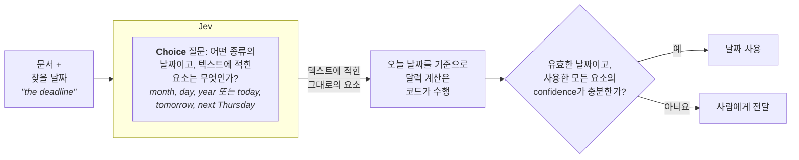

# 날짜 추출

> 문서에 적힌 날짜의 구성 요소를 Jev에게 물어 절대 날짜와 상대 날짜를 추출하고, 코드에서 날짜로 확정하고 검증한 뒤 confidence에 따라 검토 대상으로 보냅니다.

*날짜를 이루는 요소는 Jev로 텍스트에서 읽어 내고, 이를 `date`로 확정하는 일은 코드에서 처리합니다.*

이 cookbook(예제 모음)에서 만드는 함수 `extract_date(document, role)`은 문서와, 찾으려는 날짜를 가리키는 문구(예: "the deadline to return the form")를 받아 `date`와 confidence(신뢰도)를 돌려줍니다. confidence가 낮게 읽힌 경우, 읽어 낸 요소로 날짜를 만들 수 없는 경우, 문서에 아예 적혀 있지 않은 날짜인 경우에는 표시를 남깁니다. 날짜는 "August 14, 2027"처럼 풀어 쓴 형태일 수도 있고, "tomorrow"나 "next Thursday"처럼 오늘을 기준으로 쓴 형태일 수도 있습니다.

Jev는 날짜에 관한 `Choice` 질문들에 호출 한 번으로 답합니다. 어떤 종류의 날짜인지, 텍스트에 적힌 월, 일, 연도, 요일이 무엇인지를 묻는 질문입니다. 코드는 그 답을 `date`로 바꿉니다. 모델은 텍스트에 적힌 내용만 읽고, 달력 계산은 전혀 하지 않습니다.



## 준비

```bash
pip install ipython 'cooksafe>=0.3.0,<0.4.0'
```

그런 다음 `TYPESAFE_API_KEY`를 설정합니다.

```python
import json
import os
import urllib.request
from datetime import date, timedelta
from pathlib import Path

from cooksafe import JsonCache, make_playground_link
from IPython.display import Markdown, display
from typesafe_sdk import Choice, TypeSafeClient

TYPESAFE_MODEL = "jev-1.14.0"  # 이 페이지에서 쓰는 모델. "jev-latest"는 최신 모델을 실시간으로 실행합니다
TODAY = date(
    2026, 7, 30
)  # 상대 날짜가 매번 같은 결과로 확정되도록 고정한 기준 "오늘"
REVIEW_BELOW = 0.60  # threshold: confidence가 이 값보다 낮은 날짜는 사람 검토 대상으로 표시합니다

MONTHS = {
    "January": 1,
    "February": 2,
    "March": 3,
    "April": 4,
    "May": 5,
    "June": 6,
    "July": 7,
    "August": 8,
    "September": 9,
    "October": 10,
    "November": 11,
    "December": 12,
}
WEEKDAYS = [
    "Monday",
    "Tuesday",
    "Wednesday",
    "Thursday",
    "Friday",
    "Saturday",
    "Sunday",
]
YEAR_WINDOW = list(range(1900, 2051))  # 1900..2050

EXAMPLES_URL = (
    "https://raw.githubusercontent.com/typesafe-ai/typesafe-public-examples/main/"
    "cookbooks/date_extraction_cookbook"
)


def download(name: str) -> Path:
    """Fetch one of this cookbook's files from typesafe-public-examples unless it is on disk."""
    path = Path(name)
    if not path.exists():
        urllib.request.urlretrieve(f"{EXAMPLES_URL}/{name}", path)
    return path


CACHE = Path("date_extraction_cookbook_cache.json")
# True이면 공개된 답으로 CACHE를 채우므로 실행 중에 요청을 보내지 않습니다. 실시간으로
# 실행하려면 False로 바꾸고 CACHE를 삭제하세요. 디스크에 이미 있는 CACHE는 덮어쓰지 않습니다.
DOWNLOAD_CACHE = True
if DOWNLOAD_CACHE:
    download(CACHE.name)
json_cache = JsonCache(CACHE)
```

```python
client = TypeSafeClient(
    # 캐시를 재생하는 실행에는 키가 필요 없습니다.
    api_key=os.environ.get("TYPESAFE_API_KEY", "cache-only"),
    base_url=os.environ.get("TYPESAFE_BASE_URL"),
    timeout=30.0,
)
```

## 질문

`Choice` 질문 일곱 개를 호출 한 번에 보냅니다. `mode`는 날짜가 어떤 방식으로 쓰였는지 알려 줍니다. 월을 명시한 날짜이면 `absolute`, 오늘을 기준으로 쓴 날짜이면 `relative`, 문서에 해당 날짜가 아예 적혀 있지 않으면 `none`입니다.

나머지 여섯 개는 날짜의 각 요소를 읽습니다. 절대 날짜에는 `month`, `day`, `year`가 필요합니다. 상대 날짜에는 `day_anchor`가 필요하며, 오늘, 내일, 모레, 또는 특정 요일 중 하나입니다. 요일을 가리키는 경우에는 `weekday`와 `week_offset`이 어느 요일인지와 어느 주인지를 알려 줍니다. 코드는 `mode`에 해당하는 요소만 읽습니다.

`year`에는 1900년부터 2050년까지 연도마다 선택지가 하나씩 있고, 여기에 예외용 선택지 두 개가 더 있습니다. `none`은 텍스트에 연도가 적혀 있지 않다는 뜻이며, 이때는 코드가 연도를 채워 넣습니다. `out_of_range`는 텍스트에 적힌 연도가 목록 범위를 벗어난다는 뜻이며, 이때 코드는 추측하지 않고 표시만 남깁니다. 목록이 이렇게 긴 것이 마음에 걸린다면, 텍스트에서 연도처럼 보이는 숫자를 먼저 뽑아낸 뒤 그 숫자들만 모델에 선택지로 제시하세요.

```python
def date_questions(role: str) -> dict[str, Choice]:
    """Seven typed choices that read a date's shape and parts off the text -- no math."""
    absent = "The document does not state this, or it is not this kind of date."
    return {
        "mode": Choice(
            instructions=(
                f"How is {role} written? 'absolute' = a calendar date naming a month (e.g. "
                "'August 14', 'the 3rd of March'); 'relative' = given relative to today (today, "
                "tomorrow, the day after tomorrow, or a named weekday such as 'next Thursday'); "
                "'none' = the document does not state this date."
            ),
            criteria={"absolute": None, "relative": None, "none": None},
        ),
        "month": Choice(
            instructions=f"If {role} is an absolute calendar date, which month is it in?",
            criteria={m: None for m in MONTHS} | {"none": absent},
        ),
        "day": Choice(
            instructions=f"If {role} is an absolute calendar date, which day of the month (1-31)?",
            criteria={str(d): None for d in range(1, 32)} | {"none": absent},
        ),
        "year": Choice(
            instructions=(
                f"If {role} is an absolute calendar date, which year? Pick 'none' if the document "
                "states no year (code infers it), or 'out_of_range' if a year is stated but not "
                "in the list."
            ),
            criteria={str(y): None for y in YEAR_WINDOW}
            | {
                "out_of_range": "A year is stated for this date but is outside the listed range.",
                "none": "No year is stated for this date.",
            },
        ),
        "day_anchor": Choice(
            instructions=(
                f"If {role} is relative to today, which day is it? 'today', 'tomorrow', "
                "'day_after' (the day after tomorrow), or 'weekday' (a named day of the week)."
            ),
            criteria={
                "today": None,
                "tomorrow": None,
                "day_after": None,
                "weekday": None,
                "none": absent,
            },
        ),
        "weekday": Choice(
            instructions=f"If {role} names a day of the week, which one?",
            criteria={w: None for w in WEEKDAYS} | {"none": absent},
        ),
        "week_offset": Choice(
            instructions=(
                f"If {role} names a weekday, which week is it in? 'next' for 'next Thursday' or "
                "'Thursday next week'; 'current' for 'this Thursday'; 'none' for a bare weekday "
                "with no qualifier (just 'Thursday' / 'on Thursday')."
            ),
            criteria={"current": None, "next": None, "none": absent},
        ),
    }
```

## 코드에서 날짜 확정하기

호출 한 번으로 일곱 요소를 모두 읽습니다. 그런 다음 답을 `date`로 바꿉니다. 텍스트에 연도가 없으면 연도를 채워 넣고, 요일이 적혀 있으면 그 요일이 가리키는 날짜로 확정합니다. 두 계산 모두 `TODAY`를 기준으로 하며, `TODAY`는 상대 날짜가 실행할 때마다 똑같이 나오도록 고정해 두었습니다. 날짜의 confidence는 그 날짜에 사용한 요소 가운데 가장 낮은 값이므로, 요소 하나의 답만 약해도 날짜 전체가 검토 대상이 될 수 있습니다.

"next Thursday"는 서로 다른 두 날을 뜻할 수 있으므로, 어느 쪽인지는 코드가 정합니다. 수식어 없이 요일만 적혀 있으면 오늘을 포함해 그 이후에 처음 오는 해당 요일을 뜻합니다. `next`는 달력상 다음 주를, `current`는 이번 주를 뜻합니다.

```python
@json_cache
def read_parts(document: str, questions_json: str, model: str) -> dict:
    """One TypeSafe call -> {part: {choice, confidence}} for the seven questions."""
    answers = client.system_one(
        state=document, questions=json.loads(questions_json), model=model
    ).answers
    return {
        part: {"choice": ans.choice, "confidence": ans.confidence}
        for part, ans in answers.items()
    }


def resolve_weekday(today: date, weekday: str, week_offset: str) -> date:
    """Which date a named weekday points to, by our stated convention: a bare weekday is the next
    occurrence on or after today; 'next' is the following calendar week; 'current' is this week."""
    w = WEEKDAYS.index(weekday)
    this_monday = today - timedelta(days=today.weekday())
    if week_offset == "next":
        return this_monday + timedelta(days=7 + w)
    if week_offset == "current":
        return this_monday + timedelta(days=w)
    return today + timedelta(days=(w - today.weekday()) % 7)


def assemble(parts: dict, today: date = TODAY) -> dict:
    """Resolve the parts Jev read into a concrete date, in code. Confidence is the weakest of
    the parts the shape actually used."""
    mode = parts["mode"]["choice"]
    confs = [parts["mode"]["confidence"]]

    def result(resolved: date | None, note: str) -> dict:
        usable = [c for c in confs if c is not None]
        confidence = min(usable) if usable else None
        needs_review = (
            resolved is None or confidence is None or confidence < REVIEW_BELOW
        )
        return {
            "date": resolved,
            "confidence": confidence,
            "needs_review": needs_review,
            "note": note,
        }

    if mode == "none":
        return result(None, "no such date stated")

    if mode == "absolute":
        month, day, year = (
            parts["month"]["choice"],
            parts["day"]["choice"],
            parts["year"]["choice"],
        )
        confs += [
            parts["month"]["confidence"],
            parts["day"]["confidence"],
            parts["year"]["confidence"],
        ]
        if "none" in (month, day) or not day.isdigit() or month not in MONTHS:
            return result(None, "absolute date incomplete")
        if (
            year == "out_of_range"
        ):  # 연도가 적혀 있지만 목록에 없음 -> 추측하지 않고 표시
            return result(None, f"year outside {YEAR_WINDOW[0]}-{YEAR_WINDOW[-1]}")
        if (
            year == "none"
        ):  # 연도가 적혀 있지 않음 -> 올해로 추정하고, 한참 지난 날짜이면 내년으로 넘김
            try:
                resolved = date(today.year, MONTHS[month], int(day))
            except (
                ValueError
            ):  # 예: February 30. 실제 날짜가 아니라 앞뒤가 맞지 않게 읽힌 결과
                return result(None, f"impossible date: {month} {day}")
            if resolved < today - timedelta(days=31):
                resolved = date(today.year + 1, MONTHS[month], int(day))
            return result(resolved, "")
        try:  # 범위 안의 연도가 적혀 있는 경우
            return result(date(int(year), MONTHS[month], int(day)), "")
        except ValueError:
            return result(None, f"impossible date: {year}-{month}-{day}")

    if mode == "relative":
        anchor = parts["day_anchor"]["choice"]
        confs.append(parts["day_anchor"]["confidence"])
        if anchor == "today":
            return result(today, "")
        if anchor == "tomorrow":
            return result(today + timedelta(days=1), "")
        if anchor == "day_after":
            return result(today + timedelta(days=2), "")
        if anchor == "weekday":
            weekday, offset = parts["weekday"]["choice"], parts["week_offset"]["choice"]
            confs += [
                parts["weekday"]["confidence"],
                parts["week_offset"]["confidence"],
            ]
            if weekday not in WEEKDAYS:
                return result(None, "relative weekday not read")
            return result(resolve_weekday(today, weekday, offset), "")
        return result(None, "relative day not read")

    return result(None, f"unrecognized mode: {mode}")


def extract_date(document: str, role: str) -> dict:
    questions = {
        part: question.model_dump(mode="json", exclude_none=True)
        for part, question in date_questions(role).items()
    }
    return assemble(read_parts(document, json.dumps(questions), model=TYPESAFE_MODEL))
```

## 실행하기

짧은 문서 네 개에서 날짜 여섯 개를 찾습니다. 연도가 명시된 계약서의 날짜 두 개, 연도 없이 적힌 양식 제출 기한, "today"에 마감되는 설문, "next Thursday"로 잡힌 검토 회의, 그리고 양식에 전혀 언급되지 않은 날짜입니다. 모두 `TODAY` = 2026-07-30(목요일)을 기준으로 확정됩니다.

```python
CONTRACT = "This agreement is effective January 1, 2025 and expires December 31, 2027."
FORM = "Please return the signed form by August 14."
SURVEY = "Heads up - the customer survey closes today at 5pm."
REVIEW = "Let's schedule the design review for next Thursday."

# (문서, 질문 문구, 기대 날짜) -- 기대값은 채점표에만 씁니다.
EXAMPLES = [
    (CONTRACT, "the date the agreement takes effect", date(2025, 1, 1)),
    (CONTRACT, "the date the agreement expires", date(2027, 12, 31)),
    (FORM, "the deadline to return the form", date(2026, 8, 14)),
    (FORM, "the date of the kickoff call", None),
    (SURVEY, "the date the survey closes", date(2026, 7, 30)),
    (REVIEW, "the date of the design review", date(2026, 8, 6)),
]

print(f"{'':3}{'question':<38}{'expected':<12}{'got':<12}{'conf':>6}  flags")
print("-" * 84)
for document, role, expected in EXAMPLES:
    r = extract_date(document, role)
    got = r["date"].isoformat() if r["date"] else "none"
    exp = expected.isoformat() if expected else "none"
    mark = "OK" if r["date"] == expected else "XX"
    conf = f"{r['confidence']:.2f}" if r["confidence"] is not None else " n/a"
    flags = "  <== review" if r["needs_review"] else ""
    if r["note"]:
        flags += f"  ({r['note']})"
    print(f"{mark:<3}{role:<38}{exp:<12}{got:<12}{conf:>6}{flags}")
```

```
   question                              expected    got           conf  flags
------------------------------------------------------------------------------------
OK the date the agreement takes effect   2025-01-01  2025-01-01    0.87
OK the date the agreement expires        2027-12-31  2027-12-31    0.97
OK the deadline to return the form       2026-08-14  2026-08-14    1.00
OK the date of the kickoff call          none        none          0.66  <== review  (no such date stated)
OK the date the survey closes            2026-07-30  2026-07-30    0.98
OK the date of the design review         2026-08-06  2026-08-06    0.87
```

계약서에는 두 날짜의 연도가 모두 적혀 있어서 연도를 텍스트에서 그대로 읽었습니다. 양식에는 연도가 없어서 코드가 2026을 채워 넣었습니다. 코드는 올해를 기본으로 쓰고, 날짜가 이미 한 달 넘게 지난 경우에만 내년으로 넘깁니다.

킥오프 콜 날짜는 양식에 전혀 언급되지 않은 날짜입니다. 양식에 날짜가 있기는 하지만 이 날짜는 아닙니다. `no such date stated`라는 메모는 `mode`가 `none`으로 돌아왔다는 뜻입니다. 날짜는 빈 값으로 돌아왔고, confidence 0.66이 기준선을 넘는데도 이 행은 사람이 확인하도록 표시되었습니다. 문서에 적혀 있지 않은 날짜는 언제나 검토 대상이 됩니다.

## Confidence에 따라 routing하기

`REVIEW_BELOW` = 0.60에 못 미치는 날짜는 사람에게 보내고, 날짜로 조립하지 못한 경우도 마찬가지로 사람에게 보냅니다. 나머지는 그대로 통과시킵니다.

```python
confident = [
    (doc, role)
    for doc, role, _ in EXAMPLES
    if not extract_date(doc, role)["needs_review"]
]
review = [
    (doc, role) for doc, role, _ in EXAMPLES if extract_date(doc, role)["needs_review"]
]
print(f"auto-accept ({len(confident)}):")
for _doc, role in confident:
    print(f"  - {role}")
print(f"\nsend to review ({len(review)}):")
for _doc, role in review:
    r = extract_date(_doc, role)
    print(f"  - {role}  (conf {r['confidence']:.2f} / {r['note'] or 'low confidence'})")
```

```
auto-accept (5):
  - the date the agreement takes effect
  - the date the agreement expires
  - the deadline to return the form
  - the date the survey closes
  - the date of the design review

send to review (1):
  - the date of the kickoff call  (conf 0.66 / no such date stated)
```

## TypeSafe playground에서 열어 보기

아래 링크에는 "next Thursday" 메시지와, 코드가 보내는 것과 똑같은 질문이 담겨 있습니다. 링크를 열면 답과 각 답의 confidence를 확인할 수 있고, 코드를 작성하지 않고도 문구를 바꿔 볼 수 있습니다.

```python
playground_link = make_playground_link(
    REVIEW, date_questions("the date of the design review")
)
display(
    Markdown(
        f"🔗 [Open this document + questions in the TypeSafe playground]({playground_link})"
    )
)
```

[TypeSafe playground에서 이 문서와 질문 열기 →](https://console.typesafe.ai/playground#share/N4IgJg9gxgrgtgUwHYBcAqCAeKQC4AEIAMgigOQDO+FUAFgmDADYL4r35gIUCWA5knwAnBADceCAO74AZhCH4kWFPjS0YQimACGATwB0IADSEADkIhxTKChmx5CwADog4ELi4LOQKXaYSe+C50EDxQAcZBIDxIFChCMFAoPBCxgS4AEhDSPFTsrDoorBAybBxcvALCYhLSkkI8KEVIAPz4ZNoARhQQTDBFZPgAvPja+FDaLEg6CoWsSNpwMXyj+G6otPgAFAj6fPrtAIIwfDBx+ACMACxkJmT5+ADMQmD4JfgAstpCdGQAlABudoiJjaZKiBCDEZ8HgQwQgsGw1goCBsdx6bYonS6EwotxCCySXHlDHaGRFBR4+SEkzyVYLRCvSQIBAAa2x1ESm20VDISmwqnUmmx-yBfNSkOGZQK0HgyBUkG4iggKjiYORtFynHV+hcJmCDQpPG0gW8XR6fSKgSQzCY+pACPBEQINqYdqiSAl1ttAF8ffb1uxTS5fP50iAQmEIvaYnEEkkUmkHC4AJKlB5zN7p8rcfjwmpSfBa7SCc29fqsCZTGbaoomSSauhrVLsItURpF1p6qJQQ0IBomhzeABSJZg3103rd9oAYghOgkJ1P3S4vj9aMv7YdzDwmJuol9Jw5XSuQMOYEp9y5z0wjy7bVuTmcUFeQABlBDWBBwTr918AeSSCBfyEV8ADkIAhH8-2PB8ogAEQQcJoNA2Dpw9L1kxANQZVgRBUE4CAlU9VUUHVMpclpBQOy1EiKKoVkYled45l1EA-XtbFgx8PxnR7WhQnCbsXFjeJEmSVIKHDNNpVrYpswKXMqhEcRC2LUtunLIpxkmZAazmetG02Dl3geQNNi2C4AFpHguP4WmEiM+wHbiLlfAAmV9HlfK5XwAVlfAA2V8AHZXwADlfABOV8LgABlity0NPC5POS+0Lm89KomuWKAuylwLmCgqQAuMKSouSKKpikr3IS2qkvvdCXHctKmtPdysva+13N82r8u6qJ3OKwaWvK0aQHcqqJvcmqJseer5saxQ4JcT1LywnDCLw+VCOIlVqDI7T2Eot5qJUWiDpOhimKzOS2I4qJdAQb5uNDPjggEqNHNE+MJKTAhUwUuS7ozJT81UnIqBLUZNMtStdOmb45MMsJNme742gABTCVl2nWyUeGByAdoItUiioT18AxhQtigdxWBiGR+3bFA-io9oIH6AB9EpuaEEs+EJ0oxhpttDvVV5On6ZULsEB4mFyFA2PtXtGn7Y1XKiuLFpW5rSu15aTwy7W2r1lLta682TbivqJoubWButnLtZG53Cu18b3YNuLpu9h24rm-2ovi2KQ6N1aDdSsPMpju3g4uJ3jZdoqY695OPcqmOg4zg26rD9yI-1h3WoLq3c5L+OK6i9yk8jku3er9z0-rmu-abnPW4WsPbJ7s3q8ecuu6rru6+LqLHkbruW-Hx5267zvx6uXXq6uIuLaufvW6uIel5Hpex43qel5njf56XxeLb8lfW789eTb8rfx783er-3q-D4f4+r9Ph-z6vy+JtAo33HoFe+LtApPwtoFV+QD35AM-hA7+QDf4QP-kAwBLsQogItiFcBHsQpQJNiFWBWD4FYMQQQ5BWDUEEPQVgzBHtwo4JNuFfBBtwpEJduFUhTDyFMMoRw6hTDaEcPoUwxhBttZhxDjIrhHsJ4yP4VIwRDsorCKkaItR4ipGSLqjrDyOt2H6PkZNHWvCzG20MXFQR+iNH6NEfonR+i9FxVDrVNxxi3GmLqrHDxuV-G2LcfYtxji3HOLca4-OHjC6GNLjEixdVepxKCcNOJYSppxNcd3Dxvdck+LioPQxjxlF1UeEEyexSwlz2Ka45ehi14NIKTvBppTbZBKuCEq4YSrgRKuK46+r4uYoF5jIfmgsPogEONTF61EqDkwYLIOk10QbSwulQYZvAuCyUVnERZAskBCxVhhDagMQAQRmcjLUCzXhyEpJqKgrEXCPRcNibmJYQioS8CGXi4ZIxCUiCJWIYkEySWksTcipkcyVAhrUcWjokRojRNiVGTYORakaG0e46JdC3HaFSAk2Q8VkDeWSCkgwtgZlJOSfsaJ8SEnZmddozI2Qim2GMBkiyTLAxZayP4xyDTqxckOEMOLXwEsJK+UlNKvne15VxEqBNwxbRJnKAiipKYHQWfRDmNFNUqBWYxaYd0nnsX9FEeVeg3q-Kwv86MURfriUTFJLCMkqXaShYpGF1RIaKEWEqMY3LZK8tRZsCUDlAVOSFZrEVIAPipAVRNNAMBuCJu9gAdQYEoLQVqSpqA0Dmu83sZwNDTbnN8YINBlsjm+C81b9ZKs2uUWU+EFREX1RLY6DzdXrNlvRfARrmKlFNS8kAvLRkyAoKQa1YZbVfQBTGYFf1nXgtkpmT1nBwY+rhZy6G+BLU4n3UZfdLI8YYrlli-k5AlkKD5MoQUBa2V0jIPm4UGIr0nrZGQMUsACTykGHc-FDyH1vtxWKAmAG6RjE6N8VgB792NE2FTAAjuORWMgJC0wAFbPnaK+wtgwAD0nNBD4ZFPyxyasjSDm+RGDQIhUCvivUxzCZyVUtt2hqvt2rro9vFnRQ1t0WI6meX6SIIBtCmB4AANRZomBwIBRAXHYkAA)


이 문서는 개발자 문서 플랫폼인 [Mintlify](https://mintlify.com)로 제작하고 호스팅합니다.
