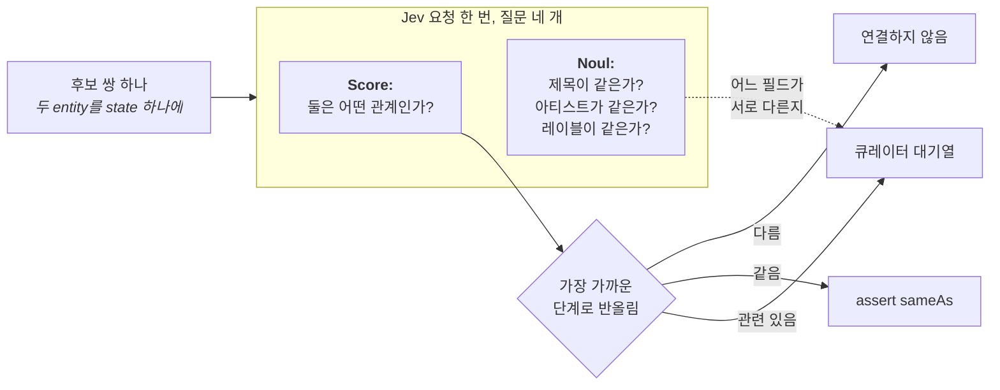

# Knowledge graph의 entity alignment

> Score 질문 하나로 두 출처에서 온 후보 레코드 쌍을 병합 권고, 수동 검토, 연결하지 않음 중 하나로 보냅니다. Noul 질문 세 개는 개별 필드를 확인합니다. 예제에서는 Wikidata와 MusicBrainz에서 가져온 앨범 쌍 450개를 사용합니다.

두 출처의 데이터를 합치다 보면 같은 사람, 제품, 장소, 작품이 양쪽에 모두 있으면서 서로 다르게 기술된 경우가 많습니다. entity alignment(엔티티 정렬)는 한쪽의 어떤 레코드가 다른 쪽의 어떤 레코드와 같은 entity(엔티티)를 가리키는지 판정하는 작업입니다. knowledge graph(지식 그래프)에서는 entity마다 사실 정보가 있고 다른 entity로 이어지는 링크가 있습니다. 모든 레코드를 다른 모든 레코드와 비교하면 느리기 때문에, 보통은 비용이 적게 드는 첫 단계에서 이름이 비슷한 레코드처럼 자세히 살펴볼 만한 쌍을 먼저 골라냅니다. 그렇게 고른 후보 쌍마다 판정이 필요한데, 이 문서에서 하는 일이 바로 그 판정입니다.

잘못 병합하면 서로 다른 entity의 사실 정보와 링크가 뒤섞입니다. 이를 되돌리려면 사실 정보 하나하나가 어디서 왔는지 다시 가려내야 합니다. 일치를 놓치면 중복이 남습니다. 검토가 필요한 쌍에는 세 번째 결과를 줍니다. 직접 보고 판정하는 사람인 큐레이터에게 보내는 것입니다.

Jev는 이 판정을 [`Score`](../primitives/score.md) 질문으로 내립니다. 결과마다 단계를 하나씩 서술해 두면, 그 단계들 위의 점수가 답으로 돌아옵니다. 여기서 단계는 연결하지 않음, 검토로 보냄, 병합 권고(`assert sameAs`)입니다. 공개 음악 카탈로그 두 곳에서 가져온 앨범 쌍 450개에 적용한 결과, 병합 권고가 57개, 검토 대상이 79개, 연결하지 않은 쌍이 314개였습니다. 병합을 권고한 57개 가운데 48개는 데이터셋에 일치로 기록되어 있습니다.



## 준비

Python 3.10 이상이 필요합니다. 패키지 관리자를 골라 의존성을 설치하세요.

> [tab] pip
>
> 가상 환경을 만들고 의존성을 추가합니다.
>
> ```bash wrap theme={null}
> python3 -m venv .venv
> .venv/bin/pip install matplotlib ipython 'cooksafe>=0.3.0,<0.4.0'
> ```

> [tab] uv
>
> 프로젝트를 초기화하고 의존성을 추가합니다.
>
> ```bash wrap theme={null}
> uv init --bare
> uv add matplotlib ipython 'cooksafe>=0.3.0,<0.4.0'
> ```

`TYPESAFE_API_KEY`를 설정하세요. 코드가 게시된 답을 `entity_alignment_cache.json`으로 내려받으므로 실행 중에 요청을 보내지 않습니다. 실시간으로 실행하려면 `DOWNLOAD_CACHE = False`로 설정하고 그 파일을 삭제하세요.

[pairs]: https://github.com/typesafe-ai/typesafe-public-examples/blob/main/cookbooks/entity_alignment/candidate_pairs.json

[license-data]: https://github.com/typesafe-ai/typesafe-public-examples/blob/main/cookbooks/entity_alignment/DATA_LICENSE.md

아래 수치는 2026-10-16에 `jev-1.14.0`으로 얻은 결과입니다.

```python
import json
import os
import urllib.request
from concurrent.futures import ThreadPoolExecutor
from pathlib import Path

import matplotlib
import matplotlib.pyplot as plt
from cooksafe import JsonCache, make_playground_link
from IPython.display import Markdown, display
from typesafe_sdk import Noul, Score, TypeSafeClient

matplotlib.use("Agg")  # 화면 없이 렌더링

TYPESAFE_MODEL = "jev-1.14.0"  # 이 페이지에서 쓴 모델. "jev-latest"는 최신 모델을 실시간으로 실행합니다
MAX_WORKERS = 6  # 조직의 rate limit을 넘지 않도록 풀을 작게 둡니다

client = TypeSafeClient(
    api_key=os.environ.get(
        "TYPESAFE_API_KEY", "cache-only"
    ),  # 키가 없는 커널은 캐시를 재생합니다
    base_url=os.environ.get("TYPESAFE_ENDPOINT"),
    timeout=120.0,
)
```

```python
EXAMPLES_URL = (
    "https://raw.githubusercontent.com/typesafe-ai/typesafe-public-examples/main/"
    "cookbooks/entity_alignment"
)


def download(name: str) -> Path:
    """Fetch one of this cookbook's files from typesafe-public-examples unless it is on disk."""
    path = Path(name)
    if not path.exists():
        urllib.request.urlretrieve(f"{EXAMPLES_URL}/{name}", path)
    return path


CACHE = Path("entity_alignment_cache.json")
# True이면 게시된 답으로 CACHE를 채우므로 실행 중에 요청을 보내지 않습니다. 실시간으로
# 실행하려면 False로 바꾸고 CACHE를 삭제하세요. 디스크에 이미 있는 CACHE는 덮어쓰지 않습니다.
DOWNLOAD_CACHE = True
if DOWNLOAD_CACHE:
    download(CACHE.name)
json_cache = JsonCache(CACHE)
```

## 후보 쌍 불러오기

[`candidate_pairs.json`][pairs]의 쌍은 공개 음악 카탈로그인 Wikidata와 MusicBrainz에서 가져왔습니다. 두 곳 모두 이 데이터를 CC0로 공개하므로 퍼블릭 도메인에 속합니다. 각 쌍에서 `entity_a`는 Wikidata의 앨범 레코드이고 `entity_b`는 MusicBrainz의 릴리스입니다. entity마다 제목, 아티스트, 연도, 레이블의 네 필드가 있습니다. 두 출처의 저작자 표시는 [`DATA_LICENSE.md`][license-data]에 있습니다.

각 쌍에는 `known_same_as`도 있습니다. Wikidata 편집자가 그 앨범을, 해당 릴리스가 속한 MusicBrainz 릴리스 그룹에 연결해 두었으면 true입니다. Wikidata는 knowledge graph이고, 그 링크가 곧 entity alignment 링크입니다. true로 표시된 70개 쌍을 이 문서에서는 *알려진 일치*라고 부릅니다. 나머지 380개에서는 Wikidata 앨범이 다른 MusicBrainz 항목에 연결되어 있습니다. 쌍을 하나하나 사람이 직접 확인한 것은 아닙니다.

텍스트는 정리하지 않고 카탈로그에 게시된 그대로 두었습니다. 대소문자와 문자 체계가 섞여 있고, 곧은 아포스트로피와 둥근 아포스트로피가 함께 쓰이며, `[no label]` 같은 자리표시자도 있습니다. 값이 없으면 `-`입니다.

쌍 하나에 요청을 한 번 보내므로, 요청 수는 두 카탈로그의 크기가 아니라 후보 쌍의 수에 따라 정해집니다.

```python
DATA = Path("candidate_pairs.json")
DATA_URL = (
    "https://raw.githubusercontent.com/typesafe-ai/typesafe-public-examples/main/"
    "cookbooks/entity_alignment/candidate_pairs.json"
)
if not DATA.exists():
    urllib.request.urlretrieve(DATA_URL, DATA)

PAIRS = json.loads(DATA.read_text(encoding="utf-8"))
BY_ID = {pair["id"]: pair for pair in PAIRS}

print(f"{len(PAIRS)} candidate pairs. The first one, as the model will see it:")
print(json.dumps({k: PAIRS[0][k] for k in ("entity_a", "entity_b")}, indent=2))
```

```
450 candidate pairs. The first one, as the model will see it:
{
  "entity_a": {
    "title": "My Refuge",
    "artist": "Alessandra Samadello",
    "year": "2003",
    "label": "-"
  },
  "entity_b": {
    "title": "My Refuge",
    "artist": "Kent Henry",
    "year": "1989",
    "label": "Hosanna! Music"
  }
}
```

## 후보 쌍마다 Score 질문 하나와 Noul 질문 세 개 보내기

이 판정을 `Score` 질문으로 하는 이유는, `Score`가 `LEVELS`의 결과마다(불확실한 가운데 결과까지 포함해서) 글로 쓴 설명을 붙여 주고 세 결과의 순서도 유지하기 때문입니다. `Noul` 질문으로는 출력에 threshold(임계값)를 적용하는 간접적인 방법으로만 가운데 결과에 도달할 수 있습니다. `Choice` 질문을 쓰면 세 결과의 순서가 사라집니다.

두 entity를 `entity_a`와 `entity_b`로 state(상태) 하나에 넣어서, 모든 질문이 그 쌍에 관한 질문이 되게 합니다. 질문 네 개는 모두 요청 한 번에 보냅니다.
제목, 아티스트, 레이블에는 각각 `Noul` 질문을 하나씩 두어 두 레코드가 어디서 다른지 알려 주게 합니다.

`route()`에서 점수를 가장 가까운 단계로 반올림합니다. 단계 설명은 점수를 보기 전에 작성하세요. 경계점은 이 데이터셋에 맞춰 조정한 값이 아니라 반올림에서 자연히 정해집니다.

가운데 단계를 어떻게 쓰느냐에 따라 어떤 쌍이 병합되거나 연결되지 않은 채 남는 대신 큐레이터에게 가는지가 결정됩니다. 그래서 큐레이터가 필요한 경우를 설명에 직접 적었습니다. 재발매, 컴필레이션, 스페셜 에디션이나 라이브 에디션, 어느 쪽 앨범을 가리킬 수도 있는 제목이 그런 경우입니다.

병합 권고의 이름은 `assert sameAs`입니다. 두 entity가 같은 대상이라고 기록하라는 권고입니다. `route()`가 반환하는 것은 이 이름표뿐이며, 이를 그래프에 반영하는 것은 별도의 단계입니다.

연도에 대한 `Noul` 질문은 없지만 연도는 state에 들어 있습니다.
연도를 확인하려면 코드에서 두 연도를 비교하되, 값이 없는 `-`도 허용하세요.

레이블 질문에는 규칙이 필요합니다. 어느 회사 이름을 적을지가 카탈로그마다 다르기 때문입니다. 여기서는 줄인 이름이나 지역 지사는 같은 레이블로 봅니다(*Columbia Records*와 *Columbia*, *EMI*와 *EMI Music Brasil*). 임프린트는 음반사가 음반을 낼 때 쓰는 브랜드 이름입니다. 임프린트와 그 모회사는 다른 레이블로 봅니다(*RCA Victor*와 *BMG*). 모회사가 같다고 해서 두 앨범이 같다고 볼 수는 없기 때문입니다.

다른 종류의 데이터에 적용하려면 쌍을 여러분의 데이터로 바꾸고 `QUESTIONS`와 `LEVELS`를 다시 작성하세요. 그 밖에 앨범에 대해 아는 코드는 쌍을 출력하면서 필드 이름을 붙이는 `show()`뿐입니다.

```python
LEVELS = [
    "They describe two different albums.",
    "They describe closely related albums that may or may not be the same one: "
    "a reissue, a compilation, a special or live edition, or a title that could "
    "plausibly refer to either.",
    "They describe one and the same album.",
]
OUTCOME = {0: "leave unlinked", 1: "curator queue", 2: "assert sameAs"}

QUESTIONS = {
    "link_state": Score(
        instructions="How do the two entity descriptions relate as albums?",
        criteria=LEVELS,
    ),
    "same_title": Noul(
        instructions="Do the two entities give the same album title? Differences in "
        "casing, punctuation, or writing system (a title and its romanisation) do not "
        "make two titles different.",
    ),
    "same_artist": Noul(
        instructions="Do the two entities credit the same artist? A name written in "
        "another script or word order, or a credit that adds collaborators to the same "
        "lead artist, is the same artist.",
    ),
    "same_label": Noul(
        instructions="Do the two entities name the same record label? A shortened name "
        "or a regional branch of a label is the same label; an imprint and its parent "
        "company are different labels. A label of '-' or '[no label]' is not recorded.",
    ),
}


@json_cache
def score(state_json: str, questions_json: str, model: str) -> dict:
    """One request about one candidate pair -> the score plus the three noul answers."""
    questions = json.loads(questions_json)
    response = client.system_one(
        state=json.loads(state_json),
        questions=questions,
        model=model,
    )
    link = response.answers["link_state"]
    return {
        "score": link.score,
        "probabilities": link.probabilities,
        "confidence": link.confidence,
        "properties": {
            k: response.answers[k].noul for k in questions if k != "link_state"
        },
    }


def score_pair(pair: dict) -> dict:
    state = {"entity_a": pair["entity_a"], "entity_b": pair["entity_b"]}
    questions = {k: q.model_dump(mode="json", exclude_none=True) for k, q in QUESTIONS.items()}
    return score(json.dumps(state), json.dumps(questions), model=TYPESAFE_MODEL)


def route(score_value: float) -> str:
    """The whole decision rule: the nearest level names the outcome."""
    return OUTCOME[min(int(score_value + 0.5), len(LEVELS) - 1)]


def show(pair_id: str) -> None:
    pair = BY_ID[pair_id]
    result = score_pair(pair)
    print(
        f"{pair_id}  score {result['score']:.2f}  confidence {result['confidence']:.2f}"
        f"  ->  {route(result['score'])}"
    )
    for side in ("entity_a", "entity_b"):
        e = pair[side]
        print(
            f"    {e['title'][:40]:<42}{e['artist'][:26]:<28}{e['year']:<6}"
            f"{e['label'][:22]}"
        )
    nouls = result["properties"]
    print(
        f"    title {nouls['same_title']:.2f}   artist {nouls['same_artist']:.2f}   "
        f"label {nouls['same_label']:.2f}"
    )
```

```python
for pair_id in ("c115", "c133", "c190", "c159"):
    show(pair_id)
    print()
```

```
c115  score 1.76  confidence 0.64  ->  assert sameAs
    Lions                                     The Black Crowes            2001  V2 Records
    Lions                                     The Black Crowes            2001  V2 Records Japan
    title 0.99   artist 0.99   label 0.94

c133  score 0.14  confidence 0.80  ->  leave unlinked
    Freak of Nature                           Anastacia                   2001  Epic Records
    Freak of Nature                           Taylor Deupree              1996  Rancho Relaxo
    title 0.99   artist 0.01   label 0.01

c190  score 1.27  confidence 0.55  ->  curator queue
    Head Hunters                              Herbie Hancock              1973  Columbia Records
    Headhunters                               Herbie Hancock              2008  Columbia
    title 0.71   artist 0.99   label 0.96

c159  score 0.75  confidence 0.62  ->  curator queue
    McCartney III                             Paul McCartney              2020  Capitol Records
    McCartney III Imagined                    Paul McCartney              2021  Capitol Records
    title 0.02   artist 0.98   label 0.99
```

`c115`는 양쪽이 같은 앨범이고 제목과 아티스트도 같습니다. 레이블은 한쪽이 *V2 Records*, 다른 쪽이 *V2 Records Japan*입니다. `c133`은 제목만 같은 서로 다른 앨범입니다. 나머지 둘은 각기 다른 이유로 가운데 단계로 반올림됩니다. `c190`은 한쪽이 1973년 앨범의 2008년 재발매이고, 제목이 한 단어로 붙어 있습니다. `c159`는 한쪽이 앨범이고 다른 쪽은 그 앨범으로 만든 리믹스 앨범입니다.

## 모든 후보 쌍 routing하기

```python
# 후보 쌍 450개, 쌍마다 요청 한 번. 실시간 실행은 1분쯤 걸립니다.
with ThreadPoolExecutor(max_workers=MAX_WORKERS) as pool:
    scored = list(pool.map(score_pair, PAIRS))

scores = [result["score"] for result in scored]
by_outcome: dict[str, list[str]] = {name: [] for name in OUTCOME.values()}
for pair, s in zip(PAIRS, scores):
    by_outcome[route(s)].append(pair["id"])

CHART_PALETTES = {
    "light": {
        "surface": "#ffffff", "ink": "#0b0b0b", "ink2": "#52514e", "muted": "#898781",
        "grid": "#e1e0d9", "axis": "#c3c2b7", "blue": "#2a78d6", "orange": "#eb6834",
    },
    "dark": {
        "surface": "#0d0a0f", "ink": "#fafafa", "ink2": "#d4d4d8", "muted": "#a1a1aa",
        "grid": "#2e2e33", "axis": "#52525b", "blue": "#5b9be8", "orange": "#f08050",
    },
}


def draw_routing(p: dict) -> plt.Figure:
    BINS, TOP = 20, len(LEVELS) - 1
    counts = [0] * BINS
    for s in scores:
        counts[min(int(s / TOP * BINS), BINS - 1)] += 1
    centers = [(i + 0.5) / BINS * TOP for i in range(BINS)]
    queued = [c if route(x) == "curator queue" else 0 for c, x in zip(counts, centers)]
    settled = [c if route(x) != "curator queue" else 0 for c, x in zip(counts, centers)]

    fig, ax = plt.subplots(figsize=(7.2, 3.6), facecolor=p["surface"])
    ax.set_facecolor(p["surface"])
    for side in ("top", "right"):
        ax.spines[side].set_visible(False)
    for side in ("left", "bottom"):
        ax.spines[side].set_color(p["axis"])
    ax.tick_params(colors=p["muted"], labelcolor=p["ink2"], labelsize=9)
    ax.set_axisbelow(True)
    ax.grid(axis="y", color=p["grid"], linewidth=0.8)
    ax.bar(
        centers, settled, width=TOP / BINS * 0.9, color=p["blue"], label="settled automatically"
    )
    ax.bar(
        centers, queued, width=TOP / BINS * 0.9, color=p["orange"], label="sent to the curator"
    )
    for edge in (0.5, 1.5):
        ax.axvline(edge, color=p["ink2"], linewidth=1, linestyle="--")
    ax.set_xticks([0, 0.5, 1, 1.5, 2])
    ax.set_xticklabels(["0\ndifferent", "0.5", "1\nrelated", "1.5", "2\nsame"])
    ax.set_xlabel("score for the pair", color=p["ink2"], fontsize=9)
    ax.set_ylabel("candidate pairs", color=p["ink2"], fontsize=9)
    n_queued = len(by_outcome["curator queue"])
    ax.set_title(
        f"{len(PAIRS) - n_queued} of {len(PAIRS)} pairs settled automatically;"
        f" {n_queued} go to the curator",
        loc="left",
        color=p["ink"],
        fontsize=11,
    )
    ax.legend(frameon=False, labelcolor=p["ink2"], fontsize=9)
    return fig


# 문서 빌드에서는 COOKSAFE_RENDER를 설정해서 다크 테마용 그림도 함께 그립니다.
for theme in ("light", "dark") if os.environ.get("COOKSAFE_RENDER") else ("light",):
    fig = draw_routing(CHART_PALETTES[theme])
    display(fig, metadata={"theme": theme})
    plt.close(fig)

for name in ("assert sameAs", "curator queue", "leave unlinked"):
    n = len(by_outcome[name])
    print(f"{name:<16}{n:>5}  ({n / len(PAIRS):>5.1%})")
```

```
assert sameAs      57  (12.7%)
curator queue      79  (17.6%)
leave unlinked    314  (69.8%)
```


경계점은 `route()`의 답이 바뀌는 두 점수인 0.5와 1.5입니다. 대부분의 쌍은 큐레이터를 거치지 않고 routing(라우팅)되었습니다. 314개가 0.5 미만, 57개가 1.5 이상의 점수를 받았고, 큐레이터에게는 79개가 남았습니다.

이 데이터셋에서는 점수 450개 가운데 257개가 0.1과 0.4 사이에 있습니다. 서로 다른 두 앨범의 제목이 같을 수 있고 레이블 이름만으로는 근거가 약하기 때문에, 모델은 쌍이 달라 보일 때도 가운데 단계에 확률을 어느 정도 줍니다. routing은 점수가 경계점의 어느 쪽에 있는지만 봅니다. 0.4인 쌍도 0인 쌍과 똑같이 연결되지 않은 채 남습니다.

Noul 답 세 개는 큐레이터가 쌍을 살펴볼 때 도움이 되지만, 어디로 보낼지는 Score만으로 결정됩니다. 큐레이터 대기열에 들어간 쌍 두 개를 보겠습니다.

| 쌍 (Wikidata / MusicBrainz 제목) | Score | 제목 일치 | 아티스트 일치 | 레이블 일치 |
| :- | -: | -: | -: | -: |
| `c190` *Head Hunters* / *Headhunters* | 1.27 | 0.71 | 0.99 | 0.96 |
| `c159` *McCartney III* / *McCartney III Imagined* | 0.75 | 0.02 | 0.98 | 0.99 |

`c190`은 아티스트와 레이블이 일치하고 제목도 거의 같으며, 두 릴리스 사이의 35년이라는 간격은 재발매임을 시사합니다. `c159`는 제목만 빼고 모두 일치하는데, 이는 같은 앨범이라기보다 관련된 앨범임을 시사합니다.

## 카탈로그에 기록된 답과 비교하기

지금까지는 `known_same_as`를 전혀 쓰지 않았습니다. 이제 결과별로 이 값을 세어서 routing 결과를 카탈로그의 기록과 비교합니다.

```python
print(f"{'':<16}{'known match':>13}{'known non-match':>17}")
for name in ("assert sameAs", "curator queue", "leave unlinked"):
    known = sum(BY_ID[pair_id]["known_same_as"] for pair_id in by_outcome[name])
    print(f"{name:<16}{known:>13}{len(by_outcome[name]) - known:>17}")
```

```
                  known match  known non-match
assert sameAs              48                9
curator queue              19               60
leave unlinked              3              311
```

"known non-match"(알려진 불일치) 열은 `known_same_as`가 false인 쌍의 수입니다. 병합 57개 가운데 48개가 알려진 일치입니다. 연결하지 않은 314개 가운데 311개는 알려진 불일치입니다. 큐레이터 대기열에는 알려진 일치가 19개, 알려진 불일치가 60개 있습니다. `known_same_as` 플래그는 검증을 거친 정답이 아니므로, 이 일치 정도를 검증된 정확도 수치로 볼 수는 없습니다.

어긋난 결과 가운데 일부는 카탈로그의 오류입니다. 그중 두 개를 MusicBrainz에서 직접 찾아봤습니다. `c088`은 양쪽 제목이 모두 *Um Novo Coração*이지만 아티스트가 Jozyanne와 Maíra입니다. MusicBrainz에는 Jozyanne의 앨범 항목이 따로 있는데 Wikidata 항목은 Maíra의 앨범에 연결되어 있어서, 서로 다른 두 앨범인데도 `known_same_as`가 true입니다. 모델은 이 쌍을 연결하지 않았습니다. `c415`는 양쪽 모두 The Limeliters의 *Tonight: In Person*으로, 1961년에 RCA Victor에서 나왔습니다. MusicBrainz에 이 앨범이 두 번 등록되어 있고 Wikidata는 다른 쪽 항목에 연결되어 있어서 `known_same_as`가 false입니다. 모델은 이 쌍을 병합했습니다. 병합된 알려진 불일치 9개 가운데 6개는 대소문자, 문장 부호, 악센트 기호를 무시하면 제목, 아티스트, 연도가 같습니다.

모델이 틀린 쌍도 있습니다. 모델은 알려진 일치 가운데 다른 두 개도 연결하지 않았는데, 그중 하나가 `c444`입니다. 한쪽은 아티스트를 *Justin Lo*로, 다른 쪽은 같은 가수의 중국어 이름인 *側田*으로 표기합니다. `same_artist` 답은 0.03이고, 이 쌍의 점수는 아래쪽 경계점에 조금 못 미치는 0.44였습니다.

```python
for pair_id in ("c088", "c415"):
    show(pair_id)
    print()
```

```
c088  score 0.43  confidence 0.35  ->  leave unlinked
    Um Novo Coração                           Jozyanne                    2001  MK Music
    Um novo coração                           Maíra                       2001  Paradoxx Music
    title 0.97   artist 0.01   label 0.01

c415  score 1.97  confidence 0.97  ->  assert sameAs
    Tonight: In Person                        The Limeliters              1961  RCA Victor
    Tonight, In Person                        The Limeliters              1961  RCA Victor
    title 0.86   artist 0.99   label 0.99
```

## playground에서 열어 보기

아래 링크는 질문 네 개와 함께 `c190`을 playground(플레이그라운드)에서 엽니다. 이 쌍은 1.27점을 받아 큐레이터에게 갔습니다. Herbie Hancock의 1973년 앨범 *Head Hunters*와 2008년 재발매 *Headhunters*로, 아티스트가 같고 레이블은 같은 곳을 두 가지로 표기한 것입니다. playground는 `jev-latest`로 실행되므로 점수가 여기의 1.27과 다를 수 있습니다.

```python
playground_link = make_playground_link(
    {
        "entity_a": BY_ID["c190"]["entity_a"],
        "entity_b": BY_ID["c190"]["entity_b"],
    },
    QUESTIONS,
)
display(
    Markdown(
        f"🔗 [Open this pair + questions in the TypeSafe playground]({playground_link})"
    )
)
```

[TypeSafe playground에서 이 쌍과 질문 열기 →](https://console.typesafe.ai/playground#share/N4IgJg9gxgrgtgUwHYBcAqCAeKQC4AEIwAOiMigJYoCeA+gIakEkiUoA2CT+pAEgvTD5eMVAgBOAZ1IAaHiHrjKklNz4SARhQTD6SKNADWs+dQHi1IAIwBOAOwBmE6Xb0NCdpYDCEdvC30+ABKCAbiYNIgAL5ypORUdBrcLGyclvyCABaiKBKRsQpKFCrpmtq6+kbOIGaKlgBMAAyNABzVru6eePI+fnABpFFRIHIgAA7iEHBjKJIY2N1ELhRIhrQq9LnJpDRjXN2kkmH7BSsq4jBQlBBIkQR8EADu+JD4KJk6KI8Q+PE0LwgjuIKDMKDdJPhxB5Njp6BD6OwNPBJAB+apQYG5YGMboAbVIaA+1ABQIo7je3xeFAAZtSJOR8AikXBJAA6aqEhDEsCAjFknRQdgQSQeYlQ1y5IRM5FvTKbfBwejEiDiBVK-BICAofDk946ST0RD4G4IAiBKHFSQwBByQIGaYUCVgpC2-CSPZQCgI42q9gUABuOgQYCozrkKsZbyonFl8oMMHYQjGrhgkjJ7DFCDpqpQPwQVA+4nZI3knO5vOB5JNjKQQj1bsNsMR8GLAF0YvIDYhaKl9swdtQ9pZNQnqmcUBcrs67vIACI-etfPOoUOA-AAcwDnw+DaN0rgUY4CBR+FnNOzyCga5W+CgcJW67kY1EVxgmzDPvwj0xD7d1BUCAHgAFIEvY1kIVAQpMipIMU743AAlC8PyatqiqGJ8lK9hCIa0vSqDFh2hyNgwRQlN0KSDn28gjl0py3BOlzXLcljzrKmHLmw2gQhiwZUOxu6wmRKAngAghqjZfpiuRIPgN56FqhZunyMyft84Q+jy4jhqqdpQiG2rvPKggRLevgdCqmwqhCuYCV2OicIIjLCXIxR2ZJijKCghEFPZtAdB42ysFRw4QKOJakOOk7MTOpBsYulJ-NxElGvW9mQqEKpCAF7BiW6mQqjJwYpToEbmggm43N6GjiHoUCZMa1KRjlck2Tu6U5QA3DWcnTMCqDgXJsz4GMigMvao1IMSY1UnhUIDTlbL4OJLUQE1ADkAC062futuKavgOWtjtbmoRlYQ8mAhHDKM9BjBQABqeTOos-pWNEQA)


이 문서는 개발자 문서 플랫폼인 [Mintlify](https://mintlify.com)로 제작하고 호스팅합니다.
