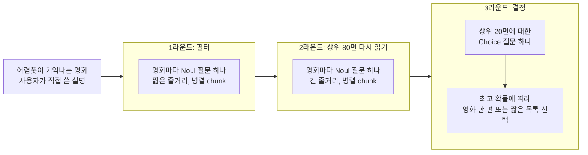

# 무한 cardinality Choice

> 사용자가 직접 쓴 설명만으로, 어렴풋이 기억하는 영화를 5,000편 가운데에서 찾습니다. 짧은 줄거리로 영화마다 Noul 하나를 묻고, 상위 80편은 긴 줄거리로 다시 묻고, 상위 20편을 놓고 Choice 하나로 결정합니다. 정답 영화가 1위에 오르는 비율은 78%이며, embedding 검색으로 후보 목록을 만들면 33%입니다.

영화는 기억나는데 제목이 떠오르지 않아서 대신 이렇게 설명하는 사람이 있습니다. "a man and a boy running from these sharp metal eyeball things with blades on the side"(한 남자와 소년이 옆에 칼날이 달린 날카로운 금속 눈알 같은 것들에게서 도망친다). 90년대에 본 영화라고 합니다. 이 영화는 카탈로그에 있는 5,000편 가운데 하나이고, 카탈로그의 줄거리 요약은 같은 이야기를 다른 말로 풀어 놓았습니다.

`Choice` 질문 하나로 목록에서 영화를 고를 수는 있지만, 선택지는 최대 255개까지만 받을 수 있고, 선택지 하나하나가 긴 줄거리 요약이라면 40개 정도가 한계입니다. 그래서 검색을 세 단계로 나누고, 단계가 진행될수록 더 적은 영화를 더 자세히 읽습니다.

1. 영화마다 "이 사람이 말하는 영화가 이것인가?"라는 `Noul` 질문을 하나씩 던지고, 줄거리의 첫 100단어를 함께 넣습니다. 질문은 chunk(청크) 단위로 나눠 한꺼번에 보내므로, rate limit(요청 한도)이 그만큼의 동시 호출을 허용하는 한 카탈로그가 커져도 대기 시간은 거의 그대로입니다.
2. 확률이 가장 높은 영화 80편에 대해, 이번에는 줄거리 600단어를 넣어 다시 묻습니다.
3. 상위 20편을 `Choice` 질문 하나에 넣습니다. 이 질문의 최고 확률을 보고 영화 한 편만 보여 줄지, 짧은 목록을 보여 줄지 정합니다.

여기서 쓰는 요청 100건은 영화 제목을 찾아 달라고 도움을 청하는 포럼에서 가져온 것이며, 건마다 그 영화를 알아본 누군가가 답을 달았습니다. 3단계에 넣을 20편을 embedding(임베딩) 검색으로 고르면 정답 영화가 1위에 오르는 요청은 33%입니다. 세 단계를 모두 거치면 78%입니다. Choice 질문이 1위 영화에 0.8 이상을 준 경우는 48번이었고, 그 48번 모두 정답이었습니다.

결과물은 `find()` 함수입니다. 요청을 받아 병렬 호출 세 라운드를 거쳐, 확률순으로 정렬한 영화 목록을 반환합니다.



## 준비

```bash
pip install openai ipython matplotlib 'cooksafe>=0.3.0,<0.4.0'
```

그런 다음 `TYPESAFE_API_KEY`를 설정하고, 결과의 비교 기준으로 쓰는 embedding 검색을 위해 `OPENAI_API_KEY`도 설정합니다. 코드는 공개된 답을 `infinite_cardinality_choice_cache.json`에 내려받으므로 실행 중에 요청을 보내지 않습니다. 실시간으로 실행하려면 `DOWNLOAD_CACHE = False`로 설정하고 그 파일을 삭제하세요.

아래 수치는 2026년 11월에 `jev-1.14.0`으로 실행해 얻은 것입니다.

```python
import json
import os
import urllib.request
from concurrent.futures import ThreadPoolExecutor
from pathlib import Path
from time import perf_counter

import matplotlib
import matplotlib.pyplot as plt
from cooksafe import JsonCache, make_playground_link
from IPython.display import Markdown, display
from typesafe_sdk import Choice, Noul, RetryPolicy, TypeSafeClient

matplotlib.use("Agg")  # 화면 없이 렌더링

TYPESAFE_MODEL = "jev-1.14.0"  # 이 페이지에서 쓰는 모델. "jev-latest"는 최신 모델을 실시간으로 실행합니다
CHOICE_LIMIT = 255  # API가 강제하는 한도. 선택지가 256개이면 요청이 바로 거부됩니다
CHUNK = 300  # 필터 호출 하나에 담는 영화 수: 편당 약 150 token이므로 호출 하나가 64k에 한참 못 미칩니다
LONG_CHUNK = 40  # 다시 읽기 호출 하나에 담는 영화 수: 편당 약 700 token, 호출당 약 28k
FIRST_CUT = 80  # 긴 줄거리로 다시 읽는 영화 수
CANDIDATES = 20  # Choice 질문에 넣는 영화 수
WORKERS = 4  # 동시에 실행하는 검색 수. 검색마다 자기 chunk를 한꺼번에 보냅니다

client = TypeSafeClient(
    api_key=os.environ.get("TYPESAFE_API_KEY", "cache-only"),  # 키가 없는 커널은 캐시를 재생합니다
    base_url=os.environ.get("TYPESAFE_ENDPOINT"),
    timeout=300.0,  # 질문 300개는 큰 요청입니다
    # 이 정도 크기의 요청은 가끔 과부하 응답을 받으므로 retry는 선택 사항이 아닙니다
    retry=RetryPolicy(max_retries=5, backoff_initial=1.0, backoff_max=30.0),
)


EXAMPLES = (
    "https://raw.githubusercontent.com/typesafe-ai/typesafe-public-examples/main/"
    "cookbooks/infinite_cardinality_choice"
)


def download(name: str) -> Path:
    """Fetch one of this cookbook's files from typesafe-public-examples unless it is on disk."""
    path = Path(name)
    if not path.exists():
        path.parent.mkdir(parents=True, exist_ok=True)
        urllib.request.urlretrieve(f"{EXAMPLES}/{name}", path)
    return path


CACHE = Path("infinite_cardinality_choice_cache.json")
# True이면 공개된 답으로 CACHE를 채우므로 실행 중에 요청을 보내지 않습니다. 실시간으로
# 실행하려면 False로 바꾸고 CACHE를 삭제하세요. 디스크에 이미 있는 CACHE는 덮어쓰지 않습니다.
DOWNLOAD_CACHE = True
if DOWNLOAD_CACHE:
    download(CACHE.name)
json_cache = JsonCache(CACHE)
```

## 카탈로그와 요청 불러오기

카탈로그는 `films.jsonl`입니다. 영화마다 제목, 연도, 그리고 2026-11-07에 가져온 Wikipedia 문서의 줄거리 섹션이 두 가지 버전으로 들어 있습니다. 짧은 버전인 `plot`은 첫 100단어 정도이며 1단계에서 읽습니다. 긴 버전인 `long_plot`은 첫 600단어 정도이며 2단계와 3단계에서 읽습니다. 카탈로그에는 모든 요청의 정답 영화가 들어 있습니다. 그 밖의 영화, 즉 검색이 걸러 내야 하는 영화는 Wikipedia 문서가 가장 많은 언어로 존재하는 영화들입니다.

`requests.jsonl`의 요청 100건은 포럼 iRememberThisMovie.com에서 수집한 Microsoft의 tip-of-the-tongue(혀끝에서 맴도는 기억) 데이터셋에서 가져왔으며, 건마다 그 요청의 답이 된 영화가 함께 들어 있습니다. 정답 영화의 Wikipedia 문서에 줄거리 섹션이 있는 709건 가운데 무작위로 뽑은 표본입니다.

```python
FILMS = {f["id"]: f for f in map(json.loads, download("films.jsonl").read_text().splitlines())}
REQUESTS = [json.loads(line) for line in download("requests.jsonl").read_text().splitlines()]


def label(film_id: str) -> str:
    film = FILMS[film_id]
    return f"{film['title']} ({film['year']})" if film["year"] else film["title"]


example = next(r for r in REQUESTS if r["id"] == "388")
print(f"{len(FILMS):,} films, {len(REQUESTS)} requests\n")
print(f"request {example['id']}:\n  {example['text']}\n")
print(f"the film: {label(example['film'])}\n  {FILMS[example['film']]['plot']}")
```

```
5,000 films, 100 requests

request 388:
  Mother and her two kids (a boy and a girl) are tormented by ghosts that turn out to be time travelers. I think the dad has recently died and the boy has some behavior issues and he is getting kicked out of or about to be kicked out of school. The mom has a boyfriend. There is a guy trying to get the mom to sell their house. Later, the kids get sick when they try to leave the house.

the film: The Diabolical (2015)
  Madison, a single mother, lives with her two children, Jacob and Hayleigh, in a suburban home. Madison's financial difficulties prompt her to consider declaring bankruptcy. Jacob was involved in a fight six months prior and now sees a counselor to evaluate his state of mind. Madison is dating her son's science tutor, Nikolai. The family experiences paranormal occurrences that manifest as a bloody and bound apparition and a bald man. Although Madison hires parapsychologists and psychics to investigate the haunting, none can help her.
```

## 1단계: 영화마다 Noul 질문 하나로 필터링하기

각 Noul 질문은 영화 한 편을 답으로 지목하고 그 줄거리를 함께 담습니다. 그래서 Jev는 제목만 보고 영화를 떠올리는 대신 요청과 줄거리를 비교합니다.

호출 하나에는 최대 64k token(토큰)까지 담을 수 있으므로, 카탈로그를 그 안에 들어가는 chunk로 나눕니다. chunk끼리는 서로 의존하지 않으므로 모두 한꺼번에 보냅니다.

```python
def proposition(film_id: str, plot: str = "plot") -> str:
    return (
        f"The film this person is trying to remember is {label(film_id)}. "
        f"Its plot: {FILMS[film_id][plot]}"
    )


def as_json(questions: dict) -> str:
    """The questions as API JSON, so the cache key changes when their wording does."""
    return json.dumps(
        {key: q.model_dump(mode="json", exclude_none=True) for key, q in questions.items()}
    )


IDS = sorted(FILMS)
CHUNKS = [
    as_json({i: Noul(instructions=proposition(i)) for i in IDS[start : start + CHUNK]})
    for start in range(0, len(IDS), CHUNK)
]


@json_cache
def filter_chunk(text: str, questions_json: str, model: str) -> dict:
    started = perf_counter()
    response = client.system_one(
        state=text, questions=json.loads(questions_json), model=model
    )
    return {
        "p": {key: answer.noul for key, answer in response.answers.items()},
        "seconds": round(perf_counter() - started, 2),
    }


def filter_films(text: str) -> dict:
    """Every chunk at once; one probability per film."""
    with ThreadPoolExecutor(max_workers=len(CHUNKS)) as pool:
        parts = list(
            pool.map(lambda chunk: filter_chunk(text, chunk, model=TYPESAFE_MODEL), CHUNKS)
        )
    return {key: p for part in parts for key, p in part["p"].items()}


def by_probability(request: dict) -> list[str]:
    p = filter_films(request["text"])
    return sorted(p, key=lambda key: (-p[key], key))


filtered = filter_films(example["text"])
seconds = [
    filter_chunk(example["text"], chunk, model=TYPESAFE_MODEL)["seconds"] for chunk in CHUNKS
]
print(f"{len(filtered):,} answers from {len(CHUNKS)} calls sent together; the slowest "
      f"took {max(seconds)}s\n")
print("the filter's own top five:")
for key in by_probability(example)[:5]:
    mark = "  <- the film" if key == example["film"] else ""
    print(f"  {filtered[key]:.2f}  {label(key)}{mark}")
print(f"\nthe film is at position {by_probability(example).index(example['film']) + 1}")
held = sum(1 for r in REQUESTS if r["film"] in by_probability(r)[:FIRST_CUT])
print(f"the top {FIRST_CUT} hold the right film for {held}/{len(REQUESTS)} requests")
```

```
5,000 answers from 17 calls sent together; the slowest took 0.4s

the filter's own top five:
  0.64  Ghostbusters: Afterlife (2021)
  0.37  The Curse of La Llorona (2019)
  0.33  Thirteen Ghosts (2001)
  0.31  Mama (2013)
  0.31  Wicked Little Things (2006)

the film is at position 6
the top 80 hold the right film for 93/100 requests
```

## 2단계: 상위 80편을 긴 줄거리로 다시 읽기

이 요청에서 필터는 *Ghostbusters: Afterlife*를 0.64로 1위에 올렸습니다. 어머니, 두 아이, 귀신 들린 집, 돈 문제가 맞아떨어지기 때문입니다. *The Diabolical*은 6위입니다. 이 요청에서 가장 구체적인 단서는 유령들이 "turn out to be time travelers"(알고 보니 시간 여행자였다)라는 대목입니다. *The Diabolical*의 줄거리에서 이 반전은 첫 100단어 뒤에 나오므로 필터는 이를 보지 못합니다. 사람들은 영화의 어느 부분에 나오는 장면이든 기억합니다.

그래서 필터의 상위 80편에 대해, 줄거리를 600단어씩 넣어 다시 묻습니다. 질문이 길어진 만큼 chunk 하나에 들어가는 영화 수는 줄지만, chunk는 여전히 한꺼번에 보냅니다. 필터의 상위 80편에는 요청 100건 가운데 93건의 정답 영화가 들어 있으며, 이 단계는 그 영화를 상위 20편 안으로 끌어올려야 합니다.

```python
def reread(request: dict) -> dict:
    """The filter's top films, asked again with the long plot; one probability per film."""
    first = by_probability(request)[:FIRST_CUT]
    chunks = [
        as_json({i: Noul(instructions=proposition(i, "long_plot"))
                 for i in first[start : start + LONG_CHUNK]})
        for start in range(0, FIRST_CUT, LONG_CHUNK)
    ]
    with ThreadPoolExecutor(max_workers=len(chunks)) as pool:
        parts = list(
            pool.map(
                lambda chunk: filter_chunk(request["text"], chunk, model=TYPESAFE_MODEL), chunks
            )
        )
    return {key: p for part in parts for key, p in part["p"].items()}


def candidates(request: dict) -> tuple[str, ...]:
    p = reread(request)
    return tuple(sorted(p, key=lambda key: (-p[key], key))[:CANDIDATES])


reread_p = reread(example)
print("the long plots' top five:")
for key in candidates(example)[:5]:
    mark = "  <- the film" if key == example["film"] else ""
    print(f"  {reread_p[key]:.2f}  {label(key)}{mark}")
held = sum(1 for r in REQUESTS if r["film"] in candidates(r))
print(f"\nthe top {CANDIDATES} hold the right film for {held}/{len(REQUESTS)} requests")
```

```
the long plots' top five:
  0.60  The Diabolical (2015)  <- the film
  0.40  Ghostbusters: Afterlife (2021)
  0.30  The Others (2001)
  0.26  Thirteen Ghosts (2001)
  0.17  Knowing (2009)

the top 20 hold the right film for 88/100 requests
```

긴 줄거리에는 반전이 들어 있습니다. 유령의 정체는 미래에서 돌아온 아들입니다. *The Diabolical*이 0.60으로 1위에 올라섭니다. 전체 요청을 놓고 보면 이제 상위 20편에 정답 영화가 들어 있는 요청은 88건이며, 필터의 상위 20편만 썼을 때는 82건입니다.

## 3단계: Choice 질문 하나로 결정하기

상위 20편을 `Choice` 질문 하나에 넣고, 각 영화의 긴 줄거리를 선택지로 씁니다. Noul 질문은 저마다 자기 영화만 따로 판단하므로, 요청에 둘 다 들어맞는 영화 두 편이 모두 0.4 이상을 받을 수 있습니다. 여기서는 0.60과 0.40이고, 상위 5편만 더해도 합이 1을 넘습니다. Choice 질문은 20편을 서로 견주어 판단하므로, 최고 확률을 보면 1위 영화가 나머지보다 얼마나 앞서 있는지 알 수 있습니다.

```python
DECISION = "Which film is this person trying to remember?"


def decision_question(options: tuple[str, ...]) -> dict:
    return {
        "film": Choice(
            instructions=DECISION,
            criteria={key: f"{label(key)}: {FILMS[key]['long_plot']}" for key in options},
        )
    }


@json_cache
def rank(text: str, questions_json: str, model: str) -> dict:
    response = client.system_one(
        state=text, questions=json.loads(questions_json), model=model
    )
    answer = response.answers["film"]
    return {"film": answer.choice, "confidence": answer.confidence,
            "probabilities": dict(answer.probabilities)}


def find(request: dict, options: tuple[str, ...] | None = None) -> dict:
    """Rank a shortlist with one Choice; by default, the top twenty on the long plots."""
    options = candidates(request) if options is None else options
    ranked = rank(request["text"], as_json(decision_question(options)), model=TYPESAFE_MODEL)
    p = ranked["probabilities"]
    return {"film": ranked["film"], "order": sorted(p, key=lambda key: (-p[key], key)),
            "confidence": ranked["confidence"], "probabilities": p}


result = find(example)
print("the Choice's own top five, out of the twenty it was given:")
for key in result["order"][:5]:
    mark = "  <- the film" if key == example["film"] else ""
    print(f"  {result['probabilities'][key]:.2f}  {label(key)}{mark}")
```

```
the Choice's own top five, out of the twenty it was given:
  1.00  The Diabolical (2015)  <- the film
  0.00  Beetlejuice Beetlejuice (2024)
  0.00  Dark Water (2002)
  0.00  Ghostbusters: Afterlife (2021)
  0.00  Ghostbusters: Frozen Empire (2024)
```

Choice 질문은 *The Diabolical*에 1.00을 줍니다.

자신의 카탈로그를 검색하려면 항목마다 짧은 설명과 긴 설명을 하나씩 준비하고 `FILMS`, `proposition()`, `decision_question()`을 다시 작성하세요. 그 밖에는 영화를 언급하는 코드가 없습니다.

## 각 단계의 효과 측정하기

`embeddings` 열은 embedding 검색을 사용합니다. 같은 내용을 다른 말로 표현한 텍스트를 찾을 때 가장 먼저 시도하는 표준적인 방법입니다. 각 영화의 짧은 줄거리와 요청을 OpenAI의 `text-embedding-3-small`로 embedding하고, 가장 가까운 20편을 같은 Choice 질문에 넣습니다. `no re-read` 열은 2단계를 건너뛰고 필터의 상위 20편을 곧바로 Choice 질문에 보냅니다.

```python
import numpy as np  # noqa: E402
from openai import OpenAI  # noqa: E402

EMBED_MODEL = "text-embedding-3-small"
embedder = OpenAI(api_key=os.environ.get("OPENAI_API_KEY", "cache-only"))


def embed(texts: list[str], embed_model: str) -> np.ndarray:
    """Unit-length embeddings, 256 texts per call."""
    vectors = []
    for start in range(0, len(texts), 256):
        response = embedder.embeddings.create(model=embed_model, input=texts[start : start + 256])
        vectors += [item.embedding for item in response.data]
    vectors = np.array(vectors)
    return vectors / np.linalg.norm(vectors, axis=1, keepdims=True)


catalog_vectors = None  # 후보 목록이 아직 캐시에 없을 때만 카탈로그를 embedding합니다


@json_cache
def embedding_shortlist(text: str, embed_model: str) -> list[str]:
    """The twenty films whose short plots sit closest to the request."""
    global catalog_vectors
    if catalog_vectors is None:
        catalog_vectors = embed([f"{label(i)}: {FILMS[i]['plot']}" for i in IDS], embed_model)
    similarity = catalog_vectors @ embed([text], embed_model)[0]
    order = sorted(range(len(IDS)), key=lambda n: (-similarity[n], IDS[n]))
    return [IDS[n] for n in order[:CANDIDATES]]


shortlists = {
    "embeddings": {
        r["id"]: tuple(embedding_shortlist(r["text"], embed_model=EMBED_MODEL)) for r in REQUESTS
    },
    "no re-read": {r["id"]: tuple(by_probability(r)[:CANDIDATES]) for r in REQUESTS},
    "all 3 steps": {r["id"]: candidates(r) for r in REQUESTS},
}

def position(film: str, order: list[str]) -> int:
    return order.index(film) + 1 if film in order else 10_000


found = {}
with ThreadPoolExecutor(max_workers=WORKERS) as pool:
    for name, lists in shortlists.items():
        found[name] = list(pool.map(lambda r: find(r, lists[r["id"]]), REQUESTS))
via_long = found["all 3 steps"]


def share(values) -> str:
    return f"{sum(values) / len(REQUESTS):.0%}"


print(f"  {'':<20}" + "".join(f"{name:>14}" for name in shortlists))
print(f"  {'reaches the Choice':<20}" + "".join(
    f"{share([r['film'] in lists[r['id']] for r in REQUESTS]):>14}"
    for lists in shortlists.values()))
for k in (1, 3):
    print(f"  {'film in the top ' + str(k):<20}" + "".join(
        f"{share([position(r['film'], f['order']) <= k for r, f in zip(REQUESTS, picks)]):>14}"
        for picks in found.values()))
```

```
                          embeddings    no re-read   all 3 steps
  reaches the Choice             35%           82%           88%
  film in the top 1              33%           73%           78%
  film in the top 3              34%           76%           82%
```

embedding 검색의 상위 20편에 정답 영화가 들어 있는 요청은 35%이고, Choice 질문이 그 영화를 1위에 올리는 요청은 33%입니다. Choice 질문은 자신에게 주어진 영화만 순위를 매길 수 있기 때문입니다. 짧은 줄거리를 요청과 대조해 읽으면 82%의 요청에서 정답 영화가 상위 20편에 들어가고, 상위 80편을 긴 줄거리로 다시 읽으면 이 비율이 88%로 올라갑니다. 정답 영화가 1위에 오르는 비율은 2단계가 없으면 73%, 있으면 78%입니다.

## 영화 한 편만 보여 줄 시점 정하기

영화 한 편만 보여 줄지 짧은 목록을 보여 줄지 정하려면 threshold(임계값)를 걸 수 있는 확률이 필요합니다. 다시 읽기 단계와 Choice 질문은 둘 다 1위 영화에 확률을 부여하며, 아래 표는 확률 구간마다 그 영화가 정답이었던 횟수를 셉니다.

```python
BANDS = ((0.0, 0.5, "under 0.5"), (0.5, 0.8, "0.5 to 0.8"), (0.8, 0.95, "0.8 to 0.95"),
         (0.95, 1.01, "0.95 and up"))
SOURCES = {
    "long-plot Nouls": [reread(r) for r in REQUESTS],
    "Choice question": [f["probabilities"] for f in via_long],
}


def top_answer(p: dict) -> tuple[str, float]:
    key = min(p, key=lambda k: (-p[k], k))
    return key, p[key]


bands = {}
for name, dists in SOURCES.items():
    bands[name] = []
    for low, high, _ in BANDS:
        hits_ = [key == r["film"] for r, p in zip(REQUESTS, dists)
                 for key, top in [top_answer(p)] if low <= top < high]
        bands[name].append((len(hits_), sum(hits_)))
print(f"  {'top answer':<14}" + "".join(f"{name:>24}" for name in SOURCES))
for i, (_, _, band) in enumerate(BANDS):
    cells = "".join(
        f"{f'{right}/{n} right':>24}" for n, right in (bands[name][i] for name in SOURCES)
    )
    print(f"  {band:<14}{cells}")

THRESHOLD = 0.8
sure = [(r, f) for r, f in zip(REQUESTS, via_long) if f["confidence"] >= THRESHOLD]
rest = [(r, f) for r, f in zip(REQUESTS, via_long) if f["confidence"] < THRESHOLD]
print(f"\nChoice at {THRESHOLD} or more: {len(sure)} requests, "
      f"right for {sum(f['film'] == r['film'] for r, f in sure)}")
print(f"below {THRESHOLD}: {len(rest)} requests, the film in the top 3 for "
      f"{sum(position(r['film'], f['order']) <= 3 for r, f in rest)}")
```

```
  top answer             long-plot Nouls         Choice question
  under 0.5                  30/49 right              9/30 right
  0.5 to 0.8                 33/40 right             21/22 right
  0.8 to 0.95                11/11 right             18/18 right
  0.95 and up                  0/0 right             30/30 right

Choice at 0.8 or more: 48 requests, right for 48
below 0.8: 52 requests, the film in the top 3 for 34
```

```python
BAR_PALETTES = {
    "light": {"surface": "#ffffff", "ink": "#000000", "note": "#5f6670", "grid": "#eef1f4",
              "bars": {"long-plot Nouls": "#8fb4d9", "Choice question": "#1b4a7a"}},
    "dark": {"surface": "#0d0a0f", "ink": "#fafafa", "note": "#9aa0a8", "grid": "#1f1b22",
             "bars": {"long-plot Nouls": "#3f6d9e", "Choice question": "#b4d2f2"}},
}


def draw_bands(p: dict) -> plt.Figure:
    ink = {key: p["ink"] for key in ("text.color", "axes.labelcolor", "axes.edgecolor",
                                     "xtick.color", "ytick.color")}
    with matplotlib.rc_context(ink):
        fig, ax = plt.subplots(figsize=(7.2, 4.2), facecolor=p["surface"])
        ax.set_facecolor(p["surface"])
        width = 0.36
        for j, name in enumerate(SOURCES):
            xs = [i + (j - 0.5) * (width + 0.03) for i in range(len(BANDS))]
            rates = [right / n if n else 0 for n, right in bands[name]]
            ax.bar(xs, rates, width=width, color=p["bars"][name], label=name, zorder=2)
            for x, rate, (n, _) in zip(xs, rates, bands[name]):
                ax.text(x, rate + 0.02, f"{n}", ha="center", fontsize=8.5, color=p["note"])
        ax.set_xticks(range(len(BANDS)))
        ax.set_xticklabels([band for _, _, band in BANDS])
        ax.set_xlabel("probability of the top answer (number of requests above each bar)")
        ax.set_ylabel("share of top answers that are right")
        ax.set_ylim(0, 1.1)
        ax.set_title(CHART_TITLE)
        ax.legend(frameon=False, loc="upper left", fontsize=9)
        ax.grid(axis="y", color=p["grid"], linewidth=1, zorder=0)
        ax.set_axisbelow(True)
        ax.spines[["top", "right"]].set_visible(False)
        fig.tight_layout()
        return fig


CHART_TITLE = "Every Choice answer at 0.8 or more was right"
# 문서 빌드는 COOKSAFE_RENDER를 설정하고 다크 테마용 그림도 함께 그립니다.
for theme in ("light", "dark") if os.environ.get("COOKSAFE_RENDER") else ("light",):
    fig = draw_bands(BAR_PALETTES[theme])
    display(fig, metadata={"theme": theme})
    plt.close(fig)
```


Choice 질문의 1위 답이 0.8 이상인 요청은 48건이고, 48건 모두 정답입니다. 0.5 미만에서는 30건 가운데 9건이 정답입니다. 다시 읽기 단계의 확률로는 요청을 확실한 것과 불확실한 것으로 가를 수 없습니다. 0.95에 이르는 답은 하나도 없고, 0.8에 이르는 답도 11건뿐이며, 0.5 미만인 답도 49건 가운데 30건이 정답이기 때문입니다.

따라서 Choice 질문의 최고 확률로 결정합니다. 0.8 이상이면 영화 한 편을 보여 줍니다. 0.8 미만이면 상위 3편을 보여 주며, 나머지 52건 가운데 34건은 그 3편 안에 정답 영화가 들어 있습니다.

## Playground에서 열어 보기

playground(플레이그라운드)는 질문 수천 개를 보기 좋게 표시하기 어려우므로, 이 링크에는 3단계만 담았습니다. 요청, 그리고 다시 읽기 단계에서 남긴 20편에 대한 Choice 질문입니다.

```python
deeplink = make_playground_link(example["text"], decision_question(candidates(example)))
display(Markdown(f"🔗 [Open in the playground]({deeplink})"))
```

[Playground에서 열기 →](https://console.typesafe.ai/playground#share/N4IgJg9gxgrgtgUwHYBcAqCAeKQC4AEIAshCgBYIBO+AhkmPhdSgO4T4DWAlmAM74AKGvgBGEAJ616tfAHMulADYBKWpQT4UESolQIGIybLIReKfuRopNMSknwQY1raI0ouiTZRoA3BIqpeADp8AElNMi4kDgiNMBoGMhp+dShkFEVJMC59KQZyDTFJJP5eCE8RBCSfLm18Ll5eGAR+OkSNBrkEFHckWU4uKA5cx2sIADMHahoxJ012SoGhkbmJ-F4oEwhFELQKfDhyxmSZIvHKHPpdpg7WuRhJFEpxKP6XWW7Yg6OXXn9FWIKRiOP4hAAyVioABovtw+F1rLxBjEWBR7AVHs95vgAr43PsTDBQSAYSAAA6Ucpk8wYbB4QjAAA6IHGXEUcGZBCZIBQ4jJCE5+GZmwggwFJKFICiZkoMCg7ggSF4guZAHVIpt8Kz2fULJF+PzKGV0c9Xtj1Ig4JVKAB+Zkw4UXFBULg0QXc8YAZgA7AAWACsKpAew0ABFXWJFIMaACBAAmAAMAEZ-coCEQEg1FTDhEi+gFvgVKDCo35+CwuORGFRNGx8Js2WB1EgYQApGhQCAiPL4AASNHEAS4xhhURkTREthEdGBiBCGeyxoA5PxWUg6FBXQDsuNWbBFO4WvgKVTrExsZ2lTwa2AEFBFDQLn1RHQOLLqVBxCF253uywTlEPjbH4DBjsIrLGIiXCYN8qBkAaFx1G0+BIBALDrAgR7CJ2MBKv4dQuAgPgxjAkKMJ0ZhkWscBRGA86Zsaur4PEvT9Oey6lJuyBpDYWjFvgAByXAcNsNBcNcGjjDQNGZPgWCGpcaQGo+dDaHAMYOFAsCUM2SkRFYBx0Fw4wtNYJzCCIigQBAYCSMhszSDQZJko+la1PYyEWTGDDqUgIQAIIHoSxj4AuWb2JE6jKd4ZK8OIIpWfIZitNIsXxRqFjsIBpnDmRBTHLhrEwqhSAaFAM4UIoZLVpQAWGfY6gUi06RmsIUUII+moPt25WKAEDAAMLSQAygAomghnDClDi7jWiqAtQhJ-PU6IEhA-L8Gst5+FZZJmvlj4dSEADypUocOZDWKibL4oU3m0M5rkKh5PQIHA1KZccOhfA2ihNsgMIYrQr3vc47DjAEt3AkSCAwpOzj7L9-32JUnaeLeVhkLJbIAqiyBETWQO4n49GLvNt6breeoGUDMYAtUbjsJRkhjvlS0aIVbLjtsTjufWM6LOMjhXIJwmiVwagXGWPYVigpWNEeioaGsB2PU67nBPgIaSH81gwNVGyXO4e6wZW2hmggACOMBcGSuhg1qtHc4ovPzS4+Uud4qE6BpZJouUyCKhJL5-fVhnOhcMZcAAXlhjk9B2HB6pJ0lsuIMLlUS+0UHA5q4fg+uUQovAwnj6hfNOoe+Sujt9IEagaH8fjqKBHnMdZlD-l++DqjdUgxuI0fZ5J1koDQHz89StgjJM+WVz5dAwmFjGLp2zfU2etz4CwHVPv0uaRdY5xHENcBjWgAXjBHGGdZEz6KlGZ28Psa7wm1CAmbpjP4AACpSABWd5rCjQGr2Y6PZLDWCEiJB8Et-wISIrUIksk3pkisuIXIhh8Cn3PiEaB4s5KYDQWJJU+kEYIEkDvcubBKDcHvuifwCAyTaDHs9belYyCMHgDOCcgD5Ql1EHMfYAQr4OGbnJcg0YASXjSHYTWIZjwAKAdvcy1hcRmC1CwyQGDHz8E5tIqkARnowjKKLGBYlmL6DlEeSBFd7q+QOESawiw0ZmmPrnfK4wnDT1JuFHs+DYEYWcDFFKC9hj1HepSGofwGA7ycoqfgY4TAbRmgMPqw8Q4L3sHjCKGgLSQkjlGWO8iKCSEqDTfY88w5RF+DAEQNFGjuWDswqMPFHxS0KHMQ6+BrbIlktwPquQcl2KrjOdQNB-zDCVDmaQASLGdGbLeFuBckCXkNiCXxjErDOlBp9E8zp5Q1XrJEP6zYVp2L+PbQR1gKIuhBLJNguFbx0T7DWRiqQEBcGlthVYEUFkXWsJsTCMRbHSjHqgWSTl+S6IcKtO6oykA1ykmkGZDBl7zXGUUmxSRyGZOqfwdi80fxdi1JSDxL9vHqDwWLQJ6hZAkP4GszcIJ5ahPWFscwIysnnLnondhVYlapPyhjBgLSxQzT3IEJc9wlSbPmlGI8pVsDYl5QinsnQnh0F4Mwygzp8jsE8ZShAEly6ViYvJWBpV8g4qOYxeBk8UDT3yKaZ8LhJx2C+N1duLAUZ3hoDDVJZRECSOfDg8azEeDYn1IWJgIRewaHtROP41t0iySsmILQNFY4MGQjDHNdxnQaN4coscf8IB8OAaA8BQtdXaN3okuFWojVyvsJ0CgMZcjIT+KgF8Qwo1zR9ZoDwsNt43HZY3MeUV1iaoBbQdtsSTkaEJfYN6IhvB6VjfaSU4wky+gAJzeiDAAcRMGYScZhAgEH8lfKgUYTKCETHGJMaZ8DDXgIgSgNRBn4GOhwB8Jh1JQlGrIeaw1+T5hrOVKeU6ZwtV5Oc6A+53AaNCEBV9SR6DaBrjRM6owkS3iFWhDy0gXYwdQkWKNnQpI6DjRoDs7hiKFqkHJbq2gyK631rC8iCF1pUF5HDOYHs0I1ikmyTWwH5q+XHjY9gMiOoAnysYUwwSnLnOjQBkdlQa2FE+c+bZidMGPH2HBuy0gmizT3jIKSY96a7zMgnIYIQJNIEAJgE-BTJew+Dm6Qa4NxblkjKGAshZCP36PEILl0axDXSR0JATBKzJy1I+XOyFDjSyLAmjhRykbNhhGgdQQFpjSB-iYBAlQcw3uoJUC2NR5S5HcQtbBGpx7sCco+FA9tdgFbqKjAODbrOkT1fyzh5VKDJPwGCOUHBJChnKK8CAqKviGxanuOmkgcPPN-qVxYyBKR9QbeOd9byuKrLKg+Romh-WQVEDrT5vBDiJQaNYI9j5JBHspF2QI2ZR0nzpjkHEBTmKQk1iViAZW4gNDXvXTxyX2ZMSSIVfQi38qAQaFwSyGglMaKijwM0Y4zW4nhOed2+wscqbJKXDUnDn6NxMCwT6L2sTIXPKVdC5xLhgAdIyZkP8bLlTMNz5kIRGfpyszOFW+wT3KfPRHARlVYpHNxB6w45cZijFiCl6Q55ZBezANZ2NryYSg-Bz2XnYB+fOGkoaYbXxNUU-wOodRZoABqURo7YKsrqkwMIADSFD1IXuoGsI9EBY7MEl6Hl0i8ftyQ2E5GTXwcPGq1i-ZLchT1qI6vCY3iwXDOZrk8qgOvhYMFY94PipnOe0Eqw7gmUdnyRDgH8RQkwTja91-r6E9xrwEprGOKKfEMlS7PU4qVclel23SCEXuBZC2sS+Ps+aLk+2y04Wbi3RvtuSVoncMnsRJC9QBIL4guEgWUGP2QgqqB+DDQw5ASgSKS9M585DT6WgfVxt8GaRqYlln5WHygDLmPqNPKBAAALRJg1zIDyBnSr74D5695VR5bdbUAwyJajYXglAaBECn7nhwHCowAQAADc++Dq085EcAAmZkquOkpk9WBE+w8Q6kE8UQ2kLcyOFAQIVsNsk+PatyMc+gIQAAqnmG8JLhnkAUaNKs6AEH7IKkgPANaJfjTscLEk6M6PYJAD6pvmDi4oqGPPwvgAAEoDivrgooDu41rVhIErQ1o4ZsQeCpIIGWKYwhChDoi2AtjGGmEyGKC97UCogGSozSTKyzziHS6j5GiaJ9RoQu7DgGr7BDSUAuSSJ0A1y3gmQGSADIBLbh1LnEkAwIuNOPQPQTERWHpt6qgJ4ecuelEC0AIshM5rEPYGlrkC4G+nAB+l+gWHAXTI1twbbFci4GSLYE0HRvYLhNqneMZDkNauMigMLq9kxPpssN5qKqYH8ArAYJIK7kgO7jQDXuoI6nYBkjlsgLOCPGUa1EDs6DbtFgqk5iBvYITvwPcf9i4MIP+H1KkreGPDdAwORnHKKoMMcUePsMMNSKkueHeiOs-LEQ3mVIdDmrMJvNQCrviDwvsOQI4JBCEMNNZB5JViYvsJ0MwgrFsTdvgAAFowAwCKAwgvbOjDBMJzSTAh5h4hA54jrr7JAoAwiTZDCV5awoG1w5r4DslR4MLvQ9EcKsz7BJ5OZEKe5uK2BFiAylIRobAQDiL5RWR9BgEUwdQxLoZtA9YIAwFID7TsAFZfKxbcb8y8DDBmStBODlCQiiqUhaD2DlRIAlQCJgp0yGbwFPEwh3xLLimR4P6tAgwfQXiUgXbalUAhC7Hu68Bq5jwfDoF0B+k9iGh2F3DqTz5OiZZVg0l0k5hXHPgSnMDsAtBQbjH5A0DhJ+ziBIi9SaI0YmmYbTCTLIBspoL6CZn2mZEHiPDsDVlUHjppJ+EUHBxnGaGQ6JnUDOHH7UYcjc4gDLEeQ6SmFrB75278DuqzHnLCDZC6qOz+AvL+SlD6xUDrjHEaSbA0CmAO7SZ6iUgRbq7v5eFAznCYShS4E1i5rLSN7mh3hLlLafLZrp4RFmAWwT5XKNGgEQHqnnHzoqryl1Gclb6amaqGHVnrDsA8kaI+m15gFQagnUm0n0mkqYRmhvENnbwdRTJmjVk1wtltkaR2ESSSCkYaAEXIQpkYVuAxQXl-STlmrqQt6n7PRsplkAhkmbGbETZTai4D7mxVmRlIp0kKXCa1TeGi4xiKj9BwE-zdA1jO7IAcAOLISqhgrzRUn6C3jok5g6S2n9pVQ9iXjHw9oTkx5-AIBJzYh4h1xHJNQ1AgiWKZELGvr6w6pDZYLOGoQsBgG+TGR0EMBk46Em5oH2mL72DL4gqyblDTjPaRnBwAGSGtCNIaJYJQDxmiGNaFW8DSr5XTrjJN6jp9z5ZER1C5XRouBPmUATz5QHmtV6WEW2Aoq0CVn9AMXBXyhfJ5Q5xeVOSUUCWOTfH5SkDa4Z6awCnTY9gi4Ny0X1ZkpNUbH1EayLZNGpCKibgBDlhZbRpSQyRCns7IDwhabaB0YbCfVWlfAHERwwlBBbrMjjC+hxi+gJhBgKLHRFj8DxgJjJgvruH4BJh7oBgMnroaDDTOj-jnk45Uwnm16HC3E4SoBYhw5jitiBAUI5hNbZn+BhC8APg+ZqS3qSCIb6zHlYL-5UC+SazXlHLiDCz9Dzkwj+S+mMVCQJTJAmIwAWakpHC5gEzlzdpIgMaVhjk4gArY0dgaDMkK5swBxA60L4yxLPUdQ+AH6qkMonRnTxCi5EBGghAABCfGSQoUOMAio0YAcATyWsTgGQjF+UAdtxYI4g2Qwg7S7lAVdC-QqC6CnW4pON5EU6BQKWiW7MRtXe9KlAt4pU-EqWYkVeyESupCQMNCwwrcXwcOOiURu8Cq+lUtZ094YknVbqGg0SlYQZwgotuE-QRQKEIRDAruoB-E0ans6QDRjkK6f0nNogj8sSbpfkqdBtrgCq6W0anQ4EdAY8cUk5QNbyBI9amipAF6CuyEQEYoAiKh2gSy2dII38iwfwt89B1ANSsoj9bhbcZgbGE8H2lBU5r8dwlppUzo6QZA5F6Qtgdkigk4ucl4fx4D-QchWgOuTk8EqSnYyRmx84rt3t+2teFNnKtivkvFH8uK1N9gSYAAHHukmMxM0MFfYKMGusxUKnUlQPuKYA0MLmnZUDAZ9JkeHlQHRurbeXYFYLYBpHBjkAdibTDJOYFsFo9WBTIn3JIk9VWOeENNia0klhwgIxvbLKylhMeK6KhMeA+C8M+Alv4K3tIL1ogIyoqDUKdtahUkus-fDv6noC8rfnkpMQ4E4PhnaW-ZQJqBLhoFZO2RSAow7Bjhdko8tMhGCrKIYWgMHbPrJhQH2opo+IXZ9AFfUK3klm9ccIeZhCjLYMeRlgQ5rEQD7StIFlkzk9-HJhpJg2WF6UeHAcTC0L-V8GwDZAIu9hvbKKQjUuwOeGQESMUVXgNEkEoC0JTkcCodiRFldCcAMv1OcqqNoKHKqI+GEKEItmuq8ASo4dOAUwkT4zDA7XEAOPrTxECkMJtPYK3RoMQnY7ILsLMzWCYDpNoMSdvvQNNNsCvQ4nEpZt8zXH4P8fWOUAHZaeTFFOWCYOsNCkFWOPC-wDfWkCY20g5kFflGwA4vDKKaUASOZPKKRH1HZKS7kN8yEMs4+Oo74fwBMzxPKU4rXsceiPc8ragDCOoBWmaOeNKE9txBibigTUxEubRjiNbdihoEqtYCrqg8S1vMCxcKyG0eDE7H0TE-WHbdKDymtAGgzK4OcRaImVXvJHw8+N8-4oMCYOdtiE0EgFGLiehnRlpLlflH8J+vvWyvJP4MnHANcAZJaZBKhcco2GcqvBBbYmzFnv-fLJa2VG9OZViJUHqW8MKyG8RNfothDP+cMsG1QKW5ylCpSB2JwpnTq9SzIGSR1iwm9MeCYBgzFJwmsC7U0z7Xlh0z2JHdHeszNQpS6DToUXU66vsPQ4wzYNaLw0iJtE4Bw02Y0-OC01y+vTxO7DGEVV8Mfl-TAI-cfi2ym+vJfvlJeYvZZE7BSzOLvQcPoFwPAMCH9NcbwAAJcbglmcLj18TsWHTX48XHB+CalQ7LI1Ax2umFmDDbzqwLsGQ8sjpUzMIlE9rH3UDsurP8DZC5BykJqPgmJk03DtDUDzk27CB7RlE9hwmonN7jABTGC8mvN5LyYCEbxfDnuP0nW6lfJuKpyZAcEGQ06hmQYnLIwQL7AlthsnUI6oAZLsxOZWjrqSsydJsAwHt0b+0Jb9rTCHLUS2BLJZFNCDDXgEAqETIQDhJ4e2o2yUyMUFs5AgSX4h6JAJCiAfnXZq2i1nS3MnswkdnjjgXSBPmnbJkglIRa5UZifraJmhMxWuvISy0esnCYoCHKG4S+uXQoTsCFtAuqlRs9jID-wSD1BHwMHb5GjODDrBxw4gZHicZWFpkFjISDu7vENRD5lfB40IAE1kM2pV04xQffwV0XgQBJAiBmpwFeKUVRBzeVhhstvIT5S0cHGsjfRptWvLQaqcFRGbdjcakVjfHkYqt4ig0Sjg0Bjeh7qw2Hw1Pil7UPrI3PoEAAFcJ6D4fiCyj8A+7qydhspT1xQNhQC0A1XmEwihjICWn8AmHjB0IlhZ7jj8ibhRzQXOjSRcbCANJIhuyyZrXkG5h7ROgk3-y4TTZFNssA9EhMdq0aRrDRq6AnV7NI7XK5F49NBaT1FeKMtkEZ2k4Z5xqdClR+zDf4D+Re62AM0VhaFd6dD9cc3bHYIM8tWx6sKxMTIYL8Qe32AkCNDqkGS0sNrxZDYDSa-SqC1NL4AABiUQfma2rTd408ktcv1AFMPe2IrRsQ1Cz1GqdYEt+APumMQpbtXYhgHBny1A64vpzt488gyeP8yQjVjerHEq0PzGjC8oFw7ZByZAlpWPXh8PvpnQiA3QiWr1acwMieWqfMyE6Q9c+BOcwcbTy3-A6kBGLUjuXNkwIW6fx4dAkbrT9V6OQyWWEIvQ3b3gmxlO7r+A5fiPJDEAsglpxSOf04blNY+yQCfMUx+2yrN70OZ3bgO8ig0HZOvePY1vgPwvnapqkS4UU-Ia9Y-wijlSyQubqAnJv+m0SYFMXz7dNzsylOmGhEaywtocTMf8opj2oBR+AK-ToATVISy9yAtgWgCiS+A38l4GxSxh8wLjVQLIFwD+Pzm3yDJLaVYfnJwlzRIBZYrEWSE8GHAfATu77aLg0HJSSd5MT9ANMhEdxGlFYuGMIm9GVYhdWgXcZWvkS7wPwdar9VpCRwigxgnGDATnur3o6-4cGVkRqpAG0Cawo+IgLBAFVKDM8AQprXAStHvAXtJWlfHajWFprR5UQszXzsRwYANYog1PUgTeSLhWoSacOXbsnnjRMQOAqEVYisiZRII2UTYZPp2i7ghBw+j8YQMdCOJDwaADNbVAoAJyT9y8SEGMvPhcB-koYFgpsLaU+ahENctASQcMjNQrEgq4fcgEKXQHzN9K9QsgFkAaBQoz610AsAkOd7molSJCbTtQCajdppqp3EeJgISB0lOUFbSSOdXgHKY2UY8cJDTgPB95G0UYNdK9kpziMZeXva7nIkvwODEU-APfJ0EFQS5TAIlTobXVSbJ5eh64TQJ-wqH7cHmh3Aso2zqJdVNQF3AEIsGYRUIgyW3Nau5QsEQDyi-QIzjDCiK-A4B+wFyGYBhAjD0g5bZtH2GEzNwwW6wAcA0QiAKBIGcEGCholciNUGsuYDsPq3FRk0lqCVSQCMXLhWRoOpFejDnz3psgwCaZe9F2nmbUNfGWhNek0MwE5ct+tiPlrVXAqeBbEe+LBLZABpploOW3WTs2ACg6A3+TbBTpj01QAgh+5JT3hgKKwMBkB7mP7hcl-4OxX4P0JUcgBCBGiXwblcqMTUFFVYqgxrOQGAJH6lQAQVhKep6QP7zR0m1TSEEKxcJVgsEwgMnPTwf4t8YRB3OjGrFTR2Rd8GeScubySw117SGMKsCXQIwPDhA0aRkUBUcgYR6qnwT2HLHWH2kNgOce4fXjzEnAFU+qPYfqKwFfksSL3KBkSL5LfDOEvw2gItUYxQx1IDYM6GCnR5rBn4wdPHNYH5HT40QYfWsQ4BEAVo9kk4hdmVCtGtpNCdAVgTCHv6M89m-hJju+gSQ4D3uJODQOpCSR0wVRzYsxvUTVadjSg4KbIHpg-JFj7w0ADgNXUsS1Zyh10JQGaGDQaQ94AiOAq0Mj7R8mWP0aMcqyajT038ZASkOhEz6OMVo54h3FczjIdRbio1dsYSKyrc9hR2KAyHuMSStBSwyeBRKwHYDs8IIhXE4BmGCz-Y6UDKZFkqGZREhWUPYRcO+FG6NxjxqDGEIUIyQ38pBGvQHtKmQZ7ZVqWcNcYZGHHfwpKXiVZM9GDiiS-guXUifJyQkUE0JwrECSYlaQ2CPE7APaHeDWY9hbRnQmFOZE7HYhuIjgbwBPCdFes8Q9pecjeOaHXcFcqbfYCBJ7Bs034uKNICaOGK+jDkmdHPmHU+FnRceURBxi3gejtZmuz9GuF8RnLPxtkXecYY+MsRljS4WWY4XIBE4IlqAtfWSIKnOyIgZIOmbTFOUXDWTCGwtGHJU1vBliBEjElPlIB1x18KYD4KdCoU6C9IegrUZOECAT5IAvwYNFkImAABscYIMD7mSpmgkaCYPdKjXsDHRQCShDGv6D3QzIWMZopYlWOsgAgxwYILAK8C9JLx0+jbGGD0AERpAAgWwpjEZ14yoM6OyLd6N0DcjzQxw10TUGYAvYz1mI3gdCIEXIRlJ-AHnTLN8SSDORzipHJtKCXBByhaIwgUaJp0kDagZy54FyNbjgIKErQrfRdK4DNCyAbYm2LBNdCmKWZCWQzV5MwA6hn4l4DQfgGgAHCe4M42wAIIYWFRgyzQ31dWojBnAsBiyXwXzACCJnWhNYoYedmIRzb2tJp-JNGfQGEDQFvA29bjpeI+nSz64MzGQB+N1jtw6gcBc8GuFYHrgxMwcauq0HVp8RFBMgdwJ4CgxNAuu0gd6bkH9AJh8ADdfgA+AjjDNEwa0lWZuDVlgdrcnQeQH4GDHRYysYfMHGYACD8R8oe6MAg3TAJQtCKbDSYIr2ExopQgE0XkpSA4qDAeMJkRoHUFbCzd7APuROSHX0rVzi+MHJcnxwFLoya4esk7uXBYgWTMxTbHmbPUyoIB1+fbKRMiwfrO8mM1EGgFV294dDA8m0HUvCN5L4BvZvs+tKOFWQuwXxCsn9H+hoAAZhAA0bWqIBKqvAYQw0JhDsh2lMNahQ8vsLYAL6j95xzA9cDmHLD-AopiE-8uiQ3kOx4Z4GZVj3U5TNMLsHMwcKbO9yWIMhtxOEhCPWDDhSEawQKNHE4IfoVwgMZ4aBVNYbBy8w4-oG7EYIdwVWoiLBO3LVnBwNWQOUXE3OeKqs9kyIIgZWPmhlwl0JZcxncGIRt15+6ommE2SPB0MmGFEtlERL44LcTgniYuEfCNRyQY5YwDYU9m-A1zXAaMI8JeA8ZpAvGZ4RLpUxKDjgkFMxH0tYD2x2kCgh3VZNeGvwEBo0FYe9K4JPIroOWOQagATFFZdUCwcc7sB8ltIMAKF8QbDPUWkxssO03YIRha3bSWZg2IRLqrTLND0zqqKlMOfEGUXNy4mwOJJR3KI5XZIs1AcMHQBjpa4awmDegOFkgg1h-IhglmPYAEjS8AAmtoA4A7Dy4+wO8eSSdneAxwSyMSOyHSD8w80lJPetMJ1i44+gyrdQCmmSiNZ5c5ycKi1DkmSy5FU+ZflY3DGJybcoFFwP4poA1wZgppXwYcHm4FgNMkHC0dhHWgD9Qo2yMgAABPGeRASUlAT6CayzQawUaLHG4D+Aa4x+IarUGsA91FQx+Led2JkA65sJsVVtCkCYTtQAmkHGMKYlP7h5vGtcDSNRIjTyBOUawbZYEsaDSYTqV3LuYeUEx1gCsdNUvN0GvijRMF4cAhYniCUTwREziSQNspWThlzwlQMAAQGPyjRm4QXDQKND8KwwL8HgNBH81z7YBWCz0MAgEB2hLK-+2CUJT2EqUx8Y8gI0hc6UhjVQkZo2UMm5NgyrJhY18NvjpkwlOChOCnRyTxFNY0zDQss1ZU8OIZ0LL854SjkC184xgu4mUUOMTkYLsZWljgUOMRyoVYBpxLzGXlUuRae4v+uNfOEQo0Aayv8fQRfpqGjlHgnV78HaFYHt5BDAeFABCdgULmLjFOFeAKbvEro2oCe6fOOqJDKn9SgOC+UgC1FRXsAqYTwarn0TC69iZQwkKGKNHaz9sNhq83uStGyDlRaRdK3FR8EQErKClSqiNXBO6RHtwk6gLxCwXsClRHwdVPEAIidWtd816wEUNsB7CgMvgugoPNkipyZK1ZckZ5XiGtTgsNIhK5VlYuNgKMKhJwTsJPPvKKxymxCHiGwurCb0YZycdbKYQtGddGMfMBrMGxrVag61l8a+E6tJXwq72Is6WL2Ku778IpOcBNo6WvnjzkIyVUlPvWQ75LHhVkBIK8UVXIRlV1SlwOeAwLIRZhQtMyHIBOCURjEIzfUApGfDVY+gT4+TDOvXA1wMCcBLxXOsMA2j7V9IsYuVzAjTptg5xYaEIWdzc9OgagkmvVWSBkAYQsovTJqx4BxtCu80LaVoB2l7oc+LKgooog-Z1YXkCiPjbIAsACKFVz0iTTrWxXd8uwfcDTM0o0BOqHJiOGMaIJTwmr+NOYRanpnczYBy8VAAfIUm6mRtXKsTLPGaFo6-ADi3QLmpuNly+FTmj4JOKkshXzBvViJX0qQDkDsBjVucYIta3VZq1qwRTLjQ0B42yATEgLNiZoosY9SP4HI5gcsHsDiaXAgzG3LRuDhorF1AijyJIJykFaKyxlG3BQwcAI00e26r4H2q9y3cHQLIX0Aw0DD0g1QyIXIGCErAh0U8mE1abNI2no1GGnoYFUkQPDfYzKvpOKFfyMhpCRm8mBoQ4B9SskvgD2r0t7TOi5UPANEEpYClk4A4xA6gQhmgFrKYByoA4mQKznZRA0Ga8gJQCPUQBoolityPgqgFaw2BpauMLLLZHXA0RnQwcKKNMIthKk+G80I8mCULEMAm4VAFnhRlo5IyFS+AOhj7L9kA4I4vucDkHUT49hzwZS3JQImGgqRaB0gTGYBhOppYAaczBZm0BE2yctgiQU2gIABnU4SScWF0ENic7Rp+5qgDdWIyK4pU9lmGXwQDskxYVQtdkVXGAGiR90cQ0AZtbQBvr3rt41kPgDCBaCY9-MUEozTFRnxxApYF8+cWcnN2yRIgdbMOPVQ2IZIG2gTYRNZCCpWFopXhKlieohkYQ3on0RYCQIc7nF-4pzNYJZD91cZFMb4+zRqVjrQdkV7MRbNLu8CcJmENSDdoiFNpV6bINe4hdoHiHC6T1WcvaPSynSmskYBwOoid2kCs5GUUYZyJhLVyCZ9gHYVzvKr2Cxs9a9Ujqnx2wiQ7eiBAjgDQEwDxq-uT9TwJ5FJb+ESCwyFQr2Tvovwd8RyM9Q4HAw24-yz8JetXr+ldiu0mED4d6QaoZITwhoXkMGuVRO0GaaCRQkBTcrpYjWMED2LbAsnM43A2CwmOf0TanJziaq6DZhVKjPqiOebJPI2JG0FAgQcOIWeqwBRSQ+o84DqPQMXQwh5deYs+rR3kBqNWoJGBhXXV8YuBsocFelJTp7hzjw+ZyE9UwCxG71cU6QL2Ie2FZZzud2sBEO7o0RxqVEZSPlExtdEBV7CKCUGMUGfqzjziQMaMahXEBLhy43lSkAE0pL9hogoErFgkAp0riRpckvvQwDjVAgz1bKBIK7vK6-Ax4Jh6-TXniC0JlW8Kg1M8Mim2I7K6SPHnbp-LCJV5TQT9CVLmoctrpTEScGKpNYiDFEvGWtGoBLyJ4Hdp0e0pIN80L4XYxM6gH4HrgTAijqe4Kt7stGNgZ9RdNlBRDqTJpmgEKSQBpr5rt9o9iMojk9inBBl2DIm-QlEGaCtx12GhQ9jahULBpkd0vD6vPtHpXKsQZqkRdm26PJ4gmcqh1TOUkPmGbUGYKmicBPANJcgV3ejaqRqiTltqHOjcTPr9ZOGyWb6zjPR2HCpdwmXwLOSkfqhE9iMLOoA50bwPZIrAtKxvGYdyTXcywVhn8Y5IXzDhh9ZyXepmwaAUBGxFo9g0CevCwpnmouD1rvOYxQtuZMYMApZAMy+DIAfUZNXrrOwd1GUMShrDce7jxpXIz4BJULrOT-gSiURVNsodDhgm7e32ADYNLcZIAfK46xI1GGSM5Gg4ryc44eJUKQBFUFWojAIeUaETMY2ByTqmNfaDJ6UR+DcknijLXc-gF+WxPRgZayQC2xlT6IifGPPFAcJ6+jj23YADtjpdODJGmXRg8z4CnRYQERpKB4kZd77avvgE9DLbicNTaTHPoMDmkIl2415XMGq1PNzo8bUgh8ERDMJS9C6PuJ7HTFIzRm-unsBcKKNFBTh6yvDKSaENIBemuUMQ+qDQpxBE5iKExd0E8IJs7BVWarnutS459L+OwR3SdSTTcEExwMAwumOQgjGjM643Tl4TgKyDX0sZusk5FeBImpyRxTwgSlNryaXIJfLEchEuP2ALRtiYk5XzZmjSmKjB6c1M2ErHGew3SOw-oT7pbVEYG42cX3FmFR6LDBqoLT3Bxiuhc4YJzbliHeCfBNlLajpC8KZiZbIDoW3A3J0b0jo6catRbHswzEdJ9KVEn+ZJEhjYgfjWvdTmECvC3gYQlFzUy8JwO0dtU3Sbw7XgDmlDBAPJkXZNLF01g10w5j+c+YBAnBKL0qQDv-SNClxdh0kBbYqPXPTlHZYdOoqoCpbx1a8McieFobBPeHH4xqaaRDSTDegYaB24MPsAeUKw64URVad6BfT+QnhblA1j5CEtHICRQObZtlKKXUAB6z4LZOXEKoA1Zho6c4jOEmKvdahNYA8VxsU0VM04IQJ3tB350Byu8+UfElZEOA3mku3waWA1mWbRgQMekg038BLAe6hs5u8cFJQUz6mxwAkFhJwlDBNlSAH2gDUYWq7pXyg80ZJAnkojnlcwuECGBNTXImot4GhCE64FYCvcPY4HcwDCDatCly+DQEdOMKBAEi8VEuxDfUQD3iI8wPEFQiBhuQE7DZ+WrSC+sQUwRMr5AVoIVbNmEwbIYAZOX52HP4BDeRx8QdhN02R7nwTYGniFYKrIhjJzCwg3dEMCa1A5ryL-NjCQCeCuer1z6k6kIRjX3KTwbCfbDFbgVm4ryn1nIIvFOA5hPwLEt4G4QhB5rlk5AEtfbh9mvA-LWmhdhynlSWYh5SkOEjJF-mLxtmuRkQj7IMzSb7nAmF5o8ZFsJZaeXsTMvbQKYxjx0HDJFTcWcpwlwY7mvpRwIF1mjkwJPfTjYmUQhj6wAmuSh8ZzhX0ptWocYWq5UtukJQmOdnzDEoRd4Mo-VtfHJ25AnVbtWwJOfWa5xSbkULCHcDXJ35vw9RHsK9e6Qqdx1CwqZaawDoq3lkrqg0Zhdyw9habq4V-cIDiZOlPp4+yihHeevStbwB5yK+rzDtjAijUYHoAWCKBYixz6E09HtBszBxIAE9aplvShiPIIWM5xxmAX66tI9UtGYYTNaI6KglwziaGQTCOSr7cUFgzOI1UrWNIm9w1eAMssTsO4QmEyUwshDHMGzvyGymsCju2NV5N76SgEAYMk0m2jA6y43UBTuDzMJ4kd8MmsHVvRlFz-AOhejdFOA3T8CSDiZrHcLAm7hcPcm8tGMGnjlMQqeUs9f4E8ct+i9+1L4QyRPAnAZAf2xdkrvCsD7Cm9QOjex5mgVC+igKo2hjtiTdSn4z4EGmG43ACA-om2-TnxmQYl9e0exo2ikuUTEYtD7-HXhnIw4KMXdIrrhk4cYZ8Azt12-8HF5QrH1MSzoE6ravpJpkDfC9QthJqsgi7hkMAKyhhA33xGiQToH3xTiVMhANLfU8ivlsfTTW2oOAMoCYN0BuhI6dNU-qZ5HhFry0XNQDUoOxjWTI-bwIMnYetLTCti9KqoS8D1NZmT82YmmlVazk+wlfN6ObAsm67AN1mqvWENGDo3BWi2dfbfuX7-2R0IaBOuOhrg+OTINojJ+RGJrar-gpzOAobwPNH2hSi97C22BUUhDPx-AKp+OeQiL3lhR4FdUFjMWIxSn+lex3GO2Dr9eO2IRe1YSu583Bbo9p+yoq3ZBV+Rp6juCYhLGpw0Om8X3VTaMTDlsrI2j06TaPOHDajW5rh5REMFBknVx+mu5sBrQcBp1AdAwHUmSYEOX4VkbQIABQCXMEgpAeY49qrVGFWkFeeL3VGIWfpoVJUXLnkQ1zOACQVTx9cjrYdC9n5ozHo8GbGE5Sv8dSg6VIXrKpMvw5UWYMRAT9+ojXACBC32nRyM2TczmCk3kI-T7EdBwNxo1729Aba1QHEAhp+g+zyuuwG9hSUSb1XcW6uHOo71obdTCyVtyQn8BrGJXaYKSwTaiSGpCM8joHfOK9WyGx7VqPSiiDBwOrmVuK3HtskgZ+9KzXpp+ZaVQoxyRZzdHdxZA+gEwh6MywogGijFyhEICbJ7kVDCAkaGNa7UmFmneg7tr6c8-idCiXTOwDNFF78wOzgQcg4leThoF8uZke99gVNdcy80UZIzd4A+dNTNVplWyU5XsSjeSDkEUcOyDsmrWDjD0xzFDyII5w8W69r4eh1u2z2esRUAg2tpsERhsFM3s7f9Qt9G3RFOXZi0nJe9I6pbNuOd8JvNRQWhdbx0+89xsYsA7e-b80Il64OoCXRPJlkyVgpMCoxr+uJsL5KWh8Eero2QpGQShDwHzkOlhujSipb6WEDCH3Aohh8XA43CXL7wRsX+FYAL6ugZeb29QNHBrhoqPJewr6-vGsBp9+troXJ74ysKfFHGX5-Jk0pAav6FLsJ93WEMqBhkZAZ6hDSfVizLHO00gLZiFEf0nBUBhrdQyvexnzDB9-ESDz+5jppPzwAYy7FMkqGmFRjPzbYGKH-5QedlpQBJLuI5YvlkIcOgPFgu+Kt1hALgI2hUKRlAN2tpBbpFhu7thAN+GlBWUCFQFXMsR7T4I8KyRgcia2t9cdGsOIs3A8sbpUoJqq+JJxFsD2l8kLDKJYv9EZ80MRIBMF0ZfdDieTddFuL-QLsZq++RrgreeeTqQsQOku98HyaiLi2aT0xEPwrAHYwbEKSccqT+Tzw+p0PsswuBsppdwDcYTrFCNHHRNpMwaW2ZyjPvNYpxyJfwAY-WcPtG+gZazzeQJJbe5nQIEs46rZwDIEi-gNJ6RT+oDw4XZYUMOzlLCbUDXrHn4+YGUf-6xAwyDKsU09oa0qx00+qxCL8Bj8rrsEO6-XBXsmseXlEw+IwLq477dTPhvBmb5gXL9MgHeEwjNAvsNzWLDSVv1sV5ezIfBtbe6llT+tp0x7LFyF3fM6ruegzT5jxAS+cvJv2juvsxqWxpeoDoa0XAl6r6co4CDvY09QDMoAeWxOZigBRjqBPGFgw9hUfKTZf9tJgu3-bzQGGYexKQSkARAl4wNlTsr8t+yVzdIGnYIuXg1JLhAtQkJFBm+8wOCGEB7ftAHrmaqYnxc348e5dfgy+vHm-fDItCRLNQqdoBR73aEkz8N3q-fvGvk7fRTOCjjzdRvWJYdFCTa9KhpU-czWL2AxFd5pvv75DZ476+5JFo37j+jL3vdYiKQA4Sj9T4l+PC3UlmLL4OgbO9oYgm3FzYN8ZSfHRxCQPEgSWryC7vfjwwLXd8D-2HPic44NhTxqF5DPo0X7c7nCRmlVLodSNSRnhO9ErlcBWz5mn4E9qATJEATX48PjqIFqoDWTHxRhx8IBo4k7R3BkuBHLR6NpJG0jLc5+KQQXWYq-ENh1RPSSE7cF833-dz7tmf2Auwnvy8HWBkeNAZmsdCv5s7Df7G1gjpjUVWZtgMQTKQ4jqDaQ2gVAOR2avUhQysBuTawtVGbbeEpIzNbC9GUb8wehprrDz4nGL3SdUVhKp728jLvsCh6-JGL40+teNCh6okKGk6RSN+jsixkLgMX7M+0gAV5HGJZqJY14eAT6RXcBhtiCbOhVq155KPMuqSM8n1NuIugCytlZeIXuDi4JeIxMQwtGE2PAFB+TfqVBDAD4DxBIyQLgEB8ejHpLBcWx+hTKQm-jgnipqAAXH6KWWyjwHZ+MZpriDQiElRiQwYgQb614mDqs5TkPpIPYqsX3s9b4OJkMzTRKngC5BjgKhCZAjePWKH46c6HsD7Da6VNzKuMxnBhB4Qoiowg-8A3j75Ts8JGxB3WH-tlgAWR3p0C3gtjPwBZ+kvkYJBmpUl8D8BWbnKzcBbrrwE1wjENZqpq7vtcCV8AirEEqB8QaQIQwiYk0CeAKujZSKuihoxSjYAdrl4NAo4MwRRAgNlw7ngmKNnJxoDvvxB4BG+i+qu8uEIiwzkBPAoCUgxdNIBxBjwqSq6o-ZAz6YQ8IB8SksoXoZZxgcYLzpBgGYOpAfcSYJ6Avo4YDKA5KZkDXjaCXbh2SOoI4o2jBydDCiqWKj5Hl5NBCmkMCCWwwNQC00u4OoAzYLQAwGOIUdqm6RquIBTJAk9pB5gMBltPei0GAwMo5QoZwQm4eW5StJYJm6crvCZyocCBzmwhSgwBJgyIY+CohfivFbL8YHiQx-o9RBVJ-0yVJICp6bYB-B-kRgPGYGy2EKcxaaz8HDDjI2TuiGRwNcDqL4MsVJkaTOW3DzJo432FiSFBMJnJwfEHkIsxKwDAOVDzca9D-Bs0H0rJ4TcJukcH1w4wn8hN4jjMO4LqGdEzAco+AByG-uVLOpo4wbuplJaE2MsOA+IjvO5TbuqfqrS3wbjvBjaoCSD9Tq87wbSE1wivoXzlET1hRgCkJwCerAicob-ThMaJreak4CgH4QwgdDDiGUAeIYaFxckcD2CzS8YYmEna4nDNTuUuemzqEB18PzprAWYJxbqmahip5zAfngh62Gj8MhyF4eSvpRHoeYYaKfBXiI0A2i8sgHxOQt2I0gniQMCuqhBx+FsFpCF+ATytkEcJELhwd5L7DhSfEI7AUyVKBhYY6IwaaiWk7gK7wZ4WjOwCBhRKtYBGh78J2Ab8wzqBROcj+mfTchwIaRSlM4BpzQ2ifTi2FEggAp-CtAWkCiw2QWavNBWE24aGRRy0YbvaN+BbHG61g7AEuH+kK6AjoYYE8HB788KTPcy5wYAB2FFgXYRhA9hpCFYTtQt8NOrRSU0JECiIKLsAHqMpHONLS8LekmET0v7hvpRghZEeC9IAgTrSQArjO4BQ8naqTKZhlId0CsSAdNEyTA5snmGuA1QLUD6U24csTMs6ggcBjhdyHQGqc13hi6HWHxF9IfaxMGaDSeAEYNTdIWelGFKA5EkrB4k8pKKEngYKkF5ZYe4dzysRpNKxIbhogX+7JYQZKHrqQk+uUyHBoVM949ge4WlKPgH0mPZXKCuspG-+jpEgL3hMEStDtmz7reEUIrYS1RQqkTJqCXM-GuQGzowbCWpvK2QFWBu0zYAnwM09sK7wTcyQIOBfsKRJ+5mqDikjL0MyNLwAzua-LewWQEADBBkilWs3BIAVyATRVAvjMgyDCFRNOCGANcPkjSgbfjMDM0RvqDJ5EmljxzPgftBwhgcZgPfpziY0VWCJofSuhI5R9RtJw0cR+icC5B2IAoR-epxrub8gaxPMAOcRyB1E6GQwCYhjwhgtcSbRCVpDDjeMms0CIhKhNTzfSPhruCGyd6OMCTkkIfHr5CXjtfCumLAJebEe-5l0bx6MgP1ITwWwqsgIO8BMlGcI0XlzxUsaHmABzGeDI3DrgwWCMCNoEMZqDIQ2QACQVaDBiTq6MOLjNGcIBRFTZES1HJhYqInJtswD6IlJhA92XgI4AY4mVMmJeRH2lFEEmIzH7qrgdQPzpue2pouTNwuQMZHIQpkZtwZ676jeQgs1XqjL84teJq6kIEQiygB2TnMIAAqOcki6+crAKzDYKjhBlr0uUQWqGEMrkacJISaWtoL4wgUT5EAg6kFNCK4Adr8IA0vzDbhDhMIPlw9qE2ASGhgAUQSxo4fElgL7KnaK9pfsrHiubsxk7AUAvQj9v+G-+gMZjjRhNXuvp+E7ANFZUGaJAUjrg2ovMRgE-jNYBFSwFEzojmtkF6z5+wUp8bUevUQBFixcoEGFOwiMWchaGIZmdjGQucmOhDh3kmqJHI-XPvRVx-gJOyRe0gD7FhRD4dKhiAMEFPqycXUW9AMoMIC0Zn8XbC4BDh9ENsF3Uh4e941g2gs4gzAQpCx41BgHH5w5AZQTYAHO3CGvT2+O8JiJexskIfjd64XG7H9KGfKEEzBACjWCZWMoJFR2En5nkIqoLmopiJxsXGREx0fkV6wlecBDbGtMuPM9EomT3lljLx7MX2JpAsZNyKMUpkXAadEnwFwFbcb0SvGYh18U7qFApQQFh04HkKUBlxBKOa7YgiwLhC906ZnVJfRGSFjGy6+QJ4R44R1gfATU1EDtRC097tXGTBtce5iacG9HuGTs5GKZ4E8O1ADj0AWNkch34CtOjFwUBgaZEUQ7gN8S3Wn9PYAZCToFtrbonoHugJgvoM9z8U39BPBxgH3AmBXaBAAojvYF7CwSkGeCpPwruPyEaBpBnQNDoXqKrgHCCoxHNGpyAFwNVBrAIahaB5IeKnUBlAILCwBzkzrluQ3q7gPBjLOQ2FWzwiX2AuQMyewFcIx4GftfDaM6wFIz3ksjF6LaAPEMRyx8ZrC4lMQ6gO4mIB2EvoBZhCIqSLnUtWM7LYgTSY4RgQK6PQCPUAiMXgIKT5GOCs82gOMHBwznlZAIKstnbLxqAwnUS3Cx3H2KOoLPFHbQuPQQmwmOTEMiIOG8miVD6WpzOuA7kDGMnho0wcr6CS0H6NGCaJ0AFuC+65tNQDXmy-F-gWApAgu7VE8zmlb7+3ANDCj+TMFoCf+iMNEm56PSlzyvwQwlnzV2a3Fih7RIdkGTh84gE1bYmyADXAJubyDKz8Q-kHUifBMIMg5awDnKLRgUc3vS44uaNO2DnmktGikUI7VEFjAun0GjCos0YLcTGqwILAoaQlELuBH0+AFVyeEUcBoiO2DAH2pbIPAP4QBQpKWUhEJOsDiw6MnCNeaTsQblABg8kiiT614hwdMlwpXptfAEx7pjeDYSI2I5KFolytClNW5yIqapIqKRwxCkvKeqZmpYEcQgWsW3NEkuAxqeinDR9eGIRm83HBsCLGnpk85vC9XIxT6KlQIjKVeIhlmpyS0uoFQSwajmma5JILE8g1YM9ONp1ghVlXaCG1pN0CkC0HHqkiQ6RK6DPAgqSana+rdi4D-gZqM2Z0W3PHDrPwtQKDLjwh4jnadM0SQbgWpbHg+LR0cFq1ikJZQFjzOgk7AL7WpNqOmkQA2GK5YCQTZOPAr284v+CFkLVuZCtoywlVpYsWAEUlLWDAIggAgWiUZwNYICnoLHqbRCtT0aN4MbFOYyQP6LSA9qWSl2xPzGzSfQICmOnSQVgLT4y8-AA2nbQ+EArjoMo8lgy38WgAdGmsIae8kkRfaXJAfoQ5LVGvpPYOGmQueHvPJakmNg3huJNkCj5CpXgHiAjBepN-Dh846benTxZNMEzuOFxMProZY8OsAQkjEa7yoCh4q8JlJ7wvUC0E68OjgBAcMB-A-UZMs+Dhx4uvuky8CGfIrTwh5HyjoSP6RLAkRIycEHMYHgKEmTAtyTWk6RF+qQz1wHMsMD9ppwmzFmq67uuB8yMAbOiMEQsfXB5OCAJmms0EgDGDSRLOuuAK4J6dYaSumbkHLI0s0ks5bA2oonF-uUYIxAO8AQPYQwgzuKPy4qCqo0i2Qi2M0ziAMAO8lDp0cKOmzORVncL48ZtMniBQjmX9L+yRDjMlnYVwl95Lpt3rLigq1fu1BWgoWPOIwpIkIIAu+lHosCmZ9fEy7QJUiuyDKAbxhpEzkO0VFk14fmQFkSwglB5lpkJ1GsjzulJDakuJktOkiMQUxE2TipB6rZnIs4VjETUARALLIdoePsFLOuk5I1YFghdG+pGcl0heinY6Nn4BOpyhK0rzRwrHDiseTpq7zhi1fkwCscAUL1mxZc-kCKi8iwpb5lSXPjWYoJcqvMlC88Pq4HsA+VuVAgYiLioTMwg2XjJ92wcD7geAjzv7wMhHkGWJXI8TjEBjgH2S1h1QcIcPTcp-Di5pRBUxpQAcqgyu1Q-B6yUIGYxNsD+xJqT1rTGeR1tprq5AjkawIx4sHE9SYYGtoTK6+1DoQztgwwEN4UYbtNlFmYzoHbDPW+WMG4qel1BSRYIsmSPK7K0gH2lZB5CQqmaitpFmHlOE3E0DAC8+Lzk-6rPImr7whJKJj8Q9xtSDjeyoXDKOEx+ucBiq55t+AuazOBRDIpcAWkBqUA5h6gNYJ0tsCTkzOeCyLBNqC9TZWu9N8Qio4yiEwb2a0DZC5Atqt9gFZC7hoDRZ4UF2lTJ5asiraQy0IJk7w1HMPq5ZrWDUENowJuHkcQwIDZBCSzvELxjepUrHwrogGQni3S0wsjnDAOieDR6JGNEYl9gecbkAZgV4PNCrSewQQBo0YII4Bo4BSm2COEyEG3oYylUZIzQRvAILx6Bj2lEQXOmgmsBwhofA8r0oMgc0xPk-cdzyeIHNLabV0h8jx73Y2YcgAZKoFA1ju5b1BBkz6jSDBn5eKkGlJOUvBpaTrwSxMMSjELDCnZZ4PeR4i8+LgGem0AugF9R0iiodcTEQY6nzDoS5ulggPgFedubeATELOYpo2tq1F2anWX5ItAL6oAL6ckgI3lIQ2AqVAHWroPPjkilkX2qU57+X-GME8mC-lVMwtpUwLeJWbpFN5HSQ7ijAI6ABpAwaPjVybQv2vxB+0BNAwAYchlAlwmCobNfgkE8MI9YmETeAECi4l4jykRm5bKPAOI7yt4B52EQHWFSWucINZjMyQbbaUhtpPxDcFJgTXzZWzMFQUXijfB+F1c+ZpdAk20kKzRkp+nvw76xWUJyibC3gC2kwcD4aeqCacBNwUpi5-n1iIZCMrXSq0JYtYD1JwSigXFS0sP3lOyGJhHbGFXhKvAPhZwQiLJZbhZjBQknQMfglKeuFj4jhNeMGxxUVwizoucpJqzydABYuwVFIfUVWDxoSoEkCRJGFjyr1wtHPHkY8QCDhnaA3YOhLSmJwgubIcjbmKQ2BqnPfDlMzkZllPsz4P3kac2wY0TRwEBWUD+iNQeqiF0xsKuY+exvolgpW8BOUWVA5AN+COEaPvwALgMShdLNWcrtX5rA4YnyBxQP2CBTo8mjqsg-8tdAxrPAlEH8LXiGplMwNoeeFIXwE0xU168FcdqFbSA0PtiBHFBGXB5KgVCK0DYCAqjHAVFZAMS49qXEu0QqQbhDchQqG2fszkZnRd6FxYMwGtzX4J1BPbOuLluXCWAbcGe5wMckM4oCWkgNCXBZWxXCVso3BQXiqciALJC2+pvICji42NrEnYGdGJVjMRVxmVCOAA5BUkIANCXqgkEERW4mk+hWfyqbF3QAyW14rBO5HvhqRjiScIIJYyGuw0eQjAr65cFdySKGpAYaSZ3ga7n8qt7B0UxFImrmwRwOtGcqcA1hTai9iLvrbiygWYlCXyl5AOkSapwzNhDPAkJJUAbqs-upBEgimvACkF3XOaQzgkYYbT00amuuAu6fGPOaLgxxN2BQiJRL5zc055iL4YW8Edy7tIaECghx4-IFvaeU3Ju6z7+NFGapLkaiv8EqQmwKhByE83Dn6ClBCRh6Vma9JqXXcZpSZKgx8WdTbRARxtsiDAwKjE6tgjhD6YmB2STai0lsJShyNq2IJ4WOp2WVKx6APaIQU6QxQL3nSAtELSm9eiIF47d8nXi3AWFohWSmNSvRqiXLl26S6m-BSyLkCzl9JdiBzKPaGzy8kImOdTW6kAB9LqYhutJjCWlSDKX3qQIEP6yUkQNVD2ouEBvrXyMwJZFw6RTlDBwO5AHNaWFYhZYgoM6BPH7EYz1nA6Dl5dL3TuOTAohJoQT9o4TneRRp0UK0BLnOba23EBhjz4ZqLJ6YQ1UMeHbx3cMLQ6FfeSpC14JRNHBAQjPGX50winlOSdA3lAMrDI6+iAnGQh5uBTrxYJNuVLGT2DSxbwj5QqVU61kCoUtMcBPECWKz4KJInAOhS77-BcDkKVRqk5BEWLZR4I5obFMJU+VMar+F4FAMOrMV7tY7pm5KQAdSLNbc8IhVYXVKyxnxxSlD6Z6XMJ7CN8Sy2zpmxGWgShG3iFAggdZQ9K1aUdZ2RLqP0A6FY4FgDRckEXUAMaG4lkFoW3cKNBgWTkkGSalpBbM4fFwrJRUKpsAKcQVxnOetB0Oe8gnm7yyrCm42VdJQqXEuFKqEFLlZqiwGRCN8YqCKmSPKhXnlt-MVX-+b5YHi7K8Yj2isc+JlxJWEjImaCqVWYmZgCS5YJ0pXWwVMsG16wpd0GXxXePSlIVnCCHkM0zlPNC5sw1EeDA2IcIoBAMSKAoBMIggYxTRCTmt4RnlWQPqYuA8aC+ZBCWUrsi-x4SOOW5wFLsAxjuW8PKJBk3BTGYQFnYH1BOQC-FByCyr3J3rGgQZD5VoV8EVErbZYAFSayIkTpNKV5NrnuhrBtef2Ccwz4Pb62AVifsBXyXggQAna4SCHhXCiDLFAsuWII95lABGNFRcZOHq3HiMPaBbgk0ceFiCa0g2IAVOlAaq3BAQR-o+IVklwKBKVgQKAIjRw58ugbSA78bLhVZE6NoCDgdRBMmOImoJEavB+kNOmtA2mPbDuQgeS3DmSlcrHYkOckHtDc1R4CWy-UZtDEAq4UcPBg2YDMkIQ+snsf-jWQfwGzV8FCjAmzkA8xD8SapTEFdwiqDYvRmCykifeC7wuZALSj88qmjQJAyUe5C6aMdcIF04sdRVqURtCawwZkioEpWgZUQHf4rM9GK3xZYjtVJZvqbijepUm9KTrLFG5dYjwoAAgLwBqWumP0BqCI1jOam0XNQHl8cNrDrEaI-1OFor5Y6N0iO1Y9cTSiibkoAqSAM9e9VIgMkKczv5wDqaxL1P6nsIaADSjAAy85wKXRfOdybQg2gIKtZo5JdhHSS0+hlp6B0MnoPtpcq5lhoAO82gAdYaE5ib6AvoGAELxp8RxARk9aWshobIFy6CX6TsDiruiwQ21Qkx1AZ5mzRlQvCiaWUmUKhTL9S+ADUDyAM5EkidA0aUDLo5mCPoDCVICv8E9My1prWYQ6PllgyeTAHuYaIWAe4VW01AD1rvREQOqWyJqusy62FwDCKZkMNEilzqmRhLbkfSDWN+KCoeHKhDfYQDbJDBhbuXvx+mM1IgypIeAVK7GUkGPoTmRpJH6aawDvJd5EgWIt+b4lINaN4pV2IDWhFmXhYtB8NLOiYCECeBAw0jZJos15pkz0LTUbeuoMCoHZJdqLjRBWcB66iWgMd4zFAbkqVDiI1mrmDqmvYKqR5Y-wFDLCMegbSpfkrWFADWwJCOCh6Qg1ENUKAucAV5QEmADKynYSyYdWT0H5Rzg2VFWjqa8AVNo1JUJMpechFN0WqU3FJger3TZYlsYiWzMHgOCAZ6biHf73URxPGo1AhdNNQ+x84Kfg4WvJTFBPYqjnQ1-ZzOgI0mlGqFnK2IZHgggb8+9FVk+NDSKNiPJPYMfgFewqoeJBNEJlxT70OUdNnAgyEpvG+OjyN6puSfqQuQWYfStJW0speL4rjKEol-l8cKhK-Q7ZMgKCk2YKjH5LL2cQo7zXRemJznZRTBPvSX4eAQsgkFU5OkpMYLOJ8jGA0Ovek6aVxc8yeW1ABCDTwcJrL5wASKPdncSx5MIExKzIVDGnGJ6sS3Ng6RALKxRdYUGU9idMIznnI15IqVtYuqGjYQIb+cVRtmZ-rpJV0uwj3yFAW5dkqEtB1XhaAa7dB4C38UTW6pikG1is23xDagoI6RU2pSQKNZmR-y6o2TSj4-6LzkFQjpYELijRCEIr4FRVWmUbFytjNFPY14BrcO5RQsAEXGepx4Dx5tI8cafZFWkQLvJIiD+UGQCQw0A5bSYEHD+iNoUzGibACj9bcSeRZqk80+cZPtx5UI6NmUBTUGtS5b7J2IEI1+8RBV2w2NnwJ5Hpx-xWvQGtuDf7GkV4NUIg9mLQOTG5sDRjVC7ASTUqo-6FFGTyAx8xKFbHgD+Rq4oiMeI7hyg5hLJBGVzqoxRgOHwPiXdIH6P4DFA-gI1VCgG5JnTCqbDFHbPlM4Vwi+QdCC8h2UWzDswnEhOflAfYkwKaw0GoyY+GARUbQAaFsNuGe3WQXDX0ZhCfuY3DTYrziMLcIlkI8B6tWCMfjrtG5O87SA1bTRo-6swgeZgdx6T-pBtysF0isaJEb8QH80HK6y84JZd1wzNEgSTC-wvGK2yVqL3s4LVM5xPHlmg0HQwC8ti2HCQX0FBHPHcl3oigIl4VKZbFECiAqdWQtphHAQ4E3Pk5wwOz4NW3v5dDbpJm8u9BDnLKXZpomE2b6i4BxtuHSWULe-hJJ4rlJpgeU6YTdop2uAdUtZV88HZehKOk3cNW3g+x6q-qUdsKIo11cvZcXoiR8BReLiRiEIzy+Q8Xj-qvtuncWzTY7bXnmA+2INx1+t7QMuV8cwqB0L7xp2IbXksjSqkiAdOcECrycyKiBj1RVyJlZmwwWqtaFIDRFtTWQHHiSXn8ETdBzWMAIqEGUFkXW9AX4DWJABPeOKA1pV0vcQBTc+NhQJ2tptAAoDxUgEdkAPge0L3I+cfQBXqTAAAIrNAGiP5DRhBtYi766bavBEbooQcb6ztijkV3rkQuBqb7sB0NN2X4ZqOcLiIEsQpo-JkyQpCCttWodxXQE3FuaT2F4oxkrM-bi7a4od7YgEKo4ileVXcSrG8VsOn0AJ1rGqYq81ts7WKkiwYU-kMSxGGiHjC8OhQIqBfU3QA94tEYDlFyQ6pFIu4eArQbOzDMDGj-zLR77CrhvqOEKHDjOkkDpTr18-IIRawHbZ07KUrDXxbLoxTe01MOdGMt1W1vYTaifNKcGJj2SuPUciWgetc0SAavYua260tbqJh8UxNTuj7odDMegSEkRLwAEADvJSCxw9gJjIU8GgEjRQ0gDaRYbyMKKR3BpR2JkbforBC+rCeMWIG7QEycsj1nAlLcdTvY1kDLLChzgXJw9UhWKbg4UK1ndkc4sQapTL8c2H0CtpDAMRRdijuGVbfwtSuhANKtCNginyHxJGh2USoIDqOUeNZE6q40gCYSSAeNPvTu4-eAgBgEpkLBX4mQ+ML2LyCVjzJCZo1HkQDpZgGAQfIPaHvjdt6Dj3AGZNYGZQnRXwJVQi90qIWxgEzssrDOQSsLhxRcT8n0ov+oLBEB9tXLgO3kIucORWCIeYAHZWEhrvZop50KCBQeA2vQqik0iZPV44Ut1bjwqFZpGaB1hIRUISxQ3QNlT-CMQccgB2myRoVuOyHrKbGYqWeqHOMH8Pdn7F+ED5lAOmhuUxrWlORpryaAQhYVCkHvQCHKIseSMBLiQCLzGuKmACs6qleCAkCYQHtjQDRw6kJmAYQxDGgFY5oVFsIJk6OTbhOgDLCr4J0m1adr+pIbmUDMIY8DRAzgsvLiVQA8QstIGBnYAjIJh04MaQQCebjawPt73RM6yl2LJkLPZg1fQBjttpChUH491DvLESuKG0UxJ8SG2o2BUPHbjvsiLXk2oAS-vRx6Uo+SZgHmsfXIokQw-vsBtF7FBDwmAdCD9JQ8+MMNSUMO0P6TWAb0EZwl6CQByKaisoLnCxQ7kMhzuoZgHVDw1sSG5KaoJg960iD6EnX2Ly0qAEJw486Fk26oV-YUQ3pQ5AKFyDUQFcjilrjp7mHAxIjIrfEUGB2Da00+PZTogoodtRoDY-m4zvQdAIa2ewqkD7AAg6EVEwhVT6btBXIZ7l3hvmWCLNgT03AVEQ-w-XDG4vIIhLwaEIO3ekAaQ20GKDDuRDeuAY4HPnhRfeXNIsjgQ51JWDBwWg5yY650HGlCQ8rvGmQZob5GSaX1NQ7abeUdRPbBpdoydcTH4vOOSThJF+PuS1kxZT6mkmpaHzi8kUBAhTLK8FdNwuUTQ-wBVcFrFb3xcfik72wiGgEOm3gb0IP5PdzqlHK64+DkRkgmaA0G2F0w2PJooDvANKrTJxyNJDWgnJHmyGhVlI51E512KzCAsNhIir8Afw5ANkFKVj2hkgAPA5wG1-DAZSNpS-boSMU3-S4BXpDQ7OHxN1oNYAnMuqNHDcADNGUNdQ6OE4VWMn5nBAlygzklD2YXwL734A-vTEA-wdSIYwnaWws8CR5VqTqUQjf4ABCVeDhhBSRe4eCCDIQ-Oi1gHMpkPenGhOsEUniMURA06DohpV-VPVAeLLgol1MXmmbYQhi-yMQjON4Cn651eYMgYC6EzDqlDsJeApo9jWlTwYWCJ3YgkbiKnX5dlAEoOoQEWNY3ruscLrSTOCSXzWsNrhOKTtIw6Qix0kRdLiUBN1jU9U9gcI9zL6w+zPSn2sxEGYLcRbaNoDSO4Itum2j+SIvIqoolKBSr4SMm0XgD-w+S1mxbQPg72oprE7wtjsuA311EeKshAvlQ2B6PDpYkjtFsJN2gYkp+QLLjZR2TYyj0yyl9Y3k4o4KDLyJlVRDDpa8+JFxD8YqqrsKXg43TgXfAfaBgOe6hQmE4SdrpRWkA1mAV8nrQXwLVnu9AueEliSF6Jtm+mioG+l+wyHHdQF0rykUbtpOQLyBdRlYAyxG4mbl0NWQRnFyTYlstX4C-dbEs5SNovg2OONaYAMENpZyENsNx4OErMkDEvBGlw14xvnPaNRWWMdQs+MaI744U7xRx5CkNhQ8pWQJcS4Ch9mbNPGcxH-H9zfZ+wP1SaOMWvRh8wFE5hMngFaDVBZ8BrtX5Z6dYDhh42gnoYEzgpcofh0abOochcd9-bybLJIblxNsR6JcpVkF73X8CBFg1QjXQ6QaSZT0T2Y16Mx4+ivPHLI-2ZOrfwB0PyXpU7tPwOU0goc+CoTkxpchiADiquldis46fodkE3cMJtCnFH8JwZGjF01ntcE4+T0VyrFHGx49ZAIh3Ut7NGhVjuQMCykIBkISNvQ-E1Yq+drgCk0Rw4wTHCnEaQ2HyUDqVY5OfEE3JsJs6ZE9843Z2qro3RDfSuKUrjd2XRRySSsP-5bclhrX2Z9aWaIbE4Lah-CfU0ylniETgQHCqq414OrylTgjVizfliWHCO2ho4wgYq4DpQGUytfiQOMQ9OaIX5FtgeHlR6UmsJFPCAS5DGPlc9kOMgq1P0L1MNR-U6uGTkXJIdL5860ClaHibVIVQ24e0yEbNgsgJlM1CUXENX2GnKI3gkEnE4lNWAo0+FwuqDQP8Pf5H-maCbTBcKom5cU9HdMFtzFOcQPTfPfQzeyQYN-a44IIAQDss1IDWBmJXrq3k0WN2nQzWZB7juRfCEIA0aIgG1ZYiZWoo09g2Vy0CYStBoQWLZW+uLiyEx40pZKz15BdhqIcDX3WwyhwzkbCNxVh8fEDaiRGIBYFgnMUM292XsGpC+w-sLoAPucKNQYBwbBo5k6ZdsqX42e2mn3QTEeECR3mjazVeBTKrwutj8sTQM5AYsMs3y2HBClEoiLU-okcpuQN1dlXnCg6JyJZauZGzRmQ5nrkAs9vPoQ1M2JCCEBQ0SvVEQpW-ENXLPwaUu4HGEu+RLC8zbI6OD8Akys9Bu6yHf2J0Y2AsKgx1bynbOSZdTrLN29lbfgA5E82bkbf1geIti9CPc08LvQbGBcATt+EGOrfwHedzOlQgASVYhWWXT8wqQPLnIzyK8pr0DNANogZluwesWm4+qt5b6mvc-Ec+C2Rh0JCXq4nxKvQk0-nhHqqxRSjCiFzTbOq6uoDXeFYkd1oQuHiNVsiQyfI3yPzDfEt1WKh7WrCPuUSyP1FeAGD4zbKztwupkEVRIaQc-N3l6jqLO1SjGdZX52mOWTgPIN8357x69822FBzjWmwL0yBcMNRtBqcSqG6KBIWBh3gbKNkzLAZRUtaP4qotMCVyHaRZLwKXM50pnQ6sdeDNWJZaawY0HM0FFVeqpSQRMuGGForn0GZNxymTzGFMIjeyC1rZUmWHk7DRoiKdQCnZ05rAXAIds6wsfoP-ePDNAwnkoCTsr48I1sSBhPossLZCRwOrTBHnA5wFBQsazgl6oV96BxNuoVOmANdjGCIus87wscwxpAWnhdtkppNWMAzXPPccpDIlhSWlyhoKHgPaEjkgNptQNBewCaNAqTWqAOIBgEOo7nPXWcjjE24q0wp2jNE6cmLRBzJpWmToQqS3NCrAkwBjmO1TtP7KA4yEPaiq8qoqJEKE5SaKJLovnI9G7RlGKQYpFwqJx4MZC4QojF4nGJlOYp+UOksvyKLrUYAagS4L7CRi5ldmNwZcakh1LtpjHasyQKIMiTsWrSdmoSg4c9YkAuqA0DH4JBHKZLY2yw9p+OFQZlZEePkE9hTaLpkBVNNaC2pIfkXfsnbFiRxHQVHArUa0Fnz89h+RuMKMbiIMmK+Ffl6VRGItgL63LR+7L6s9YTjDwvZYiqX4uy347vdqtAlqc81AFaOkJq7cyAKIqUVcP2AbtHFXRdwXiIBXjryygvLIrIDej4GAcBep9wgXvQN3AzkShKJSBjlUDGjxRQfNUAEuQ4ulzv82LGDJay0RLELpJD+PBx9pKFPJN1qUzCjJbJXmwCRkICErmLuvTKmLYjC6bXYW2ID9YOE9bWs7Kly+GtxMYaAdRPkpajMniPLK9lMi+J4U2PlD9kwMfgKIRjawHn4G5CN3s28Znn4cDyBWe2CayC40RtzWsBb6tEkroqDkUxFahCPYWk+cg+rqpDIZBBCCsgt5NnRDQnTzGyp0BaL8A7PDFc3vV+7XJC88ngPKFjqwb4BcU+PI0IsbkJjHDTtqYC0CzHjQtZhqdmaCrLXwvJpGyZbfHAYB+QlQvfEP82JBw8u814TIQA86n59V5FuhJ0DZojvOPa9gLLWFQrkCgh3e6a36seULFYlxFgI1h3MhV7xidmikFa68FVriLuNzliF2IvmVQXXLUQwZ6gdFOULcyVz3eeS4U5h2zD0NCgwic0x-GoF7rP8D2z7A06CuOCnQ2qtrDAMgsNY4aWcEouCnu4VHMLyH3PyoGbMQvIQjy29meoWRlcmxu4ImaA5rRrFnGTzisdYvSSIq2fK2Qx+dkMYwNFJGtDx067ChtIFG5PWzJac2+r+zIwsaRYID2kn6SiFvnhyXymPAwtTYCBshbN6vjGcV6ulCKegEtCIT1kxZXhCrzEYK0BajRgww2jB3p0JX8DirEGz9hD93JRnkD2-AMWuEeNHDwiYQSIunxWVoPVNYrUN3mlmmbXRU5Wha5fXptSZhqlf0rIuDnOHkE6i8ennZpK36XMUWDuUZtou8PXoUCucJ9SDZXm2xoZCsLSzoDgUesfjHQnCHACn2YAFeyGW9DLNKmWH9e4S5avTjsEANbeY2gVWS3B7y7tRkPBjIoR4CGqSqfMPBHfw8EUWh8QnVO0s94TUL5xJ61UE+yQQmsIXNMInCANDWQhoAryXuCeR2RGLAkP5ARtTwhogMcpAKXCNKiSnvRsLPYJ0rKU0aLPm2ALZGSsn4yRGQAjhoHeUAFSujIetMAHdkgDSqEyM71ZxLyN-WzUOHn7Ndbu4pNsrNytn7Atyy8gZAdbQRVlKHCY4L9uKlwlTE7YO7qj0AXA8MJR5HZymFm1l5tUT0w2r7kBpCqQUlN3ATbJRmvxyViWCkQRwxU4eTO8WIJ2AEYwAsZBiqn6uBPfqLhkvyE4wndIDg7wVICufAC20tvIobIKfLzoQZGWgVyv487a647tLrhITrErYi7aBS5SUAS2UlclwAHrHGL-rjxqnXS6yTn+szWskH+pNj5cGGKuzJK9r7pIs7dNQYrb8+ODiRpfthUUYlpmfoXuVYEmBmJhA02pC8q3GdEFg3CvGbotKu-lpL0fKIrtY6uQIzjz58ycmQ8wegKrZfAEIMFlRiXNjnVdWvnOFQDVmIEhnbp-nOqIJoakP7uEQ1Y4NhQwHu15Vt867s0yDI-EI3kzrcuv7RPIvAI1AsIgsnyhUwCgLBWup0wprC47kcsaKOZQ2MMRsgFWvlCFV2NQfGsWaQFpqiIkdTw1hdOgP7t3Gn3bJuE8gBcVR6kuXHWLzcbu+emj8B3VWD+gUIMjQ+yx8JL0AZa6KLThsSoOQTzMoY4a0ZGNQNWPmOLBjdBG4lIILt1AqUe0vS11iwsZLojHQH3zQZQFfzXEaO-BjcEqpbho8wbCGsAxOqbTepN7mts4ugHDkcvh3g3gLhHxchCDZCM8DWBtrbF2CN9smcSCXWyKxGiODvFzNOHMFzYRPcmmCsB5ioSE9PVv+Q4KLKYBpGdczCgKfe-4CgCagua9PSNYoFcjYW+EldxyCsJSGg3Dc3Ml7Pz4awG3u1DXYDR1oA-kEYTDQd-ItujQVHSdjIYnKP5Cslv7s-vSAAgALv1ET+7rjpExsZVkm2MkFmE0uEgHRmIZ68A+I0ICu7FZqxQEfGG4N+mSNTsAau54Rss2B3DwWHNDQwBaHDAHwJSJ4ZK2bBRZEMXvJy7FKg1dijBRb63IwsWyVsg7pJByBS5yCEKYQYBJEAhQrBys0WiW5mLKZueKuWUl7xTbtG-SvqHVLhiuUKpySDPABpD-g0HNFazYg4IxTZHSgOvxrFD-rabQEBtb5O24FvkTChOHsFEdfbeO8hD+H-2yp34AcYImb86NrP4CI1GMetrcDtQZ-iTOgcAmNeIzNIyrhcW5nWZfA3UR9L57AiBIex2bVqYdZA0xARjvABqOwBl7kR+vt51sChoD+H7FL6LJQAFZDWqJfwqnoW4+5vAQNQ9BWiY+K0HK4xpkQGedQYHUMSccqIbB1O7iefiZAL6wqju0g8FabR-tJ2DXNnKTssxQVR2bEgmGqWOii-BEjerOxLyQCuYCociz1dDIm16X+AAdZNbCKZQP7eh9QD+HDtFrHkAHKvfsTALJy9Zi73lPeKfQrO+Rn97sjNz4li4MicCqtaJMwYOwnLiYhit5ytKTmUhFC7BsI6EoAeMnAEGPONIwwy4BdgKDMNjq4iAEW7BJ+Je4K0W3nrCsxAiu+yd3HBoMMfKevZJqFiS9VEfsH0jwRgbQ8GRmqxcCgKIM6b8qpWsnJ6GOI8c12UMEEm5sN6jUD2GKdHLKWYFJ6MCASj5t9hl7C5qghWLBFtCfgOCi30tJYfhDMSFTRsQRlIy3VqkjWVHrYsbKs-4zOQnHxLp0f8WlGmb78qyx4Bx1QYgF2DJ7BsJ8BYIaZ9FZnHOMKLhUs4x5WdHg0J-SnPWgUis19hG9Lht97rZzFxXKvpMEJmh-hUYz7MvkJgP122TiUZAHL4A9ZZA4QxkiintQZOTQnu9HqfJpFG1JJHquCvAcj7CMGnv2k+ptueASo-DADNw6Q1WDSgitHuCfumxzRTZn0gCOctALCGzus0VzD2xlGgdEHv70pEK46g8fErnD+gTDPzptbKqBb6tdYA2zP0+0AFtZYHox6B2yH8h78SNs2bECAPncUeUqNoJ54PsJEBkOMfYbih4ZBsRZF37SosfAK1RRHCVn9jPgiRVmPDUcF036y2wIBcBq1qRmSkIAsk8DYUXiB0kUxlWoUf5Ruy2yGwsiUrcwpFhCpq0Hk060G+oDsh24qUcqQDH2INU3wLsM8oTXKsH+g6wUGBDpoukQBQAJWP+Q5S7Of0Bu024jsEJgqNCsPM072K9xRBHSMGIuNKAE8rq8czAfxMRjzaTIq6vAIsxzWetRilNmL0a4vYjjaFfKXjPcKhsV9+lB7STW5hlY1MVTCOQVw+aeOi4MAUzB5HeWbKSShIy3RHipwk9uHUPLFEF5BBpok26gWEMDQ0wBnjdnCnFkFkdf+RiAyKZFTpaZawdF4cBAA7vphWcnVY+wXhEmDYhGclnJz5M4IAAYBHPlIgCAC5iph012iFn+8qk+MNx8KZ-IGZbQkiJUgkVF2ioQ50V22nyOEHmACIDu7nOJh9-FzDm55m2LRIpN0wte7Xg0NDJNe5cERAdguexQbuU1WqV6GqTxaSY5S3lF3ZZTMYMDh0dkKHjUA0oQD5eKArx12AuZDO5qBo3fUduCaZwWo4gHgtsAWD9hX8EAMyAx+HZd8WDl05cCgG5L33qlrYt3Q4w9V8kjBw2W4HgThJdPIDtkNN6gWOXFALdDbkHSOqlVQAUEfDSKCbLRzUHcUatmrUm5Vxh0SRUCCoC3oUELf-kOJwP13AlBQWnsNhkHzfIn2TpFLNCg-c3jSwUYOEhAwuMZSXRM6btIAt1rapSAswOyKBFWCVJrHpGY5sc+BGIRE5ILdoTKoDTUVPaG1bZpSSgMii4gXOy5rJcwLhtrz+YbyXdz8SI9ifJ6w6pBHrIbrWt37LNPjc1wglkWB3bD27UsnIZBfShZZsQt45toygpfVrki2PLPPgT5HxuPAdYF7ZuCM8V1y4qp+eWCNKRs8dZ5g-pmwUB7aKIQyuXlKdhRcwWHB1OLt6Z4DWEF4SHjcARzeLZge+iUsY7JYW8h7dYOFKmaAvOo-sIi4DQeJMB7QwLlYuv0GzYTqlQF0LMCWYa5F3gIx8IlZBXl5ACNybLlbSQSm7CspZ3A938mSmdgmcoaB5QyaWX157w4F-bo3NI0srPAFwm3Dj6JfKyI5yn8KkiYMcScDK6aHYTE49czvWfgwTA3kYQ-w2V9CPzMsV+0vuRL09gJiAVoL4FAzdzYBoiZMBBYyrbBmtdj9Bixa7wCCP-GSYT3K6f0Y0V57pYgUSbAjITmk3gLnAca4C2HeUIuzKucnk4c2vT1F0D8Fwylavrr6EIuB4JCmzhHZAWn7N233jkSOYX6h1ax26RQWBZ0odb4AAANr6gAALpny8sId5BCi3QNTvZAPGyCRxd8EFQkkrw-yyFwu-XPXnErA3xyzXDiGDqFciwBcB+sahhopit6t3TfC3QNbdC9l+UByM-ou4OKjnSwPTKZjor16E1-XKpqzmZrs81wXeAFJlCy635NnUBkkZR4IWk+2nKFUAgVo66XwOUS8U+mE9TZhAncUCJo+6ZfNq3g6Kq4Fj7elmMEfQ14OT-51TtnAMlS38qOYVhhyWnmiQXT9YCDxLWWLgx3mZwLocjhLM1vyQP069NUqhHTGPnr6KgChbT6z7CkxBPEI6ME+rFQVGM8AarSm1PuUKvXvLZAszwgAkE+sBhvuR9FK4+lDh0AFjQmnyIT61j0UDPQwg1z5ok4iEz9hv-XJ1JfwX+bgQsPp1pUNrb0pfl32QtPezwKzHmECM8IQvwIwM8UYETv3wn5jVGBByPEnOQimo8a2vwF0X3Q6oiPePNp3At47ix6zImj5YjjdQg1thcwpbT7qgnIReHogmC9COZ5u3SMiopPx0Gk-TUG1zkC7isL4JT7XwSDrSUFi98zT25hioFMnIEcqEPwD2WTDjfQdVPMRmgKZeuiyUCtNjEIIGhFSaOm3wAGgdLjaNwCwnAJRo42vySdI4kea+KXej6lwSG5OaOQOxREOMVBfEKtJwGq9nSSdmRsjKh4UwHfQ1HgzSNhc15YxP3iCQMFC8HblfRcI4MSVR0xqdDUxa8O-GhUGsf0CQRmodTUVxmDdOiWkP3HQPkOHIKifYaJ08YyFB5N4iCVhsgOrxPlZYUQBwAkEsoGCv9A4b1kFIKMjAuFPjsT5rdXPHL9hu-P2L3YCb4b14ZxWLEL7sqBsnjXzBrApbc-igQFCfQCwAs0I2LbUltlgjhvfPfui7aQYAAAaH3GsE+uB6PtI+tCghKhig3cshYUOKGYo1p4-eAUn49IA2ygWiRMo-6M8IqDRtvqYsjcI1EVaZByZT0YsLaT7vjL0WEUwaHfD9AcJEMCLjvKJcgPDO8Dkt5LGJoSCN0VJcXSrpemMSdS3OoL1ZXKJTSOIN+Mnv4lesBoQoN2AwExqCOwOoOonFGXL2VJWMUAH+wV94gKVBCS-wJALuoj1CmhA4p2KyeQSYBJHTS0-FuNn8mGgBNt4MuDXmwCwEgH+E-gScN9hnkQCHUBGErYItgGfQHrD2ZUv4ZS19rxBouF-L2HVhCsaa5D9q+CWCIcxKADACk9+AEcDOAXxTWu9fsI96GZQcsB0g+xKA-A+WOZLzgk3r3ApkHDh9hLfG4KmF1HcG9oQTWvJAYs8lcFPxAOIzgJ-Lk5CcwCfkybABE9JuiwwuAcdQqZqQZoN590vMTECA1ILUAkhnPL1tJ+yffC9IBafWyKZxdIB6vjAITHLDBzru-D12Bu1+xWfpfCChJTsVgnRIuMZum6rxQCK9GXVKo48+KuXoSvtqYa-wTdF0Npf00LhBEgmA6yAgDoB+77CWGYNR+xMGeqUCw9ODS4ABfmOkkg1gA9JgdVf5VxI0nm1+sVibfuakeCnfXwok7kLMBCEE1kDpUVc1C7OzFQ-fZ0ECXoSQIWYB7ZZmByjlPMEH9SwEhUonCMQglfO858t3yukIH3QA8iTuwIfQ8G1ck6hJg7o3-PNkJpAKL6p+2P7PdvjGEFy-oinBdzxYkOL+LqIr9YG5AIkn3SeAY4TeDGzWAsATwtrLZYtZwpER4AXWjw7sTv2eG-QAZ8HmgXIKi4mmqgdLbiWIAZ90-VixbZ0YM2pzli7e1f8a4odd9zwnqtP0jLa-ULdejXwCBZOC7gh4oEaSWvX5jonOWLo1A1JB50cYpBedVBjo7L63gikA1nM+DGfkJaMIjoln4xR5fT8LvCagDHf27QBd0Jj+R-E6Ewi0fAONdUj0b1zuVPiMwBjlIyFCFZWSAtPxc7K1ZANc437ljvRbJfdL3xSxBMq-2twusySRFKt9hBt99f+ipc+kvfx-9UgJ4f7impp3nhDDaaBXEfC0ed0Fh8HXc4vtbrK-IpX-M-qdoljv6j2fiPI6AigvAFguDDv3HAfQG4ij-H-DztjKTP01pzLpOP11bMaTI5AgJ7X8TxhBFotj8HmQMNqgl2zCr8A4QuKKAVgb3Q6n5X-N5gCsYEE4MXkJZGE5sBGvA89AGg2tZHIfMP6QN-MjhGqIPirgc7BYwXfTPfNiTDVZnaONUeBYubVR5qcH7MGCv6t-Z34bqXFjQAqL6w-Z+juxegDbfRbAfuKh5FWDHJcdcn4joeoKn5QH40bUXDBeZ04HYPVgEQUjbu9Tb6ZAM0DUKXdKVNbRbLOUGpNkM0BVOGT4CfKz7uXPtClnMgHC-L4TlVJm4JjTD5miE2QBEVxo4oIFDOIOYDIA5QHmyV4ArTJr5VKKQFyfU36bfVRY0nNIws5dzBgACeCwWaTq4jFio4uM34n7A8BNOZr7SAxigjEYg7dxYgGtHJebjEKdgdmOoDRWA3C0-ZCDIA9QDilRiiwfRTCn-OHCMFDUg2sP4CYAeiBnfeG4pIdCSlsU1ydUU5aJSYv7-0KcwMtddy1-aJaD+EJjD9TxDwzDQFI3HGzsoCrRYIZ76YRRGDClAsBxrQ6KJTGtLFWMP51-Cn7IsFGK1gEv5cLSdAZASr5V-PaKT2d9Y2sPeg2YEhb2YRcwZAr4RHEfv6JYYYB5uH6qTAoDyZMKPzDrDM4lMA0LY-SchKNH5hPYI9SaOYwyojPr6Jff-wQ-etTPfLkK4QcFo9mewES-JIrhrTsBcwBpyECWn7A+fQjCsBfx4tWZzjecCrTqe4EIgCqqH-Aug7AqbBO-P4TT3XozuAhGY4uCEEzBIr4iUOEFLPIkAoffAEY3XvC+cSEIW2VqBQtUIBXlEPKX4CEFHcRTa5Kel7CPUtjHuEWZ-kaAr8PSJRzEZm5r6WLZ89BMDeyJ7hmWD2h4-KS4ucZ450NAIDU8cVBy9CrYTYKOi-ueHjdAd3DvcDQQmzEoaXYRQDX+QupJeLgrV+amrn-Hd7a8TzBnUI4CsZQlr3pZgRV4QqLMxFEELPIsDaDdKA9FSOaHgSbwGQUSQrZY4LW-ETBY+YwgVlOl4OKQk5IydQ7QDDFAkIbTDODcQxaMPcywtJ2pZgEtLjsX9yAOfhbjWNYC5XfwAfAQ0xmqObyNiZKpLtb3h+oYmhINfiBIyf1DEcRc6xgvBLXkM0FzvYMSh9a+BGELQqDTaUHR0LIJc5fBzw8FUzjPPpas+CjAEcdRhFRP+grMKPyksSW7DkfnzuOfkgygpvzzVH-SG9appTjSkBcfeK5KjGzSNAPmorfGiQonQGzzQfsBlECKzw-dhSa0feiQoMFQMyGta37Sw7lgi4B0JW-oYeDSDD0WmgWgSQDi9aAYuKSdhLfL1q-AcDA+6D1i1HO3akxfpo4XfYC1KIsBNrKvDJgxQCpg5aBSYIciMhZIYKGIUqiHCCbsoKZhTIDI5Z4XIBJ0CQDQmcBw6yTaDUVCkhwELMG9rccHZ9bbb0YbQBN9Twj6AA0jmUBuaZXRKTf-WwhqQJpzmUMCFilfe4idaLRgEOxQjobmgk3DRCtgn6hFBB3g1sHCzZcFoC2ARrZ7RAK5tRPeTZtGcimsQ0j3FOty-cZb6OEGcQYWHCAilDYzY1DJA0rPlDw8FIpjgMkEDwA8z8QqdBo1aUIvWZiHgQuIAIRRv5KwcQCHAf0TRQRRyvsTogsIb2qaFZ7LDuRcD2tNyYCWCZb8SQNhWgP47ngyNBiKKcj6KFbiG6QqZvxYcy7KB0FgfSf4aZKDJn8AyB3gt6CM2dLLKYWCSBAUiDE0WaaIJKkAFDcVrCsK363oXxymIFQiXhWg4egzO5lQ6gAV0cBbpQ7LbMrIs6gvOdpZ-GxjZkGRKySfoChQlnQdaUigUSWgCKxMcHR0DixjtA8E6wAWagQ6yEWLI8Hi3AJKNoS8ZlHLbIPqIXjJVN9QemQ5iJSZf6zQ1iH9LbtzE5FMZmgIPI5ae5jaeLK7l0fxjvTAjrzMVbwxzYBhl9M4KLgCmSLpbsoAZNBAYQ545dgF8FEcIJbq8UyH9MaK5kcIzjtJbXwyxIM7ubYWj7QvgSTBccE3wcobhcfqHUhe8FZTFhBkZYiqqA9fTeTEyD53aeD+oLTSfgVCgNQIEYDUWUCxYDQgOwFGFyzZzTsedCQnNANTCkEhAOmeVKB3d8zH4Py4MXChDA9Q7wXdHPh3LN6peYd8wzoLwg-ZaEzmyT0G1goajmgrFif7bJxIyRiJp2FozioJjQ59DWwG4eqFegmWEf+AbzdqPaKlgrIEjoWGEAOeLb8OcRgtQhmEbkEcaH1RqxwAe8juQQ7zxna4iHAVhKN3C2GKgbGR1AbsEWSVsG-uQ9au8FfZ-1a2w2BI+7Q8K+iOQRAwS-RtCAQpgDAQ25YKcGaFWQg6H7rC9Y+whohHgxcYZVCCIjwRaDLtUUiEQ6Ogk2CRqSsG2amgi8EPQYWYiiLcIIw70TrCNyC9DBoC9POuyEEWz6GFY5BTUThCfhBGHIQSR6X5FG6E5Yc7JwgNB0tU7wewvixwEP2F3pIIQeCQAYm2fYxZYQDpulanBUAeADRdNbzvrAU4pMZRo22cRCsDWuilg+KE87R0HqoT5iQoYowKODp7kyLOTZAdGIt0JiEyEayGQPJcgwgHaEqCYcjCfdCAqw2RCtAGoL1A75bgjIIjjLOqRAwu2Ri3dozQEdhQuJFvBfnThCK-M6CRsCHCHBOzSS0fWEFwZSjNQw1rUDS5T5QJwxgADs4xAdSIaAcRpnuWSDw8NICKQ-U6f6Jj7zApEqCsAdLzQNAB4lI8RuQ5BTCCFgrbmegC2HPjjbQRyRICfCBkYBgCSPE0qZTSdq2IE2FgbTaF4qKSQsiToDe6XIDoXMfyl+C0yBwveDjefBzvtQSAKlKgDAQhKzruNwS7-GRHygMaHGhIyB+AiRGR+APjJ4KeFMQGD5akEIYGAHjLCsWOE6IrK7OfbYBcNGIGrhWBJVgdOHtw-Eh0kZmFRAJsFBnG0YjZEUqZTNqSfdIhF5vbmFBcfVCWuHFyGws2E-cHUHfwKYia1RjLN9UbT6wsM5dNCxHIMBYzK6POJttQyxrSP1xBgRqwB9E5jXwVaRxgF9ANKctI0QK5TmAOpDcVEQIJ4SpL45SmJhcVOB8AVjSgndoRvPMSQxXRZhh8GhLsAfsA98FqyXqQBzsqbZDZZDrixWQr5aAEuJUBc6y-XeEK0g0IAcAALKt+f7zNgBPRTMeZz8tDrDDtXbCDyMIC7IvLLH9Wb4DAUUz50DQiLYIsx3AKrjdgcJbntcZDhkODzrAKqwDtJ9jlpRu5FQomrqQz5DZZGr7TAMTqvlWySBA3EAgoNYwarShB6CPshUdNoHSkCXbCsScCNgLBxSMOr44cawDh8GiAwpDaKtYYiBsgEICNIxvASweWzRaBSDcQLByaoUKiK2Cm7QXeOJfSAcjpAmXiYWaeIs6Q9QIMceB6BVPJFccODW-SAQTAP+qbMYVqakMkjlCSsCoozHDxmELAiqZSiz7OzoThEuxnab9avoUwSWCJAqk0DRZ-aUagW+LZpeLb8qdoawD7tIvDtYUKx3AJGBxDPRyDoMcCD-Z+DiCNZpYNR+ohfAXTfwcfQxATjA7IvZF-jPlGnw9qj3iBdDdmYAYZHBxqyBN-Auaf1EiQClHtrWHoHCZBSTAZpitIvLJoZSdagxU7QFgJcLnjHtBz7CogN0GXbN0ISSflTv58XFJLdsUgD+mbiI1gY-QYIRji8LTsAGQcBy8o2zLTgf5j-eZf62INNFNAPLIDKRF7dORuZBxAI6rhCNCpAfh5q4fFKQo9rAp0U6DkmGECUopNEnqONFZQRtCnImIaxQP4iIhZIEpwaxAIzF5qvcbY4VXXgxuCF5wujC-ruAcuDilRmIPgFgD68VUFksdgCEorgAwpAeK55Q8FlAosYoGLx5jECDKcFARDsuLzyGGNiKCsElElDHWq14dtGnSTtGCo-9aawZdHNI4-55IZ9o9gMRK5NHAyBA8FAogesSryT2SSQpUCaiEYDrdXOYjQuRxwkXVCfLOqR9ogNH2oKqQF6Nei1eWyQaxEFRiIwFhIqawC0YvLL2BM6TEAnDFKQp4BiqGToppGGRHIZZAO5flHq5QohISK1Dl-OtbcY+TJ2SSxZF+WTFXIgNGCVcgCOoEQAJoppESwL77cZO5ij2KFFdiGXzMYd+zsSCcJro8tgOVcsrpo9dEanGVSozfSghvK+JhIxhCMYO-yWxZ-SNwaEzkZCCDkEW6LjeToBromLqqdcyavcQ5piqRTF1QCmD++NFAJYANEfuWKIuAJDFcAQEbY8V2r+qDZyfAEDDTqULET8YEJCMMjLFUCoCJwJdGJo5pFpkCfiSofwhZ8D4iKuZaCKYgzbTDDCwTaZH6AAjzHOY1xwwfKt7RwkFrW0Mci0EHtBgHQHC2IH4FBUULGrfF5wt0SxAOietxd4X1ybI0LGHGDj6d4fSinGG0ia0NXxoQXOJShXwSbovpRQ5dDEB-TDEupIPChwQ7E9oc1qbQPGo3xXEBMYhTjQmNLGTsG7FLYGJTsaDTLqtXMGU9ORzIQGuYawUdA6wQ8oVvErTaKZnrPWejH4bYArdwNLGVwx7AiibLr8wcrRD2eYCJI2Ow7cApoAtLx7HAZyCJid3RRadTE3I8iQRPcwre0ezGHxD+CQoVPLu0SRLhTYKaNNZCChY8KEuqMByKAT1Tu6UszjmOuG1QZkAAAXwFxEoBAAe5ksoRoHcg9IBAAPgCTAIAD5xQAA)


이 문서는 개발자 문서 플랫폼인 [Mintlify](https://mintlify.com)로 제작하고 호스팅합니다.
