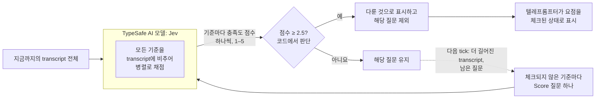

# Intelliprompter

> 발표자가 말하는 동안 발표 노트의 항목을 하나씩 체크합니다. Jev가 아직 다루지 않은 항목마다 실시간 transcript를 채점하고, 점수가 threshold를 넘은 항목은 체크된 상태로 남습니다.

*Intelliprompter는 발표 요점 하나당 `Score` 질문 하나를 써서, 발표자가 요점을 다룰 때마다 체크합니다.*

텔레프롬프터는 무슨 말을 해야 하는지 알려 줍니다. 하지만 글머리 기호로 정리한 노트를 보며 발표한다면, **지금까지 한 말**이 계획한 요점을 각각 다뤘는지가 더 궁금할 수 있습니다.

**Intelliprompter**는 발표를 듣고 있다가, 지금까지 한 말과 하려고 계획한 말을 거의 실시간으로 비교합니다.

[Intelliprompter 데모](https://player.vimeo.com/video/1230923851)

발표자가 말하는 동안 앱은 누적 transcript(전사문)를 만들어 갑니다. 그리고 0.5초마다 transcript가 바뀌었는지 확인합니다. 바뀌었다면 transcript 전체를 Jev에 보내면서, 아직 체크되지 않은 기준마다 "발표자가 이 기준을 얼마나 충분히 다뤘는가?"라는 질문을 하나씩 함께 보냅니다.

아래 애니메이션은 transcript에 새로 들어온 chunk(청크)가 어떻게 처리되는지 보여 줍니다. chunk가 하나 추가될 때마다 기준이 하나도 체크되지 않을 수도 있고 여러 개가 체크될 수도 있습니다. 한번 완료로 표시된 항목은 나중에 다시 해제되지 않습니다.


## Intelliprompter의 동작 방식

페이지 맨 위의 데모 영상은 실제로 동작하는 시스템을 보여 줍니다. 마이크를 ElevenLabs와 연결하고, 로컬 앱이 Jev로 transcript를 채점하면서 어떤 항목이 완료되었는지 추적합니다.

이 cookbook(예제 모음)에서는 연동 코드를 건너뛰고 TypeSafe와 관련된 부분만 다룹니다. transcript에서 가져온 chunk 여섯 개를 코드에 직접 넣어 두고 Jev에 차례로 누적해서 보냅니다.

* [state(상태)](../concepts/state.md)는 지금까지의 transcript 전체입니다.
* 체크되지 않은 기준 하나하나가 다섯 단계의 충족도를 가진 [`Score` 질문](../primitives/score.md)이 됩니다.
* `system_one` 요청 한 번에 state와 모든 질문을 함께 보냅니다.
* Jev는 기준마다 점수를 하나씩 반환합니다. SDK는 다섯 단계에 0–4 번호를 매기므로, 이 cookbook에서는 실제 앱의 1–5 표시에 맞추려고 1을 더합니다.
* 5점 만점에 2.5점은 이 데모가 자체적으로 정한 충족도 threshold(임계값)이며, Jev의 confidence(신뢰도) 값이 아닙니다. 앱은 이 점수에 도달한 기준을 다룬 것으로 표시하고 이후 요청에서 제외합니다.



## 준비

이 예제를 로컬에서 실행하려면 [TypeSafe API 키를 만든](https://console.typesafe.ai/keys) 다음, 터미널에서 아래 명령을 실행하세요. `<ADD_YOUR_KEY>`는 발급받은 키로 바꿉니다.

```bash
pip install ipython 'cooksafe>=0.3.0,<0.4.0'
export TYPESAFE_API_KEY="<ADD_YOUR_KEY>"
```

아래 수치는 2026-11-04에 `jev-1.14.0`으로 얻은 결과입니다.

```python
import json
import os
import urllib.request
from pathlib import Path

from cooksafe import JsonCache, make_playground_link
from IPython.display import Markdown, display
from typesafe_sdk import Score, TypeSafeClient

TYPESAFE_MODEL = "jev-1.14.0"  # 이 페이지에서 쓴 모델. "jev-latest"는 최신 모델을 실시간으로 실행합니다
COVERED_AT = 2.5  # 실제 앱이 1–5 척도에서 쓰는 기본 threshold

client = TypeSafeClient(
    api_key=os.environ.get("TYPESAFE_API_KEY", "cache-only"),  # 캐시된 결과를 다시 렌더링할 때는 키가 필요 없습니다
    model=TYPESAFE_MODEL,
    timeout=120.0,
)
```

```python
EXAMPLES_URL = (
    "https://raw.githubusercontent.com/typesafe-ai/typesafe-public-examples/main/"
    "cookbooks/intelliprompter"
)


def download(name: str) -> Path:
    """Fetch one of this cookbook's files from typesafe-public-examples unless it is on disk."""
    path = Path(name)
    if not path.exists():
        urllib.request.urlretrieve(f"{EXAMPLES_URL}/{name}", path)
    return path


CACHE = Path("intelliprompter_cache.json")
# True이면 게시된 답으로 CACHE를 채우므로 실행 중에 요청을 보내지 않습니다. 실시간으로
# 실행하려면 False로 바꾸고 CACHE를 삭제하세요. 디스크에 이미 있는 CACHE는 덮어쓰지 않습니다.
DOWNLOAD_CACHE = True
if DOWNLOAD_CACHE:
    download(CACHE.name)
json_cache = JsonCache(CACHE)
```

기준마다 화면에 표시할 짧은 문구(`display`)와 Jev에 보낼 더 긴 설명(`description`)이 있습니다. 설명은 Jev가 transcript에서 무엇을 찾아야 하는지 알려 줍니다.

```python
CHECKLIST = [
    {
        "title": "Introduce Intelliprompter",
        "criteria": [
            {
                "display": "Say its name",
                "description": "The speaker said the name Intelliprompter.",
            },
            {
                "display": "Explain what it does",
                "description": (
                    "The speaker described Intelliprompter as a teleprompter that listens "
                    "and checks off talking points as they are covered."
                ),
            },
        ],
    },
    {
        "title": "Explain the scoring loop",
        "criteria": [
            {
                "display": "Send the rolling transcript",
                "description": (
                    "The speaker explained that the accumulated transcript is sent to "
                    "TypeSafe for scoring."
                ),
            },
            {
                "display": "Score each criterion",
                "description": (
                    "The speaker explained that each criterion gets a score from 1 to 5, "
                    "and a talking point completes when all its criteria are covered."
                ),
            },
        ],
    },
    {
        "title": "Name useful use cases",
        "criteria": [
            {
                "display": "Give at least two uses",
                "description": (
                    "The speaker named at least two suitable uses, such as conference talks, "
                    "lectures, or product demos."
                ),
            }
        ],
    },
]

for point in CHECKLIST:
    print(point["title"])
    for criterion in point["criteria"]:
        print(f"  [ ] {criterion['display']}")
```

```
Introduce Intelliprompter
  [ ] Say its name
  [ ] Explain what it does
Explain the scoring loop
  [ ] Send the rolling transcript
  [ ] Score each criterion
Name useful use cases
  [ ] Give at least two uses
```

## 각 점수의 의미를 Jev에 알려 주기

`Score` 질문에는 명확한 척도가 필요합니다. 여기서는 "Not mentioned at all"(전혀 언급하지 않음)부터 "Covered well and with useful detail"(유용한 세부 내용과 함께 충분히 다룸)까지 다섯 단계를 줍니다. Jev는 각 기준을 transcript에 비추어 채점합니다.

SDK는 0부터 4까지의 점수를 반환합니다. 단계 번호마다 그 단계의 확률을 곱해서 모두 더한 값이므로, 두 단계 사이의 값이 나올 수 있습니다. 실제 데모는 같은 결과를 1부터 5까지로 보여 주므로 `score_tick`에서 1을 더합니다. 앱은 이 점수가 2.5에 도달하면 기준을 체크된 것으로 표시합니다.

요청 한 번으로 여러 기준을 채점할 수 있습니다. 모든 기준은 동일한 transcript 전체를 봅니다.

```python
SCORE_LEVELS = [
    "Not mentioned at all",
    "Briefly or indirectly mentioned",
    "Mentioned directly",
    "Mostly covered",
    "Covered well and with useful detail",
]


def score_question(description: str) -> Score:
    return Score(
        instructions=(
            "How completely has the speaker covered this criterion in `transcript`: "
            f'"{description}"'
        ),
        criteria=SCORE_LEVELS,
    )


@json_cache
def score_tick(transcript: str, questions_json: str, model: str) -> dict:
    response = client.system_one(
        state={"transcript": transcript},
        questions=json.loads(questions_json),
        model=model,
    )
    return {
        "answers": {
            key: {"score": answer.score + 1} for key, answer in response.scores.items()
        }
    }
```

## 체크된 기준은 체크된 상태로 유지하기

Jev는 점수를 반환할 뿐, 체크리스트의 상태를 보관하지 않습니다. 앱은 다룬 기준의 키를 set에 저장합니다. 점수가 설정해 둔 충족도 threshold에 도달하면 앱이 그 키를 추가합니다. 이 데모에서는 5점 만점에 2.5점을 씁니다. 이후 요청에서는 다룬 기준의 키를 빼므로, 체크된 기준은 다시 채점되지 않습니다.

실제 앱은 transcript가 바뀌었고 진행 중인 요청이 없을 때 새 tick(틱)을 시작합니다. 이 cookbook의 재현 코드에서는 transcript chunk 여섯 개가 곧 tick을 정하므로 일반적인 반복문을 씁니다.

```python
SPEECH_CHUNKS = [
    "Hello. This is Intelliprompter.",
    (
        "It is a smart teleprompter. It listens while I present and marks points "
        "after I cover them."
    ),
    (
        "As I keep speaking, the complete transcript so far goes to TypeSafe for "
        "review, not just my last line."
    ),
    (
        "Each remaining requirement gets a score out of five, and a point is done "
        "when all its requirements are met."
    ),
    "You could use it on stage at an industry event.",
    "Teachers could use it in class, and so could anyone showing customers new software.",
]


def pending_criteria(covered: set[str]) -> tuple[tuple[str, str], ...]:
    return tuple(
        (f"c_{point_index}_{criterion_index}", criterion["description"])
        for point_index, point in enumerate(CHECKLIST)
        for criterion_index, criterion in enumerate(point["criteria"])
        if f"c_{point_index}_{criterion_index}" not in covered
    )


def run_loop(chunks: list[str]) -> tuple[set[str], dict[str, dict], list[dict]]:
    transcript = ""
    covered: set[str] = set()
    latest: dict[str, dict] = {}
    ticks: list[dict] = []  # 각 요청이 보낸 내용. 아래 playground 링크에 씁니다

    for tick, chunk in enumerate(chunks, 1):
        transcript = f"{transcript} {chunk}".strip()
        pending = pending_criteria(covered)
        if not pending:
            break
        ticks.append({"transcript": transcript, "pending": pending})

        questions = {
            key: score_question(description).model_dump(mode="json", exclude_none=True)
            for key, description in pending
        }
        result = score_tick(transcript, json.dumps(questions), model=TYPESAFE_MODEL)

        new_checks = 0
        for key, answer in result["answers"].items():
            latest[key] = answer
            if answer["score"] >= COVERED_AT:
                covered.add(key)
                new_checks += 1

        scores = ", ".join(
            f"{key}={answer['score']:.2f}" for key, answer in result["answers"].items()
        )
        print(
            f"tick {tick}: {len(transcript.split()):>2} words | "
            f"{scores} | +{new_checks} checks"
        )

    return covered, latest, ticks


covered, latest, ticks = run_loop(SPEECH_CHUNKS)
```

```
tick 1:  4 words | c_0_0=3.03, c_0_1=1.07, c_1_0=1.00, c_1_1=1.01, c_2_0=1.01 | +1 checks
tick 2: 21 words | c_0_1=3.60, c_1_0=1.01, c_1_1=1.09, c_2_0=1.07 | +1 checks
tick 3: 40 words | c_1_0=3.45, c_1_1=1.10, c_2_0=1.11 | +1 checks
tick 4: 60 words | c_1_1=3.36, c_2_0=1.12 | +1 checks
tick 5: 70 words | c_2_0=2.01 | +0 checks
tick 6: 84 words | c_2_0=3.76 | +1 checks
```

초반 tick에서는 체크리스트가 바뀌지 않은 채 점수만 조금씩 오를 수 있습니다. 점수가 2.5에 도달하면 그 기준은 다룬 상태로 남고 이후 요청에서 빠집니다. 체크되지 않은 나머지 기준은 체크리스트에서의 위치와 상관없이 모두 다음 요청에 그대로 들어갑니다.

## 최종 체크리스트 읽기

Jev는 점수를 반환합니다. 그 점수를 안정적인 체크리스트로 바꾸는 것은 애플리케이션입니다. 순서, 2.5 규칙, 한 방향으로만 바뀌는 상태 전환은 Jev가 제어하지 않습니다.

```python
for point_index, point in enumerate(CHECKLIST):
    print(point["title"])
    for criterion_index, criterion in enumerate(point["criteria"]):
        key = f"c_{point_index}_{criterion_index}"
        state = "✓" if key in covered else " "
        answer = latest.get(key, {"score": 0.0})
        print(f"  [{state}] {criterion['display']:<30} score {answer['score']:.2f}")
```

```
Introduce Intelliprompter
  [✓] Say its name                   score 3.03
  [✓] Explain what it does           score 3.60
Explain the scoring loop
  [✓] Send the rolling transcript    score 3.45
  [✓] Score each criterion           score 3.36
Name useful use cases
  [✓] Give at least two uses         score 3.76
```

이 패턴을 실제 스트림에 적용하려면 `SPEECH_CHUNKS`를 음성 인식 서비스가 제공하는 누적 텍스트로 바꾸세요. 점수 단계의 설명은 구체적으로 쓰고, threshold는 코드에 두세요.

## playground에서 직접 해 보기

아래 링크에는 세 번째 tick이 담겨 있습니다. chunk 세 개까지의 transcript가 state로, 그 시점에 아직 체크되지 않은 기준마다 `Score` 질문이 하나씩 들어 있습니다. playground(플레이그라운드)에서 transcript를 고치면 점수도 따라서 바뀝니다.

```python
third = ticks[2]
playground_link = make_playground_link(
    {"transcript": third["transcript"]},
    {key: score_question(description) for key, description in third["pending"]},
)
display(
    Markdown(
        f"🔗 [Open one scoring tick in the TypeSafe playground]({playground_link})"
    )
)
```

[TypeSafe playground에서 채점 tick 하나 열기 →](https://console.typesafe.ai/playground#share/N4IgJg9gxgrgtgUwHYBcAqCAeKQC4AEIwAOiCgE4CGSAzlOQJYAOKpBpAEggDbcQB0+NAAsGNfGPwBJVD27NyEOCwTlBUlBPGV8NOJXKaUPBE0XLja6Zvk1jtfAHdR3BNPxmENZJuph8+uQA1uJMEAyo2gBmlu5QEABuqvgowghwggCC4lL4QQimukwIlEERAOYANClp+PHKrsYpVLT0zJo0EPhRBvjlEF4pXWgAnsUAypRRblEQ5PjkCAkMCI7VSBCaAFYwdgEj+NyUe-JICPykAL4g1SBmSiw0GNh4hCQgUAD6AIyfAAxsfDvFBjBCA0h0OZgm74UgROzkGBQFAMCC0cEgDgQRx1B6NHgHYTHGpuGjFUrJeJJRb+VKSNqWVFICTMgAGFGodEYLFZ7GIpBEpPJ+XmWCYRwiCFpRKMtUoUFgcBgR2MtJaXPaWl0PiGQlBk2m3TmunijCQ5Qu-JApGqpAZqgYlEBAG1SAA5TYBHxMqX4Si+Xg22EgABCjAQUW4B2NETADEWyKjXtQPrAQdIAFlvWjfXGEygo+mQBmIHYk1TVFKiwBhRKV-yOOR+pANhipfC7CPK-BgBAoSgMbikAC6l1tHx+P0BwNBGMhiyL8IoSJRaJoGKxOPq4r7BPwRPEqSFJRFuOpvrp4ntjDRLPw7PVbR5fIFtTJJ+SYolZ2l-vwJSgYQ6kYRlb3KPttBNKFunMfBvl1ABWao-D9FJKG4MpzQ8cJUFxBpd3EZxkD9XgJBQK8QIdHQDDcCsaUtUgi2vR0XXdT1EBTHN-D-dChxhUgwxWSNo3mWN4wQRMDg41cfyLLNOJ-HtxMkuTSwLA46KrfiQFrc8GybFDHDbIDOyibte37QcRzHYMvgAJn+adSBBYo51NaFxyXRFkSZddXk4bE8J3YwkwPEkig-eZNOlelKJvZkInvDlWm5FBeVhK1BQiil5iQShEG4mwSj2FBHC6GgYDbSgACNXA7bwaGqCrAL9K80WmRYkCgNx+wwxrDgklAYEWfrjXuMAVx7dJSwY61tOYp1XldEAPU0aTUz9AM+PHQSIyTGMW2U9TkxkrTx3k07-DzQbC20ksyw0usaRrJ7fUbUjDOM+qu24KbLL40drluSgmAYAA1VQaCZV4QASb4QEuIA)


이 문서는 개발자 문서 플랫폼인 [Mintlify](https://mintlify.com)로 제작하고 호스팅합니다.
