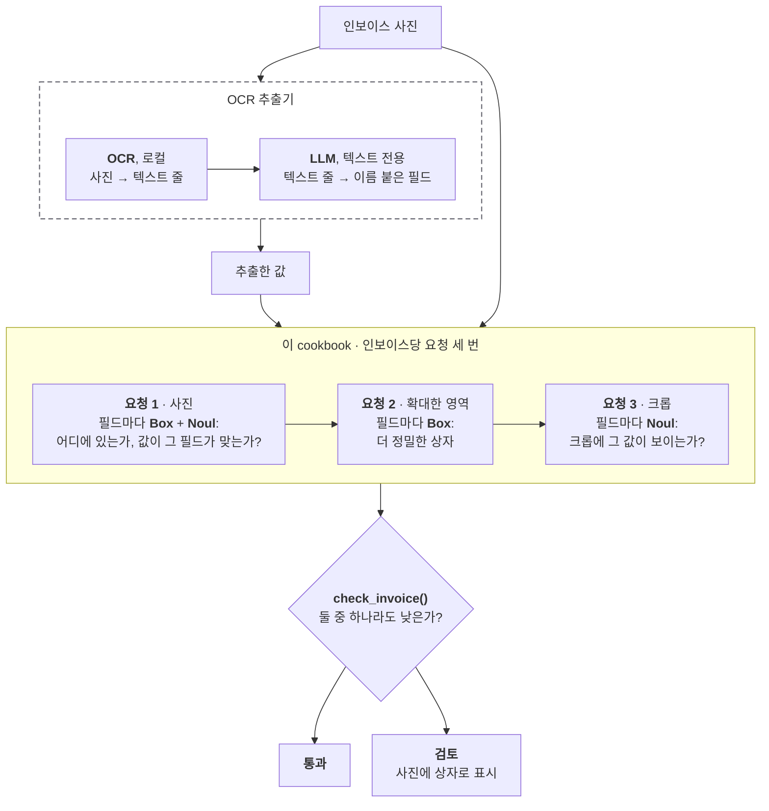

# OCR confidence와 bounding box

> OCR 추출기가 인보이스 사진에서 읽어 낸 값을 검증합니다. Jev가 값마다 상자를 치고, 페이지 전체와 상자를 잘라 낸 이미지에 각각 비추어 점수를 매긴 뒤, 점수가 낮은 값을 검토 대상으로 표시합니다.

OCR이 인보이스 사진에서 추출한 값은 대부분 맞습니다. 하지만 값을 하나하나 사람이
확인하려면 직접 입력하는 것만큼 시간이 걸립니다. 이 확인을 Jev에 맡길 수 있습니다. Jev가
사진에서 값마다 상자를 치고 틀려 보이는 값을 표시해 주므로, 검토자는 표시된 값만 보면 됩니다.


여기서는 공급업체 인보이스 두 장에서 추출기가 공급업체, 인보이스 번호, 날짜, 청구 금액,
은행 정보를 읽었고, 그중 값 세 개를 틀렸습니다. Jev는 세 개를 모두 표시합니다.

Jev는 값을 두 번씩 확인합니다. 한 번은 페이지 전체에 비추어(페이지 검사), 한 번은 상자를
잘라 낸 이미지에 비추어(크롭 검사) 확인합니다. 둘 중 어느 한쪽에서라도 점수가 0.25보다 낮은
값은 검토로 넘어갑니다. 아래 표에서 "추출값"은 추출기가 읽은 값이고 "인쇄된 값"은 인보이스에
실제로 적힌 값입니다.

| 인보이스 | 필드 | 추출값 | 인쇄된 값 | 페이지 검사 | 크롭 검사 |
| - | - | - | - | - | - |
| Milkwood | 인보이스 번호 | `AN400074` | `IN400074` | 0.88 | 0.18 |
| Siyakhula | 인보이스 번호 | `INV03070` | `INV03079` | 0.02 | 0.04 |
| Siyakhula | 날짜 | `16/09/2028` | `16/09/2026` | 0.17 | 0.66 |

아래 코드는 OCR 단계와 LLM 단계가 만들어 낸 값이 담긴 `extractions.json`에서 출발하며, 이 두
단계 자체는 다루지 않습니다. 이 파일은 Tesseract와 원하는 LLM으로 직접 만들 수 있습니다.



## 설정

```bash
pip install ipython pillow 'typesafe-sdk[pil]>=0.7.5' 'cooksafe>=0.3.0,<0.4.0'
```

그런 다음 `TYPESAFE_API_KEY`를 설정합니다.

> **참고** - 이미지와 `Box` 질문은 dreamer-ready 단계입니다. 아직 프로덕션에 쓸 준비가 되지
> 않았고, 요청 형식과 답이 릴리스마다 달라질 수 있다는 뜻입니다. Jev 1.14가 필요하며, 모든
> 요청에 `TypeSafe-Danger-Zone-Images: true` 헤더를 넣어야 합니다. 아래 클라이언트는 이
> 헤더를 설정해 둡니다.

아래 수치는 2026-10-15에 `jev-1.14.0`으로 얻은 것입니다.

```python
import io
import json
import os
import urllib.request
from pathlib import Path

from cooksafe import JsonCache
from IPython.display import display
from PIL import Image as PILImage
from PIL import ImageDraw, ImageFont
from typesafe_sdk import Box, Image, Noul, SystemOneResponse, TypeSafeClient

# Box 질문에는 Jev 1.14 이상이 필요합니다.
TYPESAFE_MODEL = "jev-1.14.0"  # 이 페이지에서 쓴 모델. "jev-latest"는 최신 모델을 실시간으로 실행합니다
BAR = 0.25  # 검사 점수가 이 값보다 낮으면 해당 필드를 표시합니다
ZOOM = 3  # 확대 영역은 첫 번째 상자의 세 배이며, 최소한 페이지의 ZOOM_MIN 만큼은 됩니다
ZOOM_MIN = (0.30, 0.15)  # 너비, 높이 (페이지 대비 비율)
GROW = (0.25, 0.20)  # 각 상자 둘레의 검토용 여백 (상자 너비와 높이 대비 비율)
MIN_SIDE, MAX_SIDE = 280, 1568  # Jev가 이미지의 각 변에 허용하는 픽셀 범위

client = TypeSafeClient(
    api_key=os.environ.get("TYPESAFE_API_KEY", "cache-only"),  # 키가 없는 커널은 캐시를 재생합니다
    base_url=os.environ.get("TYPESAFE_ENDPOINT"),
    headers={"TypeSafe-Danger-Zone-Images": "true"},
    timeout=120.0,
)


EXAMPLES = (
    "https://raw.githubusercontent.com/typesafe-ai/typesafe-public-examples/main/"
    "cookbooks/ocr_confidence_bounding_boxes"
)


def download(name: str) -> Path:
    """Fetch one of this cookbook's files from typesafe-public-examples unless it is on disk."""
    path = Path(name)
    if not path.exists():
        path.parent.mkdir(parents=True, exist_ok=True)
        urllib.request.urlretrieve(f"{EXAMPLES}/{name}", path)
    return path


CACHE = Path("ocr_confidence_bounding_boxes_cache.json")
# True 이면 공개된 답으로 CACHE 를 채우므로 실행 중에 요청을 보내지 않습니다. 실시간으로
# 실행하려면 False 로 바꾸고 CACHE 를 삭제하세요. 디스크에 이미 있는 CACHE 는 덮어쓰지 않습니다.
DOWNLOAD_CACHE = True
if DOWNLOAD_CACHE:
    download(CACHE.name)
json_cache = JsonCache(CACHE)
```

## 사진과 추출기가 읽은 값 불러오기

두 사진은 한 식당이 공급업체에서 받은 인보이스를 휴대폰으로 찍은 것입니다. 하나는 Milkwood
Mushrooms에서 받은 구겨진 먹지 사본입니다. 다른 하나는 Siyakhula Trading에서 받은 것으로,
가운데에 세로로 그림자가 져 있어 OCR로 읽기 까다롭습니다.

추출한 값은 `extractions.json`에 있습니다. 사진은 Apple Vision의 텍스트 인식(OCR)으로 읽었고,
그 출력을 LLM이 읽어 구조화된 값으로 반환했습니다. 검사에 필요한 것은 사진과 값뿐이므로
어떤 추출기를 써도 됩니다.

```python
INPUTS = Path("inputs")  # 사진. extractions.json 에서는 파일 이름이 키입니다
EXTRACTIONS = json.loads(download("extractions.json").read_text())
for photo in EXTRACTIONS:
    download(f"inputs/{photo}")
FIELDS = {
    # 필드: 그 필드가 무엇인지, 모든 질문에서 쓰는 표현으로
    "supplier_name": "the supplier's (seller's) business name",
    "invoice_number": "the invoice or document number",
    "invoice_date": "the invoice date",
    "amount_due": "the final total amount payable",
    "bank_name": "the name of the supplier's bank in the payment details",
    "account_holder": "the account holder name in the supplier's bank details",
    "account_number": "the supplier's bank account number",
    "branch_code": "the supplier's bank branch code",
}
SAME_VALUE = "Ignore differences in spacing, punctuation, currency symbols and letter case."

for photo, values in sorted(EXTRACTIONS.items()):
    with PILImage.open(INPUTS / photo) as page:
        print(f"{photo}  ({page.width} x {page.height} px)")
    for field, value in values.items():
        print(f"  {field:<16}{value}")
```

```
milkwood.jpg  (1393 x 1080 px)
  supplier_name   MILKWOOD mushrooms
  invoice_number  AN400074
  invoice_date    01/09/2026
  amount_due      504.70
  bank_name       Standard Bank
  account_holder  MILKWOOD
  account_number  080 11 4941
siyakhula.jpg  (899 x 1599 px)
  supplier_name   Siyakhula Trading Services (Pty) Ltd ta Siyakhula Trading
  invoice_number  INV03070
  invoice_date    16/09/2028
  amount_due      R1,305.65
  bank_name       Standard Bank
  account_holder  Siyakhula Trading
  account_number  10 13 205 260 5
  branch_code     051001
```

Jev는 각 변이 280픽셀에서 1568픽셀 사이인 이미지를 받습니다. 더 큰 이미지는 축소하고, 작은
크롭은 글자를 읽을 수 있도록 확대합니다. 그래도 너무 작은 이미지는 흰 캔버스 가운데에 놓고
캔버스에서의 위치를 기록해 둡니다. 그러면 Jev가 캔버스 위에 그린 상자를 크롭 위의 위치로
되돌려 환산할 수 있습니다.

```python
def as_image(picture: PILImage.Image, upscale_to: int | None = None) -> tuple[Image, tuple]:
    picture = picture.convert("RGB")
    if upscale_to and max(picture.size) < upscale_to:
        scale = upscale_to / max(picture.size)
        picture = picture.resize(
            (round(picture.width * scale), round(picture.height * scale)), PILImage.LANCZOS
        )
    picture.thumbnail((MAX_SIDE, MAX_SIDE))
    frame = (0.0, 0.0, 1.0, 1.0)  # 캔버스에서 그림이 차지하는 left, top, width, height
    if min(picture.size) < MIN_SIDE:
        canvas = PILImage.new("RGB", (max(picture.width, MIN_SIDE), max(picture.height, MIN_SIDE)), "white")
        x, y = (canvas.width - picture.width) // 2, (canvas.height - picture.height) // 2
        canvas.paste(picture, (x, y))
        frame = (x / canvas.width, y / canvas.height, picture.width / canvas.width,
                 picture.height / canvas.height)
        picture = canvas
    buffer = io.BytesIO()
    picture.save(buffer, "JPEG", quality=90)
    return Image(buffer.getvalue()), frame


def crop(photo: str, box: dict, pad: float = 0.0) -> PILImage.Image:
    with PILImage.open(INPUTS / photo) as page:
        w, h = page.size
        return page.convert("RGB").crop((
            max(0, int((box["left"] - pad) * w)), max(0, int((box["top"] - pad) * h)),
            min(w, int((box["right"] + pad) * w)), min(h, int((box["bottom"] + pad) * h)),
        ))
```

## 페이지에서 각 필드 찾기

세 번의 요청 가운데 첫 번째는 사진 전체를 보내며, 필드마다 질문을 두 개씩 담습니다.

* 필드를 찾는 `Box` 질문입니다. 어떤 텍스트에 상자를 쳐야 하는지 알려 주는 힌트로 추출값을
  함께 넣습니다. 이 상자를 기준으로 확대할 위치가 정해집니다.
* 추출값이 이 페이지에서 그 필드가 맞는지 묻는 `Noul` 질문입니다. 이 질문의 P(yes)가 두 검사
  가운데 첫 번째인 페이지 검사입니다.

```python
def page_questions(values: dict) -> dict:
    questions = {}
    for field, value in sorted(values.items()):
        questions[f"box_{field}"] = Box(
            instructions=f"{FIELDS[field]}, printed as “{value}” in `page`"
        )
        questions[f"fits_{field}"] = Noul(
            instructions=f"Is “{value}” {FIELDS[field]} on `page`? {SAME_VALUE}"
        )
    return questions


def as_json(questions: dict) -> str:
    return json.dumps(
        {key: q.model_dump(mode="json", exclude_none=True) for key, q in questions.items()}
    )


@json_cache
def find_fields(photo: str, questions_json: str, model: str) -> dict:
    questions = json.loads(questions_json)
    fields = sorted(key.removeprefix("box_") for key in questions if key.startswith("box_"))
    with PILImage.open(INPUTS / photo) as page:
        image, _ = as_image(page)  # 페이지 전체는 크기 범위를 채우므로 캔버스가 필요 없습니다
    response = client.system_one(
        state={"page": image}, questions=questions, model=model
    )
    return {
        "boxes": {f: response.boxes[f"box_{f}"].box.model_dump() for f in fields},
        "fits": {f: response.nouls[f"fits_{f}"].noul for f in fields},
    }


found = {photo: find_fields(photo, as_json(page_questions(values)), model=TYPESAFE_MODEL)
         for photo, values in sorted(EXTRACTIONS.items())}
for photo, result in found.items():
    print(photo)
    for field, value in EXTRACTIONS[photo].items():
        print(f"  {field:<16}{value:<24.24} value fits the page {result['fits'][field]:.2f}")
```

```
milkwood.jpg
  supplier_name   MILKWOOD mushrooms       value fits the page 0.98
  invoice_number  AN400074                 value fits the page 0.88
  invoice_date    01/09/2026               value fits the page 0.53
  amount_due      504.70                   value fits the page 0.95
  bank_name       Standard Bank            value fits the page 0.98
  account_holder  MILKWOOD                 value fits the page 0.90
  account_number  080 11 4941              value fits the page 0.35
siyakhula.jpg
  supplier_name   Siyakhula Trading Servic value fits the page 0.96
  invoice_number  INV03070                 value fits the page 0.02
  invoice_date    16/09/2028               value fits the page 0.17
  amount_due      R1,305.65                value fits the page 0.97
  bank_name       Standard Bank            value fits the page 0.97
  account_holder  Siyakhula Trading        value fits the page 0.93
  account_number  10 13 205 260 5          value fits the page 0.96
  branch_code     051001                   value fits the page 0.97
```

페이지 검사는 `INV03070`(0.02)과 `16/09/2028`(0.17)을 잡아내지만, 잘못 읽은 `AN400074`는
0.88로 통과시킵니다. 페이지 전체를 찍은 사진에서는 작은 글씨가 세밀하게 보이지 않으므로, 이
첫 번째 상자들은 대략적인 위치만 나타냅니다.

## 확대해서 각 필드에 다시 상자 치기

필드마다 첫 번째 상자 주변 영역을 잘라 내어 확대합니다. 이 영역은 너비가 페이지의 30% 이상,
높이가 15% 이상이므로 첫 번째 상자가 어긋났더라도 필드가 영역 안에 들어옵니다. 그런 다음
영역마다 같은 `Box` 질문을 다시 묻습니다. 각 영역의 이미지는 해당 질문의 instructions(지시문)
안에 들어가고, 모든 영역이 요청 하나에 담기며, `client.attach_assets()`가 이미지를 요청과
함께 보냅니다.

이어서 코드는 새로 얻은 상자의 사방에 여백을 덧붙여, 상자대로 잘라 냈을 때 값의 일부가
잘려 나가지 않도록 합니다.

```python
IMAGE = "{image}"  # 요청을 보내기 전까지 각 질문의 이미지 자리를 대신합니다
ZOOM_TASK = "Locate fields in zoomed-in parts of a supplier invoice."


def region_around(box: dict) -> dict:
    width = min(1.0, max(ZOOM_MIN[0], (box["right"] - box["left"]) * ZOOM))
    height = min(1.0, max(ZOOM_MIN[1], (box["bottom"] - box["top"]) * ZOOM))
    left = min(max(0.0, (box["left"] + box["right"] - width) / 2), 1 - width)
    top = min(max(0.0, (box["top"] + box["bottom"] - height) / 2), 1 - height)
    return {"left": left, "top": top, "right": left + width, "bottom": top + height}


def zoom_questions(values: dict) -> dict:
    return {
        field: Box(
            instructions=f"{FIELDS[field]}, printed as “{values[field]}” in this image: {IMAGE}"
        )
        for field in sorted(values)
    }


def ask_with_images(task: str, questions: dict, images: dict, model: str) -> SystemOneResponse:
    """Put each field's image into its question, and send all the questions in one request."""
    for field, question in questions.items():
        question["instructions"] = question["instructions"].replace(IMAGE, str(images[field]))
    with client.attach_assets(list(images.values())):  # 텍스트 안의 참조를 실제 이미지로 연결합니다
        return client.system_one(state={"task": task}, questions=questions, model=model)


@json_cache
def zoom_fields(
    photo: str, regions_json: str, task: str, questions_json: str, grow: tuple, model: str
) -> dict:
    regions, images, frames = json.loads(regions_json), {}, {}
    for field, region in regions.items():
        images[field], frames[field] = as_image(crop(photo, region), upscale_to=1200)
    response = ask_with_images(task, json.loads(questions_json), images, model)
    tight = {}
    for field, region in regions.items():
        b, (fx, fy, fw, fh) = response.boxes[field].box, frames[field]
        # 캔버스 -> 영역 -> 페이지 순으로 변환한 뒤 검토용 여백을 더합니다
        left, right = (b.left - fx) / fw, (b.right - fx) / fw
        top, bottom = (b.top - fy) / fh, (b.bottom - fy) / fh
        gx, gy = (right - left) * grow[0], (bottom - top) * grow[1]
        rw, rh = region["right"] - region["left"], region["bottom"] - region["top"]
        tight[field] = {
            "left": max(0.0, region["left"] + (left - gx) * rw),
            "top": max(0.0, region["top"] + (top - gy) * rh),
            "right": min(1.0, region["left"] + (right + gx) * rw),
            "bottom": min(1.0, region["top"] + (bottom + gy) * rh),
        }
    return {"boxes": tight}
```

## 각 값을 크롭과 대조하기

여백을 덧붙인 상자대로 사진을 잘라 내고, 필드마다 `Noul` 질문을 하나씩 묻습니다. 이 크롭에
추출값이 보이는지 묻는 질문입니다. 각 크롭은 해당 질문의 instructions 안에 들어갑니다. 답의
P(yes)가 크롭 검사입니다.

```python
CROP_TASK = "Check values read from cropped parts of a supplier invoice."


def crop_questions(values: dict) -> dict:
    return {
        field: Noul(
            instructions=f"Image: {IMAGE}\nDoes this cropped image clearly show {FIELDS[field]}"
            f" as “{values[field]}”? {SAME_VALUE} Answer no if it is cut off, unreadable or"
            " different."
        )
        for field in sorted(values)
    }


@json_cache
def check_crops(
    photo: str, boxes_json: str, task: str, questions_json: str, model: str
) -> dict:
    images = {
        field: as_image(crop(photo, box, pad=0.01), upscale_to=800)[0]
        for field, box in json.loads(boxes_json).items()
    }
    response = ask_with_images(task, json.loads(questions_json), images, model)
    return {
        "shows": {f: response.nouls[f].noul for f in sorted(images)},
    }
```

## 사람이 확인해야 할 필드 표시하기

두 검사 중 하나라도 점수가 `BAR`(0.25)보다 낮으면 그 필드는 검토로 넘어갑니다.

```python
def check_invoice(photo: str, values: dict) -> dict:
    first = find_fields(photo, as_json(page_questions(values)), model=TYPESAFE_MODEL)
    regions = {field: region_around(box) for field, box in first["boxes"].items()}
    tight = zoom_fields(photo, json.dumps(regions, sort_keys=True), ZOOM_TASK,
                        as_json(zoom_questions(values)), GROW, model=TYPESAFE_MODEL)
    shown = check_crops(photo, json.dumps(tight["boxes"], sort_keys=True), CROP_TASK,
                        as_json(crop_questions(values)), model=TYPESAFE_MODEL)
    return {
        field: {
            "value": values[field],
            "box": tight["boxes"][field],
            "fits": first["fits"][field],
            "shows": shown["shows"][field],
            "review": first["fits"][field] < BAR or shown["shows"][field] < BAR,
        }
        for field in sorted(values)
    }


checked = {photo: check_invoice(photo, values) for photo, values in sorted(EXTRACTIONS.items())}
KEY = {field: n for n, field in enumerate(FIELDS, 1)}  # 아래에서 각 상자에 그려 넣는 번호
print(f"{'photo':<15}{'#':<3}{'field':<16}{'extracted':<26}{'fits page':>10}{'crop':>7}  verdict")
for photo, fields in checked.items():
    for field, r in sorted(fields.items(), key=lambda item: KEY[item[0]]):
        verdict = "REVIEW" if r["review"] else "ok"
        print(f"{photo:<15}{KEY[field]:<3}{field:<16}{r['value']:<26.26}{r['fits']:>10.2f}"
              f"{r['shows']:>7.2f}  {verdict}")
```

```
photo          #  field           extracted                  fits page   crop  verdict
milkwood.jpg   1  supplier_name   MILKWOOD mushrooms              0.98   0.95  ok
milkwood.jpg   2  invoice_number  AN400074                        0.88   0.18  REVIEW
milkwood.jpg   3  invoice_date    01/09/2026                      0.53   0.82  ok
milkwood.jpg   4  amount_due      504.70                          0.95   0.80  ok
milkwood.jpg   5  bank_name       Standard Bank                   0.98   0.53  ok
milkwood.jpg   6  account_holder  MILKWOOD                        0.90   0.57  ok
milkwood.jpg   7  account_number  080 11 4941                     0.35   0.92  ok
siyakhula.jpg  1  supplier_name   Siyakhula Trading Services      0.96   0.31  ok
siyakhula.jpg  2  invoice_number  INV03070                        0.02   0.04  REVIEW
siyakhula.jpg  3  invoice_date    16/09/2028                      0.17   0.66  REVIEW
siyakhula.jpg  4  amount_due      R1,305.65                       0.97   0.84  ok
siyakhula.jpg  5  bank_name       Standard Bank                   0.97   0.98  ok
siyakhula.jpg  6  account_holder  Siyakhula Trading               0.93   0.96  ok
siyakhula.jpg  7  account_number  10 13 205 260 5                 0.96   0.78  ok
siyakhula.jpg  8  branch_code     051001                          0.97   0.94  ok
```

어느 검사도 혼자서는 잘못 읽은 값 세 개를 모두 잡아내지 못합니다. 크롭 검사는 페이지 검사가
0.88로 통과시킨 `AN400074`를 잡아냅니다(0.18). 페이지 검사는 크롭 검사가 0.66으로 통과시킨
`16/09/2028`을 잡아냅니다(0.17). `INV03070`은 두 검사가 모두 잡아냅니다.

올바른 값은 모두 두 검사를 통과합니다. 그중 가장 낮은 점수는 페이지 검사에서 0.35를 받은
Milkwood 계좌 번호와 크롭 검사에서 0.31을 받은 Siyakhula 공급업체 이름입니다.

각 사진에서 모든 상자에는 위 표의 `#` 열과 같은 번호가 붙습니다. 주황색은 검토할 필드, 파란색은
통과한 필드를 뜻하므로, 검토자는 값이 인쇄된 바로 그 자리에서 각 값을 확인할 수 있습니다.

```python
BLUE, ORANGE = "#2a78d6", "#eb6834"


def annotate(photo: str, fields: dict) -> PILImage.Image:
    with PILImage.open(INPUTS / photo) as page:
        page = page.convert("RGB")
    draw = ImageDraw.Draw(page)
    font = ImageFont.load_default(size=max(14, page.width // 60))
    for field, r in fields.items():
        colour = ORANGE if r["review"] else BLUE
        b = r["box"]
        xy = (b["left"] * page.width, b["top"] * page.height,
              b["right"] * page.width, b["bottom"] * page.height)
        draw.rectangle(xy, outline=colour, width=max(3, page.width // 300))
        label = f" {KEY[field]} "  # 배지가 작아야 같은 줄에 인쇄된 필드들도 가리지 않고 읽을 수 있습니다
        tx, ty = xy[0], max(0, xy[1] - font.size - 4)
        draw.rectangle(draw.textbbox((tx, ty), label, font=font), fill=colour)
        draw.text((tx, ty), label, fill="white", font=font)
    return page


for photo, fields in checked.items():
    display(annotate(photo, fields))
```


이 문서는 개발자 문서 플랫폼인 [Mintlify](https://mintlify.com)로 제작하고 호스팅합니다.
