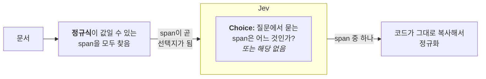

# 미리 파싱한 값 추출

> 정규식으로 이메일, 전화번호, 금액 후보를 찾고, 그중 요청한 값을 Jev가 고르게 한 다음, 고른 span을 코드에서 그대로 정규화합니다.

*정규식이 후보 값을 찾고, Jev가 질문에서 묻는 값을 고르면, 그 값을 글자 그대로 복사합니다.*

이 cookbook(예제 모음)에서는 텍스트에서 값 세 개를 뽑아냅니다. 발신자가 영수증을 받고 싶어 하는 주소, `+14155550177` 형식의 전화번호, 그리고 청구 금액으로 표시된 송장 합계 `1315.50 USD`입니다.
세 값 모두 문서에서 바꾸지 않고 그대로 복사한 span(텍스트 구간)에서 출발합니다. Jev는 정규식이 이미 찾아 둔 span 중에서만 고르므로 값을 지어내거나 숫자 자리를 뒤바꿀 수 없습니다. 같은 `find`와 `pick` 조합을 여러분의 문서에도 그대로 적용할 수 있습니다. 과정은 세 단계입니다.

1. 정규식이 텍스트에서 후보 값을 찾습니다. 틀린 값이 일부 섞여 들어오더라도 진짜 값은 하나도 놓치지 않도록 정규식을 조정합니다.
2. Jev가 질문에서 묻는 후보를 고르고, 뒤 단계에서 필요한 속성(통화, 국가, 금액이 크레딧인지 청구액인지)도 함께 읽어 냅니다.
3. 고른 값을 복사해서 정규화합니다.

[날짜 추출](date_extraction_cookbook.md)도 일을 같은 방식으로 나눕니다.
Jev가 텍스트에서 날짜의 구성 요소를 읽어 내고, 달력 계산은 코드에서 합니다.



## 준비

```bash
pip install ipython phonenumbers 'cooksafe>=0.3.0,<0.4.0'
```

그런 다음 `TYPESAFE_API_KEY`를 설정합니다.

```python
import os
import re
import urllib.request
from decimal import Decimal
from pathlib import Path

import phonenumbers
from cooksafe import JsonCache, make_playground_link
from IPython.display import Markdown, display
from typesafe_sdk import Choice, Noul, TypeSafeClient

TYPESAFE_MODEL = "jev-1.14.0"  # 이 페이지에서 쓰는 모델. "jev-latest"는 최신 모델을 실시간으로 실행합니다
NONE = "none"  # 모든 선택에 두는 탈출구: "맞는 후보가 없음"

# base_url의 기본값은 https://api.typesafe.ai/ 입니다. 환경 변수로 다른 배포를 가리키도록 바꿀 수 있습니다.
ts = TypeSafeClient(
    api_key=os.environ.get(
        "TYPESAFE_API_KEY", "cache-only"
    ),  # 캐시로 다시 렌더링할 때는 키가 필요 없습니다
    base_url=os.environ.get("TYPESAFE_BASE_URL"),
    timeout=30.0,
)
```

```python
EXAMPLES_URL = (
    "https://raw.githubusercontent.com/typesafe-ai/typesafe-public-examples/main/"
    "cookbooks/pre_parsed_value_extraction_cookbook"
)


def download(name: str) -> Path:
    """Fetch one of this cookbook's files from typesafe-public-examples unless it is on disk."""
    path = Path(name)
    if not path.exists():
        urllib.request.urlretrieve(f"{EXAMPLES_URL}/{name}", path)
    return path


CACHE = Path("pre_parsed_value_extraction_cookbook_cache.json")
# True이면 공개된 답으로 CACHE를 채우므로 실행 중에 요청을 보내지 않습니다. 실시간으로
# 실행하려면 False로 바꾸고 CACHE를 삭제하세요. 디스크에 이미 있는 CACHE는 덮어쓰지 않습니다.
DOWNLOAD_CACHE = True
if DOWNLOAD_CACHE:
    download(CACHE.name)
json_cache = JsonCache(CACHE)
```

## 헬퍼

후보는 진짜 값을 모두 잡아내는 정규식으로 찾고, 중복된 일치 항목은 버립니다(`find`). 그중 하나를 고를 때는 이 span들을 선택지로 삼는 `Choice` 질문을 씁니다(`pick`). 그래서 답은 후보 중 하나를 그대로 복사한 값이거나, 맞는 후보가 없을 때의 `none`입니다.
통화와 국가는 고정된 라벨 집합을 대상으로 하는 `Choice` 질문에서 얻고(`classify`), 금액이 크레딧인지는 `Noul` 질문에서 얻습니다(`is_true`).

코드가 공개된 답을 `pre_parsed_value_extraction_cookbook_cache.json`에 내려받으므로 실행 중에 요청을 보내지 않습니다. 실시간으로 실행하려면 `DOWNLOAD_CACHE = False`로 설정하고 이 파일을 삭제하세요.

```python
EMAIL_RE = re.compile(r"[A-Za-z0-9._%+-]+@[A-Za-z0-9.-]+\.[A-Za-z]{2,}")
PHONE_RE = re.compile(r"\(?\+?\d[\d\s()\-.]{6,}\d")
MONEY_RE = re.compile(r"[$€£¥]\s?\d[\d,]*(?:\.\d{2})?")


def find(pattern: re.Pattern, text: str) -> list[str]:
    """Code-side candidate finder: recall-tuned regex, deduped, in document order."""
    seen: set[str] = set()
    out: list[str] = []
    for match in pattern.findall(text):
        span = match.strip()
        if span and span not in seen:
            seen.add(span)
            out.append(span)
    return out


@json_cache
def pick(document: str, candidates: list[str], question: str, model: str) -> dict:
    """Jev selects which found span plays the role. Returns {choice, confidence}.

    The options ARE the candidate spans, so ``choice`` is a verbatim copy of one of them (or the
    ``none`` hatch). The model chooses; code owns the string."""
    criteria = {c: None for c in candidates} | {
        NONE: "None of these is the requested value."
    }
    answer = ts.system_one(
        state=document,
        questions={"pick": Choice(instructions=question, criteria=criteria)},
        model=model,
    ).answers["pick"]
    return {"choice": answer.choice, "confidence": answer.confidence}


@json_cache
def classify(document: str, question: str, options: list[str], model: str) -> dict:
    """A small Choice over a fixed label set (currency, country, ...). Returns {choice, confidence}."""
    answer = ts.system_one(
        state=document,
        questions={
            "q": Choice(instructions=question, criteria={o: None for o in options})
        },
        model=model,
    ).answers["q"]
    return {"choice": answer.choice, "confidence": answer.confidence}


@json_cache
def is_true(document: str, question: str, model: str) -> float:
    """A yes/no Noul. Returns P(yes)."""
    return (
        ts.system_one(
            state=document,
            questions={"q": Noul(instructions=question)},
            model=model,
        )
        .answers["q"]
        .noul
    )
```

## 이메일: 역할에 맞는 주소 고르기

헤더에는 주소가 네 개 있습니다. 본문에서는 영수증을 `To:`의 청구 담당 별칭 주소가 아니라 개인 주소로 보내 달라고 요청하므로, 본문을 읽어야 답을 알 수 있습니다.
질문은 두 가지입니다. 어느 주소로 영수증을 보내야 하는지, 그리고 어느 주소에서 메시지를 보냈는지입니다.

```python
EMAIL_DOC = """From: Jane Doe <jane.doe@example.com>
To: billing@example.com
Cc: orders@example.com
Reply-To: jane.personal@example.net

Hi team - please don't use the billing alias for this one. Send my receipt to my
personal address instead. Thanks, Jane."""

emails = find(EMAIL_RE, EMAIL_DOC)
receipt = pick(
    EMAIL_DOC,
    emails,
    "Which email address does the sender want their receipt sent to?",
    model=TYPESAFE_MODEL,
)
sender = pick(
    EMAIL_DOC,
    emails,
    "Which email address did this message come from (the From line)?",
    model=TYPESAFE_MODEL,
)

print("candidates :", emails)
# 코드는 고른 값을 글자 그대로 복사해서 정규화(소문자화)합니다. 값을 다시 타이핑하는 일은 없습니다
print(
    f"receipt -> : {receipt['choice'].lower():<28} (conf {receipt['confidence']:.2f})"
)
print(f"sender  -> : {sender['choice'].lower():<28} (conf {sender['confidence']:.2f})")
```

```
candidates : ['jane.doe@example.com', 'billing@example.com', 'orders@example.com', 'jane.personal@example.net']
receipt -> : jane.personal@example.net    (conf 0.97)
sender  -> : jane.doe@example.com         (conf 1.00)
```

영수증은 본문에서 요청한 대로 `Reply-To:` 줄의 개인 주소로 갑니다. 발신자는 `From` 줄에 있는 주소입니다. 둘 다 정규식 일치 항목을 복사한 값이고, 여기에 소문자화만 적용했습니다.

## 전화번호: 휴대전화 번호를 골라 E.164로 정규화하기

텍스트에는 번호가 세 개 있고, 어느 것에도 국가 번호가 붙어 있지 않습니다. Jev가 휴대전화 번호를 고르고 텍스트에서 국가를 읽어 내면, `phonenumbers`가 이 두 답을 합쳐 E.164로 만듭니다. E.164는 `+`와 국가 번호로 시작하는 국제 형식입니다.

```python
PHONE_DOC = """Reach our San Francisco office at these numbers: main desk (415) 555-0199,
billing fax (415) 555-0142, and my direct cell (415) 555-0177. Call the cell if it's urgent."""

phones = find(PHONE_RE, PHONE_DOC)
mobile = pick(
    PHONE_DOC, phones, "Which of these is the direct mobile / cell number?", model=TYPESAFE_MODEL
)
region = classify(
    PHONE_DOC,
    "In what country is this office located?",
    ["US", "GB", "DE", "FR", "CA", "AU"],
    model=TYPESAFE_MODEL,
)

# 코드는 고른 값을 복사한 뒤 모델이 알려 준 국가를 써서 정규화합니다
parsed = phonenumbers.parse(mobile["choice"], region["choice"])
e164 = phonenumbers.format_number(parsed, phonenumbers.PhoneNumberFormat.E164)

print("candidates :", phones)
print(f"mobile  -> : {mobile['choice']}  (conf {mobile['confidence']:.2f})")
print(f"country -> : {region['choice']}  (conf {region['confidence']:.2f})")
print(f"E.164   -> : {e164}")
```

```
candidates : ['(415) 555-0199', '(415) 555-0142', '(415) 555-0177']
mobile  -> : (415) 555-0177  (conf 1.00)
country -> : US  (conf 1.00)
E.164   -> : +14155550177
```

숫자만 봐서는 어느 번호가 휴대전화인지, 어느 나라 번호인지 알 수 없습니다. 그 정보는 숫자 주변의 단어에 있습니다. Jev가 그 단어를 읽고, `phonenumbers`가 고른 번호를 `+14155550177` 형식으로 바꿉니다.

## 금액: 금액을 고르고, 통화를 분류하고, 크레딧과 청구액 구분하기

송장에는 금액이 네 개 적혀 있습니다. Jev가 납부할 합계와 크레딧을 고르고, 통화를 읽고, 고른 금액마다 청구액인지 크레딧인지 표시합니다. 고른 문자열은 각각 복사해서 `Decimal`로 파싱합니다.

```python
MONEY_DOC = """Invoice INV-2087.
Subtotal: $1,200.00
Sales tax: $115.50
Total due: $1,315.50
A $50.00 courtesy credit from last month has already been applied."""

amounts = find(MONEY_RE, MONEY_DOC)
currency = classify(
    MONEY_DOC,
    "What currency are these amounts in?",
    ["USD", "EUR", "GBP", "JPY", "CAD"],
    model=TYPESAFE_MODEL,
)
total = pick(
    MONEY_DOC, amounts, "Which amount is the total the customer must pay?", model=TYPESAFE_MODEL
)
credit = pick(
    MONEY_DOC,
    amounts,
    "Which amount is the courtesy credit that was applied?",
    model=TYPESAFE_MODEL,
)


def to_decimal(value: str) -> Decimal:
    """Copy the picked value and parse the number in code (US grouping/decimal here)."""
    return Decimal(re.sub(r"[^\d.]", "", value))


for label, chosen in [("total due", total), ("credit", credit)]:
    is_credit = is_true(
        MONEY_DOC,
        f"Is the amount {chosen['choice']} a credit or refund to the customer, not a charge?",
        model=TYPESAFE_MODEL,
    )
    kind = "credit" if is_credit > 0.5 else "charge"
    print(
        f"{label:<10}: {chosen['choice']:<10} -> {to_decimal(chosen['choice'])} {currency['choice']} "
        f"({kind}, P(credit)={is_credit:.2f})"
    )
print("\ncandidates :", amounts)
```

```
total due : $1,315.50  -> 1315.50 USD (charge, P(credit)=0.03)
credit    : $50.00     -> 50.00 USD (credit, P(credit)=0.98)

candidates : ['$1,200.00', '$115.50', '$1,315.50', '$50.00']
```

납부할 합계는 \$1,315.50이고 크레딧은 \$50.00이며, 둘 다 USD입니다. 크레딧인지 청구액인지 묻는 `Noul` 질문은 합계에 0.03, 크레딧에 0.98을 주므로, 파싱한 각 `Decimal`의 부호를 알 수 있습니다.

> 금액은 쉼표가 천 단위 구분자이고 점이 소수점이라는 가정 아래 파싱합니다. `$1,315.50`에서는 이 가정이 맞지만 `€1.315,50`에서는 반대입니다. "Does this document use a comma as the decimal point?" 같은 `Noul` 질문을 던지고 그 답에 따라 분기하세요.

## TypeSafe 플레이그라운드에서 열어 보기

영수증 질문을 직접 시험해 보려면 이 이메일 스레드를 플레이그라운드에서 여세요. 정규식이 찾은 주소 네 개가 질문의 선택지입니다.

```python
receipt_criteria = {e: None for e in emails} | {
    NONE: "None of these is the requested value."
}
playground_link = make_playground_link(
    EMAIL_DOC,
    {
        "receipt": Choice(
            instructions="Which email address does the sender want their receipt sent to?",
            criteria=receipt_criteria,
        )
    },
)
display(
    Markdown(
        f"🔗 [Open this thread + selection in the TypeSafe playground]({playground_link})"
    )
)
```

[이 스레드와 선택 질문을 TypeSafe 플레이그라운드에서 열기 →](https://console.typesafe.ai/playground#share/N4IgJg9gxgrgtgUwHYBcAqCAeKQC4AEIAYgE4RwEBSAhkgvgCIT0A8AVrQgHSQIACWanAAOAG25RyAPgA6SNBAIAjAJajRKpAHMBmIWInk5AYSgEIJMAhIBnXfvFdJcOQCUEYgJ4BaBQQ50XMLWNhBI1KL2Io50KHJyABIq+CgIQvje+AbUNvSQSADkKPgwuSkAFvSq6ppa+BEqOfgAZhYVKjb4Ydz4AMrIYPhwnvgkCFAIKsLFKBBDnnLBtmER9WBgYzadmjap1GBc+GjltADWNgA0+DSBIFcgwmQiKDYY2HiEwDIgYxNTcR8viAUJ5gt8CN8oOUICoJt8rt8digSDAoCgVGEbOD8N8AOrlWHlfAIODUNRrDYILb4XidFCVfC5JBWEj4ADutBmlRUrN+k2mjOQMwgAH54TiQFASCpUtLqNigQFuLwogYnEYPkgYOoESBqhptKrHM5sVqdRKLCy7IJooYXJrtaJdUqgiEVpEbWrYqbHbqkN1sd8AHLdLrNCpU+gdCOjBAARxgVNSgwAbhFE1xvgBfHN3QjUYQqABqIQxSA+IBTAEYQFmgA)

## 두 가지 한계

* `Choice` 질문에는 선택지를 최대 255개까지 넣을 수 있습니다. 후보가 그보다 많으면 두 단계로 좁히세요. 먼저 섹션을 고르고, 그다음 그 안의 span을 고릅니다.
  [줄 단위 검색](semantic_find.md)에서 첫 단계를 볼 수 있습니다. 각 줄에 ID를 붙이고, 일치하는 줄을 `Choice`가 가리키게 하는 방식입니다.
* 손이 가는 부분은 후보를 찾는 일입니다. 이메일, 전화번호, 금액은 정규식으로 잡아낼 수 있지만 이름은 그렇지 않습니다. 그래서 이름 후보는 이미 가지고 있는 명단에서 가져오거나, named-entity recognizer(개체명 인식기)나 LLM이 제안하게 해야 합니다. 그러면 Jev가 그중에서 질문에서 묻는 것을 고릅니다.


이 문서는 개발자 문서 플랫폼인 [Mintlify](https://mintlify.com)로 제작하고 호스팅합니다.
