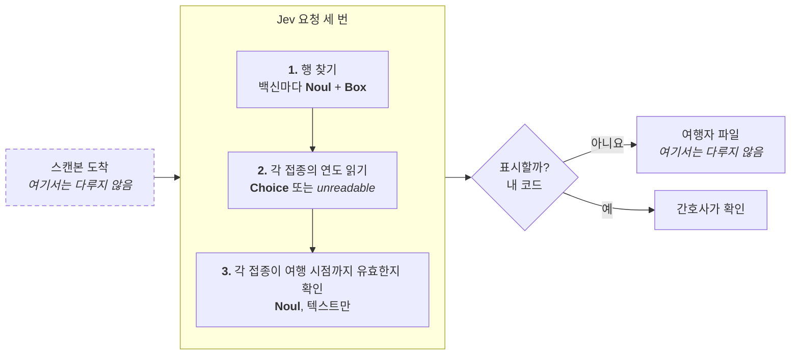

# 스캔한 예방접종 기록 읽기

> 스캔한 여행 예방접종 기록에서 Noul과 Box로 백신별 행을 찾고, unreadable로 답할 수 있는 Choice로 각 접종의 연도를 읽은 다음, 텍스트만 담은 요청으로 각 접종이 여행 시점까지 유효한지 확인합니다.

텍스트 레이어가 없는 스캔본 예방접종 기록이 있고, 여행 전에 각 기록의 내용이 올바른지 Jev로 확인하려는 상황입니다. Jev는 이미지를 받아, 미리 정해 둔 질문 목록에 답합니다.

* 백신마다 `Noul` 질문 하나: 이 백신이 기록에 있는가?
* 백신마다 `Box` 질문 하나: 해당 행은 어디에 있는가?
* 행마다 `Choice` 질문 하나: 날짜에 적힌 연도는 무엇인가, 아니면 `unreadable`인가?


이 예제에서 Jev는 위의 여행 예방접종 기록을 백신마다 한 행씩 읽어 내고, 여행 전에 검토가 필요한 행에 표시를 남깁니다. 이 기록에는 그런 행이 두 개 있습니다.

* 광견병(rabies) 접종 날짜는 배치 스티커에 가려져 있어서 스캔본으로는 읽을 수 없습니다. Jev는 추측하지 않고 `unreadable`이라고 답합니다.
* 장티푸스(typhoid) 접종은 2021년 6월에 이루어졌습니다. 날짜는 또렷하지만 장티푸스 주사의 예방 효과는 3년 정도이므로, 2026년 11월 여행 시점에는 유효하지 않습니다.

이 사례에서는 가능한 답을 이미 알고 있습니다. 클리닉에서 접종하는 백신 목록과, 접종이 이루어졌을 수 있는 연도들입니다. 페이지에서 값을 찾을 수 없는 경우에 대비해 `unreadable`도 선택지로 둡니다.

요청 두 번으로 스캔본을 읽고, 세 번째 요청으로 읽어 낸 값을 텍스트로 확인합니다. 각 요청에 무엇을 넣을지, 어느 행에 표시를 남길지는 코드가 결정합니다.



## 준비

```bash
pip install ipython matplotlib 'typesafe-sdk>=0.7.5,<0.8.0' \
    'cooksafe>=0.3.0,<0.4.0'
```

`TYPESAFE_API_KEY`를 설정합니다.

> [!WARNING]
>
> 이미지와 `Box` 질문은 초기 미리보기(early preview) 단계입니다. 이미지나 `Box` 질문이 담긴 요청에는 `TypeSafe-Danger-Zone-Images: true` 헤더가 필요하며, 요청 형식은 릴리스마다 바뀔 수 있습니다. [이미지](../images.md)를 참고하세요.

```python
import hashlib
import json
import os
import urllib.request
from datetime import date
from pathlib import Path
from time import perf_counter

import matplotlib

matplotlib.use("Agg")
import matplotlib.pyplot as plt
from cooksafe import JsonCache
from IPython.display import Markdown, display
from typesafe_sdk import Image, TypeSafeClient

TYPESAFE_MODEL = "jev-1.14.0"  # 이 페이지에서 쓰는 모델. "jev-latest"는 최신 모델을 실시간으로 실행합니다
IMAGES_ON = {"TypeSafe-Danger-Zone-Images": "true"}  # 이미지 미리보기 기능 사용에 동의
READ_CUTOFF = 0.90  # 이 값보다 낮으면 사람이 판독 결과를 종이 원본과 대조합니다
LEGIBLE_CUTOFF = 0.50  # 판독 가능 여부를 묻는 Noul에는 더 낮은 별도 cutoff를 씁니다
IN_DATE_CUTOFF = 0.50  # 이 값보다 낮으면 접종이 여행 시점까지 유효한지 간호사가 확인합니다

client = TypeSafeClient(
    api_key=os.environ.get("TYPESAFE_API_KEY", "cache-only"),  # 키가 없는 커널은 캐시를 재생합니다
    base_url=os.environ.get("TYPESAFE_ENDPOINT"),
    timeout=120.0,
)


EXAMPLES = (
    "https://raw.githubusercontent.com/typesafe-ai/typesafe-public-examples/main/"
    "cookbooks/reading_scanned_documents"
)


def download(name: str) -> Path:
    """Fetch one of this cookbook's files from typesafe-public-examples unless it is on disk."""
    path = Path(name)
    if not path.exists():
        path.parent.mkdir(parents=True, exist_ok=True)
        urllib.request.urlretrieve(f"{EXAMPLES}/{name}", path)
    return path


CACHE = Path("reading_scanned_documents_cache.json")
# True이면 공개된 답으로 CACHE를 채우므로 실행 중에 요청을 보내지 않습니다. 실시간으로
# 실행하려면 False로 바꾸고 CACHE를 삭제하세요. 디스크에 이미 있는 CACHE는 덮어쓰지 않습니다.
DOWNLOAD_CACHE = True
if DOWNLOAD_CACHE:
    download(CACHE.name)
json_cache = JsonCache(CACHE)
```

## 스캔본을 Jev에 보내기


각 요청은 state(상태)에 스캔본을 `page`라는 이름의 `Image(PAGE)`로 담고, 각 질문은 `page`를 언급해 어느 이미지에 관한 질문인지 밝힙니다. 한 요청의 모든 질문은 같은 이미지를 보므로, 단계별 질문은 요청 하나에 모아 보냅니다.

Jev는 최대 16 MiB의 PNG, JPEG 파일을 받습니다. 가로와 세로는 각각 280픽셀에서 1568픽셀 사이여야 하므로, 고해상도 스캔본은 보내기 전에 축소하세요. 요청 전체에 적용되는 한도를 포함한 나머지 제한은 [이미지 제한](../images.md#limits) 페이지에 정리되어 있습니다.

```python
PAGE = download("vaccination_record.jpg")
PAGE_SHA = hashlib.sha256(PAGE.read_bytes()).hexdigest()[:16]  # 스캔본의 캐시 키


@json_cache
def ask(page_sha: str, questions_json: str, model: str) -> dict:
    """One request: the scan as the state, plus a set of questions about it."""
    started = perf_counter()
    response = client.system_one(
        state={"page": Image(PAGE)},
        questions=json.loads(questions_json),
        model=model,
        extra_headers=IMAGES_ON,
    )
    return {
        "answers": {k: a.model_dump(mode="json") for k, a in response.answers.items()},
        "seconds": round(perf_counter() - started, 2),
        "input_tokens": response.usage.input_tokens or 0,
        "output_tokens": response.usage.output_tokens or 0,
    }


def ask_page(questions: dict) -> dict:
    if not questions:  # 물을 것이 없는 경우. 예: 행을 하나도 찾지 못한 페이지
        return {"answers": {}}
    return ask(PAGE_SHA, json.dumps(questions, sort_keys=True), model=TYPESAFE_MODEL)
```

## 기록에 있는 백신 찾기

Jev는 데이터를 목록으로 추출하지 않습니다. 페이지에 무엇이 있는지 묻는 질문에 답하므로, 찾으려는 항목 하나하나에 대해 물어야 합니다. 여기서는 클리닉에서 접종하는 백신 16종이 그 항목입니다. 첫 번째 요청은 백신마다 질문 두 개를 던집니다.

* `Noul` 질문: 이 백신이 표에 있는가?
* `Box` 질문: 해당 행은 어디에 있는가?

목록에는 Hepatitis A 옆의 A형, B형 간염 혼합 백신처럼 이름이 비슷한 백신도 들어 있습니다. Jev가 정확한 이름으로 대조하는지 확인하기 위해서입니다. 여기에 `Noul` 질문 하나를 더해, 목록에 아예 없는 백신이 표에 있는지 묻습니다. 다른 질문으로는 그런 경우를 잡아낼 수 없기 때문입니다.

```python
VACCINES = [
    "Hepatitis A", "Hepatitis B", "Hepatitis A and B combined", "Typhoid",
    "Hepatitis A and typhoid combined", "Yellow fever", "Rabies", "Japanese encephalitis",
    "Tick-borne encephalitis", "Cholera", "MenACWY", "MenB",
    "Tetanus, diphtheria and polio (Td/IPV)", "MMR", "Varicella", "Influenza",
]
PRESENT_CUTOFF = 0.5  # P(recorded)가 이 값 이상이면 백신이 페이지에 있는 것으로 봅니다
```

```python
def find_questions() -> dict:
    questions = {"unlisted": {
        "type": "noul",
        "instructions": {
            "question": "Does the vaccines table in `page` record any vaccine that is not "
                        "in this list?",
            "list": VACCINES,
        },
    }}
    for i, vaccine in enumerate(VACCINES):
        questions[f"vac_{i:02d}"] = {
            "type": "noul",
            "instructions": f"Is {vaccine} recorded in the vaccines table in `page`, with "
                            "exactly this name?",
        }
        questions[f"vac_{i:02d}|box"] = {
            "type": "box",
            "instructions": f"the whole {vaccine} row of the vaccines table in `page`",
        }
    return questions
```

모든 질문을 요청 하나에 담아 보냅니다. 점수가 0.5 이상인 백신은 페이지에 있는 것으로 보고, 각 box의 위쪽 가장자리 값으로 페이지상의 순서를 정합니다.

```python
found = ask_page(find_questions())
F = found["answers"]
present = []
for i, vaccine in enumerate(VACCINES):
    p, box = F[f"vac_{i:02d}"]["noul"], F[f"vac_{i:02d}|box"]
    print(f"{vaccine:<40}recorded {p:.2f}  box top {box['box']['top']:.2f}")
    if p >= PRESENT_CUTOFF:
        present.append({"vaccine": vaccine, "present": p, "box": box["box"],
                        "box_confidence": box["confidence"]})
print(f"\nanother vaccine on the page: {F['unlisted']['noul']:.2f}")

rows = sorted(present, key=lambda r: r["box"]["top"])
for n, row in enumerate(rows, 1):
    row["id"], row["position"] = f"row-{n}", n
```

```
Hepatitis A                             recorded 0.98  box top 0.33
Hepatitis B                             recorded 0.98  box top 0.40
Hepatitis A and B combined              recorded 0.02  box top 0.36
Typhoid                                 recorded 0.98  box top 0.48
Hepatitis A and typhoid combined        recorded 0.01  box top 0.34
Yellow fever                            recorded 0.98  box top 0.55
Rabies                                  recorded 0.97  box top 0.69
Japanese encephalitis                   recorded 0.01  box top 0.35
Tick-borne encephalitis                 recorded 0.01  box top 0.34
Cholera                                 recorded 0.01  box top 0.34
MenACWY                                 recorded 0.00  box top 0.34
MenB                                    recorded 0.01  box top 0.35
Tetanus, diphtheria and polio (Td/IPV)  recorded 0.98  box top 0.62
MMR                                     recorded 0.01  box top 0.33
Varicella                               recorded 0.01  box top 0.34
Influenza                               recorded 0.01  box top 0.34

another vaccine on the page: 0.02
```

페이지에 있는 백신 여섯 종은 0.97 이상이고, 이름이 비슷한 백신들은 0.02 이하입니다. box 기준으로 정렬하면 여섯 행이 페이지와 같은 순서로 나옵니다. 목록에 없는 백신에 관한 질문은 0.02이므로 그런 백신은 없습니다.

> [!NOTE]
>
> `Box`는 페이지에 없는 백신에 대해서도 항상 box를 반환합니다. `Noul`이 백신이 있다고 답한 경우에만 box를 사용하세요.

백신 16종으로 질문이 33개 만들어집니다. 목록이 수천 개 규모라면 질문이 요청 하나에 다 들어가지 않을 수 있습니다([context length](../models.md#context-length) 참고). 규모가 더 큰 구현이라면 목록을 먼저 좁힐 것입니다. 예를 들어 백신 그룹마다 `Noul` 질문을 하나씩 던지는 방식입니다.

## 각 접종의 연도 읽기

유효 기간 확인에는 각 접종이 대략 얼마나 오래되었는지만 알면 되므로, 두 번째 요청은 행마다 `Choice` 질문 하나로 연도만 묻습니다. `Choice`는 항상 선택지 가운데 하나를 고르기 때문에, 그대로 두면 스티커에 가려진 날짜에는 가장 비슷해 보이는 연도가 선택됩니다. 그래서 연도 목록 끝에 `other`와 `unreadable`을 두어, Jev가 날짜를 읽을 수 없다고 답할 수 있게 합니다.

각 행에는 날짜가 온전히 판독 가능한지 묻는 `Noul` 질문도 붙습니다. 무언가가 날짜를 가리고 있다는 것을 알려 주는, `Choice`와는 별개의 두 번째 신호입니다.

```python
YEAR = {
    **{f"y{n}": str(n) for n in range(2016, 2027)},
    "other": "A year before 2016 or after 2026",
    "unreadable": "The year is covered, stained, smudged or damaged and can't be read",
}
```

이 기록은 날짜를 일/월/연도 순으로 적으므로, 연도 질문에서 연도가 마지막 부분이라고 알려 줍니다.

```python
def read_questions(row: dict) -> dict:
    where = f"the DATE GIVEN cell of the {row['vaccine']} row of the vaccines table in `page`"
    i = row["id"]
    return {
        f"{i}|year": {
            "type": "choice", "criteria": YEAR,
            "instructions": "Dates on this record are written day/month/year, so the year "
                            f"is the last part. What year is written in {where}?",
        },
        f"{i}|legible": {
            "type": "noul",
            "instructions": f"Is the date in {where} fully legible, with nothing covering, "
                            "staining, smudging or blurring any of it?",
        },
    }
```

```python
read = ask_page({k: q for row in rows for k, q in read_questions(row).items()})
A = read["answers"]
for row in rows:
    i = row["id"]
    row["year"], row["year_confidence"] = A[f"{i}|year"]["choice"], A[f"{i}|year"]["confidence"]
    row["legible"] = A[f"{i}|legible"]["noul"]
```

`other`나 `unreadable`이 선택되면 그 행에는 연도가 없으므로, 아직 확인할 것이 없습니다.

```python
UNRESOLVED = ("other", "unreadable")  # 선택되면 행에 연도가 남지 않는 선택지


def year_given(row: dict) -> int | None:
    return None if row["year"] in UNRESOLVED else int(row["year"][1:])


def unresolved(row: dict) -> bool:
    """True when the year came back without a value to check."""
    return year_given(row) is None


def as_text(row: dict) -> str:
    year = year_given(row)
    return str(year) if year else row["year"]


print(f"{'vaccine':<40}{'year':<12}legible")
for row in rows:
    print(f"{row['vaccine']:<40}{as_text(row):<12}{row['legible']:.2f}")
```

```
vaccine                                 year        legible
Hepatitis A                             2026        0.96
Hepatitis B                             2026        0.86
Typhoid                                 2021        0.96
Yellow fever                            2025        0.96
Tetanus, diphtheria and polio (Td/IPV)  2024        0.96
Rabies                                  unreadable  0.05
```

연도 다섯 개는 올바르게 읽혔습니다. 광견병 행에서는 `Choice`가 `unreadable`을 골랐고 판독 가능 여부 `Noul`은 0.05입니다.

판독 가능 여부 `Noul`은 또렷한 날짜에 0.86에서 0.96 사이의 점수를 주는데, 이는 `Choice` 답보다 낮습니다. 뒤에서 이 질문에 0.50이라는 별도 cutoff(기준값)를 쓰는 이유입니다. 그중 가장 낮은 0.86은 형광펜 줄이 그어진 Hepatitis B 행이며, 그래도 스티커에 가려진 날짜의 0.05보다는 훨씬 높습니다.

## 각 접종이 여행 시점까지 유효한지 확인하기

페이지를 정확히 읽는 것만으로는 장티푸스 접종 문제를 잡아낼 수 없습니다. 연도는 또렷하고 Jev도 제대로 읽었습니다. 세 번째 요청은 다른 질문을 던집니다. 여행자가 출발하는 날에도 이 접종이 여전히 예방 효과를 낼까요?

이 요청에는 이미지가 들어가지 않습니다. 읽어 낸 값을 텍스트로 보내므로 답은 접종 자체에 관한 것만 다루고, 판독은 이미지 질문의 몫으로 남습니다. 날짜 계산은 코드가 할 일이므로 각 접종이 출발일보다 대략 얼마나 전에 이루어졌는지는 코드에서 계산하고, 연도가 없는 행은 제외합니다. state로 Jev에 출발일을 알려 주고, criteria(판단 기준)로 무엇을 유효 기간 내로 볼지 정의합니다.

```python
DEPARTURE = date(2026, 11, 12)  # 여행자의 예약 정보에서 가져온 값


def before_departure(year: int) -> str:
    years = DEPARTURE.year - year
    return "less than a year" if years == 0 else f"about {years} year{'s' * (years != 1)}"


CHECK_CONTEXT = (
    "Each entry is one line of an adult traveller's vaccination record, as read from a "
    f"scan. The traveller leaves on {DEPARTURE.day} November {DEPARTURE.year}. Judge "
    "only whether the dose will still protect the traveller on that date, by usual "
    "travel-health guidance for adults."
)
IN_DATE_QUESTION = "Will this dose still protect the traveller on the departure date?"
IN_DATE_CRITERIA = {
    "true": "The dose is within the usual protection period for this vaccine on the "
            "departure date.",
    "false": "The dose is past the usual protection period for this vaccine by the "
             "departure date.",
}
```

```python
def check_questions(readable: list[dict]) -> dict:
    return {
        row["id"]: {
            "type": "noul",
            "instructions": {"question": IN_DATE_QUESTION, "entry": row["id"]},
            "criteria": IN_DATE_CRITERIA,
        }
        for row in readable
    }


def check_state(readable: list[dict]) -> dict:
    return {
        "context": CHECK_CONTEXT,
        "entries": [{"id": r["id"], "vaccine": r["vaccine"], "year_given": as_text(r),
                     "given_before_departure": before_departure(year_given(r))}
                    for r in readable],
    }
```

이 요청에는 이미지가 없으므로 이미지용 헤더가 필요 없습니다.

```python
@json_cache
def check(state_json: str, questions_json: str, model: str) -> dict:
    started = perf_counter()
    response = client.system_one(
        state=json.loads(state_json), questions=json.loads(questions_json), model=model
    )
    return {
        "answers": {k: a.noul for k, a in response.answers.items()},
        "seconds": round(perf_counter() - started, 2),
        "input_tokens": response.usage.input_tokens or 0,
        "output_tokens": response.usage.output_tokens or 0,
    }


readable = [r for r in rows if not unresolved(r)]
checked = check(json.dumps(check_state(readable)),
                json.dumps(check_questions(readable)),
                model=TYPESAFE_MODEL) if readable else {"answers": {}}
for row in rows:
    row["in_date"] = checked["answers"].get(row["id"])
    year = year_given(row)
    ago = before_departure(year) if year else "-"
    shown = "  -" if row["in_date"] is None else f"{row['in_date']:.2f}"
    print(f"{row['vaccine']:<40}{as_text(row):<12}{ago:<20}{shown}")
```

```
Hepatitis A                             2026        less than a year    0.94
Hepatitis B                             2026        less than a year    0.83
Typhoid                                 2021        about 5 years       0.38
Yellow fever                            2025        about 1 year        0.95
Tetanus, diphtheria and polio (Td/IPV)  2024        about 2 years       0.93
Rabies                                  unreadable  -                     -
```

출발 약 5년 전에 접종한 장티푸스는 0.38입니다. 다른 접종은 0.83 이상입니다. 광견병은 연도를 읽을 수 없었기 때문에 점수가 없습니다.

## 확인할 행에 표시하기

한 행에는 표시가 최대 두 개 붙습니다.

* **Check the reading**(판독 확인): 행을 찾거나 읽는 것과 관련된 답이 0.90 미만이거나, 판독 가능 여부 `Noul`이 0.50 미만이거나, 연도가 `other` 또는 `unreadable`로 돌아온 경우입니다.
* **Check the dose**(접종 확인): 유효 기간 점수가 0.50 미만인 경우입니다.

목록에 없는 백신에 관한 질문이 0.5 이상이면 페이지 전체에 표시를 남깁니다. 그런 백신에는 자기 행이 따로 없기 때문입니다.

유효 기간 점수가 높아도 의심스러운 판독 결과가 상쇄되지는 않습니다. 그 점수는 틀렸을지도 모르는 연도를 바탕으로 판단한 것이기 때문입니다. cutoff 값들(`READ_CUTOFF`는 0.90, `LEGIBLE_CUTOFF`와 `IN_DATE_CUTOFF`는 0.50)은 출발점일 뿐입니다. 사람이 이미 확인한 기록을 기준으로 조정하세요.

```python
def reading_score(row: dict) -> float:
    """The weakest of the answers that say the row was found and read."""
    return min(row["present"], row["year_confidence"])


def review_reasons(row: dict) -> list[str]:
    reasons = []
    if (unresolved(row) or reading_score(row) < READ_CUTOFF
            or row["legible"] < LEGIBLE_CUTOFF):
        reasons.append("Check the reading")
    if row["in_date"] is not None and row["in_date"] < IN_DATE_CUTOFF:
        reasons.append("Check the dose")
    return reasons


def review_queue(rows: list[dict]) -> list[tuple[dict, list[str]]]:
    return [(row, review_reasons(row)) for row in rows if review_reasons(row)]


def page_reasons() -> list[str]:
    """Flags that belong to the whole page rather than to one row."""
    if F["unlisted"]["noul"] >= PRESENT_CUTOFF:
        return ["Check the page: it may record a vaccine outside the list"]
    return []


table = ["| Vaccine | Year given | Lowest reading score | Legible | In date | Flagged |",
         "|---|---|---|---|---|---|"]
for row in rows:
    in_date = "–" if row["in_date"] is None else f"{row['in_date']:.2f}"
    table.append(f"| {row['vaccine']} | {as_text(row)} | {reading_score(row):.2f} | "
                 f"{row['legible']:.2f} | {in_date} | {', '.join(review_reasons(row)) or '–'} |")
display(Markdown("\n".join(table)))
print(f"page: {', '.join(page_reasons()) or 'not flagged'} "
      f"(another vaccine on the page: {F['unlisted']['noul']:.2f})")
```

```
page: not flagged (another vaccine on the page: 0.02)
```

| Vaccine | Year given | Lowest reading score | Legible | In date | Flagged |
| - | - | - | - | - | - |
| Hepatitis A | 2026 | 0.98 | 0.96 | 0.94 | – |
| Hepatitis B | 2026 | 0.98 | 0.86 | 0.83 | – |
| Typhoid | 2021 | 0.98 | 0.96 | 0.38 | Check the dose |
| Yellow fever | 2025 | 0.98 | 0.96 | 0.95 | – |
| Tetanus, diphtheria and polio (Td/IPV) | 2024 | 0.98 | 0.96 | 0.93 | – |
| Rabies | unreadable | 0.97 | 0.05 | – | Check the reading |

## 표시된 행을 간호사용으로 잘라 내기

`Box` 답에는 이미지의 높이와 너비에 대한 비율로 표현한 `top`, `bottom`, `left`, `right` 가장자리 값과 `confidence`(신뢰도)가 들어 있습니다. 이미지 크기를 곱하면 픽셀 값이 됩니다. 잘라 낼 때는 첫 번째 요청에서 받은 box에 여백을 조금 더해 다시 쓰고, box의 confidence가 0.6 미만이면 여백을 더 넓게 줍니다.

```python
SURFACE, INK, INK2, MUTED = "#fcfcfb", "#0b0b0b", "#52514e", "#898781"
GRID, AXIS, BLUE, ORANGE = "#e1e0d9", "#c3c2b7", "#2a78d6", "#eb6834"
PAD = 0.02  # 잘라 내기 전에 각 box 둘레에 더하는 여백 (페이지 대비 비율)
LOW_BOX_CONFIDENCE, LOW_PAD = 0.6, 0.05  # 덜 확실한 box에는 여백을 더 넓게 줍니다


def crop(box: dict, confidence: float):
    page = plt.imread(PAGE)
    h, w = page.shape[:2]
    pad = LOW_PAD if confidence < LOW_BOX_CONFIDENCE else PAD
    top, bottom = max(0.0, box["top"] - pad), min(1.0, box["bottom"] + pad)
    left, right = max(0.0, box["left"] - pad), min(1.0, box["right"] + pad)
    return page[int(top * h):int(bottom * h), int(left * w):int(right * w)]
```

```python
queue = review_queue(rows)
for row, _ in queue:
    b = row["box"]
    print(f"{row['vaccine']:<40}top {b['top']:.2f}  bottom {b['bottom']:.2f}  "
          f"left {b['left']:.2f}  right {b['right']:.2f}  "
          f"confidence {row['box_confidence']:.2f}")

if not queue:
    print("No rows were flagged by these checks.")
else:
    fig, axes = plt.subplots(len(queue), 1, figsize=(8, 1.9 * len(queue)), facecolor=SURFACE,
                             squeeze=False)
    for ax, (row, reasons) in zip(axes[:, 0], queue):
        ax.imshow(crop(row["box"], row["box_confidence"]))
        ax.set_xticks([]), ax.set_yticks([])
        for side in ax.spines.values():
            side.set_color(ORANGE if "Check the dose" in reasons else BLUE)
            side.set_linewidth(2)
        ax.set_title(f"Row {row['position']}, {row['vaccine']}: "
                     f"{', '.join(reasons).lower()}", loc="left", color=INK, fontsize=10)
    fig.suptitle(f"Flagged by these checks: {len(queue)} of {len(rows)} rows",
                 x=0.01, ha="left", color=INK, fontsize=12)
    plt.tight_layout()
    display(fig)
    plt.close(fig)
```

```
Typhoid                                 top 0.48  bottom 0.53  left 0.06  right 0.94  confidence 0.88
Rabies                                  top 0.69  bottom 0.75  left 0.04  right 0.94  confidence 0.77
```


Typhoid에는 접종을 확인하라는 표시가, Rabies에는 판독을 확인하라는 표시가 붙었습니다. 잘라 낸 이미지마다 행 전체가 보입니다.

## 내 문서에 적용하기

이 방식은 가능한 답을 미리 알고 있는 문서라면 어디에나 맞습니다. `VACCINES`와 `YEAR`를 직접 만든 목록으로 바꾸고, 선택지 목록마다 `other`와 `unreadable`을 남겨 두고, 유효 기간 질문을 문서에 맞게 다시 쓰세요.

***

# 부록

## 판독과 확인을 별도 요청으로 나누는 이유

텍스트만 담은 요청을 건너뛰고, 출발일이 머리글에 적혀 있는 스캔본 자체를 대상으로 유효 기간 질문을 던져 봅니다.

```python
def direct_questions(row: dict) -> dict:
    return {row["id"]: {
        "type": "noul",
        "instructions": {"question": IN_DATE_QUESTION + " The departure date is on `page`.",
                         "entry": f"the {row['vaccine']} row of the vaccines table in "
                                  "`page`"},
        "criteria": IN_DATE_CRITERIA,
    }}


direct = ask_page({k: q for row in rows for k, q in direct_questions(row).items()})
print(f"{'vaccine':<40}{'from the image':>15}{'from the readings':>19}")
for row in rows:
    via_text = "  -" if row["in_date"] is None else f"{row['in_date']:.2f}"
    print(f"{row['vaccine']:<40}{direct['answers'][row['id']]['noul']:>15.2f}{via_text:>19}")
```

```
vaccine                                  from the image  from the readings
Hepatitis A                                        0.88               0.94
Hepatitis B                                        0.85               0.83
Typhoid                                            0.50               0.38
Yellow fever                                       0.96               0.95
Tetanus, diphtheria and polio (Td/IPV)             0.84               0.93
Rabies                                             0.88                  -
```

Rabies는 날짜가 스티커에 가려져 있는데도 0.88을 받아 통과합니다. Typhoid는 cutoff와 정확히 같은 0.50이어서 역시 통과합니다. 두 건을 모두 놓친 것은 답 하나가 두 단계를 한꺼번에 떠맡았기 때문입니다. Jev가 날짜를 읽지 못한 것인지, 접종을 잘못 판단한 것인지 구분할 수 없습니다.


이 문서는 개발자 문서 플랫폼인 [Mintlify](https://mintlify.com)로 제작하고 호스팅합니다.
