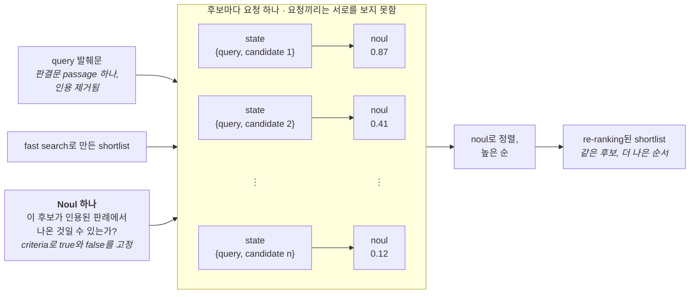

# Re-ranking

> CLERC 법률 query 40개에 대해 BM25로 passage 30개짜리 shortlist를 만든 다음, query와 후보 쌍마다 System One 질문 하나를 던져 top-1 정확도를 5%에서 30%로, top-10 정확도를 38%에서 65%로 끌어올립니다.

문서가 수천 개 있고, 그중에서 특정 질문에 답하는 문서 하나를 찾아야 한다고 합시다.

먼저 키워드 매칭처럼 빠른 방법으로 수천 개의 후보를 그럴듯한 것만 남긴 shortlist(후보
목록)로 줄입니다. 이 단계를 fast search(빠른 검색)라고 부릅니다.

fast search는 이 일은 잘하지만, shortlist의 어느 후보가 정답인지는 알려 주지 못합니다. 여기서
re-ranking(재순위화)이 필요합니다. re-ranking은 shortlist의 모든 후보를 query(쿼리)와 직접
맞대어 점수를 매기고, 가장 좋은 후보를 맨 앞에 놓습니다.

아래에서는 두 단계를 모두 CLERC 데이터셋의 판결문 passage(구절) 3,565개에 실행합니다. BM25가
query 40개 각각에 대해 후보 30개짜리 fast search shortlist를 만들고, 이어서 Jev가 각
shortlist의 순위를 다시 매깁니다. re-ranking을 거치면 정답 passage가 1위에 오는 query의 비율이
30%가 됩니다. fast search만 썼을 때는 5%였습니다.

## 직접 해 보기

[TypeSafe Playground에서 이 예제 열기](https://console.typesafe.ai/playground#share/N4IgJg9gxgrgtgUwHYBcAqCAeKQC4AEIwAOiAI4wIBOAngPpZTUAOKpBpUANgIYCWcfADMIVfADc+EXiilIAzvghD8AaWQoYUANY18UPpK75mVaAjAwqCADT4UACwR6h-Yygj55KHigT4efV4BfBhmCCR8AHcHPigHfGsuPgQVKB5IgCN-AHMqDL8wADp8NCd8AFk+bUVIfCQIFHw+MA0+IRpAFAIMsCUrRIR5BB4qePxIQfrGgfFhrm79HhghpRUeKFkI4VEJKRk5RWU1DS1dfUM+YwByEzMmS2sSitEECFmqOwAxazAwFMr1tEeIoGk1AswRig9B57OURNZuBB5FZ-OtNpEeoskKD8Nl8E4uL1rPJwgo+JkuP54QEkHpTOYHjxjK0hAgNoo+JFHP56UwLJycvISmhPNz8Fg-KhYb5Yf4qjUvAgENp7J5MlQBQEgvxBNTJNJfAdVrK+GJLDy7oNFBqcg4UIoYEhWmIxZ92o58ABBRBOn1NGFigCqSD4hXwAGUfH5FABhCLeUMwdF2bkuNyqrxR1HakJhLYxOIJJIpNIZXG5fKoCzl9LLfzfCx-OWAvgg6aBHJvahIP0BDY7GKedJZfwE3rJHgUqk7KDx2SadFM3YG9FC-AASUi+AASgBRAAinpjaAP+FlEbC1kQ+DjViagx8FNbTl6gSE+UQUVEKuprT8VDgTlNRiZAtU7d4ew0ABaEl4xeXpZyocJ8nRZpFA7LsqEgqU0R2alZwUeckzkJdmCscIhjXdcmjHaUmkAHAIQOsfAilY88AHFMOwpooGsXxJkCRDkMNLZMj0Ek2T4JdeCiOxqTFIQ7ycSsmGNcDuz9JcIEyAArNlZFmeQ7ExawfE5RRqVDIYuBUZhqDgDINACJMHFEUNoU8HhmHCTkwXwBydLcqFjTFP4EQ8KhDhURwZSE0QRKQFNyjilC5DQkxISgkLyk4iDe2pMikKRSYjldU1vC9H0wD9IpAFwCDdigCJoAGYAE5WrsABGTqAFYIyKGMUBKVqADZOqKOxg2dc8ABkEHVABnyJ3x4T9vy+H4mwBKB0pxDC8qc3CxEHLFy3xBBCXwCcp22MR9X2eNsvrd0Em9ZBqo0QBMAkUfdKHwAAFS15FjXg6xKcMlTsBAihyCbKpKAAhDJtGoRRnioFBYZvURmBKcQSk+CwSgACQga8ZogMt0cxko4yQuGAHY+s+Ipmt6TqABYAAZOq67mRqgrnWvwAAKVqPRjU0ik69qRoASlIOxOB6Fp+LoCFgZ4HIEHYfBSB8bRNWUFQtjjUR5E+gIwHeWR5GA2IxjrRQxXkLgIByMsjkADAJw0ud58ARmAuEpFBLcs+1y2oLEjPPPxsFuaBgjgZ2HBlM3IvSr2yn8X2uH9wPg4Qf1U7BARFGz-BPhGHc+FtUPFHCZJZHSYwtfewIZTFJxIWNN6NXSIpLfqgAObrK-BsJcfwdrmrsdq+pF8N9wAOQATXwGXWuauWSm9FB8m0b7dlU0xBhaJy-nkLz6VmXoxR4a3qFthA-TsTlxAgQ2kBySr954Q+G7SDiDQN+SBlKhmrO+MmzQI6n1aEwYGOxgRXR6G7KgvQjj-WQJESMCUkr+CwdieQNA84ZCkjuNwZgH7YzgBCWkdh6IxSaKGaIlxjB7WDhAKIJggHNyXA-G2rYjZcnKAAbXDDpOyGx1hB2rgIp+Qjv5eFrkgOqXpvIlAAEzDx6iUOai0RGgSEJcasyIWFa34IRX+B8aS9DQPudcdhuA6gFKA-8AQJxJU7uUawikr7uE8MwXgqlYjoUfhjVsL8nJbDFOGKRPhYC8DEKnXo91+K9FCZXcqYInRZKEB6N6vonI2jtGuT0+So5YDsn8MMl9ZzvBAeefcrZ95xCaLeDGiQg7ViYdY-+dhsi1hWEcKyQRir2BSM7UU5RCbOiXLlDSGg7BRGQYEBZWFexHWMk0SkwImjUjdJFJohSPpSkKhRQYxlcm9NGdYPSGw0pHH0WYJAR96QXNfOE5+myHQKBgKGSclJbrjFbEEngehOQA2wRGKMaUUnLhkD0mZ2TKrvRqqUZKEA7z4DyAUaszylo0maEgHSjoHlbExKIZ01Y942MxPY9cGZL5gr0M8iIR95ERKGL2GJ5Q4n6RkUk4U5RgwQN6Lg6M2NsVHE9N5OYFkdixLZBEXoktRj-KaNYd4QxGqdU0ePfAbNDXD2HqLTe29hU8kclwI+EBmBAS2MYo5Uwwy9Npf-IEMcxKx3slFc8lIcitgeiI2KfEwyhjsHtfA6zuLilQO5N+xRtmGtalzAA3LY2UkQCLcBgK0O+JdzyzOoPMrivYVltiaPITw79pC31YQUuAf8VS9LFDIf8R94FCMerOIOvQ8QETttS3orI5mt3JYlZoSamops6lBNqmjaaxFSPgAAUnm7W+Bl4ICiA5SIl8hhVkagAdQrHihCCj4oahKD1MegZwYlG6lzBem8OY7w3Iy09+IeCzHOpdCITA7CBwxlsfG+Bj2XEAt-DwkR-ojC-j-T0LkgqNOaiNPq97+r4AZr1M1o1Opyyub0K+LR-IZGhAIS5dE+yrmNKYQw-E43zkmadatiBZCIEUHiawHt0HVmQepDZGh+ETuBYOoii5jDnOKmuCGthxQlFhnYcMZZvgZAMPIWcXoMaKAAGRekcCHOIMdNxQDxiUUVYYJWTAAPJcBoLQuINC4Bww5sPZq+BMPhhvZozRdgeocxGnh4eDM5YZoRlweAEgSirxGEXeQug7Acx6gzTzD7p6tV5hvLmXMObBc0WFyoEBxkUzAJu5eEBH1c1S2B9cVBJAx25qlrzj6Rqzw3gzfVIsZadffdRdKrhTQZivtCQt9EsViHSJRcYkk-hKJApEej4hGNojSoBOuZ1WhRILTKUq5RvCMdTr+nE2RkCkAAL4gDsCAektD7QYGwHgQgJAQCtjoAYQodBq1WCYLrF7UI7K61IA0IOis9avcIlQLQq4gcgArhQagehGAsB4mTSYUDBCBEDOGYQFgS3GF7Z0u1DqMS5IrdEDUKBJTNDgIgP4-F7MBDMI6V85xYUxM8rcNkePUAZrFB9hKMDrIqFTlxpUkQrxdkareS6-OVZgEYxrK+m68QY+ox96sp97hOU6OMCAkwWEPkBc+c8EkDDGJ2gG0iZgKKhjSmKBHtBxSYCYEhZhSAP4o3QswiOAvUI+VQAAfjB5wSn1ApJ-f1lDnWT3SAV2HH8BXfgMqa03QdyVOwjdPnkE4FO-gzftCc1DykdgDtOhGGAOwrlCSuKUGIVwGwMpU+7NRh3lAnfI7d01VpmQkyTBhLcl+Uu2cJSKCHkArguBDFh-H+XivgTK-8K2fy1ALp6ApcowCSTVT2p2jsSAGwNRIAQBmlhExK1eEnozl2UjC87XeUiO3vL-CO6Ry7lHAxkglVURd87l3rteR8AABqqMcgT2IA4gnUV2hA1k+kFgzwrQU+T2oiIAEkFgdAiK3gIAAAuudkAA)

## 수천 개 중에서 문서 하나를 어떻게 찾을까요?

모든 문서를 하나씩 query와 대조하면 문서 하나당 비교가 한 번 필요합니다. 문서가 수백만
개라면 query 하나에 비교도 수백만 번입니다. 두 단계로 나누면 더 빠릅니다.

1. 전체 더미에 돌릴 수 있을 만큼 빠른 방법으로, 더미를 가능성 높은 후보만 남긴 짧은 목록으로
   줄입니다.
2. 그 짧은 목록에 더 정확한 단계를 적용해 정확한 정답을 찾습니다.


## fast search란 무엇인가요?

fast search는 query를 큰 corpus(코퍼스)의 모든 문서와 비교해 순위가 매겨진 shortlist를 빠르게
돌려줄 수 있는 방법을 모두 가리킵니다. 흔히 쓰는 방법으로는 BM25 같은 키워드 검색과, passage를
의미로 비교하는 dense embedding(밀집 임베딩)이 있습니다.

여기서 첫 단계는 BM25이고 다른 것은 쓰지 않습니다. BM25는 공통으로 들어 있는 단어를 기준으로
passage 순위를 매깁니다. 어떤 fast search 방법을 고르는지는 부차적인 문제입니다. re-ranking은
shortlist에 든 passage만 보기 때문입니다.

## re-ranking이란 무엇인가요?

re-ranking은 shortlist를 더 나은 순서로 정렬합니다. query를 corpus 전체와 한꺼번에 비교하는
대신, shortlist의 후보 하나하나에 대해 query와의 점수를 매기고 그 점수로 정렬합니다.


이 점수는 언어 모델에서 얻을 수 있습니다. query와 후보 하나를 함께 주고, 그 후보가 query에
얼마나 잘 답하는지 묻습니다. 그러면 re-ranking은 표현이 query와 다르더라도 shortlist에서 가장
잘 맞는 후보를 찾아냅니다.

## Jev로 re-ranking하기

re-ranker에는 모든 query와 후보 쌍에 대해 서로 비교할 수 있는 점수가 필요합니다.

### Jev가 돌려주는 값

TypeSafe에서는 점수를 요청하는 일이 곧 예/아니요 질문입니다.

```text
Could this candidate passage be from the cited precedent?
```

단순한 예 또는 아니요만으로는 후보 30개의 순위를 매길 수 없습니다. `Noul`은 그 대신 0과 1
사이의 숫자를 돌려주며, 이 숫자를
[noul](../primitives/noul.md)이라고 부릅니다. noul은 답이 "예"일
가능성을 Jev가 추정한 값입니다.

무엇이 true이고 무엇이 false인지는 질문의 criteria(판단 기준)가 정합니다. Jev는 이 criteria를
모든 query와 후보 쌍에 적용해 noul을 바로 돌려줍니다. 애플리케이션은 이 noul을 점수로 삼아
정렬합니다.

단순화한 의사 코드로 보면 TypeSafe 점수 호출 하나는 다음과 같습니다.

```python title="Sketch"
question = Noul(
    instructions="Is this candidate the cited case?",
    criteria=NoulCriteria(
        true="The candidate states the specific rule the query cites.",
        false="The candidate is only on a similar topic.",
    ),
)
response = client.system_one(state={...}, questions={"is_cited_source": question})
response.answers["is_cited_source"].noul  # -> 0.87
```

shortlist를 re-ranking하려면 모든 후보에 같은 질문을 던지고 noul이 높은 순으로 정렬합니다.

```python title="Sketch"
nouls = {candidate: ask_typesafe(query, candidate) for candidate in shortlist}
reranked = sorted(shortlist, key=lambda c: nouls[c], reverse=True)  # noul이 높은 순
```



## re-ranking 예제

이제 fast search와 re-ranking을 법률 검색 데이터셋인
[CLERC](https://aclanthology.org/2025.findings-naacl.441/)에 실행합니다.
이 예제는 판결문 passage 3,565개와 query 40개를 사용합니다.

### 준비

* `bm25s`와 `datasets`로 fast search shortlist를 만듭니다.
* `typesafe-sdk`와 `cooksafe`로 re-ranking과 API 캐싱을 처리합니다.
* `matplotlib`으로 결과 차트를 그립니다.

```bash
pip install bm25s datasets matplotlib 'cooksafe>=0.3.0,<0.4.0'
```

TypeSafe를 호출하려면 `TYPESAFE_API_KEY`가 필요합니다.

```python
import hashlib
import json
import os
import random
import urllib.request
from concurrent.futures import ThreadPoolExecutor
from pathlib import Path

from cooksafe import JsonCache
from IPython.display import display
from typesafe_sdk import Noul, NoulCriteria, TypeSafeClient

TYPESAFE_MODEL = "jev-1.14.0"  # 이 페이지에서 쓴 모델입니다. "jev-latest"로 바꾸면 최신 모델을 실시간으로 호출합니다
N_ROWS = 170  # 공유 corpus로 모으는 CLERC 행 수
N_QUERIES = 40  # 평가하는 행 수
TOP_K = 30  # query마다 shortlist가 re-ranker에 넘기는 후보 수

client = TypeSafeClient(
    api_key=os.environ.get(
        "TYPESAFE_API_KEY", "cache-only"
    ),  # 키가 없는 커널은 캐시를 재생합니다
    base_url=os.environ.get("TYPESAFE_ENDPOINT"),
    timeout=120.0,
)
```

```python
EXAMPLES_URL = (
    "https://raw.githubusercontent.com/typesafe-ai/typesafe-public-examples/main/"
    "cookbooks/rerank_typesafe"
)


def download(name: str) -> Path:
    """Fetch one of this cookbook's files from typesafe-public-examples unless it is on disk."""
    path = Path(name)
    if not path.exists():
        urllib.request.urlretrieve(f"{EXAMPLES_URL}/{name}", path)
    return path


CACHE = Path("rerank_typesafe_cache.json")
# True이면 공개된 답변으로 CACHE를 채우므로 실행 중에 요청을 보내지 않습니다. 실시간으로
# 실행하려면 False로 바꾸고 CACHE를 삭제하세요. 디스크에 이미 있는 CACHE는 덮어쓰지 않습니다.
DOWNLOAD_CACHE = True
if DOWNLOAD_CACHE:
    download(CACHE.name)
json_cache = JsonCache(CACHE)
```

### fast search로 passage 순위 매기기

여기서 쓰는 데이터셋은 미국 법원 판결문으로 이루어진 corpus이며, 170개 행을 한데 모은
것입니다. 각 행은 다음과 같이 나뉩니다.

* **Query**: 인용 하나가 제거된 판결문 발췌문입니다.
* **Gold**: 제거된 인용이 가리키던 passage로, 해당 query의 유일한 정답입니다.
* **Candidates**: corpus의 나머지 모든 passage입니다. 하나하나가 query와 잘못 짝지어질 수 있는
  대상입니다.

170개 행 가운데 40개를 골라 query로 평가합니다. 나머지 130개는 후보로만 등장합니다.

fast search는 corpus를 불러와 BM25로 모든 query에 대해 순위를 매깁니다. 아직 Jev는 관여하지
않습니다.

```python
CLERC_FILE = (
    "https://huggingface.co/datasets/jhu-clsp/CLERC/resolve/main/"
    "teva_train_dir/train_data.jsonl.gz"
)


def cid(text: str) -> str:
    """Corpus id: a content hash, so passages shared across queries dedupe."""
    return hashlib.sha1(text.encode("utf-8")).hexdigest()[:16]


@json_cache
def build_slice(n_rows: int, n_queries: int, seed: int) -> dict:
    """Stream CLERC rows, pool ``n_rows`` of them into a corpus, pick ``n_queries`` to evaluate."""
    from datasets import load_dataset  # 무거운 import이므로 함수 안에 둡니다

    stream = load_dataset("json", data_files=CLERC_FILE, streaming=True, split="train")
    rows = []
    for row in stream:
        if (
            row.get("positive_passages")
            and len(row.get("negative_passages") or []) == 20
        ):
            rows.append(row)
        if len(rows) >= 1000:
            break

    rng = random.Random(seed)
    picked = rng.sample(rows, n_rows)
    corpus, pool = {}, []
    for row in picked:
        gold = row["positive_passages"][0]["text"]
        corpus[cid(gold)] = gold
        for neg in row["negative_passages"]:
            corpus[cid(neg["text"])] = neg["text"]
        pool.append(
            {"qid": str(row["query_id"]), "query": row["query"], "gold": cid(gold)}
        )
    # 모아 둔 행 중 처음 20개는 떼어 두고, 나머지에서 평가합니다
    queries = rng.sample(pool[20:], n_queries)
    # corpus를 id로 정렬해 실시간 실행이든 캐시 재생이든 매번 같은 순서로 순회하게 합니다
    return {"queries": queries, "corpus": dict(sorted(corpus.items()))}


def bm25_rankings(corpus: dict[str, str], queries: dict[str, str], k: int = 100):
    """Rank every passage in the corpus by word overlap with each query."""
    import bm25s

    cids = list(corpus)
    retriever = bm25s.BM25()
    retriever.index(bm25s.tokenize([corpus[c] for c in cids], stopwords="en"))
    qids = list(queries)
    idxs, _ = retriever.retrieve(
        bm25s.tokenize([queries[q] for q in qids], stopwords="en"), k=min(k, len(cids))
    )
    return {q: [cids[i] for i in idxs[row]] for row, q in enumerate(qids)}


def gold_rank(ranked: list[str], gold: str) -> int | None:
    """1-based rank of the gold id, or None if it isn't in the list."""
    return ranked.index(gold) + 1 if gold in ranked else None


# 문서 페이지에서는 각 차트가 밝은 테마 또는 어두운 테마에 맞춰 표시되고, 노트북에서는 밝은 쪽만 표시됩니다.
PALETTES = {
    "light": {"surface": "#ffffff", "ink": "#34342f", "muted": "#7c7c77", "grid": "#d8d8cf", "blue": "#5d76a2", "green": "#6f9b52"},
    "dark": {"surface": "#0d0a0f", "ink": "#fafafa", "muted": "#a1a1aa", "grid": "#3f3f46", "blue": "#8fa6d6", "green": "#93c47d"},
}


def show(draw) -> None:
    """Display ``draw(palette)`` in the light palette. The docs build sets COOKSAFE_RENDER and
    also gets the dark copy."""
    import matplotlib.pyplot as plt

    for theme in ("light", "dark") if os.environ.get("COOKSAFE_RENDER") else ("light",):
        fig = draw(PALETTES[theme])
        display(fig, metadata={"theme": theme})
        plt.close(fig)


def bar_chart(labels: list[str], shares: list[float], title: str, p: dict):
    """A small single-series bar chart of shares (0-1, shown as percentages)."""
    import matplotlib.pyplot as plt

    fig, ax = plt.subplots(figsize=(5, 3.2), facecolor=p["surface"])
    ax.set_facecolor(p["surface"])
    for side in ("top", "right"):
        ax.spines[side].set_visible(False)
    for side in ("left", "bottom"):
        ax.spines[side].set_color(p["grid"])
    ax.tick_params(colors=p["muted"], labelcolor=p["ink"], labelsize=9)
    ax.set_axisbelow(True)
    ax.grid(axis="y", color=p["grid"], linewidth=0.8)

    bars = ax.bar(labels, shares, width=0.55, color=[p["blue"], p["green"]][: len(labels)])
    ax.bar_label(
        bars,
        labels=[f"{s * 100:.0f}%" for s in shares],
        padding=4,
        color=p["ink"],
        fontsize=11,
    )
    ax.set_ylim(0, 1.1)
    ax.set_yticks([0, 0.25, 0.5, 0.75, 1.0])
    ax.set_yticklabels(["0%", "25%", "50%", "75%", "100%"])
    ax.set_ylabel(f"share of {len(queries)} queries", color=p["ink"], fontsize=9)
    ax.set_title(title, loc="left", color=p["ink"], fontsize=11)
    plt.tight_layout()
    return fig


ds = build_slice(N_ROWS, N_QUERIES, seed=0)
corpus: dict[str, str] = ds["corpus"]
queries = {q["qid"]: q["query"] for q in ds["queries"]}
golds = {q["qid"]: q["gold"] for q in ds["queries"]}

candidates = {q: ranked[:TOP_K] for q, ranked in bm25_rankings(corpus, queries).items()}

in_top_k = sum(golds[q] in candidates[q] for q in queries)
at_rank_1 = sum(candidates[q][0] == golds[q] for q in queries)

show(lambda p: bar_chart(
    [f"In top {TOP_K}", "At rank 1"],
    [in_top_k / len(queries), at_rank_1 / len(queries)],
    f"Where the correct passage lands, {len(queries)} queries against {len(corpus):,} candidates",
    p,
))
```


### fast search가 정답 passage를 1위에 놓는 일은 드뭅니다

이 차트는 후보 3,565개 가운데 fast search가 정답 passage를 어디에 놓는지 보여 줍니다.

shortlist는 query 40개 모두(100%)에서 정답을 포함하지만, 정답을 1위에 놓는 경우는 5%뿐입니다.

re-ranking은 이미 shortlist에 있는 상위 30개 후보의 순서만 바꿉니다. fast search가 고르지
않은 passage를 추가할 수는 없습니다.

### Jev로 shortlist re-ranking하기

Jev가 각 쌍에 대해 답하는 질문은, 그 후보가 query에서 제거된 인용이 가리키는 passage일 수
있느냐입니다. re-ranking은 세 단계로 진행합니다.

1. 그 질문을 정의합니다.
2. 모든 shortlist의 후보마다 한 번씩 묻습니다. query 40개에 후보 30개를 곱해 1,200번의
   호출이며, 동시에 실행합니다.
3. Jev가 돌려준 noul로 각 shortlist를 정렬합니다.

```python
is_cited_source = Noul(
    instructions=(
        "The query excerpt comes from a US federal court opinion and was written "
        "immediately around a citation to a precedent; the citation itself has been "
        "removed. Could the candidate passage be from that cited precedent — does it "
        "establish the specific legal proposition the query excerpt invokes at its "
        "citation point?"
    ),
    criteria=NoulCriteria(
        true=(
            "The candidate passage states or establishes the specific rule, standard, "
            "holding, or fact pattern that the query excerpt attributes to its removed "
            "citation."
        ),
        false=(
            "The candidate passage is merely on a similar topic or doctrine; it does not "
            "supply the specific proposition the query excerpt relies on."
        ),
    ),
)


@json_cache
def score_candidate(query: str, candidate: str, question_json: str, model: str) -> dict:
    """One TypeSafe call about one (query, candidate) pair: a noul, plus token usage."""
    # SDK는 질문을 JSON dict로 받으므로, 캐시된 문자열을 디코딩해 그대로 넘깁니다
    question = json.loads(question_json)
    response = client.system_one(
        state={"query_excerpt": query, "candidate_passage": candidate},
        questions={"is_cited_source": question},
        model=model,
    )
    return {
        "noul": response.answers["is_cited_source"].noul,
        "input_tokens": response.usage.input_tokens or 0,
        "output_tokens": response.usage.output_tokens or 0,
    }


# query 40개에 후보가 30개씩 있으므로 모든 shortlist를 re-ranking하려면 독립적인 호출이 1,200번
# 필요합니다. 하나씩 차례로 보내지 않고 스레드 풀로 한꺼번에 보내도 될 만큼 가볍습니다.
pair_list = [(q, c) for q in queries for c in candidates[q]]
question_json = is_cited_source.model_dump_json(exclude_none=True)
with ThreadPoolExecutor(max_workers=12) as pool:
    results = pool.map(
        lambda p: score_candidate(
            queries[p[0]], corpus[p[1]], question_json, model=TYPESAFE_MODEL
        ),
        pair_list,
    )
pair_scores = {q: {} for q in queries}
for (q, c), result in zip(pair_list, results):
    pair_scores[q][c] = result

reranked = {
    q: sorted(candidates[q], key=lambda c: -pair_scores[q][c]["noul"]) for q in queries
}


def chart_before_after(
    runs: dict[str, dict[str, list[str]]], thresholds: list[int], p: dict
):
    """Grouped bar chart: how often the correct passage lands in the top N, for each run."""
    import numpy as np
    import matplotlib.pyplot as plt

    labels = list(runs)
    colors = [p["blue"], p["green"]]

    def share_in_top(rankings, k):
        return sum(
            gold_rank(rankings[q], golds[q]) in range(1, k + 1) for q in queries
        ) / len(queries)

    fig, ax = plt.subplots(figsize=(6.5, 3.6), facecolor=p["surface"])
    ax.set_facecolor(p["surface"])
    for side in ("top", "right"):
        ax.spines[side].set_visible(False)
    for side in ("left", "bottom"):
        ax.spines[side].set_color(p["grid"])
    ax.tick_params(colors=p["muted"], labelcolor=p["ink"], labelsize=9)
    ax.set_axisbelow(True)
    ax.grid(axis="y", color=p["grid"], linewidth=0.8)

    x = np.arange(len(thresholds))
    width = 0.35
    for i, (label, rankings) in enumerate(runs.items()):
        shares = [share_in_top(rankings, k) for k in thresholds]
        offset = (i - (len(labels) - 1) / 2) * width
        bars = ax.bar(x + offset, shares, width * 0.92, color=colors[i], label=label)
        ax.bar_label(
            bars,
            labels=[f"{s * 100:.0f}%" for s in shares],
            padding=3,
            color=p["ink"],
            fontsize=8.5,
        )

    ax.set_xticks(x, [f"top {k}" for k in thresholds])
    ax.set_ylim(0, 1)
    ax.set_yticks([0, 0.25, 0.5, 0.75, 1.0])
    ax.set_yticklabels(["0%", "25%", "50%", "75%", "100%"])
    ax.set_ylabel(f"share of {len(queries)} queries", color=p["ink"], fontsize=9)
    ax.set_title(
        "How often the correct passage lands near the top",
        loc="left",
        color=p["ink"],
        fontsize=11,
    )
    ax.legend(frameon=False, labelcolor=p["ink"], fontsize=9, loc="upper left")
    plt.tight_layout()
    return fig


show(lambda p: chart_before_after(
    {"Fast search": candidates, "+ Jev 1.14 re-rank": reranked}, [1, 5, 10], p
))
```


### re-ranking은 정답을 위쪽으로 끌어올립니다

이 차트는 fast search만 쓴 경우와 fast search에 re-ranking을 더한 경우를 세 가지
threshold(임계값)에서 비교합니다. re-ranking은 세 경우 모두에서 정답 passage를 더 위쪽으로
옮깁니다.

* **Top 1**: 5% → 30%
* **Top 5**: 15% → 57%
* **Top 10**: 38% → 65%

이 예제에서는 이해하기 쉽도록 쌍마다 질문을 하나만 던졌습니다. 실제 애플리케이션이라면 같은
쌍에 대한 질문 여러 개를 호출 하나에 담을 것입니다. 방법은 [병렬 질문
cookbook(예제 모음)](parallel_questions.md)과
[Speculative fan-out(팬아웃) 패턴](../patterns/fan-out.md)을 참고하세요.

***

## 다음 단계

* [Noul](../primitives/noul.md): Jev가 예/아니요 질문을 점수로 바꾸는
  방식을 설명합니다.
* [Speculative fan-out](../patterns/fan-out.md): 문서 하나에 대한
  질문 여러 개를 호출 하나로 묻는 방법을 설명합니다.
* [Line-by-line Search](semantic_find.md):
  키워드가 아니라 의미로 corpus를 검색하는 또 다른 방법을 설명합니다.


이 문서는 개발자 문서 플랫폼인 [Mintlify](https://mintlify.com)로 제작하고 호스팅합니다.
