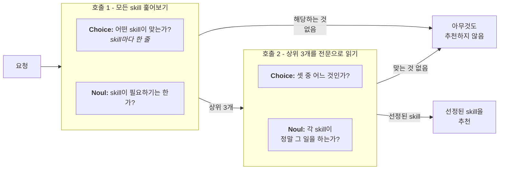

# Skill 추천

> Nous Research의 Hermes 카탈로그에 있는 skill 194개 가운데 agent turn 하나에 쓸 skill을 최대 하나 고릅니다. TypeSafe 요청 두 번으로 순위를 매기고 상위 후보를 다시 확인합니다.

*agent(에이전트)는 모든 skill(스킬)을 설명이 잘린 채로 시스템 메시지에 넣은 index(인덱스)를 보고 skill을 고릅니다. 이 방식은 skill 선택의 품질을 떨어뜨리고, 세션의 나머지 구간에서 context rot(컨텍스트 부패)를 일으킵니다. 여기서는 turn(턴)마다 TypeSafe 요청을 두 번 추가합니다. 하나는 skill의 순위를 매기고, 다른 하나는 선택을 검증합니다. 그 결과 잘못된 skill 로드는 절반으로, 불필요한 로드는 거의 3분의 1 수준으로 줄었습니다.*

skill roster(스킬 목록)가 큰 agent는 정보가 거의 없는 상태에서 선택을 합니다. roster는 index 형태로 agent에 전달됩니다. skill마다 한 줄씩이고, 전체 텍스트가 대화를 밀어내지 않도록 설명은 잘려 있습니다. 여기서 사용하는 agent harness(하니스)인 Hermes는 기본적으로 설명을 60자로 자릅니다. 이 길이에서는 `.pptx` 파일을 *편집하는* Office skill과 슬라이드 덱을 *새로 만드는* 금융 skill이 둘 다 PowerPoint 도구로 읽힙니다. 기존 덱을 수정해 달라고 요청했는데 agent가 새 덱을 만드는 skill을 로드할 수 있습니다. 맞는 skill이 전혀 없는 turn에서도 agent는 어쨌든 하나를 로드할 수 있습니다. 이름이 나열되어 있으면 추측하고 싶어지기 때문입니다.

여기서는 progressive disclosure(점진적 공개)를 씁니다. skill 194개를 모두 적은 비용으로 훑어본 다음, 그중 세 개를 자세히 읽습니다. 어떤 skill을 로드할지, 로드하긴 할지를 결정하기 전에 TypeSafe 요청 두 번을 먼저 보냅니다. 첫 번째 요청은 roster의 모든 skill을 사용자의 turn에 비추어 순위를 매기고, 이 turn에 skill이 필요하기는 한지 답합니다. 두 번째 요청은 상위 세 개만 다시 읽는데, 이번에는 skill마다 전체 설명과 instructions(지시문)의 앞부분을 함께 보고, 셋 모두를 기각할 수도 있습니다.

선정된 skill의 이름은 해당 turn에 한해 agent의 system prompt(시스템 프롬프트)에 추가되는 한 줄에 들어갑니다.

```
<skill_relevance>
Relevant to the current request: pptx-author. Ignore this if it does not fit what the user
actually asked for.
</skill_relevance>
```

agent는 전체 index와 자체 판단을 그대로 유지하며, 이 한 줄은 어느 항목을 먼저 살펴볼지만 알려 줍니다. Hermes roster의 skill을 사용해 `claude-haiku-4-5-20251001`에 요청 452개를 보낸 결과는 다음과 같습니다.

| | 잘못된 skill을 로드 | 맞는 것이 없는데 로드 |
| - | - | - |
| roster만 가진 agent 단독 | 15.7% | 14.0% |
| **Jev의 추천을 받은 agent** | **7.9%** | **5.2%** |
| 정답을 건네받은 agent | 3.2% | 4.1% |

세 번째 행이 하한선입니다. 올바른 skill을 건네받은 agent도 항상 그것을 로드하지는 않으며, 어떤 선택 방법도 이보다 낮아질 수는 없습니다.

최종 결과물은 skill 이름을 최대 하나 반환하는 `suggest()` 함수, 그 이름을 system prompt에 넣을 형태로 감싸는 `suggestion_block()`, 그리고 위 표를 만들어 낸 측정 harness입니다. 측정 harness는 여러분의 roster에 바로 적용할 수 있습니다.



## 준비

* TypeSafe 클라이언트, Anthropic 클라이언트, cookbook(예제 모음) 공용 헬퍼를 설치합니다.
* [TypeSafe API 키](https://console.typesafe.ai/keys)와, 측정 대상 agent에 쓸 Anthropic 키를 설정합니다.

```bash
pip install anthropic matplotlib ipython 'cooksafe>=0.3.0,<0.4.0'
export TYPESAFE_API_KEY=your-key-here
export ANTHROPIC_API_KEY=your-key-here
```

> **참고:** 이 페이지의 코드 블록은 모두 합쳐서 하나의 스크립트를 이룹니다. 실행하려면 나오는 순서대로 한 파일에 넣으세요.

## 결과 캐싱

각 호출의 결과는 입력을 키로 삼아 `skill_suggestion_cache.json`에 캐시합니다. 코드가 게시된 캐시 파일을 내려받으므로, 실행하면 두 API를 호출하지 않고 아래 수치를 그대로 재생합니다. 게시된 실행에는 `jev-1.14.0`과 `claude-haiku-4-5-20251001`을 사용했고, 2026-10-30에 렌더링했습니다.

```python
import json
import os
import urllib.request
from collections import defaultdict
from concurrent.futures import ThreadPoolExecutor
from pathlib import Path
from time import perf_counter

import anthropic
import matplotlib
import matplotlib.pyplot as plt
from matplotlib.ticker import MultipleLocator, PercentFormatter
from cooksafe import JsonCache, make_playground_link
from IPython.display import Markdown, display
from typesafe_sdk import Choice, Noul, TypeSafeClient

matplotlib.use("Agg")  # 화면 없이 렌더링

TYPESAFE_MODEL = "jev-1.14.0"  # 이 페이지에서 쓴 모델. "jev-latest"는 최신 모델을 실시간으로 실행합니다
AGENT_MODEL = (
    "claude-haiku-4-5-20251001"  # 테스트 대상 agent. 점수가 흔들리지 않도록 버전을 고정합니다
)

SHORTLIST = 3  # 첫 번째 요청에서 두 번째 요청으로 넘기는 후보 수
EXCERPT_CHARS = (
    700  # 후보마다 가져오는 SKILL.md 글자 수. roster 파일에는 1600자가 저장되어 있습니다
)
ACTION_THRESHOLD = (
    0.30  # action noul 세 개의 평균. 이 값 이상이면 skill이 필요한 것으로 봅니다
)
NAMED_THRESHOLD = (
    0.50  # "방법을 명시하는가" noul. 이 값 이상이어도 skill이 필요한 것으로 봅니다
)
FITS_THRESHOLD = (
    0.30  # "이 skill이 맞는가" noul의 최댓값이 이 값 미만이면 shortlist를 버립니다
)
WORKERS = 8  # 작은 풀: 실시간 실행을 몇 분 안에 끝내면서 rate limit에 부담을 주지 않습니다

assert EXCERPT_CHARS <= 1600, (
    "the shipped roster file stores 1600 body characters per skill"
)

client = TypeSafeClient(
    api_key=os.environ.get(
        "TYPESAFE_API_KEY", "cache-only"
    ),  # 키가 없는 커널은 캐시를 재생합니다
    base_url=os.environ.get("TYPESAFE_ENDPOINT"),
    timeout=120.0,
)
agent = anthropic.Anthropic(api_key=os.environ.get("ANTHROPIC_API_KEY", "cache-only"))


EXAMPLES = (
    "https://raw.githubusercontent.com/typesafe-ai/typesafe-public-examples/main/"
    "cookbooks/skill_suggestion"
)


def download(name: str) -> Path:
    """Fetch one of this cookbook's files from typesafe-public-examples unless it is on disk."""
    path = Path(name)
    if not path.exists():
        path.parent.mkdir(parents=True, exist_ok=True)
        urllib.request.urlretrieve(f"{EXAMPLES}/{name}", path)
    return path


CACHE = Path("skill_suggestion_cache.json")
# True이면 게시된 답으로 CACHE를 채우므로 실행 중에 요청을 보내지 않습니다. 실시간으로
# 실행하려면 False로 바꾸고 CACHE를 삭제하세요. 디스크에 이미 있는 CACHE는 덮어쓰지 않습니다.
DOWNLOAD_CACHE = True
if DOWNLOAD_CACHE:
    download(CACHE.name)
json_cache = JsonCache(CACHE)
```

## 1단계: roster 불러오기

`hermes_roster.json`에는 [NousResearch/hermes-agent](https://github.com/NousResearch/hermes-agent)의 skill 194개가 특정 커밋에 고정된 상태로 들어 있습니다. 레코드마다 skill의 이름과 카테고리, index에 표시되는 설명, 전체 설명, `SKILL.md`의 앞부분이 들어 있습니다. skill의 라이선스는 [`DATA_LICENSE.md`](https://github.com/typesafe-ai/typesafe-public-examples/blob/main/cookbooks/skill_suggestion/DATA_LICENSE.md)에 있습니다.

아래의 index와, prompt(프롬프트)에서 그 위에 놓이는 지시문은 Hermes에서 그대로 가져온 것입니다.

```python
ROSTER = json.loads(download("hermes_roster.json").read_text(encoding="utf-8"))
BY_NAME = {skill["name"]: skill for skill in ROSTER}

# hermes-agent agent/prompt_builder.py:_render_skills_index에서 그대로 가져왔습니다.
PREAMBLE = (
    "## Skills\n"
    "Before replying, scan the skills below. If a skill matches or is even partially relevant to your "
    "task, you MUST load it with skill_view(name) and follow its instructions. Err on the side of "
    "loading — it is always better to have context you don't need than to miss critical steps, pitfalls, "
    "or established workflows. Skills contain specialized knowledge — API endpoints, tool-specific "
    "commands, and proven workflows that outperform general-purpose approaches. Load the skill "
    "even if you think you could handle the task with basic tools like web_search or terminal. "
    "Skills also encode the user's preferred approach, conventions, and quality standards for tasks like "
    "code review, planning, and testing — load them even for tasks you already know how to do, because "
    "the skill defines how it should be done here.\n"
    "If a skill has issues, fix it with skill_manage(action='patch').\n"
    "After difficult/iterative tasks, offer to save as a skill. If a skill you loaded was missing steps, "
    "had wrong commands, or needed pitfalls you discovered, update it before finishing.\n"
    "\n"
)
FOOTER = "\n\nOnly proceed without loading a skill if genuinely none are relevant to the task."
IDENTITY = (
    "You are Hermes, a capable AI assistant with access to tools and a library "
    "of skills. You help the user with coding, research, and everyday tasks.\n\n"
)


def render_index() -> str:
    """The body of <available_skills>: skills grouped by category, both sorted by name."""
    by_category = defaultdict(list)
    for skill in ROSTER:
        by_category[skill["category"]].append(skill)
    lines = []
    for category in sorted(by_category):
        skills = sorted(by_category[category], key=lambda s: s["name"])
        if len(skills) == 1:  # skill이 하나뿐인 카테고리는 최상위 행 하나로 씁니다
            lines.append(f"  - {skills[0]['name']}: {skills[0]['description']}")
            continue
        lines.append(f"  {category}:")
        lines.extend(f"    - {skill['name']}: {skill['description']}" for skill in skills)
    return "\n".join(lines)


CATALOG_PROMPT = (
    IDENTITY
    + PREAMBLE
    + "<available_skills>\n"
    + render_index()
    + "\n</available_skills>"
    + FOOTER
)

widths = [len(skill["description"]) for skill in ROSTER]
print(f"{len(ROSTER)} skills in {len({s['category'] for s in ROSTER})} categories")
print(f"roster prompt: {len(CATALOG_PROMPT):,} characters")
print(
    f"index description: {sum(widths) / len(widths):.0f} characters on average, "
    f"{max(widths)} at most"
)
print("\none category, as the agent reads it:")
index_lines = render_index().splitlines()
start = index_lines.index("  apple:")
end = next(
    i
    for i in range(start + 1, len(index_lines))
    if not index_lines[i].startswith("    ")
)
print("\n".join(index_lines[start:end]))
```

```
194 skills in 32 categories
roster prompt: 16,376 characters
index description: 55 characters on average, 60 at most

one category, as the agent reads it:
  apple:
    - apple-notes: Manage Apple Notes via memo CLI: create, search, edit.
    - apple-reminders: Apple Reminders via remindctl: add, list, complete.
    - findmy: Track Apple devices/AirTags via FindMy.app on macOS.
    - imessage: Send and receive iMessages/SMS via the imsg CLI on macOS.
```

## 2단계: agent 단독 성능 측정하기

`requests.json`에는 단일 turn 요청 452개가 들어 있습니다. 그중 280개는 정확히 skill 하나가 담당하는 요청이고, 나머지 172개는 담당하는 skill이 없는 요청입니다.

담당 skill이 있는 요청은 Claude Sonnet 5가 각 skill의 `SKILL.md`를 보고 작성했습니다. 그래서 레이블은 믿을 수 있지만, 요청 자체는 실제 사용자가 보내는 요청보다 쉽습니다.

담당 skill이 없는 172개는 모두 추측하면 손해를 보도록 작성했습니다. 일상적인 요청이 84개, 어떤 skill도 다루지 않는 기술 질문(*explain what a monad is*, 모나드가 무엇인지 설명해 달라)이 42개, 그리고 roster에 해당 skill이 없는 구체적인 작업을 요구하는 요청이 46개입니다. 마지막 유형의 예로, X만 지원하고 다른 것은 지원하지 않는 roster에 *post this to Mastodon*(이것을 Mastodon에 올려 달라)이라고 요청하는 경우가 있습니다.

채점에는 agent의 첫 번째 응답만 봅니다. 두 수치 모두 오류율이므로 둘 다 낮을수록 좋습니다.

* **잘못된 로드(wrong load)**: 담당 skill이 있는 요청 가운데 첫 번째 `skill_view` 호출이 담당 skill이 아니었던 비율입니다. 아무것도 로드하지 않은 turn도 실패로 칩니다.
* **불필요한 로드(needless load)**: 담당 skill이 없는 요청 가운데 agent가 `skill_view`를 한 번이라도 호출한 비율입니다.

```python
REQUESTS = json.loads(download("requests.json").read_text(encoding="utf-8"))
POSITIVES = [p for p in REQUESTS if p["gold"]]
NEGATIVES = [p for p in REQUESTS if not p["gold"]]

print(
    f"{len(REQUESTS)} requests: {len(POSITIVES)} covered by a skill "
    f"({len({p['gold'] for p in POSITIVES})} distinct skills), {len(NEGATIVES)} covered by none"
)
print(f"\ncovered   [{POSITIVES[0]['gold']}]  {POSITIVES[0]['text']}")
print(f"uncovered  {NEGATIVES[0]['text']}")
```

```
452 requests: 280 covered by a skill (145 distinct skills), 172 covered by none

covered   [1password]  I've got a config.yaml with `{{ op://app-prod/db/password }}` placeholders in it — can you set up my project to pull the real values in at runtime instead of hardcoding them?
uncovered  Add these three cards to our Trello backlog.
```

추천은 system prompt에서 roster 안이 아니라 roster 뒤의 별도 블록에 들어갑니다. 이렇게 하면 roster 텍스트가 모든 turn에서 동일하므로 prefix caching(프리픽스 캐싱)이 유지됩니다.

agent에는 최소한의 도구만 주어지며, 그중 `skill_view`는 자유 텍스트로 받은 이름으로 skill을 로드합니다. 이름이 skill과 정확히 일치해야 올바르게 로드됩니다.

```python
# hermes-agent tools/skills_tool.py:SKILL_VIEW_SCHEMA에서 그대로 가져왔습니다.
SKILL_VIEW_DESCRIPTION = (
    "Load a skill's SKILL.md, or one of its linked references, templates or scripts. "
    "The first call returns SKILL.md plus a 'linked_files' dict; call again with "
    "file_path to read one."
)
TOOLS = [
    {
        "name": "skill_view",
        "description": SKILL_VIEW_DESCRIPTION,
        "input_schema": {
            "type": "object",
            "properties": {
                "name": {"type": "string", "description": "The skill name."}
            },
            "required": ["name"],
        },
    },
    {
        "name": "terminal",
        "description": "Run a shell command on the user's machine and return its output.",
        "input_schema": {
            "type": "object",
            "properties": {"command": {"type": "string"}},
            "required": ["command"],
        },
    },
    {
        "name": "read_file",
        "description": "Read a file from the user's filesystem.",
        "input_schema": {
            "type": "object",
            "properties": {"path": {"type": "string"}},
            "required": ["path"],
        },
    },
    {
        "name": "web_search",
        "description": "Search the web and return result snippets.",
        "input_schema": {
            "type": "object",
            "properties": {"query": {"type": "string"}},
            "required": ["query"],
        },
    },
]


@json_cache
def run_turn(
    arm: str, roster: str, tools_json: str, request: str, suggestion: str, agent_model: str
) -> dict:
    """One measured turn. ``arm`` is in the key so each arm samples independently."""
    system = [{"type": "text", "text": roster, "cache_control": {"type": "ephemeral"}}]
    if suggestion:
        system.append({"type": "text", "text": suggestion})  # 캐시 중단점 뒤에 둡니다
    response = agent.messages.create(
        model=agent_model,
        max_tokens=1024,
        system=system,
        tools=json.loads(tools_json),
        messages=[{"role": "user", "content": request}],
    )
    return {
        "loaded": [
            str(block.input.get("name", ""))
            for block in response.content
            if block.type == "tool_use" and block.name == "skill_view"
        ],
    }


def summarise(turns: dict[str, dict]) -> dict[str, float]:
    """Two failure rates: wrong loads on covered requests, needless ones on uncovered."""
    hits = [turns[p["text"]]["loaded"][:1] == [p["gold"]] for p in POSITIVES]
    over = [bool(turns[p["text"]]["loaded"]) for p in NEGATIVES]
    return {
        # 두 지표 모두 오류율이므로 두 열을 같은 방향으로 읽으면 됩니다
        "wrong_load": 1 - sum(hits) / len(hits),
        "needless_load": sum(over) / len(over),
    }


def run_arm(arm: str, suggestions: dict[str, str]) -> dict[str, dict]:
    """One measured turn per request, in a small pool. 452 calls."""
    texts = [request["text"] for request in REQUESTS]
    with ThreadPoolExecutor(max_workers=WORKERS) as pool:
        turns = pool.map(
            lambda t: run_turn(
                arm,
                CATALOG_PROMPT,
                json.dumps(TOOLS),
                t,
                suggestions.get(t, ""),
                agent_model=AGENT_MODEL,
            ),
            texts,
        )
        return dict(zip(texts, turns))
```

먼저 agent를 지금 쓰이는 방식 그대로, roster만 가진 상태로 실행합니다. 이때의 두 오류율이 baseline(기준선)입니다.

```python
baseline = run_arm("baseline", {})
base_scores = summarise(baseline)
print(
    f"wrong loads    {base_scores['wrong_load']:.1%}   ({len(POSITIVES)} covered requests)"
)
print(
    f"needless loads {base_scores['needless_load']:.1%}   ({len(NEGATIVES)} uncovered requests)"
)

# 잘못된 로드가 어디로 가는가: 올바른 skill의 이웃인가, 아니면 전혀 무관한 곳인가?
misses = [
    (p["gold"], baseline[p["text"]]["loaded"][0])
    for p in POSITIVES
    if baseline[p["text"]]["loaded"] and baseline[p["text"]]["loaded"][0] != p["gold"]
]
same_category = sum(
    1
    for gold, got in misses
    if got in BY_NAME and BY_NAME[got]["category"] == BY_NAME[gold]["category"]
)
print(
    f"\nof {len(misses)} wrong first picks, {same_category} came from the right skill's own "
    f"category"
)
```

```
wrong loads    15.7%   (280 covered requests)
needless loads 14.0%   (172 uncovered requests)

of 26 wrong first picks, 11 came from the right skill's own category
```

잘못된 로드는 우연으로 설명할 수 있는 수준보다 훨씬 자주 올바른 skill과 같은 카테고리에 떨어집니다. 따라서 어려운 부분은 비슷하게 생긴 몇 개를 서로 구별하는 일입니다. agent는 이미 대체로 맞는 곳을 보고 있습니다.

## 3단계: roster 전체에 순위 매기기

요청 하나에 두 종류의 질문을 담습니다.

* **`which`**는 skill 이름 194개 전체를 대상으로 하는 [`Choice`](../primitives/choice.md) 질문입니다. 각 선택지의 criteria(판단 기준)로는 index의 설명(agent가 받는 것과 같은 텍스트)을 씁니다. 이 질문의 확률이 곧 순위입니다.
* **요청에 대한 [`Noul`](../primitives/noul.md) 질문 세 개**는 요청이 설명을 듣고 싶어 하는지 아니면 어떤 행동을 해 주기를 바라는지를 각기 다른 방식으로 묻습니다. 세 답은 평균을 내는데, `prose_suffices`는 뒤집어서 씁니다. 이 질문에서는 yes가 skill이 필요 없다는 뜻이기 때문입니다.
* **`Noul` 질문 하나인 `named`**는 요청이 이름이 명시된 특정 도구, 형식, 템플릿, 방법을 요구하는지 묻습니다.

두 종류 모두 요청 하나로 나가므로, 순위 매기기와 확인에 왕복 한 번이면 됩니다.

action 질문 세 개는 행동을 원하는지를 묻도록 작성하세요. 주제를 묻는 질문으로는 *explain what a monad is*와 skill이 필요한 요청을 구분하지 못합니다. 둘 다 소프트웨어에 관한 요청이기 때문입니다.

turn에 skill이 필요한 이유는 두 가지 중 하나입니다. 어떤 행동을 해 주기를 바라거나, 밈 템플릿이나 Suno prompt처럼 특정 skill이 담당하는 방법을 명시하는 경우입니다. action 질문 세 개는 첫 번째 이유를 측정하므로 평균을 냅니다. `named`는 두 번째 이유를 측정하므로 평균에 넣지 않고 자체 threshold(임계값)를 둡니다. 평균에 넣으면 action 답 세 개에 묻혀 버리기 때문입니다. 두 이유가 모두 낮게 나올 때만 아무것도 추천하지 않습니다.

이 정도 크기의 roster는 `Choice` 질문 하나로 무리 없이 담을 수 있습니다. 몇 배 더 크다면 chunk(청크)로 나누어 chunk별로 순위를 매긴 다음, 4단계처럼 chunk별 1위를 모아 re-ranking(재순위화)하면 됩니다.

```python
CHOICE_INSTRUCTIONS = (
    "Which of these skills, if any, is the right one to load to help with the "
    "user's latest request?"
)
ACTION_QUESTIONS = {
    "acts_on_user_system": (
        "Is the assistant being asked to act on the user's files, accounts, devices, "
        "or online services, rather than only to explain or advise?"
    ),
    "would_follow_documented_procedure": (
        "Would a careful expert answering this consult a specific documented procedure "
        "or set of commands, rather than answering from general understanding?"
    ),
    "prose_suffices": (
        "Could a knowledgeable generalist fully satisfy this request in prose, with "
        "no tools, no documentation, and no access to the user's files or accounts?"
    ),
}
INVERTED = {"prose_suffices"}  # 여기서 yes는 skill이 필요 없다는 쪽을 가리킵니다
NAMED_QUESTION = (
    "Does the request ask for a specific named tool, format, template, or method to be "
    "used, rather than for general help?"
)


def build_state(request: str) -> dict:
    return {"request": request, "recent_context": ""}


def as_json(questions: dict) -> str:
    return json.dumps(
        {key: q.model_dump(mode="json", exclude_none=True) for key, q in questions.items()}
    )


def wide_questions() -> dict:
    questions = {
        "which": Choice(
            instructions=CHOICE_INSTRUCTIONS,
            criteria={skill["name"]: skill["description"] for skill in ROSTER},
        )
    }
    for key, text in ACTION_QUESTIONS.items():
        questions[f"gate::{key}"] = Noul(instructions=text)
    questions["named"] = Noul(instructions=NAMED_QUESTION)
    return questions


@json_cache
def rank_wide(request: str, questions_json: str, model: str) -> dict:
    """Request 1: rank all 194 skills, and score the request for whether a skill applies."""
    started = perf_counter()
    response = client.system_one(
        state=build_state(request),
        questions=json.loads(questions_json),
        model=model,
    )
    ranked = sorted(
        response.answers["which"].probabilities.items(), key=lambda kv: -kv[1]
    )
    values = {
        key.removeprefix("gate::"): answer.noul
        for key, answer in response.answers.items()
        if key.startswith("gate::")
    }
    return {
        "ranked": ranked[
            :12
        ],  # 어떤 shortlist에 필요한 것보다도 많고, 캐시를 작게 유지합니다
        "values": values,
        "named": response.answers["named"].noul,
        "seconds": round(perf_counter() - started, 2),
    }


def first_pass(request: str) -> dict:
    """Request 1, plus the three action answers averaged into ``action``."""
    wide = rank_wide(request, as_json(wide_questions()), model=TYPESAFE_MODEL)
    oriented = [(1.0 - v) if k in INVERTED else v for k, v in wide["values"].items()]
    return {**wide, "action": sum(oriented) / len(oriented)}


def needs_skill(wide: dict) -> bool:
    """Either reason is enough: an action is wanted, or a named method is asked for."""
    return wide["action"] >= ACTION_THRESHOLD or wide["named"] >= NAMED_THRESHOLD


DEMO = [
    "Can you save this recipe as a new note in my 'Recipes' folder in Notes.app so it syncs"
    " to my phone? Just write it up in whatever editor pops up.",
    "I've got a client pitch deck as a .pptx template - I need to duplicate slide 4's layout"
    " for three new product slides and then strip out any unused media/rels afterward so the"
    " file isn't bloated.",
    "Post this announcement to my Mastodon account.",
    "Can you make me a Gru's Plan meme about a developer's plan to refactor the codebase that"
    " ends up breaking prod?",
]
for request in DEMO:
    wide = first_pass(request)
    verdict = "suggest" if needs_skill(wide) else "stay quiet"
    print(f'"{request[:78]}"')
    print(
        f"  action {wide['action']:.2f}, names a method {wide['named']:.2f} -> {verdict}"
        f"   ({wide['seconds']}s)"
    )
    for name, probability in wide["ranked"][:SHORTLIST]:
        print(f"    {probability:.3f}  {name:<38}{BY_NAME[name]['description']}")
    print()
```

```
"Can you save this recipe as a new note in my 'Recipes' folder in Notes.app so "
  action 0.83, names a method 0.88 -> suggest   (0.14s)
    0.990  apple-notes                           Manage Apple Notes via memo CLI: create, search, edit.
    0.010  computer-use                          Drive the desktop background-first; escalate on signal.
    0.000  apple-reminders                       Apple Reminders via remindctl: add, list, complete.

"I've got a client pitch deck as a .pptx template - I need to duplicate slide 4"
  action 0.73, names a method 0.64 -> suggest   (0.25s)
    0.730  pptx-author                           Build PowerPoint decks headless with python-pptx.
    0.270  microsoft-office                      Create, read, and edit Word, PowerPoint, and Excel files.
    0.000  apple-notes                           Manage Apple Notes via memo CLI: create, search, edit.

"Post this announcement to my Mastodon account."
  action 0.86, names a method 0.61 -> suggest   (0.1s)
    0.280  xurl                                  X/Twitter via xurl CLI: raw post search, posting, DM, media.
    0.240  social-media-content-calendar         Plan multi-platform social campaigns: briefs to posting.
    0.190  computer-use                          Drive the desktop background-first; escalate on signal.

"Can you make me a Gru's Plan meme about a developer's plan to refactor the cod"
  action 0.12, names a method 0.87 -> suggest   (0.12s)
    1.000  meme-generation                       Create meme PNGs from templates with Pillow text overlay.
    0.000  apple-notes                           Manage Apple Notes via memo CLI: create, search, edit.
    0.000  apple-reminders                       Apple Reminders via remindctl: add, list, complete.
```

Notes.app 요청은 모호한 데가 없고, 1위 선택지가 올바른 skill입니다. Mastodon 요청은 순위 매기기로는 어떻게 해도 구제할 수 없습니다. 계정에 글을 올리는 것은 행동이므로 action 질문 세 개는 skill이 필요하다고 답합니다. X에 글을 올리는 skill은 있고 Mastodon용은 없으니, 어쨌든 가장 가까운 skill이 1위가 됩니다.

밈 요청에서는 두 번째 이유가 작동합니다. 밈을 만드는 일은 사용자의 어떤 것에도 손을 대지 않으므로 action 질문은 낮게 나오지만, 요청이 밈 템플릿을 명시하고 있어서 `named`가 threshold를 넘습니다. 1위 선택지는 밈 skill입니다.

이제 슬라이드 덱 요청이 남습니다. 상위 두 개가 모두 `.pptx` skill이고, 설명이 각각 60자뿐이다 보니 skill 194개 전체를 대상으로 한 `Choice` 질문은 기존 덱을 편집해 달라는 요청인데도 덱을 새로 만드는 skill을 Office skill보다 앞에 둡니다.

## 4단계: 상위 세 개를 re-ranking하기

선택지가 세 개뿐이면 전체 설명에 더해 각 skill의 `SKILL.md` 앞부분까지 넣을 여유가 있습니다. 그래서 두 번째 요청은 같은 질문을 더 나은 근거 위에서 다시 묻습니다.

* **`which`**는 shortlist(후보 목록)를 대상으로 하는 `Choice` 질문이며, 그 긴 텍스트를 각 선택지의 criteria로 씁니다.
* **`fits::{name}`**은 후보마다 하나씩 두는 `Noul` 질문으로, 이 skill이 요청에서 요구하는 바로 그 일을 하는지 묻습니다. 각 질문은 따로따로 답이 나오므로 모두 낮게 나올 수 있고, 그럴 때는 shortlist를 버립니다.

[Re-ranking cookbook](rerank_typesafe.md)에서는 후보를 추린 뒤 다시 채점하는 같은 단계를 법률 문단에 적용하며, 비용이 적게 드는 첫 번째 단계로 BM25를 씁니다.

```python
RERANK_INSTRUCTIONS = (
    "Exactly one of these skills is the right one to load for the user's latest "
    "request. Which one? Read what each actually does, not just its name."
)


def rerank_criteria(names: tuple[str, ...], excerpt: int) -> dict[str, str]:
    return {
        name: f"{BY_NAME[name]['description_full']} — {BY_NAME[name]['body'][:excerpt]}"
        for name in names
    }


def rerank_questions(names: tuple[str, ...], excerpt: int) -> dict:
    questions = {
        "which": Choice(
            instructions=RERANK_INSTRUCTIONS, criteria=rerank_criteria(names, excerpt)
        )
    }
    for name in names:
        questions[f"fits::{name}"] = Noul(
            instructions=(
                f"Does the skill '{name}' do the specific thing the user's request asks "
                f"for? It is described as: {BY_NAME[name]['description_full']}"
            )
        )
    return questions


@json_cache
def rerank(request: str, questions_json: str, model: str) -> dict:
    """Request 2: the same Choice over a shortlist, plus one absolute noul per candidate."""
    started = perf_counter()
    response = client.system_one(
        state=build_state(request),
        questions=json.loads(questions_json),
        model=model,
    )
    return {
        "winner": response.answers["which"].choice,
        "fits": {
            key.removeprefix("fits::"): answer.noul
            for key, answer in response.answers.items()
            if key.startswith("fits::")
        },
        "seconds": round(perf_counter() - started, 2),
    }


for request in DEMO:
    wide = first_pass(request)
    if not needs_skill(wide):
        print(f'"{request[:78]}"\n  scored too low, nothing suggested\n')
        continue
    shortlist = tuple(name for name, _ in wide["ranked"][:SHORTLIST])
    result = rerank(
        request, as_json(rerank_questions(shortlist, EXCERPT_CHARS)), model=TYPESAFE_MODEL
    )
    best = max(result["fits"].values())
    verdict = result["winner"] if best >= FITS_THRESHOLD else "nothing fits"
    print(f'"{request[:78]}"')
    print(f"  was {shortlist[0]} -> {verdict}   ({result['seconds']}s)")
    for name in shortlist:
        print(f"    fits {result['fits'][name]:.2f}  {name}")
    print()
```

```
"Can you save this recipe as a new note in my 'Recipes' folder in Notes.app so "
  was apple-notes -> apple-notes   (0.11s)
    fits 0.81  apple-notes
    fits 0.50  computer-use
    fits 0.02  apple-reminders

"I've got a client pitch deck as a .pptx template - I need to duplicate slide 4"
  was pptx-author -> microsoft-office   (0.11s)
    fits 0.77  pptx-author
    fits 0.76  microsoft-office
    fits 0.01  apple-notes

"Post this announcement to my Mastodon account."
  was xurl -> nothing fits   (0.07s)
    fits 0.10  xurl
    fits 0.27  social-media-content-calendar
    fits 0.28  computer-use

"Can you make me a Gru's Plan meme about a developer's plan to refactor the cod"
  was meme-generation -> meme-generation   (0.16s)
    fits 0.84  meme-generation
    fits 0.03  apple-notes
    fits 0.01  apple-reminders
```

두 `.pptx` skill은 각자의 텍스트가 함께 들어가자 구별됩니다. 슬라이드 덱 요청의 결과가 기존 파일을 편집하는 Office skill로 바뀝니다.

`fits` noul은 두 `.pptx` skill에 거의 같은 점수를 줍니다. 둘 다 덱으로 무언가를 할 수 있기 때문입니다. 이 noul이 정하는 것은 `Choice` 질문이 정하는 것과 다릅니다. `Choice` 질문은 *어떤* skill인지를 정하고, noul은 추천을 *하기는 할지*를 정합니다. [Line-by-line search cookbook](semantic_find.md)에서도 같은 방식으로 `Choice` 질문과 `Noul` 질문을 짝지어, 문서가 질의에 답하기는 하는지를 가려냅니다.

Mastodon 요청은 두 번째 단계에서 멈춥니다. 아깝게 빗나간 후보 세 개 가운데 요청한 일을 하는 것이 하나도 없으므로, 가장 높은 `fits` noul조차 threshold 아래로 나오고 아무것도 추천하지 않습니다.

전체 방법은 요청 두 번과 threshold 두 개로 이루어지며, skill 이름을 최대 하나 반환합니다.

여러분의 roster에 적용하려면 `hermes_roster.json`을 바꾸세요. 위의 모든 질문은 그 파일에서 `name`, `description`, `description_full`, `body`를 읽으며, `suggest()`에서 Hermes에만 해당하는 부분은 그 밖에 없습니다.

```python
def suggest(request: str) -> tuple[str, ...]:
    """At most one skill name for a request, or () for "nothing here applies"."""
    wide = first_pass(request)
    if not needs_skill(wide):
        return ()
    shortlist = tuple(name for name, _ in wide["ranked"][:SHORTLIST])
    result = rerank(
        request, as_json(rerank_questions(shortlist, EXCERPT_CHARS)), model=TYPESAFE_MODEL
    )
    if max(result["fits"].values()) < FITS_THRESHOLD:
        return ()
    return (result["winner"],)


def suggestion_block(names: tuple[str, ...]) -> str:
    """What gets appended after the roster, in the suggestion.

    This string is a measured input rather than prose: it goes to the agent, so it is part
    of every graded turn's cache key. Editing a word here silently invalidates the shipped
    results and costs a live re-run to restore them.
    """
    body = (
        f"Relevant to the current request: {', '.join(names)}. Ignore this if it does not "
        "fit what the user actually asked for."
        if names
        else "No skill in the roster appears relevant to this request."
    )
    return f"\n\n<skill_relevance>\n{body}\n</skill_relevance>"


print(suggestion_block(suggest(DEMO[1])))
print(suggestion_block(suggest(DEMO[2])))
```

```


<skill_relevance>
Relevant to the current request: microsoft-office. Ignore this if it does not fit what the user actually asked for.
</skill_relevance>


<skill_relevance>
No skill in the roster appears relevant to this request.
</skill_relevance>
```

## 5단계: 추천의 효과 측정하기

요청 452개를 각각 agent에 세 번 보내며, 매번 측정 대상 turn은 하나입니다. 세 실행은 agent에 무엇을 알려 주는지만 다릅니다.

| | system prompt에 들어가는 내용 |
| - | - |
| agent 단독 | 없음 |
| 추천을 받은 agent | `suggest()`가 반환한 값 |
| 정답을 받은 agent | 담당 skill의 이름. 담당 skill이 없으면 "nothing applies"(해당하는 것이 없음) |

실제 시스템은 담당 skill을 미리 알 수 없으므로, 세 번째 arm(실험군)은 나머지 둘을 견주어 볼 하한선 역할을 합니다.

추천 문구는 두 가지 역할을 합니다. 첫째, 추천을 무시해도 된다고 말합니다. 더 강하게 밀어붙이면 잘못된 추천까지 따르게 되는데, 잘못된 추천은 추천이 없는 것보다 나쁘기 때문입니다. 둘째, 추천할 것이 없는 turn에서도 그렇다고 알리는 문장을 보냅니다. 아무것도 보내지 않으면 roster에 들어 있는 "err on the side of loading"(애매하면 로드하는 쪽으로) 지시문을 견제할 것이 없어집니다.

```python
texts = [request["text"] for request in REQUESTS]
with ThreadPoolExecutor(max_workers=WORKERS) as pool:  # TypeSafe 요청 최대 452 x 2회
    suggested = dict(zip(texts, pool.map(suggest, texts)))
WIDE = {text: first_pass(text) for text in texts}  # 이제 모두 캐시에서 나옵니다. 아래에서 다시 씁니다

arms = {
    "baseline": {},
    "TypeSafe": {
        request["text"]: suggestion_block(suggested[request["text"]])
        for request in REQUESTS
    },
    "oracle": {
        request["text"]: suggestion_block((request["gold"],) if request["gold"] else ())
        for request in REQUESTS
    },
}
scores = {
    arm: summarise(run_arm(arm, suggestions)) for arm, suggestions in arms.items()
}

RUN_NAME = {"TypeSafe": "Jev"}  # 표시용 이름일 뿐입니다. arm 키는 각 turn의 캐시 키에 포함됩니다
print(f"{'run':<10}{'wrong loads':>13}{'needless loads':>16}")
for arm, row in scores.items():
    print(f"{RUN_NAME.get(arm, arm):<10}{row['wrong_load']:>13.1%}{row['needless_load']:>16.1%}")


def fewer(metric: str) -> str:
    """The plain ratio between the two arms' error rates."""
    return f"{scores['baseline'][metric] / scores['TypeSafe'][metric]:.1f}x fewer"


print(
    f"\nbaseline -> Jev:  {fewer('wrong_load')} wrong loads, "
    f"{fewer('needless_load')} needless ones"
)
```

```
run         wrong loads  needless loads
baseline          15.7%           14.0%
Jev                7.9%            5.2%
oracle             3.2%            4.1%

baseline -> Jev:  2.0x fewer wrong loads, 2.7x fewer needless ones
```

```python
moved = [
    (
        baseline[p["text"]]["loaded"][:1] == [p["gold"]],
        run_turn(
            "TypeSafe",
            CATALOG_PROMPT,
            json.dumps(TOOLS),
            p["text"],
            arms["TypeSafe"][p["text"]],
            agent_model=AGENT_MODEL,
        )["loaded"][:1]
        == [p["gold"]],
    )
    for p in POSITIVES
]
print(
    f"of {len(POSITIVES)} covered requests: {sum(not b and a for b, a in moved)} the suggestion "
    f"fixed, {sum(b and not a for b, a in moved)} it broke"
)
```

```
of 280 covered requests: 29 the suggestion fixed, 7 it broke
```

추천은 망가뜨리는 요청보다 훨씬 많은 요청을 바로잡지만, agent가 혼자서 맞혔던 요청 일부를 망가뜨리기도 합니다. 확신에 찬 잘못된 추천이 agent를 스스로 찾은 정답에서 벗어나게 하는 것입니다. turn 앞에 추천을 두는 데 따르는 대가입니다.

```python
CHART_PALETTES = {
    "light": {
        "surface": "#ffffff", "ink": "#0b0b0b", "ink2": "#52514e", "muted": "#898781",
        "grid": "#e1e0d9", "axis": "#c3c2b7", "blue": "#2a78d6", "orange": "#eb6834",
    },
    "dark": {
        "surface": "#0d0a0f", "ink": "#fafafa", "ink2": "#d4d4d8", "muted": "#a1a1aa",
        "grid": "#2e2e33", "axis": "#52525b", "blue": "#5b9be8", "orange": "#f08050",
    },
}


def draw_loads(p: dict) -> plt.Figure:
    ARM_COLOR = {"baseline": p["blue"], "TypeSafe": p["orange"], "oracle": p["muted"]}
    ARM_LABEL = {  # 표시용 이름일 뿐입니다. arm 키는 각 turn의 캐시 키에 포함됩니다
        "baseline": "agent alone",
        "TypeSafe": "with suggestion",
        "oracle": "given the answer",
    }


    def style(ax):
        ax.set_facecolor(p["surface"])
        for side in ("top", "right"):
            ax.spines[side].set_visible(False)
        for side in ("left", "bottom"):
            ax.spines[side].set_color(p["axis"])
        ax.tick_params(colors=p["muted"], labelcolor=p["ink2"], labelsize=9)
        ax.set_axisbelow(True)


    panels = [
        ("wrong_load", f"wrong loads\n{len(POSITIVES)} covered requests"),
        ("needless_load", f"needless loads\n{len(NEGATIVES)} uncovered requests"),
    ]
    names = list(scores)
    fig, axes = plt.subplots(1, 2, figsize=(8.4, 3.6), facecolor=p["surface"])
    for ax, (metric, title) in zip(axes, panels):
        style(ax)
        ax.grid(axis="y", color=p["grid"], linewidth=0.8)
        values = [scores[arm][metric] for arm in names]
        bars = ax.bar(
            [ARM_LABEL[arm] for arm in names],
            values,
            0.58,
            color=[ARM_COLOR[arm] for arm in names],
            # oracle은 경쟁 대상이 아니라 한계선입니다. 회색으로 칠하고 빗금을 넣어서
            # 색만으로 구별하지 않게 합니다
            hatch=["", "", "///"],
            edgecolor=p["surface"],
            linewidth=1.2,
        )
        ax.bar_label(
            bars,
            labels=[f"{v:.1%}" for v in values],
            padding=3,
            color=p["ink2"],
            fontsize=9,
        )
        ax.set_title(title, loc="left", color=p["ink2"], fontsize=9.5)
        ax.set_ylim(0, max(values) * 1.28)
        ax.yaxis.set_major_locator(MultipleLocator(0.05))
        ax.yaxis.set_major_formatter(PercentFormatter(xmax=1, decimals=0))
        ax.set_ylabel("% of those requests - lower is better", color=p["ink2"], fontsize=9)
    fig.suptitle(
        f"Hermes' {len(ROSTER)}-skill roster, {AGENT_MODEL}",
        x=0.02,
        ha="left",
        color=p["ink"],
        fontsize=11,
    )
    fig.tight_layout()
    return fig


# 문서 빌드에서는 COOKSAFE_RENDER를 설정해서 다크 테마용 그림도 함께 그립니다.
for theme in ("light", "dark") if os.environ.get("COOKSAFE_RENDER") else ("light",):
    fig = draw_loads(CHART_PALETTES[theme])
    display(fig, metadata={"theme": theme})
    plt.close(fig)
```


## 결과가 보여 주는 것

* 잘못된 로드는 15.7%에서 7.9%로 줄었습니다. 잘린 index를 보고 추측하는 경우와 정답을 건네받는 경우 사이의 격차를 절반 넘게 좁힌 것입니다. 불필요한 로드는 14.0%에서 5.2%로 줄어서 격차를 거의 다 좁혔습니다.
* agent가 혼자서 맞혔던 요청 가운데 일부는 추천이 붙으면 틀리게 됩니다. 담당 skill이 있는 요청 280개 가운데 추천이 망가뜨린 것은 7개, 바로잡은 것은 29개입니다.

## playground에서 열어 보기

4단계의 슬라이드 덱 요청에 대한 playground(플레이그라운드) 링크를 만듭니다. 각 후보의 전체 설명과 본문 발췌를 criteria로 씁니다.

```python
demo_shortlist = tuple(name for name, _ in first_pass(DEMO[1])["ranked"][:SHORTLIST])
playground_link = make_playground_link(
    build_state(DEMO[1]),
    rerank_questions(demo_shortlist, EXCERPT_CHARS),
)
display(
    Markdown(
        f"🔗 [Open the shortlist + questions in the TypeSafe playground]({playground_link})"
    )
)
```

[TypeSafe playground에서 shortlist와 질문 열기 →](https://console.typesafe.ai/playground#share/N4IgJg9gxgrgtgUwHYBcAqCAeKQC4AEIwAOiAE4ICOMCAziqQaQJIDkAbgvgOYQr4BDfFAA2AS2T8ADmJRQAFvjAIoAa0G1B+AHRSpKTPhQI4UkQOP4AtPmb4kCBGCMQlMM2KgWutccvwALKya5gCeEDD8AGYQZEbyFFwOAO74UmQQYDBQ-L5iypoCSM4o8sj49GRiUvgR-EWh+DBIMLRO+IhgYgIA9BQihVHGZMkCZM60rqVcUWIiXGK0SKz8AEYiEN5g2qQANPikFFCSAPpQEKhYDHgHIKQAviD7IOkQpii0GNg3RKTJ8p55Ix8CQQChQlIEMDSAoIJ4oU9bmIkJVsigxBdaNCQABRTACHIiRoXLgQKLxOg+VRzAb4RYU-BVbjyfgklz4DYCZwxOLTJptMjBDneeiMqg0ejafAAdQBClqDgA-PgAEoILn4f4WfDq+UElAwAQiIlKCB0fZIPj4ABWrX4sk0SAEiB2iJhVWG3WBoL0BisAki8li2IAQjA5s4AAoQZIIMjR5H8ZRqTRlLnzWiaZKyRRSUKlC5WX2YKWAFAJ8ABiNL6TD+wOxfCRjJZY5aXQ1-CzeYKpSLdStZHcfAAAzzBaQRZrw6lAFU2pqykh8OEYPZHCVXMpxJw4kJk+oBIVO3MuGN0VF9RarWAqpwtNuuNHY-G4agKnRaBikFKAIJgAT6O0UQZHA+A-qgCQQDIUBCqONZ1gWZDDoIxQjjIcjyFY+7IbQ1LGpoyL4AA2kUpQZNBtA9LMTpIFA3QiFYArsPCtAALoABQsigUi0LgPQ9NwOYwKs2jnHAPSkZBFFUciRR0UajFxsxxy0AAlFKaBlPgACyADCkb4D0+AAPJRLMxxWAAUgAyvgqxkHJZSaGSDKxGIglOrSYxcDeUGQs45alPSh60PAdD4GmYAZpokb5kG374AAYg2fL2ZsyhkPsRoUFyoSMQCejtE+cYJm+AaIYOFR4SI+DsXkBT7LQkICKocb2Hw5o6nAqxOLQ+ydN0qmNY4DKrOGIgoFYhHDnAngZJMQxWGS5kIDh1UaQCmi4TSdJHuIzLDFYsbuSyaQWMMS4Gg43INnAmQIAxqwEq1zj7po7HofKb37MwukdCYEB9TqYxIIOjodWpC5xlwCA7o0LTdW1cB2kYDmtigrhCJMMBkK2ySxKoqwQBAqhShWey3LNUDzWSk3LfC2K6Tlxj7DlYBZahTiyDKsTs42MYla+KAc84eLHDVXZ0GWlY6XNgO0yZZnwvg1nVfgTPqizYpcvsXPCyhJQmGY3g8+MtXTpAUCYMOQ388+pX8Ox07FjbIv4GLD3m9omADNb+zTlAtDsDbx4ZrUZniA4mo5hUcBGjVsXjurAAyzCaGNcyskuY7xVh0CYPsOeFsWbtQcgeY+1KpkrXSHwPeS9IODua5OE4UrMEmZrg6ykJLvM3AEo0qyyWQjQ8nHHxe5bw7++2KAzyO3sDCHRSvV37X8BQxRtVIAjcOF2YFpE+DJ2I9kINX8Jk1WsrlBj+Bzo+njqHy48WPs0xLmzteaBQUTQ7RLgh9FDDm2saE4zEEDJGQj1HkQCCaDgIAAHySiefAKC1T-y3q2FBaAISeCNBoVQmgUEoKsOQ9B1gKFkOoZQi2+dkIoOHH-ABKkej43GNoOAYBGFiikLED4+x5goGGEDc4qA0aCJHMAYAGNWpIHuPcZCxhTDmGMEDFAaMXrCHkEUfeYi3iIFQCQuhc9rZ0JYdgugPR+HPn4YmLhPDKGfUUN9OyDlihWBUcbSwbiFBnjFMBBE+xSAATMAgKwlp1HYm0kUPeXAfx6G7AAOQhvgZiQhEB3RTswAg1NNYIGGmMBQusugoGllWRJ4T8CpPUQ-ecM0AbKNcHHJ0+8wJJK4LU8KXQjgoBNMBN4DJhizU8lKbpW1Qi0UENTQGhRjQdOqcoZS4UMl0l0hsGA2xKxVibNDagixZDhRsAAKhOXHKAxlrJnOjqUGpENtBhOsLYFEKB44EGHOfVIbyaikQuBiZsZAehZNcAAMlBe4qBdJXnxxQhjUGsRMhApBcCppzyADiHj+A-kiG8CwX4ZkqU0PfCZjy9BQ2ziBQCzh2LWVCPQEwKsEAiLBvgQASYSNlvIPdlYFcUTy-KpHZMpFzskfs8x+u5cLEtcPk7w+xIHJH2A2NoxTFBVJSWkmw1kBDMSQEOZEb90QXHZKSp5PJhDzVoFhWGysCREuecZMgA9QYAC9KpRPComVwMQRAZU0DYPE-CyDoj1RvcK99YlkFUJAZISAegAAk0DaWTkK2+S5knGTQKK+cNhjKrE-F0Io6SAwTQ6HE-eRj+ActaFwPkw4ID5vyN0JAa0do2BDOqOIEyeVtF3g5SwTz2JRIqO4INxhnBlAoIKmwABFcMahBD71QEtJAJoPWaGrfOOtILR7NIgCIB49wQkgFmB8XAuBiwISDGQb0pBwSQmxJaGAB63QgGRKiHIX4sQ3FIAAEXXnyMBNVWCXvKte1gpoGRNRUGIcy8RKp8hrYKX+4o6D1ClZ2WIyoO67SUHQamZ92iHgIGGCMdtBaJjwymCK6oooflubmOKxcayuiPbcU9vFcBUxpotemxxb1gghAiJgIAn0vuPe+zRaIv3Yn-eGrSQH8CsG4-LXjStjgQcgFByEdE4NBVDYhgUQoKDUDQ0QzQPJsP2k0AUAjPVnDEfVszQp2s+arx1GU02fNiovkTG7D2EsTy0FY8ejj56wnzEiRDAT97hO3DExTUgkmyDScxLJgDCm1asAixE9dmmpgKZ07Bzw8GDNaSQ8Z1DopDzEMw2QKzuHbNVHsxoAgsS2kJM6fcupayQU5Lyc5opuN5ClNkKxx4zwAJiAAGpxk-BcH47AACMIB7hAA)

## 다음 단계

같은 구조는 다른 곳에서도 나옵니다. skill이 아니라 handler(핸들러)로 routing(라우팅)하는 [확률 기반 routing](../patterns/probability-routing.md), threshold 두 개를 고르는 데 필요한 [Confidence](../confidence.md), 모든 질문을 요청 하나에 담는 [Speculative fan-out](../patterns/fan-out.md)을 참고하세요.


이 문서는 개발자 문서 플랫폼인 [Mintlify](https://mintlify.com)로 제작하고 호스팅합니다.
