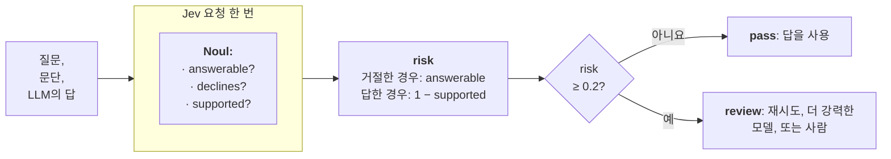

# LLM의 답을 출처에 비추어 검증하기

> 요청 한 번에 Noul 질문 세 개를 보내서 LLM의 답이 주어진 문단에서 도출되는지 확인하고, 의심스러운 답은 검토로 보냅니다.

검색해서 넘겨준 문단을 바탕으로 질문에 답하는 LLM이 있고, 그 답은 대부분 맞다고 해 봅시다.

흔한 실수는 두 가지입니다. 하나는 LLM이 문단 어디에도 없는 답을 내놓는 경우로, 빠진 단계를 추측으로 메운 것입니다. 다른 하나는 문단에 답이 있는데도 문단으로는 질문에 답할 수 없다고 말하는 경우입니다. 두 경우 모두 겉으로는 맞는 답과 전혀 구별되지 않습니다.

이 cookbook(예제 모음)에서는 답마다 Jev 요청을 한 번 보내서 문단과 답에 대한 `Noul` 질문 세 개로 확인합니다.

* `answerable`: 질문에 필요한 사실이 문단에 모두 나와 있는가?
* `declines`: 답이 문단에 답이 없다고 하면서 답변을 거절하는가?
* `supported`: 질문에서 출발해 문단을 한 단계씩 따라가면 LLM의 답에 도달하는가?

코드 몇 줄로 이 세 값을 위험도(risk) 하나로 바꿉니다. 위험도가 높을수록 답이 틀렸을 가능성이 큽니다. LLM이 답변을 거절했다면 위험도는 문단이 실제로는 질문에 답하고 있을 확률입니다. LLM이 답했다면 위험도는 문단을 따라가도 그 답에 이르지 못할 확률입니다. 위험도가 0.2 이상인 답은 검토로 보냅니다.

`gpt-6-luna`가 답한 질문 1,000개에 이 방법을 적용했습니다. 각 질문은 두 단계에서 네 단계를 거쳐야 답할 수 있고, 앞 단계의 답이 있어야 뒤 단계로 넘어갈 수 있습니다. 답의 88.5%가 맞았습니다. 검사는 답의 73%를 통과시켰고, 그중 95.7%가 맞았습니다. 나머지 27%는 검토로 갔는데, 틀린 답 115개 가운데 84개가 여기에 들어 있었습니다.



최종 결과물은 `check_answer()`입니다. 질문, 문단, 답을 받아서 확률 세 개와 위험도, 그리고 `pass` 또는 `review`를 반환합니다.

## 준비

```bash
pip install openai ipython matplotlib 'cooksafe>=0.3.0,<0.4.0'
```

그런 다음 `TYPESAFE_API_KEY`와 `OPENAI_API_KEY`를 설정하세요. 검사 대상이 되는 답은 OpenAI 모델이 작성합니다. 마지막의 측정 단계에서는 답이 데이터셋의 기준 답안과 일치하지 않을 때 그 답이 맞는지도 OpenAI 모델이 판정합니다.

아래 수치는 2026-11-07에 `jev-1.14.0`으로 얻은 결과이며, 같은 날 `gpt-6-luna`가 작성한 답을 검사한 것입니다.

```python
import json
import os
import urllib.request
from collections import Counter
from concurrent.futures import ThreadPoolExecutor
from pathlib import Path

import matplotlib

matplotlib.use("Agg")
import matplotlib.pyplot as plt
from cooksafe import JsonCache, make_playground_link
from IPython.display import Markdown, display
from openai import OpenAI
from typesafe_sdk import Noul, NoulCriteria, TypeSafeClient

TYPESAFE_MODEL = "jev-1.14.0"  # 이 페이지에서 쓴 모델. "jev-latest"는 최신 모델을 실시간으로 실행합니다
ANSWERING_MODEL = "gpt-6-luna"  # 답을 검사받는 LLM
RECHECK_MODEL = "gpt-6.1-sol"  # 측정을 위해, 기준 답안과 어긋나는 답을 최종 판정합니다
REVIEW_AT = 0.2  # 위험도가 이 값 이상이면 답을 검토로 보냅니다
LLM_WORKERS = 8  # OpenAI 호출 약 1,250회
TYPESAFE_WORKERS = 4  # Jev 호출 2,000회. worker를 더 늘리면 공개 rate limit에 걸립니다

client = TypeSafeClient(
    api_key=os.environ.get("TYPESAFE_API_KEY", "cache-only"),  # 키가 없는 커널은 캐시를 재생합니다
    base_url=os.environ.get("TYPESAFE_ENDPOINT"),
    timeout=120.0,
)
llm = OpenAI(api_key=os.environ.get("OPENAI_API_KEY", "cache-only"))

EXAMPLES = (
    "https://raw.githubusercontent.com/typesafe-ai/typesafe-public-examples/main/"
    "cookbooks/verify_llm_outputs"
)


def download(name: str) -> Path:
    """Fetch one of this cookbook's files from typesafe-public-examples unless it is on disk."""
    path = Path(name)
    if not path.exists():
        urllib.request.urlretrieve(f"{EXAMPLES}/{name}", path)
    return path


CACHE = Path("verify_llm_outputs_cache.json")
# True이면 게시된 답으로 CACHE를 채우므로 실행 중에 요청을 보내지 않습니다. 실시간으로
# 실행하려면 False로 바꾸고 CACHE를 삭제하세요. 디스크에 이미 있는 CACHE는 덮어쓰지 않습니다.
DOWNLOAD_CACHE = True
if DOWNLOAD_CACHE:
    download(CACHE.name)
json_cache = JsonCache(CACHE, indent=None)
```

## 질문과 문단 불러오기

질문은 [MuSiQue](https://github.com/StonyBrookNLP/musique)(Trivedi 외, CC BY 4.0)에서 가져왔습니다. 각 질문은 Wikipedia에 관한 단순한 질문 두 개에서 네 개를 하나로 이어 붙인 것이어서, 앞부분의 답을 알아야 뒷부분을 물을 수 있습니다. 질문마다 문단 20개가 딸려 있습니다. 대부분은 인접한 주제를 다루는 문단이라 질문에 답하는 데 도움이 되지 않습니다.

MuSiQue에는 질문마다 두 가지 버전이 있습니다. 한 버전에서는 질문에 필요한 모든 사실이 문단에 들어 있습니다. 다른 버전에서는 필요한 문단 하나가 빠져 있어서 질문에 답할 수 없지만, 남은 문단만 보면 여전히 답할 수 있을 것처럼 보입니다. 파일에는 MuSiQue 개발 세트에서 무작위로 뽑아 고정한 질문 1,000개가 들어 있고, 질문마다 두 버전 중 하나가 들어 있습니다. 약 절반은 답할 수 없는 버전입니다.

```python
DATA = json.loads(download("musique_questions.json").read_text(encoding="utf-8"))
QUESTIONS = DATA["questions"]
BY_ID = {q["id"]: q for q in QUESTIONS}


def paragraphs_text(q: dict) -> str:
    return "\n\n".join(f"## {p['title']}\n{p['text']}" for p in q["paragraphs"])


answerable = sum(q["answerable"] for q in QUESTIONS)
print(f"{len(QUESTIONS):,} questions, {answerable} answerable from their paragraphs")
example = QUESTIONS[0]
print(f"\n{example['question']}")
print("paragraphs:", "; ".join(p["title"] for p in example["paragraphs"][:6]), "; ...")
```

```
1,000 questions, 473 answerable from their paragraphs

On what team was the player who hit the first home run at the new location of NY Yankees home games?
paragraphs: Yankee Stadium (1923); Yankee Stadium; Utah Jazz; New York City; List of milestone home runs by Barry Bonds; Vegas Golden Knights ; ...
```

## `gpt-6-luna`로 답하기

지시문에서 모델이 문단으로는 질문에 답할 수 없다고 말해도 된다고 허용합니다. 아래에서 검사하는 답변 거절은 여기서 나옵니다. 여러분의 LLM을 검사하려면 `answer_prompt()`와 `ask_llm()`을 바꾸세요.

```python
ANSWER_INSTRUCTION = (
    "Answer the question using only the paragraphs. Return only the shortest answer that fully "
    "answers the question. Do not explain your reasoning. If the paragraphs do not answer the "
    "question, say so."
)


def answer_prompt(q: dict) -> str:
    return (
        f"{ANSWER_INSTRUCTION}\n\nQuestion:\n{q['question']}\n\n"
        f"Paragraphs:\n{paragraphs_text(q)}"
    )


@json_cache
def ask_llm(prompt: str, answering_model: str) -> dict:
    response = llm.chat.completions.create(
        model=answering_model, messages=[{"role": "user", "content": prompt}]
    )
    return {
        "answer": (response.choices[0].message.content or "").strip(),
        "input_tokens": response.usage.prompt_tokens,
        "output_tokens": response.usage.completion_tokens,
    }


with ThreadPoolExecutor(max_workers=LLM_WORKERS) as pool:
    LLM_ANSWERS = dict(
        zip(
            BY_ID,
            (
                r["answer"]
                for r in pool.map(
                    lambda q: ask_llm(answer_prompt(q), answering_model=ANSWERING_MODEL),
                    QUESTIONS,
                )
            ),
        )
    )

print(f"{example['question']}\n  {ANSWERING_MODEL}: {LLM_ANSWERS[example['id']]}")
```

```
On what team was the player who hit the first home run at the new location of NY Yankees home games?
  gpt-6-luna: New York Yankees.
```

## 답마다 Jev에 질문 세 개 보내기

답 하나에 Jev 요청을 한 번 보냅니다. state(상태)에는 질문, LLM이 받은 지시문, 문단, LLM의 답이 들어갑니다. 질문 세 개는 같은 요청에 함께 보냅니다.

```python
def noul(instructions: str, yes: str, no: str) -> Noul:
    return Noul(instructions=instructions, criteria=NoulCriteria(true=yes, false=no))


CHECK_QUESTIONS = {
    "answerable": noul(
        "Do the paragraphs state every fact needed to answer the question?",
        yes="each step from the question to its answer is stated in the paragraphs",
        no="at least one step from the question to its answer is not stated in the paragraphs",
    ),
    "declines": noul(
        "Does the candidate response decline to answer, or say the information is missing?",
        yes="the candidate says it cannot answer or that the paragraphs do not say",
        no="the candidate gives an answer",
    ),
    "supported": noul(
        "Following the paragraphs step by step from the question, do you arrive at the "
        "candidate's answer?",
        yes="the paragraphs connect the question to the candidate's answer through stated facts",
        no="the paragraphs do not connect the question to the candidate's answer",
    ),
}


def as_json(questions: dict) -> str:
    return json.dumps(
        {k: q.model_dump(mode="json", exclude_none=True) for k, q in questions.items()},
        sort_keys=True,
    )


def check_state(question: str, paragraphs: str, answer: str) -> dict:
    return {
        "request": question,
        "response_requirement": ANSWER_INSTRUCTION,
        "paragraphs": paragraphs,
        "candidate_response": answer,
    }


@json_cache
def ask_jev(
    question: str, paragraphs: str, answer: str, questions_json: str, model: str
) -> dict:
    response = client.system_one(
        check_state(question, paragraphs, answer), json.loads(questions_json), model=model
    )
    return {
        "nouls": {k: response.answers[k].noul for k in sorted(response.answers)},
        "input_tokens": response.usage.input_tokens or 0,
    }


def check_answer(question: str, paragraphs: str, answer: str) -> dict:
    nouls = ask_jev(
        question, paragraphs, answer, as_json(CHECK_QUESTIONS), model=TYPESAFE_MODEL
    )["nouls"]
    if nouls["declines"] >= 0.5:
        risk = nouls["answerable"]  # 거절한 경우: 문단에 답이 있으면 위험합니다
    else:
        risk = 1 - nouls["supported"]  # 답한 경우: 문단이 그 답으로 이어지지 않으면 위험합니다
    return {**nouls, "risk": risk, "status": "review" if risk >= REVIEW_AT else "pass"}


with ThreadPoolExecutor(max_workers=TYPESAFE_WORKERS) as pool:
    CHECKS = dict(
        zip(
            BY_ID,
            pool.map(
                lambda q: check_answer(q["question"], paragraphs_text(q), LLM_ANSWERS[q["id"]]),
                QUESTIONS,
            ),
        )
    )
```

## 답 네 개의 검사 결과 살펴보기

검사는 앞의 두 개를 통과시키고 뒤의 두 개를 검토로 보냅니다. 순서대로 맞는 답, 올바른 답변 거절, 문단이 뒷받침하지 않는 답, 문단에 답이 있는 질문에 대한 답변 거절입니다.

```python
def show(question_id: str) -> None:
    q, check = BY_ID[question_id], CHECKS[question_id]
    print(q["question"])
    print(f"  {ANSWERING_MODEL}: {LLM_ANSWERS[question_id]}")
    print(
        f"  answerable {check['answerable']:.2f}  declines {check['declines']:.2f}  "
        f"supported {check['supported']:.2f}  ->  risk {check['risk']:.2f}, "
        f"{check['status'].upper()}\n"
    )


DEMOS = [
    "2hop__501624_181960__ans",  # The Mud Bath
    "2hop__728887_159109__unans",  # Assomada
    "2hop__145082_35034__unans",  # Tammy Leitner
    "2hop__580231_162399__ans",  # Dahyabhai Patel
]
for question_id in DEMOS:
    show(question_id)
```

```
Where did the painter of The Mud Bath study?
  gpt-6-luna: The Slade School of Art.
  answerable 0.97  declines 0.02  supported 0.98  ->  risk 0.02, PASS

Where is Assomada located?
  gpt-6-luna: The paragraphs do not say where Assomada is located.
  answerable 0.07  declines 0.99  supported 0.97  ->  risk 0.07, PASS

What was the population density of Tammy Leitner's city of birth in 2009?
  gpt-6-luna: 182.5/km²
  answerable 0.12  declines 0.04  supported 0.08  ->  risk 0.92, REVIEW

When did the father of Dahyabhai Patel die?
  gpt-6-luna: The paragraphs do not say when Dahyabhai Patel’s father died.
  answerable 0.86  declines 0.81  supported 0.09  ->  risk 0.86, REVIEW
```

앞의 두 개는 정반대의 이유로 통과합니다. The Mud Bath 답은 `supported`가 0.98이므로 문단을 따라가면 그 답에 이릅니다. Assomada 답은 답변을 거절했고 `answerable`이 0.07이므로, 거절한 것이 옳았습니다.

Tammy Leitner는 San Diego에서 태어났지만, 2009년 San Diego의 인구 밀도를 알려 주는 문단은 없습니다. 그래서 `supported`가 0.08이고 위험도는 0.92입니다. Patel 질문은 답할 수 있습니다. 한 문단이 Dahyabhai Patel의 아버지가 Sardar Vallabhbhai Patel이라고 밝히고, 다른 문단이 그가 사망한 날짜를 알려 줍니다. 그런데도 LLM은 답변을 거절했습니다. `answerable`이 0.86이므로 이 거절은 검토로 갑니다.

## 모든 답에 레이블 붙이기

검사의 성능을 측정하려면 모든 답에 맞음 또는 틀림이라는 레이블이 있어야 합니다. MuSiQue는 질문마다 기준 답안을 제공합니다. `Noul` 질문 하나를 담은 별도의 Jev 요청이 LLM의 답을 기준 답안과 비교합니다. 이 요청은 문단을 보지 않으며, 표현이 달라도 같은 답이면 받아들입니다. 일치하는 답은 맞은 것으로 칩니다. 일치하지 않는 답은 `gpt-6.1-sol`로 보내고, 이 모델이 문단을 읽은 뒤 답에 right(맞음), wrong(틀림), unclear(불분명) 중 하나로 레이블을 붙입니다. 이 두 번째 단계를 둔 이유는 기준 답안이 문단의 내용과 맞지 않을 때가 가끔 있기 때문입니다.

```python
REFERENCE_QUESTIONS = {
    "matches_reference": noul(
        "Does the candidate response give the same answer as the reference answer?",
        yes=(
            "the candidate names the same entity, value or date as one of the reference "
            "answers, allowing for different wording; or the reference says the question "
            "cannot be answered and the candidate declines to answer"
        ),
        no=(
            "the candidate names something different from every reference answer; or it "
            "declines when the reference gives an answer; or it gives an answer when the "
            "reference says the question cannot be answered"
        ),
    )
}


def reference_state(q: dict, answer: str) -> dict:
    if q["answerable"]:
        reference = {"reference_answer": q["answer"], "also_accepted": q["answer_aliases"]}
    else:
        reference = {"reference_answer": "The question cannot be answered from the source."}
    return {"question": q["question"], **reference, "candidate_response": answer}


@json_cache
def matches_reference(question_id: str, answer: str, questions_json: str, model: str) -> float:
    state = reference_state(BY_ID[question_id], answer)
    response = client.system_one(state, json.loads(questions_json), model=model)
    return response.answers["matches_reference"].noul


RECHECK_SCHEMA = {
    "type": "object",
    "additionalProperties": False,
    "required": ["label", "rationale"],
    "properties": {
        "label": {"type": "string", "enum": ["right", "wrong", "unclear"]},
        "rationale": {"type": "string"},
    },
}


@json_cache
def recheck(question_id: str, answer: str, recheck_model: str) -> dict:
    q = BY_ID[question_id]
    references = [q["answer"], *q["answer_aliases"]] if q["answerable"] else ["(none)"]
    prompt = (
        "Grade one answer to a question about the paragraphs below. The reference answers "
        "were written by people and may be wrong about what the paragraphs say. Label it "
        "right if it is correct and complete according to the paragraphs, including a "
        "correct statement that they do not answer the question; wrong if it is not; "
        "unclear only if the paragraphs genuinely leave it open.\n\n"
        f"The answerer was told: {ANSWER_INSTRUCTION}\n\n"
        f"Question:\n{q['question']}\n\nReference answers: {'; '.join(references)}\n\n"
        f"Answer to grade:\n{answer}\n\nParagraphs:\n{paragraphs_text(q)}"
    )
    response = llm.chat.completions.create(
        model=recheck_model,
        reasoning_effort="high",
        messages=[{"role": "user", "content": prompt}],
        response_format={
            "type": "json_schema",
            "json_schema": {"name": "grade", "schema": RECHECK_SCHEMA, "strict": True},
        },
    )
    return json.loads(response.choices[0].message.content)


def label(question_id: str) -> dict:
    answer = LLM_ANSWERS[question_id]
    if matches_reference(
        question_id, answer, as_json(REFERENCE_QUESTIONS), model=TYPESAFE_MODEL
    ) >= 0.5:
        return {"label": "right", "by": "reference"}
    return {**recheck(question_id, answer, recheck_model=RECHECK_MODEL), "by": RECHECK_MODEL}


with ThreadPoolExecutor(max_workers=TYPESAFE_WORKERS) as pool:
    LABELS = dict(zip(BY_ID, pool.map(label, BY_ID)))

by_source = Counter((v["by"], v["label"]) for v in LABELS.values())
print(f"matched the reference: {by_source[('reference', 'right')]}")
for verdict in ("right", "wrong", "unclear"):
    print(f"re-checked by {RECHECK_MODEL}, {verdict}: {by_source[(RECHECK_MODEL, verdict)]}")
```

```
matched the reference: 739
re-checked by gpt-6.1-sol, right: 146
re-checked by gpt-6.1-sol, wrong: 115
re-checked by gpt-6.1-sol, unclear: 0
```

답 739개가 기준 답안과 일치했습니다. 나머지 261개는 `gpt-6.1-sol`이 문단을 읽고 판정했는데, 그중 146개는 결국 맞는 답이었습니다. 이 146개에서는 모두 기준 답안이 다음 두 가지 중 한 가지 방식으로 문단의 내용과 맞지 않았습니다. MuSiQue는 답할 수 있는 질문으로 치지만 문단에 한 단계가 빠져 있거나, 답할 수 없게 만든 질문인데 다른 문단에 답이 여전히 남아 있는 경우입니다. 이렇게 해서 틀린 답은 115개가 남습니다.

## 답 1,000개로 검사 성능 측정하기

표는 LLM을 쓰는 두 가지 방식을 비교합니다. 모든 답을 그대로 쓰는 방식과, 검사를 통과한 답만 쓰는 방식입니다. 두 번째 방식은 몇 가지 threshold(임계값)에서의 결과를 보여 주며, 위험도가 threshold보다 낮은 답이 통과합니다. 각 행에서 "how many"는 사용한 답의 수, "right"는 그중 맞는 답의 비율, "wrong held back"은 LLM의 틀린 답 가운데 사용되지 않고 검토로 간 답의 수입니다.

```python
SCORED = [qid for qid in BY_ID if LABELS[qid]["label"] != "unclear"]
WRONG = [qid for qid in SCORED if LABELS[qid]["label"] == "wrong"]


def row(name: str, used: list[str]) -> str:
    right = sum(LABELS[qid]["label"] == "right" for qid in used)
    held = len(WRONG) - sum(LABELS[qid]["label"] == "wrong" for qid in used)
    return (
        f"| {name} | {len(used):,} ({len(used) / len(SCORED):.0%}) | "
        f"{right / len(used):.1%} | {held} of {len(WRONG)} |"
    )


rows = [
    "| answers used | how many | right | wrong held back |",
    "|---|---:|---:|---:|",
    row("every answer", SCORED),
]
for threshold in (0.2, 0.3, 0.5, 0.7):
    used = [qid for qid in SCORED if CHECKS[qid]["risk"] < threshold]
    rows.append(row(f"risk below {threshold}", used))
display(Markdown("\n".join(rows)))
```

| answers used | how many | right | wrong held back |
| - | -: | -: | -: |
| every answer | 1,000 (100%) | 88.5% | 0 of 115 |
| risk below 0.2 | 727 (73%) | 95.7% | 84 of 115 |
| risk below 0.3 | 825 (82%) | 94.2% | 67 of 115 |
| risk below 0.5 | 917 (92%) | 91.9% | 41 of 115 |
| risk below 0.7 | 965 (96%) | 90.3% | 21 of 115 |

threshold가 0.2일 때 검사는 답의 73%를 통과시키고 그중 95.7%가 맞습니다. 모든 답을 쓸 때는 88.5%입니다. 검사가 걸러 낸 답은 273개이고 그중 84개가 틀린 답입니다. 나머지 189개는 맞는 답이었으므로, 검토 작업의 대부분은 문제없던 답을 다시 확인하는 데 쓰입니다.

```python
# 문서 페이지는 라이트 또는 다크 테마에 맞는 차트를 보여 줍니다. 노트북에서는 라이트 테마 차트가 나옵니다.
CHART_PALETTES = {
    "light": {
        "surface": "#ffffff", "ink": "#0b0b0b", "ink2": "#52514e", "muted": "#898781",
        "grid": "#e1e0d9", "axis": "#c3c2b7", "blue": "#2a78d6", "orange": "#eb6834",
    },
    "dark": {
        "surface": "#0d0a0f", "ink": "#fafafa", "ink2": "#d4d4d8", "muted": "#a1a1aa",
        "grid": "#2e2e33", "axis": "#52525b", "blue": "#5b9be8", "orange": "#f08050",
    },
}
BINS = [i / 10 for i in range(11)]


def draw_risk(p: dict) -> plt.Figure:
    fig, ax = plt.subplots(figsize=(8, 3.6), facecolor=p["surface"])
    ax.set_facecolor(p["surface"])
    for side in ("top", "right"):
        ax.spines[side].set_visible(False)
    for side in ("left", "bottom"):
        ax.spines[side].set_color(p["axis"])
    ax.tick_params(colors=p["muted"], labelcolor=p["ink2"], labelsize=9)
    ax.grid(axis="y", color=p["grid"], linewidth=0.8)
    ax.set_axisbelow(True)
    for verdict, colour, offset in (("right", p["blue"], -0.022), ("wrong", p["orange"], 0.022)):
        risks = [CHECKS[qid]["risk"] for qid in SCORED if LABELS[qid]["label"] == verdict]
        counts = [0] * 10
        for r in risks:
            counts[min(int(r * 10), 9)] += 1
        shares = [c / len(risks) for c in counts]
        ax.bar(
            [b + 0.05 + offset for b in BINS[:-1]], shares, width=0.044, color=colour,
            label=f"{verdict} answers ({len(risks)})",
        )
    ax.axvline(REVIEW_AT, color=p["ink2"], linewidth=1, linestyle="--")
    ax.text(REVIEW_AT + 0.01, ax.get_ylim()[1] * 0.92, "review from here", color=p["ink2"], fontsize=9)
    ax.set_xticks(BINS)
    ax.set_xlabel("risk from check_answer()", color=p["ink2"], fontsize=9)
    ax.set_ylabel("share of answers", color=p["ink2"], fontsize=9)
    ax.yaxis.set_major_formatter(matplotlib.ticker.PercentFormatter(1.0, decimals=0))
    ax.legend(frameon=False, labelcolor=p["ink2"], fontsize=9)
    ax.set_title(
        f"Risk for {len(SCORED):,} {ANSWERING_MODEL} answers, by whether they were right",
        loc="left", color=p["ink"], fontsize=11,
    )
    fig.tight_layout()
    return fig


for theme in ("light", "dark") if os.environ.get("COOKSAFE_RENDER") else ("light",):
    fig = draw_risk(CHART_PALETTES[theme])
    display(fig, metadata={"theme": theme})
    plt.close(fig)
```


맞는 답은 위험도 0 근처에 몰려 있고, 틀린 답은 전 구간에 퍼져 있습니다. 그래서 틀린 답을 대부분 걸러 내려면 threshold를 낮게 잡아야 하고, 그렇게 낮은 threshold에서는 맞는 답도 일부 검토로 가게 됩니다.

## 여러분의 답에 적용하기 전에

* **검사가 놓치는 것.** 틀린 답 31개가 통과했습니다. 그중 18개는 실제로 물은 질문 대신 관련된 다른 질문에 답한 경우입니다. 밴드 멤버가 누구냐는 질문에 "Leftover Salmon"이라고 답하거나, NFL이 어떤 종류의 것이냐는 질문에 "the NFL"이라고 답하는 식입니다. 문단을 따라가면 실제로 그 답에 이르기 때문에 `supported`가 높게 나옵니다. 나머지 13개는 문단에 답이 있는 질문에 대한 답변 거절입니다. 이 경우에는 `answerable`도 0.10에서 0.19로 낮게 나왔습니다. LLM이 놓친 문단 간의 연결 고리를 Jev도 똑같이 놓친 것입니다.
* **threshold는 여러분의 답을 기준으로 정하세요.** 레이블을 붙이는 단계는 기준 답안이 있는 질문 세트라면 어디에나 쓸 수 있습니다. 질문, 문단, 기준 답안을 여러분의 것으로 바꿔서 다시 실행하고, 표를 보고 threshold를 고르세요.
* **이 수치의 근거.** 맞음과 틀림 레이블은 모델이 붙인 것이므로, 재검사를 더 엄격하게 하거나 더 느슨하게 하면 88.5%라는 수치가 달라집니다. 검사 질문 세 개는 이 표본의 첫 100개 질문에 시험해 보고 다른 두 가지 질문 세트 대신 고른 것입니다. 그 100개가 선택에 영향을 주었으므로, 그 100개에 대한 결과는 공정한 테스트가 아닙니다.

## playground에서 열어 보기

아래 링크는 Patel 질문의 답변 거절을 playground(플레이그라운드)에서 엽니다. 질문, 문단, 답, 검사 질문 세 개가 채워져 있습니다. 거기서 같은 요청을 실행해 보고, 브라우저에서 질문을 고쳐 보세요.

```python
PLAYGROUND_ID = DEMOS[-1]
q = BY_ID[PLAYGROUND_ID]
playground_link = make_playground_link(
    check_state(q["question"], paragraphs_text(q), LLM_ANSWERS[PLAYGROUND_ID]), CHECK_QUESTIONS
)
display(Markdown(f"🔗 [Open in the TypeSafe playground]({playground_link})"))
```

[TypeSafe playground에서 열기 →](https://console.typesafe.ai/playground#share/N4IgJg9gxgrgtgUwHYBcAqCAeKQC4AEIwAOiAE4ICOMCAziqQaQOoAWy+YAlmPiu-gBmAQ34Iy+CIPwARYawCewgEathXfAAVRCADacuCAPykANPlIVaABwhJaCAPoVqXColSMLIAIL2A7uJ8AtR0KFx2+DC0XEgA5pJIugrBCPjWwmTCcVnWrLQAdPgASggoMGRIicmp+LSsEGQoYfjCAUH8okIwujVttIFktLWh9BFIRTIQ+EgQKPhY1rrqVQoQFfgUwrR2sXFFAJLSYumZ2bn5nNOz8-2DIzRjdua0wik7BWbeGVk5wnm0LykADEwPwAHkUChpgBlKCsHqILj0cTEYhISHQ-BwhG6JEoiQACgAjPgfNYyFx9MSAJzEgBs+Fi+AAaoYkEhhPhAMgE+GJAAYyTA4tF5gAmfn80nMtnITkASnw-m2rSqPlFlLa+AAVutKsJdMiUOZ-A0lSqwHQoJTlAheCqTpAFBwpEL6JqqrqKpzDbQ4EUABJpZXDO1caFkAC0sUj8MM0ldMkMWisDiEZAgcD5NPppKxtIA7Iy2rxw8NrDBlL72BJBBms4XGfmaQAOGmB4MOgQiMQSV2CRqICTg4oAMXwUEaVlsSEtqC0wh62PhiIQRvEh3mIc2CAAbggDXamVUJfyacEugJ-I0ANZHgcSE4AYQOPnTmdqtPp-MKaKQf9BfB6XPGEsBSNBWD2YYxVkaYACEEAfNIAE11lkQw-2A7EwPwCCoPwGCpnwBCkPwVCYHQtJCXoBRDQALyPLDQMwcDIPiaDYOIgAWABVSjFW3LlNGWBRlAgcCWVaMAenmJAEH8P1smEOjYjSCkpCpPYFkwOYuCgfBdGgQ9aHMdYUEgRopP3VAKjoVVeFgMgKHncRdP0lBnLAX90QAsEAwgfxZAPfh8CfYRED4aYAFFMn4P9-MCmRgtYULwrSLEYqaFLkVaPkuMjOBYhgZoJ2KszVS4OBRHGIQqSzZQUgOeoKO0Zp9HU6SoCPZlC1JBragAOWquwDXwUc6uIiBMl4V0ws5MBhCKCC0kECbLQNYZ-HDFKtQOWcuC1OAFBC11rWC8ZzBLJlhhuFRdBWyyyz4SlrGsFJd2RGBRpo+7Ph89FAJZYRLUNP8gZBjQcq5RTenwD7emyNJmTgxpXl4FADRgG9hHMPwru4d09ONfAAHEYG1M5ib27hFvwA55hywyoB0e0MxgWd8BbAACm8szrD8UaGYHN2uuoKjZ2cj36k5BHEcJ7tCtQMwxiQKDiGrTT0lLljIOI9BSDqYC64ZoWUYQoEncxKS68xJyhZ4DOBlJVvicRzDQTNRAgcxNDmL37MkXtWhyPSZIqUbrQgaxClwgMfAAaRHSR-HsWoqt1SkUBSV1lGiVTaBM-B08acNs+kVq9GGTIVvrIDBQaaI0knOA4HZ0uL3mSBCs5Zphh8Vv9BheRscpfAAFlgYNDQx6pG9ZHUMgUiuiv9DNujMiKSEayL4QM4nTNW6QcNDCrih57IM2yHdtQb0acw4KyVhu6rjmn1YSkxn6IoSZLSDtQ0DIBcjz8DZnEFK4M9AaFalwJQx5577XHpkeEdRRBKD+Kwe+qNgYoKzuceQi0-y+VwgIZgnsqjMhOD4MAu4jLNAAOTDBJgFf86Jlr4FIVVchVRKHUNoQgBhpNmH4EJCTcQnCCBJjSKOLIFFKq4QNJkRUUNsxinPANRogR1ZtEjKIsgnC6hUmQJ3LIVVap4gMBQKAzReD9SoRAXQ0g0DKzogHegmRKTxCFLwKKetLSRgGsiBwSAfaLn0MULWzQJBXWkeGFx8dGgoDkmQIob5ZZVQVssfwzoJDN0KigYYtAYB6R4GkYQghIkGFoJOfcHiEgy0aHrReE5thpHqEjcsGYHCwHCJ4tQNiEAcFyeGax+B+rbyET2Gsf0WFIEAj4d+kQ5DwD-JIsaa45aIzprQLIldzCrO1AAH4JvCDgo51lNE2cyIIMIImcCCE44Gx9IiEiDGQE5VQWTiGWHEcw0i2g3kEBUW4WYJ6xHMDQ3QhxzC0hpAAZnMNYIoABWJF9JwX2MOAcaFNIaRcQRcipFBZ5SEIBmCAAMkaSQ0g4gQBqbMIYVLailAcGQfcxF-mMupgdP8bDYiLhFFkfQUhVpdQaLoS0EhtwnAfsfeooz-lBHBLQMSlQ0gwjyRgpUkEFZPgKDISYdAn5YxSlK7sbh6B032lqGldLGhLQELYGI4RIg5Ucs5FANR2DitGSkHiZB-7zBXiaM00IIBz1pUEfmWZijZARCYkou8tSRC4thawzQ4C2gkBKBk0yiGrPBIaGpWhoDbxhA0fwKzkwFq4EW32JyJBloCuaKujtmiRiPmA+Y9Qm1bRCtW2tJagjdpTj67EogCjSiqLozh2cqgxIWgoGObDh2iy5IVTAjLlhto7aweYzc7RLw5tYcQOwfSlyKDFZBygMzA2Zha206tU69pSm42ckYYDWH3ogMACh7XiFKWfPWSSDQ1BQNeCcegEDXvbiKMIMcZAVC0jLc1XaDynp9oOsgAjJlBF0dNdMVAaCoD6K9A8FAZrcIECulU0MSk3j0jeXNpLiFpCBroGgjL1H8D2DygQbGOOui42xOIBAEqRRKIa-4aQJ5kDvPMGE0BDBZwDqUS0Ls0hJTgNALIUAUjKLEmG0dMbtQLjaq0MSxVagIEnLMQq+lrTIihhzJ6iFZZWMSPvew8AT0FHps29IlZqzdRPFKfkTHZlgjkIoFQagoE6F0Cs+QShVDqFM3oYRtJ+T0m5IWWFAkuytMiK6LlWp7rA2udNTIrIQMxZS3Ftql0qhXS3UENdCAM1BFdCcbQZBDRpXnMVq1F7OoszgSjDNbw9lJZi6lle+A-jSVG1G2oZMKZZHmGyH9-xtoBwfVqa8smtIPlVMeQpWQkBdS-RkJAChGu8AcFCe6pYqjjbNr+-AAYcqrSGFuLgssyLbAaAtAwdpzBlY+r0uRkECmRDglwawsQOytqCFVJyhheBwTUEgeA1UA59NVHMbe6HSaLgxv6D7X2t0eaHrOONFrihTXtBzFrEhNBZBS5aD6Y3Mxvf8zLFwRH5hWBKRdtIroh5kAWqz+LKTdD8HWGA9IlJUdUiXqMvOckC6cJCWZn44QoDw9GxQgQABFIp8wStFwjR4W4HNtyVQpMiOw95a60i4jBZsXEuLhcBjV1QdW0sJfRGx5Y-vYv4ED8I2FpJwRWIgJmvkLYCxIp5HyFPSUuodYkLSJF-J5QIqjj0TINQbyzBHSqCXUvA8mho1UErVRbCGn1wdCYH3WniH3PaE2ZqftBQrMptnlVpOxHXH2aQJWkeCTr1aqol8P4VKum43u2vcpBIiBIMrErGUnHr-gIazqfShTsDkOgL97RCHWPtTxOGx9MoQBWKselOVWq1dMJYbwjxck31pDMCtjdN0vw8gUAEXdGFDiAVmO1iEtGPUllFwDhFBKVLHyWPGaD+APxQOmC5DbmsXMCgPv2QDnFkmGlbz2ktRpgDkrnkhrAQHMCvBVCkGaCqGZl6CPEr0yHMEQDaC0jRFIDjEQh4JADgU+32nMD9Wkjuy0BPRbyR3NhGRVH8gihniPgJE4EQ08ROEb2PmYJQIQDQJqkG3IKuh31nAgEjG0Ho1fQ0GYCq1dDdwLAKDm23CyGRGC1qEnHZiAJiEtEZSXzF2kFW0pknxozFgtlP0BX0EyWySR0KWUAcFCGI2zl1i4IcF4GPW2DaGQOW3jnYAWkwSFjAAkLgmmnsUhinXJkpjgVmCQEjA+nsSMQnBrSpEqXjzDGQEuyUliAtWlUzmRBSmM3MFtGbi0md23wEC0wtViEEHYyMQOgiIPAlWGGZACPWyCKrleggFiDkO7zSC4hpBCjZzoBF3mAMJbz32INGifGP1TFMiSOUKQwdVimdkskgysXGEWKqFpFhRTSuk+ILC1UMSV0zF0nUNN3NzIIOnHmtyMR93JUpVdBtXEHpWGC6wEGZQ7zSCKKQHDXHytV4yRk5GFHDiFUEBFQQDFS31NQxJ6LlTNixMVWVUaDkmxA1WDQBN1X1SCnqFbhvBNQK1ql713wRMqDtRY3SAgCdRqldXFiMU9T0BsV9X9XDGr1f0ikMwjVrFrhjTAXDmjUTSqGTVTXTQT2zXpCKG1BJQi3wBink3unv0oj-GtOxFtM-VWUJCURbWzRghhECAJhSlWnMX8EzkYIDm4EsRGX6h-mgz0CEi1numSWwgZgbysCMUjAXWxB9OQFwPmAHF6AChbS2F9H1zqAjCXgs1tyiDkjgCWHEiPDWHZgSGvH0U5G-QTUAENALkQkAaMRPlfAMlLGc2fPFU0AuIcAuyLEF2c-OSQKXUZQf4hWGIAeDGOSdYWgUDYQejTxZmM+V0InBjIQUQbeQkGeZYKoGQX4LgVsrgQAcEB5QYTcJph44qR9AuQx5oANy4hlA3AwA-wyUBl8B8dDILVt4tNexg1phCkST-1eBlsbdRonzNdC4YgN1nRMhhhbRSI2ki4ygPsIAGgSTWh5gKVXpYg7YUBABMAmRJJL0joA7FrAPLdlykiM6yqFNA-B8ChFDk2hVC0xBlByVHWG9W4HSnAxQoZTKQqQ0MCz0mIMZQ9nwEfNhhfLfL2E-MlzvKGl1nsTxNZCfM2TUBhwihpQgHu3Fkv24HYg8xAwvw2C8JorJHZ1ONAi5CxBOGYDCFEKzziGEEiBcqozMhNUgmQRygcB+FG36i5EpCLSujrOLKfJmAGXP1lichSCxEjgLiWmmBOAU2KhShigmO2J0oRj1kZRpwpiaw5l8rSHUSylFglzsAWiKDqtnC5H0wPGKj+yXBhn0Hhm+WDB2y5FsArC3X0OkEyDMr5FPDx2CNtFJw6v0G1X0GfQvysD3XVM-1hnVKZBQBFg2mmH0r4HAxmvavCN7PXLskXwPA8xOEJyHRKUarGuatXV0B2H-MzHSlhH0sgmxnnAAClI9WLV0lQ9B9BS8hFj0hgRom89NKNWkMYSpXRliuhjtocFgSSEkTYAppphgyAiSoglg-sUAbcA4oZnrphAhYZQby8W1r1hA2UvR9RCzGrPquBvr5g-q5sSaXqakUhyaQay8qhjsTgR9whqo2VBMBkshjxpJ3R3hsKP1lragP1DRykiac5zYbxlRJc4ETg1Zxg7yAxpoWbA94pDa55HCVQVV9SQt8AfqegUgYVYU4EuREbwhI8RBCpQN4IlYugroeJ6ghIZdLUCJJQ8V-ycofgjFhgtNO9xM2QTEvLycDbJcjb6AYAhLoLa4nxlgC5WQDhxMs7thhgWQDgS6CL0JdxYEfq1h5N4QIB7E4E47woE6BjEJGg0ho6kMHziJsQ1BwE+UUgJ59or4tV-1-zYa070cKz5ZQps7hgAANEu1Y3KWwSyVOwggOLkBzKAOTBYVABEGIbYbai0wCIo2+aXNqP8U+yyDm4YOMcVZyARJvcQUQWyCcb2qxIIM6MKlIJO+HLINGVkJQYYY7QFDkQ9Sqb6CME+ALR-NpeUiwNEEAH+faXcAQy6N+qkMAB+tCrgQIBAG8GoJY8o9bDQE8kUTZB-ILeB5B7gXcMdSCXBRBIe8wGEcOYmF28wCfUUhELTNmApKB86ss9lM+-6oMjgfqFkIB-45Bb7C1f4NI8jOBT44sDmGzHpGgdGOKnPJFP9YskuOyEi9jbwm6qJPejMWwXhvIJ-eEM4D+hlQxieyHTaP7Ggnu9c0eVqE8rgXR+gfRzaUe82Zua7SeparUJ8jUGSow8MBWR3VAVwrOBHbQhJiAP4PIHmwKk1UerB4QEdaWcDVh9beVFI1oJoSla9ExwuNAfoY1AOQewpHk3RmxnTCpQYtKWoPSIrfw4h3HO+rB5AR+8MZ+8oM+K6QSBaNNYLLETe7VPppAARd-X9Y+sETHexGberPQS+sVNZ-62vcErUF2jQUnBoeMoMPgflXdGYbzPhx2eIL6PWKueYF2-AHiI+GpJ1Q9XgbgByTMUK8INlNe6B10J+9bV+5kbgSC91G58h+5pHDyfoFrXgLARgmIfcPoO3ZWNIU-N4M-Z6WmvQFJx4JenJ6aYBAQbQMAUxMtUeZkU8FsO8qKOefyDGHS6Wm+B0xlv2Fl6IG+YRcwd03KGFGCGTA8jQf0rMUM6zcMlIH6lQS+SPK6Q2LqeB-fcYUacacxJKVFqOImy4sgWwEhzpvZ3RsV4s1C06zAQqVm4icQS0cwCeMABEeS8KT8kecwAJdjLQXEVxoGIYNQZ52gLyuwEeOBTfTYOonF18rHMkLyzCq6JMQ0T9NnGbXcA0YN5kQpdY0pzxX-GipZsdOATkYRMV4ldEIeAtlqltQsFNYV7jSMMhu5puZXNIbJ0xCVj++BmV5QOVleEWbcIxKCjA2oMUJFEKBCXrZkPaSJHuVV-QdVrMM5MYFNyFL4XgksHgHQZwOgGcBwIEEANhUK1Jy4SAGYOYFBdJjgKLZLcPFeCi-coOdOz4EAAAXxAHMBAHUirPyQwGwDwEIBIBADuGfqrAQC8H-YSZA9-dIFmB6BXZAE6I8iNgP0BEg5ACIg0LOEPf4Z0AWG5v3PczkjtGAUwPaEfBCEeAPxMFfe8Ac0iW5V-bA5xog6YBAAPGQRRE-WWxOFGHQKxCekA4kGCrhviYeN+AuGQ-MFIBEGeqY+8C6DKwtRGPY-fCzC4-I5ql4+QP49FhuFNZGX-1OFE-+HyFICfafYk-AGs0NE11A9IHA93eg4Syo9IHg5xteLsGQ+Y6mDHIEGZn2gWhKmnHc+bcs9UnE345uLPfaaQAfCqnQJykKgLj2Eo-M5o-EDo4IAY5oF3ZOF86+ew9eEXS2uaQ5FPa08sk6HmHQ8M4BCuBPa7TeFg6k53ZQ5y7Xf87SHVn3BflVAGFRGfbM+8Azf1esRs5ADs5Q4c9g5c8Q7eN3dHHsUMi2hBLUgw7E+LLtP6iU847I7CAulq5ivcRrVKUq587a50AEX4+S+o8zjS+EFG4Q5k9s5E7wRq5szknc1U9258sytO78-O5fl69I9ARfSE+gtkPE+8Ca8e7G+e8w9q507e8lYeC++4R+6bjO-oQB8GBM9M6o4A4R0+SGHGF-ZAF3GJGfaAA)


이 문서는 개발자 문서 플랫폼인 [Mintlify](https://mintlify.com)로 제작하고 호스팅합니다.
