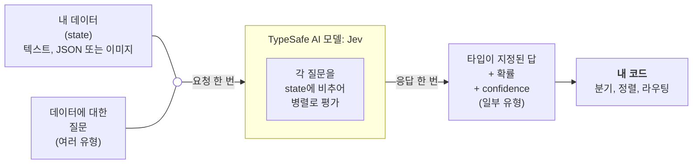

# 소개

> Jev는 TypeSafe의 대표 모델이자 최초의 System One 모델입니다. state와 타입이 지정된 질문을 보내면, 코드에서 바로 쓸 수 있는 구조화된 답을 돌려받습니다.

대규모 언어 모델(LLM)은 사람이 읽을 텍스트를 만들어 내도록 설계되었습니다. 그래서 코드가 받아서 쓸 판단을 모델에게 맡기려고 하면 어긋나는 부분이 생깁니다. 텍스트 생성 시스템이 구조화된 결정을 출력하도록 억지로 유도한 다음, 그 결과를 다시 파싱해서 코드가 믿고 쓸 수 있는 형태로 바꿔야 하기 때문입니다.

Jev는 TypeSafe의 대표 모델이자 최초의 [System One 모델](concepts/system-one.md)입니다. System One 모델은 소프트웨어가 바로 사용할 수 있는 구조화된 결정을 빠르게 내리도록 만들어졌습니다. Jev는 타입이 지정된 *질문*을 *state*(상태)에 비추어 평가하고 구조화된 결과를 바로 반환합니다. 텍스트를 생성하지도 않고, 파싱할 필요도 없습니다. 코드에서 분기하고, 정렬하고, routing(라우팅)하는 데 쓸 수 있는 타입이 지정된 값과 확률 분포를 받습니다. 일부 질문 유형은 [confidence(신뢰도)](confidence.md)도 함께 반환하며, 코드는 이 값을 보고 답에 따라 행동할지, 행동한다면 어떻게 할지를 정할 수 있습니다. 답에 무엇이 들어 있는지는 질문 유형별 페이지에 정리되어 있습니다.

## TypeSafe primitive

TypeSafe는 *AI primitive*(프리미티브: 기본 구성 요소)를 제공합니다. 소프트웨어의 primitive와 마찬가지로 TypeSafe의 AI primitive는 모듈식이고, 조합할 수 있고, 구조화되어 있으며, 안정적이고 빠릅니다. primitive마다 서로 다른 유형의 *질문*을 던지고 서로 다른 유형의 답을 반환합니다.

| 질문 유형 | 목적 | 반환값 |
| - | - | - |
| [Choice](primitives/choice.md) | 목록에서 선택지 하나를 고릅니다 | `choice`, `probabilities`, `confidence` |
| [Score](primitives/score.md) | rubric(루브릭: 채점 기준)에 따라 state에 점수를 매깁니다 | `score`, `probabilities`, `confidence` |
| [Noul](primitives/noul.md) | 이 진술이 참인가요? | `noul` (0–1) |
| [Box](primitives/box.md) | 이미지의 어디에 있나요? | `box` (`top`, `bottom`, `left`, `right`), `confidence` |

한 요청 안에 여러 유형의 *질문*을 자유롭게 섞어 넣을 수 있습니다. 모든 *질문*은 같은 *state*를 대상으로 서로 격리된 채 병렬로 한 번에 평가됩니다. 질문을 추가해도 응답 시간은 거의 달라지지 않습니다. 질문이 각각 독립적으로 평가되므로, 질문이 늘어나도 context rot(컨텍스트 부패)이 생기지 않습니다.

## 원자적인 질문을 코드로 조합하기

System One 모델은 질문 하나가 범위가 분명한 구체적인 것 하나만 물을 때 가장 잘 동작합니다. 질문 하나하나를 직감으로 내리는 판단이라고 생각하세요. 해당 분야를 잘 아는 사람이 적절한 맥락만 주어지면 몇 초 안에 내릴 수 있는 종류의 판단입니다.

묻고 싶은 질문이 긴 추론을 요구하거나 서로 독립적인 여러 요소를 저울질해야 한다면 질문을 쪼개세요. 요소마다 별도의 질문으로 묻고, 그 결과를 코드의 로직으로 결합합니다. 이렇게 하면 개별 평가가 안정적으로 유지되고, 각 차원에 가중치를 어떻게 줄지도 온전히 직접 제어할 수 있습니다.

예를 들어 "이 스타트업 피치를 평가해 줘"라고 묻는 대신 시장 규모, 기술적 실현 가능성, 차별성을 따로따로 묻습니다. 그런 다음 직접 만든 공식으로 점수를 합칩니다. 우선순위가 바뀌면 prompt(프롬프트)를 다시 쓰는 대신 코드의 계수 하나만 바꾸면 됩니다.

## 다음 단계

* [빠른 시작](introduction/quickstart.md): 바로 시작하는 데 필요한 모든 것을 담았습니다.
* [AI 입문](introduction/machine-learning-primer.md): TypeSafe가 텍스트 생성이 아니라 calibrated(보정된) 결정을 위해 모델을 학습시키는 이유를 설명합니다.
* [Primitive(질문)](primitives.md): 질문을 정의하고, 질문 유형을 고르고, 여러 질문을 한꺼번에 묻는 방법을 다룹니다.
* [Confidence](confidence.md): Jev가 확실성을 어떻게 알려 주는지, 그리고 이를 아키텍처에 어떻게 활용하는지 설명합니다.
* [패턴](patterns.md): TypeSafe로 시스템을 구축할 때 자주 쓰는 패턴을 소개합니다.

이 문서는 개발자 문서 플랫폼인 [Mintlify](https://mintlify.com)로 제작하고 호스팅합니다.
