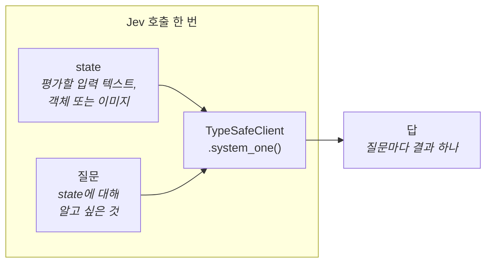

# 빠른 시작

> 5분 만에 Jev를 실행해 봅니다.

이 가이드는 TypeSafe의 [System One 모델](../concepts/system-one.md)인 Jev를 사용하는 네 가지 방법을 다룹니다. [SDK 사용하기](#code-it-your-first-request), [API 호출하기](#call-it-the-api), [agent skill 사용하기](#vibe-it-the-agent-skill), [브라우저 기반 Playground 써 보기](#try-it-the-playground)입니다.

API 키는 [TypeSafe 콘솔](https://console.typesafe.ai/keys)에서 발급받으세요.

## Jev를 효과적으로 쓰기 위해 알아야 할 최소한의 내용

Jev를 호출할 때마다 요청 하나를 보냅니다. 요청은 [state(상태)](../concepts/state.md)(단순한 문자열 또는 구조화된 객체이며, 어느 쪽이든 [이미지](../images.md)를 포함할 수 있습니다)와 [질문](../primitives.md) 집합으로 이루어지고, 질문마다 답 하나가 반환됩니다.



Jev는 primitive(프리미티브: 기본 구성 요소)라고 부르는 다음 질문 유형에 답합니다.

| 질문 유형 | 목적 | 반환값 |
| - | - | - |
| [Choice](../primitives/choice.md) | 목록에서 선택지 하나를 고릅니다 | `choice`, `probabilities`, `confidence` |
| [Score](../primitives/score.md) | rubric(루브릭: 채점 기준)에 따라 state에 점수를 매깁니다 | `score`, `probabilities`, `confidence` |
| [Noul](../primitives/noul.md) | 이 진술이 참인가요? | `noul` (0–1) |
| [Box](../primitives/box.md) | 이미지의 어디에 있나요? | `box` (`top`, `bottom`, `left`, `right`), `confidence` |

## 바이브로 만들기: Agent Skill

프로젝트에 Jev를 추가하는 가장 빠른 방법은 TypeSafe skill을 설치한 코딩 에이전트에게 연동 코드를 작성하게 하는 것입니다.

1. **[TypeSafe skill을 설치합니다](../agent-skill.md#installation).** Claude Code 플러그인이나 `npx skills add typesafe-ai/skills --skill typesafe-ai`를 사용하세요. [GitHub에서 SKILL.md를 읽어 볼](https://github.com/typesafe-ai/skills/blob/main/skills/typesafe-ai/SKILL.md) 수도 있습니다.

> [tab] Claude Code
>
> 터미널에서 다음 두 명령을 실행하세요.
>
> ```bash theme={null}
> claude plugin marketplace add typesafe-ai/skills
> claude plugin install typesafe@typesafe-ai
> ```

> [tab] 다른 에이전트
>
> ```bash theme={null}
> npx skills add typesafe-ai/skills --skill typesafe-ai
> ```
>
> 안내가 나오면 사용하는 에이전트를 선택하세요. 기본적으로 프로젝트 로컬에 설치되며, 전역으로 설치하려면 `-g`를 추가하세요.

> [tab] 에이전트에 복사하기
>
> 다음 prompt(프롬프트)를 코딩 에이전트에 붙여 넣으세요.
>
> ```text wrap theme={null}
> Install the TypeSafe skill. If you're in Claude Code, run `claude plugin marketplace add typesafe-ai/skills`, then `claude plugin install typesafe@typesafe-ai`. If you're in another agent, run `npx skills add typesafe-ai/skills --skill typesafe-ai` and select your agent. Use one installation method. You can read the skill directly at https://github.com/typesafe-ai/skills/blob/main/skills/typesafe-ai/SKILL.md (raw: https://raw.githubusercontent.com/typesafe-ai/skills/main/skills/typesafe-ai/SKILL.md). Then use the TypeSafe skill when working on this project.
> ```

2. **코딩 에이전트에게** 개발하는 동안 TypeSafe skill을 사용하라고 알려 주세요.

```plaintext title="Coding agent prompt"
Let's build a simple CLI that uses Jev to evaluate a set of supplied texts on multiple dimensions. Use the TypeSafe skill to understand how to use the TypeSafe API and how to structure the system. Ask me questions about what kinds of texts I want to evaluate and on what dimensions.
```

> [!NOTE]
>
> TypeSafe API 키를 발급받아 환경 변수(예: `TYPESAFE_API_KEY`)에 저장해 두기를 권장합니다.

[Agent Skill](../agent-skill.md) 페이지에는 더 많은 예시 prompt와, 에이전트가 skill을 사용하지 않는 경우처럼 자주 생기는 문제의 해결 방법이 있습니다.

## 코드로 만들기: 첫 요청

즐겨 쓰는 프로그래밍 언어에서 Jev를 호출하는 방법을 살펴봅니다. Python, JavaScript, TypeScript 예제는 TypeSafe SDK를 사용하고, Bash 예제는 API를 직접 호출합니다.

작업 디렉토리를 만들고 API 키를 설정하세요. 다음 설정 명령은 macOS, Linux, 또는 WSL을 쓰는 Windows의 Bash 기준입니다.

```bash
mkdir typesafe-quickstart
cd typesafe-quickstart
export TYPESAFE_API_KEY="your-api-key"
```

예제는 고객 지원 티켓 하나를 보내고 한 요청으로 Jev에게 세 가지를 묻습니다. 어느 팀이 처리해야 하는지, 고객이 얼마나 불만스러워 보이는지, 문제가 긴급한지입니다.

> [tab] Python
>
> Python 3.10 이상이 필요합니다. SDK를 설치할 패키지 관리자를 고르세요.
>
> > [tab] pip
> >
> > [pip가 설치된](https://pip.pypa.io/en/stable/installation/) 상태에서 가상 환경을 만들고 SDK를 추가합니다.
> >
> > ```bash wrap theme={null}
> > python3 -m venv .venv
> > .venv/bin/pip install typesafe-sdk
> > ```
>
> > [tab] uv
> >
> > [uv가 설치된](https://docs.astral.sh/uv/getting-started/installation/) 상태에서 프로젝트를 초기화하고 SDK를 추가합니다.
> >
> > ```bash wrap theme={null}
> > uv init --bare
> > uv add typesafe-sdk
> > ```
>
> `route_ticket.py`로 저장합니다.
>
> ```python wrap theme={null}
> from typesafe_sdk import Choice, Noul, Score, TypeSafeClient
>
> ticket = "Our API integration started returning 500 errors on every request about 20 minutes ago, and we can't process any customer orders until this is fixed."
>
> with TypeSafeClient(model="jev-latest") as client:  # TYPESAFE_API_KEY를 읽습니다.
>     response = client.system_one(
>         state=ticket,
>         questions={
>             "department": Choice(
>                 instructions="Which team should handle this",
>                 criteria={
>                     "billing": "Payment or subscription issues",
>                     "technical": "Bugs or integration problems",
>                     "sales": "Pricing or account questions",
>                 },
>             ),
>             "frustration": Score(
>                 instructions="How frustrated the customer appears",
>                 criteria=[
>                     "Calm, just stating facts",
>                     "Frustrated but civil",
>                     "Very angry, strong language",
>                 ],
>             ),
>             "is_urgent": Noul(
>                 instructions="The message conveys urgency or time-sensitivity",
>             ),
>         },
>     )
>
> print(response.choices["department"].choice)
> print(response.scores["frustration"].score)
> print(response.nouls["is_urgent"].noul)
> ```
>
> 어느 설치 방법을 썼든 다음과 같이 실행합니다.
>
> ```bash wrap theme={null}
> .venv/bin/python route_ticket.py
> ```

> [tab] JavaScript
>
> Node.js 20 이상이 필요합니다. SDK를 설치하고 프로젝트를 ES 모듈로 지정합니다.
>
> ```bash wrap theme={null}
> npm install @typesafe-ai/sdk
> npm pkg set type=module
> ```
>
> `route_ticket.js`로 저장합니다.
>
> ```javascript wrap theme={null}
> import { choice, noul, score, TypeSafeClient } from "@typesafe-ai/sdk";
>
> const ticket = "Our API integration started returning 500 errors on every request about 20 minutes ago, and we can't process any customer orders until this is fixed.";
>
> const client = new TypeSafeClient({ defaultModel: "jev-latest" }); // TYPESAFE_API_KEY를 읽습니다.
> const response = await client.systemOne({
>   state: ticket,
>   questions: {
>     department: choice("Which team should handle this", {
>       billing: "Payment or subscription issues",
>       technical: "Bugs or integration problems",
>       sales: "Pricing or account questions",
>     }),
>     frustration: score("How frustrated the customer appears", [
>       "Calm, just stating facts",
>       "Frustrated but civil",
>       "Very angry, strong language",
>     ]),
>     is_urgent: noul("The message conveys urgency or time-sensitivity"),
>   },
> });
>
> console.log(response.answers.department.choice);
> console.log(response.answers.frustration.score);
> console.log(response.answers.is_urgent.noul);
> ```
>
> 실행합니다.
>
> ```bash wrap theme={null}
> node route_ticket.js
> ```

> [tab] TypeScript
>
> TypeScript를 바로 실행하려면 Node.js 22.18 이상이 필요합니다. SDK를 설치하고 프로젝트를 ES 모듈로 지정합니다.
>
> ```bash wrap theme={null}
> npm install @typesafe-ai/sdk
> npm pkg set type=module
> ```
>
> `route_ticket.ts`로 저장합니다.
>
> ```typescript wrap theme={null}
> import { choice, noul, score, TypeSafeClient } from "@typesafe-ai/sdk";
>
> const ticket = "Our API integration started returning 500 errors on every request about 20 minutes ago, and we can't process any customer orders until this is fixed.";
>
> const client = new TypeSafeClient({ defaultModel: "jev-latest" }); // TYPESAFE_API_KEY를 읽습니다.
> const response = await client.systemOne({
>   state: ticket,
>   questions: {
>     department: choice("Which team should handle this", {
>       billing: "Payment or subscription issues",
>       technical: "Bugs or integration problems",
>       sales: "Pricing or account questions",
>     }),
>     frustration: score("How frustrated the customer appears", [
>       "Calm, just stating facts",
>       "Frustrated but civil",
>       "Very angry, strong language",
>     ]),
>     is_urgent: noul("The message conveys urgency or time-sensitivity"),
>   },
> });
>
> console.log(response.answers.department.choice);
> console.log(response.answers.frustration.score);
> console.log(response.answers.is_urgent.noul);
> ```
>
> 실행합니다.
>
> ```bash wrap theme={null}
> node route_ticket.ts
> ```
>
> SDK가 질문으로부터 답의 타입을 추론하므로 `response.answers.department.choice`의 타입은 `"billing" | "technical" | "sales"`가 됩니다.

> [tab] Bash
>
> curl 7.76 이상이 필요합니다. `route_ticket.sh`로 저장합니다.
>
> ```bash wrap theme={null}
> #!/usr/bin/env bash
> set -euo pipefail
> : "${TYPESAFE_API_KEY:?Set TYPESAFE_API_KEY first.}"
>
> curl --fail-with-body --silent --show-error \
>   https://api.typesafe.ai/v1/systemone \
>   -H "Authorization: Bearer $TYPESAFE_API_KEY" \
>   -H "Content-Type: application/json" \
>   --data-binary @- <<'JSON'
> {
>   "state": "Our API integration started returning 500 errors on every request about 20 minutes ago, and we can't process any customer orders until this is fixed.",
>   "model": "jev-latest",
>   "questions": {
>     "department": {
>       "type": "choice",
>       "instructions": "Which team should handle this",
>       "criteria": {
>         "billing": "Payment or subscription issues",
>         "technical": "Bugs or integration problems",
>         "sales": "Pricing or account questions"
>       }
>     },
>     "frustration": {
>       "type": "score",
>       "instructions": "How frustrated the customer appears",
>       "criteria": [
>         "Calm, just stating facts",
>         "Frustrated but civil",
>         "Very angry, strong language"
>       ]
>     },
>     "is_urgent": {
>       "type": "noul",
>       "instructions": "The message conveys urgency or time-sensitivity"
>     }
>   }
> }
> JSON
> ```
>
> 실행합니다.
>
> ```bash wrap theme={null}
> bash route_ticket.sh
> ```

Jev는 각 질문을 같은 state에 비추어 평가하고, 직접 지정한 ID 아래에 답을 반환합니다. `choice`는 팀 레이블이고, `score`는 세 단계로 된 불만 정도 rubric 위의 위치(0–2)이며, `noul`은 긴급할 확률(0–1)입니다.

Python, JavaScript, TypeScript 예제는 이 세 값을 출력합니다.

```text title="Example output"
technical
0.67
0.99
```

Bash 예제는 가공하지 않은 JSON 응답을 한 줄로 출력합니다. 다음 섹션의 Raw Response에서 각 답의 confidence(신뢰도)와 확률까지 포함해 보기 좋게 정리된 형태를 볼 수 있습니다. 이 값들은 예시 결과이며, Jev 릴리스에 따라 달라질 수 있습니다.

[클라이언트 SDK](../sdk.md) 페이지에서는 Python 및 JavaScript SDK 설치, 타입이 지정된 답, retry(재시도) 정책을 다룹니다.

## 호출하기: API

앞 섹션의 코드 예제 네 개는 모두 이 엔드포인트를 사용합니다. 위의 Bash 탭은 SDK 없이 보내는 완전한 HTTP 요청을 보여 줍니다.

```http
POST https://api.typesafe.ai/v1/systemone
Authorization: Bearer <API_KEY>
Content-Type: application/json
```

> [accordion] Raw Response(원본 응답)
>
> ```json theme={null}
> {
>   "model": "jev-1.13.0",
>   "answers": {
>     "department": {
>       "type": "choice",
>       "choice": "technical",
>       "confidence": 1.0,
>       "probabilities": {
>         "technical": 1.0,
>         "billing": 0.0,
>         "sales": 0.0
>       }
>     },
>     "frustration": {
>       "type": "score",
>       "score": 0.67,
>       "confidence": 0.5,
>       "legend": {
>         "0": "Calm, just stating facts",
>         "1": "Frustrated but civil",
>         "2": "Very angry, strong language"
>       },
>       "probabilities": {
>         "0": 0.33,
>         "1": 0.67,
>         "2": 0.0
>       }
>     },
>     "is_urgent": {
>       "type": "noul",
>       "noul": 0.99
>     }
>   },
>   "usage": {
>     "input_tokens": 428,
>     "output_tokens": 73
>   }
> }
> ```

[API 레퍼런스](https://docs.typesafe.ai/api)에는 모든 요청 필드, 질문 유형, 답 유형이 정리되어 있습니다.

## 써 보기: Playground

Playground는 브라우저에서 Jev를 실행합니다. 코드를 작성하지 않고도 state를 붙여 넣고, 질문을 추가하고, 답을 읽을 수 있습니다.

1. **[Playground](https://console.typesafe.ai/playground)를 열고** 로그인합니다.
2. **아무 텍스트나 붙여 넣어** state로 사용합니다.

```plaintext title="Sample state"
Our API integration started returning 500 errors on every request about 20 minutes ago, and we can't process any customer orders until this is fixed.
```

3. **질문을 추가합니다.** Noul 질문을 써 보세요: `"Does this message express urgency?"`

```json
{
  "urgency": {
    "type": "noul",
    "instructions": "Does this message express urgency?"
  }
}
```

4. **질문을 더 추가합니다.** 한 요청에 Noul, Choice, Score 질문을 섞어 넣고 모든 결과를 한꺼번에 확인하세요.

***

## 다음 단계

LLM에 익숙하더라도 primitive를 조합해 더 큰 시스템을 만드는 데는 어느 정도 연습이 필요합니다. [머신 러닝 입문](machine-learning-primer.md)은 Jev가 왜 생성된 텍스트 대신 calibrated(보정된) 확률을 반환하는지, 그리고 그에 따라 구축 방식이 어떻게 달라지는지 설명합니다.

[Primitive](../primitives.md)와 [사용 사례 맵](../concepts/use-case-map.md)도 살펴보시기를 권합니다.

1. [오류와 retry](../sdk/python/usage/basic.md#error-handling)
2. [병렬 질문](../cookbooks/parallel_questions.md)


이 문서는 개발자 문서 플랫폼인 [Mintlify](https://mintlify.com)로 제작하고 호스팅합니다.
