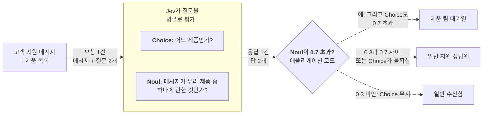

# Companion Noul

> Choice에 "맞는 선택지가 하나라도 있는가"를 묻는 Noul을 짝지어 두면, 맞는 선택지가 없는 경우를 코드에서 구분할 수 있습니다.

Choice 질문은 해당하는 선택지가 하나도 없어도 반드시 하나를 고릅니다. 입력이 세 가지 중 무엇에 관한 것인지 물으면, 셋 중 어느 것과도 관련 없는 입력에도 답이 나오고 그 확률이 높게 나올 수도 있습니다. 모델은 받은 질문에 답할 뿐이므로 세 선택지 중 가장 가까운 것을 고릅니다.

이 문제를 해결하려면 같은 요청에 질문을 하나 더 넣습니다. 선택지 중 맞는 것이 하나라도 있는지 묻는 Noul 질문입니다. 이렇게 짝지어 넣는 Noul을 companion Noul(동반 Noul)이라고 부릅니다. 코드에서는 Noul이 분명한 yes일 때만 Choice의 답을 사용합니다.



## 예제: 메시지를 제품 팀으로 routing하기

제품 세 가지를 판매하고, 고객 지원 메시지를 각각 담당 제품 팀으로 보낸다고 가정해 보겠습니다. 다른 가게에서 산 램프나 채용 담당자가 보낸 메모처럼 그 밖의 내용을 다룬 메시지는 일반 수신함으로 보냅니다. 이렇게 메시지를 알맞은 곳으로 보내는 일이 routing(라우팅)입니다.

### 어느 제품인지, 그리고 맞는 제품이 있는지 묻기

두 질문 모두 state(상태)에 들어 있는 제품 목록을 `products`라는 키로 참조합니다. Jev는 Choice 질문의 선택지 이름을 볼 수 있으므로 `desk_pro` 같은 이름만으로 각 제품이 무엇인지 전달됩니다. Noul 질문의 `false` criterion(판단 기준)에는 no로 볼 경우를 나열합니다. 다른 제품, 서비스, 판매하지 않는 물건이 여기에 해당합니다.

Playground에서 실행해 보기 →

Jev의 응답:

```json
{
  "model": "jev-1.14.0",
  "answers": {
    "product": {
      "type": "choice",
      "choice": "desk_pro",
      "confidence": 0.94,
      "probabilities": {
        "desk_pro": 0.96,
        "chair_lite": 0.01,
        "monitor_arm": 0.03
      }
    },
    "about_our_product": {
      "type": "noul",
      "noul": 0.02
    }
  },
  "usage": {
    "input_tokens": 549,
    "output_tokens": 63
  }
}
```

Choice는 `desk_pro`를 0.96의 확률로 골랐고 confidence(신뢰도)는 0.94입니다. 이 답만 봐서는 메시지가 여러분의 책상에 관한 것이 아니라는 사실을 알 수 없습니다. 세 선택지 중에서는 책상용 램프가 책상에 가장 가깝기 때문입니다. 반면 companion Noul은 0.02로, 메시지가 여러분의 어느 제품과도 관련이 없다고 말해 줍니다. 서로 다른 메시지 네 개에 대한 Jev의 답은 다음과 같습니다.

| 메시지 | Choice | 최고 확률 | Noul |
| - | - | - | - |
| "The motor on my standing desk has started making a grinding noise... the 140 cm one" | `desk_pro` | 1.00 | 0.98 |
| "The chair arrived but the monitor arm didn't. Can you check where the arm is?" | `monitor_arm` | 1.00 | 0.99 |
| "My desk lamp stopped working after two weeks..." | `desk_pro` | 0.96 | 0.02 |
| "I'm a recruiter working with several furniture retailers and wondered if your head of operations is open to a quick call" | `desk_pro` | 0.81 | 0.02 |

### 맞는 제품이 있을 때만 Choice를 믿기

Noul을 먼저 읽습니다. 분명한 no라면 Choice는 무시하고 메시지를 일반 수신함으로 보냅니다. 분명한 yes는 메시지가 여러분의 제품 중 하나에 관한 것임을 알려 주지만 어느 제품인지는 알려 주지 않으므로, Choice가 고른 제품의 확률도 함께 확인합니다. 둘 다 높으면 메시지를 해당 제품 팀으로 바로 보냅니다. 그렇지 않으면 일반 지원 상담원이 판단하고, Choice가 고른 제품은 참고용 제안으로 함께 전달합니다.

```python title="route.py"
YES = 0.7
NO = 0.3
PRODUCT_SURE = 0.7


def route(message_id, response):
    about_ours = response.answers["about_our_product"].noul
    product = response.answers["product"]
    product_probability = product.probabilities[product.choice]

    if about_ours < NO:
        # 맞는 제품이 없습니다. Choice의 답은 노이즈이므로 읽지 않습니다.
        send_to_general_inbox(message_id)

    elif about_ours > YES and product_probability > PRODUCT_SURE:
        # Choice가 유효한 질문에 답하고 있고, 한 제품을 분명하게 골랐습니다. 그 답을 사용합니다.
        send_to_product_team(message_id, product.choice)

    else:
        # 판단이 서지 않거나, 우리 제품에 관한 것이지만 어느 제품인지 분명하지 않은 경우:
        # Choice의 최상위 선택지를 힌트로 삼아 사람이 결정합니다.
        send_to_general_agent(message_id, suggested_product=product.choice)
```

## `other` 선택지로는 부족한 이유

Choice 질문에 `other: 'Something else'`를 추가하면 일이 더 적어 보이고, 예전에는 이 방법을 흔히 권했습니다. 하지만 `other`는 제품 선택지들과 확률을 놓고 경쟁합니다. 일부는 제품에 관한 내용이고 일부는 다른 내용인 메시지는 확률이 `other`와 해당 제품으로 나뉘고, 두 숫자 어느 쪽도 코드가 무엇을 해야 하는지 알려 주지 못합니다. companion Noul을 쓰면 Choice 질문은 제품 중에서만 고르고, 맞는 제품이 있는지는 구체적인 `true`와 `false` criteria를 갖춘 별도의 질문이 판단합니다. 저희 테스트에서는 대체로 이 방식이 더 잘 동작했습니다.

> [!NOTE]
>
> 이미지 안에서 무언가의 위치를 찾는 질문 유형인 [Box](../primitives/box.md)에도 같은 문제가 있습니다. Box는 항상 이미지 안의 위치를 반환합니다. "Is there a coffee mug in `photo`?" 같은 Noul 질문을 짝지어 두면, 그 box가 실제로 머그잔을 가리키는지 코드에서 알 수 있습니다.

## Companion Noul의 다른 활용법

* **선택지마다 Noul 질문 하나씩.** 메시지가 둘 이상의 제품에 관한 것일 수 있다면 Choice는 확률을 그 제품들에 나눠 줄 수밖에 없습니다. 대신 제품마다 Noul 질문을 하나씩 묻고 각각을 따로 읽으세요. 이렇게 하면 맞는 제품이 없을 때 모든 Noul이 낮게 나오므로, 그 경우를 위한 질문을 따로 둘 필요가 없습니다.
* **사전 선별용으로.** Noul 질문을 먼저 묻고, Choice나 Score가 필요할 수도 있는 비용이 큰 단계는 답이 분명한 yes일 때만 실행합니다. [Noul로 먼저 선별하기](noul-screen.md)를 참고하세요.
* **코드로 만든 후보.** 선택지가 고정된 목록일 필요는 없습니다. 코드로 텍스트에서 가능한 값을 뽑아 Choice 질문의 선택지로 쓰고, companion Noul 질문으로 올바른 값이 그 안에 있는지 물을 수 있습니다. [값 추출 cookbook(예제 모음)](../cookbooks/pre_parsed_value_extraction_cookbook.md)에서도 이렇게 코드로 후보를 만들지만, companion Noul 대신 `none` 선택지를 사용합니다.


이 문서는 개발자 문서 플랫폼인 [Mintlify](https://mintlify.com)로 제작하고 호스팅합니다.
