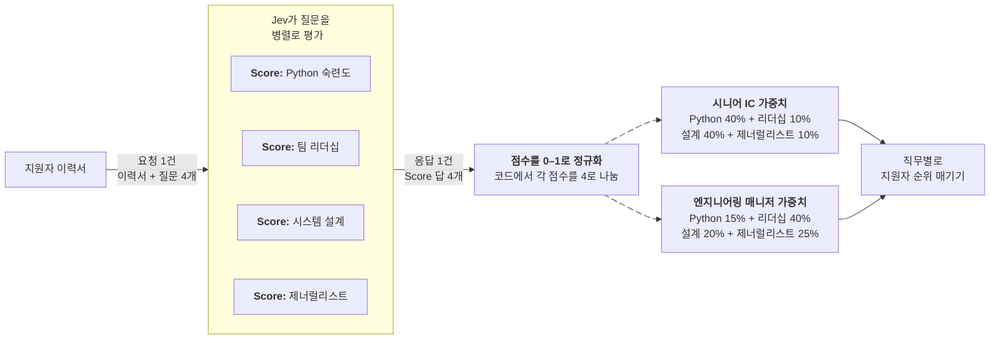

# Composite scoring

> 복잡한 판단을 더 쪼갤 수 없는 개별 점수로 나누고, 코드에서 직접 정한 가중치로 합칩니다.

여러 criteria(판단 기준)를 한꺼번에 놓고 항목들의 순위를 매겨야 할 때가 많습니다. composite scoring(복합 점수화)은 이 문제를 쉽게 풀어 가는 방법입니다. 판단을 서로 독립적인 차원으로 나누고, 차원마다 따로 점수를 매긴 다음, 코드에서 직접 정한 가중치로 합칩니다.

## 예제: 이력서 선별하기

엔지니어링 직무 지원자의 이력서를 처리한다고 가정해 보겠습니다. 여러 criteria로 지원자의 순위를 매기고, 최종적으로 상위 X명을 골라 추가 검토를 진행하려고 합니다.



### 차원마다 따로 점수 매기기

이력서를 보내면서 차원마다 Score 질문을 하나씩 붙입니다. 질문 하나가 판단 하나만 요구하므로, 나중에 점수마다 가중치를 따로 줄 수 있습니다.

Playground에서 실행해 보기 →

### 가중치로 점수 합치기

각 차원의 점수를 0–1 범위로 정규화한 뒤 가중치를 적용합니다. 가중치를 쓰면 개별 점수에 담긴 세밀한 차이를 잃지 않으면서 각 차원의 상대적 중요도를 손쉽게 조정할 수 있습니다.

```python title="scoring.py"
py      = response.answers["python_depth"].score / 4
lead    = response.answers["team_leadership"].score / 4
arch    = response.answers["system_design"].score / 4
general = response.answers["generalist"].score / 4

# 시니어 IC
ic_score = (0.40 * py) + (0.10 * lead) + (0.40 * arch) + (0.10 * general)

# 엔지니어링 매니저
em_score = (0.15 * py) + (0.40 * lead) + (0.20 * arch) + (0.25 * general)
```

이제 복합 점수로 지원자의 순위를 매길 수 있습니다. 더 중요한 점은 최종 점수가 정확히 어떻게 계산되는지 들여다볼 수 있다는 것입니다. 상위에 오른 지원자가 기대와 다르다면 가중치를 조정해 알맞은 균형을 찾으면 됩니다.


이 문서는 개발자 문서 플랫폼인 [Mintlify](https://mintlify.com)로 제작하고 호스팅합니다.
