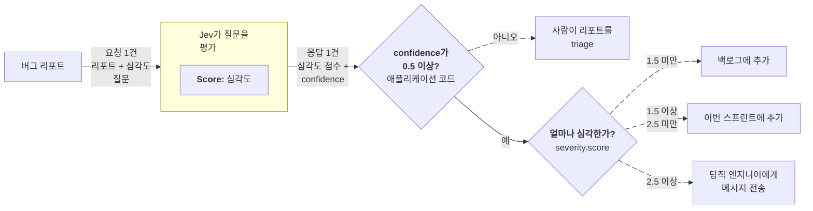

# Confidence 기반 routing

> confidence를 두 번째 축으로 사용합니다. 점수는 무엇인지를 알려 주고, confidence는 그 점수대로 행동해도 되는지를 알려 줍니다.

Score 답에는 척도 위의 위치인 `score`와, 그 답이 얼마나 확실한지를 0에서 1 사이로 나타내는 [confidence(신뢰도)](../confidence.md)가 함께 들어 있습니다. confidence를 먼저 확인하세요. 확률이 척도 전체에 퍼져 있는 답은 사람에게 보내고, 나머지는 점수에 따라 routing(라우팅)합니다.

## 예제: 버그 리포트 triage하기

들어오는 리포트를 triage(우선순위 분류)하는 버그 트래커를 만든다고 가정해 보겠습니다. 외관상의 문제는 백로그에서 기다려도 되고, 고장 난 기능은 현재 스프린트에 넣으며, 사용자가 핵심 작업을 끝내지 못하게 막는 문제는 곧바로 당직 엔지니어에게 보냅니다. 심각도가 분명히 드러나지 않는 리포트는 누군가 엔지니어에게 메시지를 보내기 전에 사람이 먼저 봐야 합니다.



### 리포트의 심각도 점수 매기기

리포트를 Score 질문 하나와 함께 보냅니다. 다섯 단계는 외관상의 문제부터 치명적인 문제까지 이어집니다.

Playground에서 실행해 보기 →

Jev의 답은 업데이트 때문에 노트가 사라진 것인지 사용자가 직접 삭제한 것인지 말해 주지 않습니다.

```json
{
  "model": "jev-1.14.0",
  "answers": {
    "severity": {
      "type": "score",
      "score": 3.19,
      "confidence": 0.34,
      "legend": {
        "0": "Cosmetic: wording, layout, or styling only",
        "1": "Minor: something misbehaves, but users can still do what they wanted",
        "2": "Major with a workaround: a feature is broken, but there is another way to get the job done",
        "3": "Major with no workaround: users cannot complete a core task",
        "4": "Critical: data loss, a security hole, or the product is down for everyone"
      },
      "probabilities": {
        "0": 0.01,
        "1": 0.14,
        "2": 0.07,
        "3": 0.19,
        "4": 0.59
      }
    }
  },
  "usage": {
    "input_tokens": 435,
    "output_tokens": 17
  }
}
```

3.19라는 점수만 보면 당직 엔지니어에게 메시지를 보내야 합니다. 하지만 확률은 다른 이야기를 합니다. 업데이트로 노트가 사라졌을 경우에 해당하는 "critical"에 확률 대부분이 몰려 있지만, 사용자가 직접 삭제했을 경우에 해당하는 "minor"에도 0.14가 있습니다. 확률이 이렇게 퍼져 있어서 confidence가 0.34까지 내려갑니다.

### 판단이 서지 않는 점수는 사람에게, 나머지는 routing하기

점수를 읽기 전에 confidence를 확인하고, 확인을 통과했을 때만 점수에 따라 routing합니다.

```python
severity = response.answers["severity"]

if severity.confidence < 0.5:
    # 확률이 척도 전체에 퍼져 있습니다. 사람이 먼저 리포트를 읽습니다.
    send_to_triage(report_id)

elif severity.score < 1.5:
    add_to_backlog(report_id)

elif severity.score < 2.5:
    add_to_sprint(report_id)

else:
    message_on_call(report_id)
```

"Notes gone?" 리포트는 triage로 가고, 거기서 사람이 리포트 작성자에게 노트를 삭제했는지 물어볼 수 있습니다. 심각도가 분명한 리포트는 그대로 통과합니다. 아래는 `jev-1.14.0`의 답을 기록한 것입니다.

| 리포트 | `score` | `confidence` | 결과 |
| - | - | - | - |
| Typo on the settings page | 0.0 | 1.0 | 백로그 |
| PDF export fails over 50 pages; splitting the document works | 2.0 | 1.0 | 이번 스프린트 |
| Checkout returns a 500 error for every customer | 3.36 | 0.7 | 당직 엔지니어에게 메시지 |
| Notes gone after the update, or maybe deleted | 3.19 | 0.34 | triage |

## 두 단계가 답을 나눠 가질 때

Score에서 두 단계가 똑같이 가장 높은 확률을 가질 때, 두 단계가 서로 붙어 있으면 떨어져 있을 때보다 점수가 훨씬 높습니다. 두 단계가 멀리 떨어져 있을수록 점수는 낮아집니다.
Score의 confidence는 이웃한 단계에 놓인 확률을 작은 퍼짐으로만 계산합니다. 이 두 단계 사이에 threshold(임계값)를 두면 문제가 될 수 있습니다. 두 단계로 나뉜 답이 confidence 확인은 통과하면서 threshold의 잘못된 쪽에 떨어질 수 있기 때문입니다. [Score explorer](../confidence.md#score)에서 단계 사이의 거리에 따라 confidence가 어떻게 달라지는지 볼 수 있습니다.

답이 단계 경계의 어느 쪽에 떨어지느냐에 따라 결정이 달라진다면, 중요한 쪽에 있는 단계들의 확률을 더하세요.

```python
blocked = severity.probabilities[3] + severity.probabilities[4]

if blocked >= 0.3:
    # 사용자가 막혀 있을 가능성이 실제로 있습니다. 스프린트를 기다리지 말고 누군가에게 메시지를 보냅니다.
    message_on_call(report_id)
```

[확률 기반 routing](probability-routing.md)에서는 이런 확률을 바탕으로 동작마다 threshold를 따로 두어 라우터 전체를 구성합니다.


이 문서는 개발자 문서 플랫폼인 [Mintlify](https://mintlify.com)로 제작하고 호스팅합니다.
