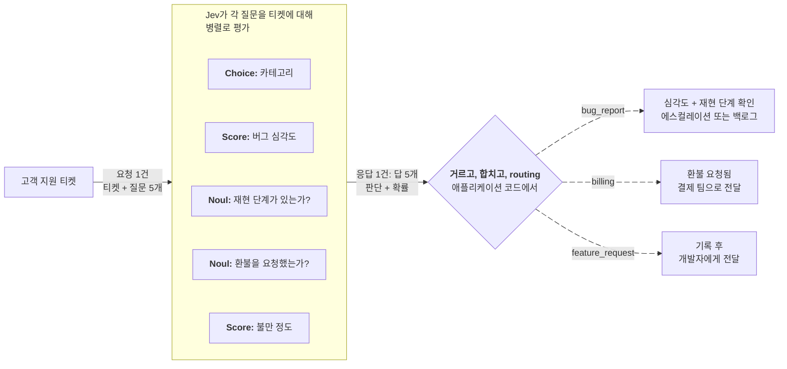

# Speculative fan-out

> 필요할지 확실하지 않은 질문까지 포함해 여러 질문을 한 번의 요청으로 보내고, 무엇이 관련 있는지는 코드에서 판단합니다.

Jev는 한 번의 API 호출로 여러 질문에 답하므로, 시스템에 필요한 질문을 모두 한 요청에 담고 무엇이 관련 있는지는 나중에 코드로 판단하는 방식을 권장합니다. 이 패턴이 speculative fan-out(추측성 팬아웃)입니다. 모든 질문은 병렬로 평가되므로 질문을 더 넣어도 응답 시간에는 대체로 거의 영향이 없습니다.

## 예제: 고객 지원 티켓 triage하기

고객 지원 티켓을 triage(우선순위 분류)해야 하는 지원 시스템을 만든다고 가정해 보겠습니다. 티켓을 카테고리로 분류해야 하고, 버그 리포트라면 버그의 심각도도 판단해야 합니다.

카테고리를 먼저 묻고 심각도를 후속 호출로 묻는 대신 둘을 동시에 물을 수 있습니다. 티켓이 버그 리포트가 아니라면 버그 심각도 질문의 결과는 그냥 무시하면 됩니다.



### 모든 질문을 한 요청으로 묻기

코드에 필요할 수 있는 질문을 모두 티켓과 함께 보냅니다. 카테고리 질문에 더해, 일부 카테고리에서만 의미가 있는 질문도 포함합니다.

Playground에서 실행해 보기 →

> [!NOTE]
>
> **Speculative 질문:** `bug_severity`와 `has_reproducible_steps`는 티켓이 버그 리포트일 때만 의미가 있습니다. `refund_requested`는 결제 관련 티켓에서만 의미가 있습니다. 질문을 추가해도 응답 시간에는 대체로 거의 영향이 없으므로 처음부터 모두 넣습니다. 티켓이 기능 요청으로 판명되면 버그 심각도 결과는 쓸모가 없어지고, 그 경우 해당 코드 경로에서 그냥 무시합니다.

### 코드에서 routing하기

분류 결과를 바탕으로 무엇이 관련 있는지 코드에서 판단하고, 그에 따라 routing(라우팅)합니다.

```python title="triage.py"
category = response.answers["category"]
bug_severity = response.answers["bug_severity"]
bug_repro = response.answers["has_reproducible_steps"]
refund = response.answers["refund_requested"]
frustration = response.answers["frustration"]

if category.choice == "bug_report":
    if bug_severity.score > 1.5 and bug_repro.noul > 0.6:
        escalate_to_engineering(ticket_id, severity="high")
    else:
        add_to_bug_backlog(ticket_id)

elif category.choice == "billing":
    if refund.noul > 0.7:
        route_to_billing_with_flag(ticket_id, refund_likely=True)
    else:
        route_to_billing(ticket_id)

elif category.choice == "feature_request":
    log_feature_request(ticket_id)

# 불만 정도는 카테고리와 상관없이 유용합니다
if frustration.score > 1.5:
    flag_for_priority_response(ticket_id)
```

의사 결정 트리 전체에 필요한 모든 것이 한 번의 호출로 나옵니다. speculative 질문은 관련이 없으면 무시하면 되고, 관련이 있으면 왕복 한 번을 아껴 줍니다.


이 문서는 개발자 문서 플랫폼인 [Mintlify](https://mintlify.com)로 제작하고 호스팅합니다.
