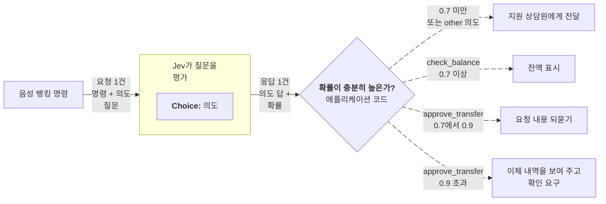

# 확률 기반 routing

> 위험한 동작일수록 확률 threshold를 높게 잡습니다. 답은 무엇을 할지 알려 주고, 그 확률은 실제로 할지 말지를 알려 줍니다.

Jev의 모든 답에는 [확률](../confidence.md)이 함께 나옵니다. 코드가 수행할 수 있는 동작마다 확률이 얼마나 높아야 그 동작을 실행할지 정하세요. 이 기준값이 threshold(임계값)입니다. 위험한 동작일수록 threshold를 높게 잡고, threshold에 못 미치는 답은 yes로 치지 말고 사용자에게 다시 확인을 요청하는 것처럼 별도의 결과로 처리합니다. 동작은 코드로 호출할 수 있는 것이면 무엇이든 됩니다. 앱 안의 함수일 수도 있고, LLM이나 사람일 수도 있습니다. 답에 따라 알맞은 동작으로 보내는 이 과정이 routing(라우팅)입니다.

## 예제: 음성 뱅킹 명령 처리하기

사용자가 말로 계좌를 관리하는 음성 뱅킹 인터페이스를 만든다고 가정해 보겠습니다. 명령을 실행하기 전에 사용자가 무엇을 요청했는지 어느 정도 확신할 수 있어야 하고, 위험한 동작이라면 매우 확실해야 합니다.



### 사용자가 무엇을 하려는지 묻기

사용자의 명령을 Choice 질문 하나와 함께 보냅니다. `other` 선택지는 이 시스템이 처리하지 않는 명령을 받아 냅니다. 예제를 짧게 유지하려고 이렇게 했지만, 나머지를 모두 받아 내는 용도로는 대체로 [companion Noul](companion-noul.md#why-an-other-option-falls-short)이 더 잘 동작합니다.

Playground에서 실행해 보기 →

Jev의 응답:

```json
{
  "model": "jev-1.14.0",
  "answers": {
    "intent": {
      "type": "choice",
      "choice": "check_balance",
      "confidence": 1.0,
      "probabilities": {
        "check_balance": 1.0,
        "approve_transfer": 0.0,
        "other": 0.0
      }
    }
  },
  "usage": {
    "input_tokens": 343,
    "output_tokens": 41
  }
}
```

### 동작마다 threshold 정하기

선택된 선택지의 확률인 `probabilities[choice]`를 threshold와 비교합니다. 이 숫자는 그 선택지가 사용자가 실제로 요청한 것일 가능성을 나타냅니다.

```python
action = response.answers["intent"]
likelihood = action.probabilities[action.choice]

# 어떤 동작이든 0.7 미만이면 명령만으로 의도가 정해지지 않은 것입니다. 사람에게 넘깁니다.
if likelihood < 0.7:
    route_to_support_agent(account_id)

elif action.choice == "check_balance":
    # 위험도가 낮습니다. 0.7이면 충분합니다.
    show_balance(account_id)

elif action.choice == "approve_transfer":
    if likelihood > 0.9:
        # 의도를 파악하면 확인 절차가 시작될 뿐, 이체가 승인되는 것은 아닙니다.
        show_transfer_for_confirmation(account_id)
    else:
        # 이체 워크플로를 열기 전에 사용자가 원하는 것을 다시 확인합니다.
        ask_user_to_clarify("Would you like to review the pending transfer?")

else:
    route_to_support_agent(account_id)
```

threshold는 어떤 워크플로를 실행할지만 고릅니다. 어느 threshold도 돈을 직접 옮기지는 않습니다. 분명한 이체 요청은 금액과 수취인이 표시된 확인 화면을 열고, 이체는 사용자가 그 내용을 확인한 뒤에만 실행됩니다. 덜 확실한 요청이라면 먼저 사용자에게 무슨 뜻이었는지 묻습니다.

확인 단계가 중요한 이유는 머뭇거리는 명령에도 의도는 분명할 수 있기 때문입니다. `jev-1.14.0`에서 "Um, the transfer thing... yeah, go ahead I guess."는 `approve_transfer`에 0.99를 받았습니다. 이 답은 사용자가 어떤 동작을 원하는지 알려 주지만, 사용자가 이체 내역을 확인했는지까지 알려 주지는 않습니다.

> [!NOTE]
>
> **왜 `confidence`를 쓰지 않나요?** 선택지 수가 고정된 Choice 질문에서 `confidence`(신뢰도)는 최고 확률로부터 계산되므로, 여기에 threshold를 걸어도 더 얻는 것이 없습니다. 위험도로 읽기에는 확률 쪽이 더 쉽습니다. 나머지 선택지들의 확률이 서로 어떤지가 중요하다면 그 확률들도 함께 확인하세요. confidence는 [confidence 기반 routing](confidence-routing.md)에서처럼 Score에 더 유용합니다. [confidence에 따라 행동해야 할 때](../confidence.md#when-to-act-on-confidence)도 함께 살펴보세요.


이 문서는 개발자 문서 플랫폼인 [Mintlify](https://mintlify.com)로 제작하고 호스팅합니다.
